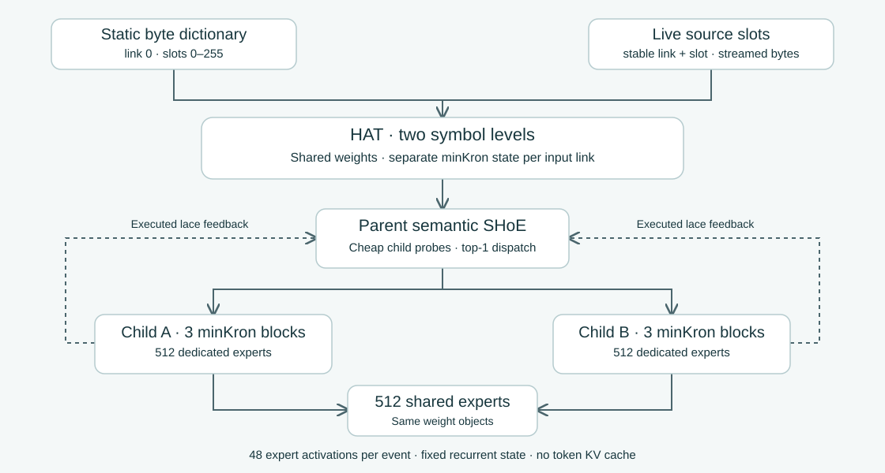

# Sparse Hierarchy of Experts

**SHoE** learns local semantic addresses and sparse relationships between them. **HAT**, the Hierarchical AutoTokenizer, provides a common byte and source-address interface with recurrent context. Together they let inexpensive semantic heads choose which expert computation to run, share experts across branches, and reinforce useful routes from downstream outcomes.

The interfaces provide the experts with context and routing: virtual synapses around the primary computation. The examples keep the expert banks simple so that the routing, sharing and memory mechanisms can be inspected directly.



## What is here

| Experiment | Unique parameters | Demonstration |
|---|---:|---|
| [Semantic SHoE, 1M](experiments/semantic_1m) | 1,000,732 | Three semantic layers, 1,024 tiny experts, cross-layer lace factors, sparse attention |
| [Semantic SHoE, 10M](experiments/semantic_10m) | 10,027,388 | Six layers, wider representations, 4,096 experts and 256 lace factors |
| [Parent and two children](experiments/two_child) | 1,636,784 | Semantic-only parent; two expert SHoEs sharing 512 experts with 512 private experts each; bottom-up reinforcement |
| [HAT + minKron](experiments/hat_minkron) | 1,624,588 | Static byte dictionary and live source slots; two symbol levels; recurrent child context without a token KV cache |

The two-child models contain **1,536 physical expert MLPs and 1,228,800 unique expert matrix parameters**. Shared banks are the same parameter objects; each source event executes 48 expert MLPs through one selected child. Semantic probes execute neither child memory nor experts.

## Run it

Python 3.10+ and PyTorch are sufficient for the models and tests. The recorded experiments used Python 3.12.14 and PyTorch 2.15.0+cpu on Linux.

```bash
git clone https://github.com/JRowe47/Sparse-Hierarchy-of-Experts.git
cd Sparse-Hierarchy-of-Experts
python -m pip install -r requirements.txt
python scripts/check_all.py
python experiments/hat_minkron/example_live.py
```

The live example uses random producer and consumer weights to demonstrate slot publication, consumption and carried state. The test runner executes all four suites in isolated processes: **60 checks**, including independent recurrence references, gradients, causality, sparse arithmetic, shared-weight identity and checkpoint round trips.

To reproduce a trained example:

```bash
python scripts/prepare_data.py
cd experiments/hat_minkron
python train.py --steps 600 --threads 2 --out results/language
python generate.py --checkpoint results/language/checkpoint.pt --prompt 'ROMEO:'
python learning_checks.py --steps 500 --threads 2
```

The data script downloads Tiny Shakespeare and verifies its SHA-256 against the original runs. An offline copy can be supplied with `--source /path/to/input.txt`. Training writes checkpoints locally. **Git contains source, protocols, raw measurements and samples; it does not contain trained weights or optimizer checkpoints.** Existing result files are overwritten when reusing an output directory; pass a different `--out` to preserve them. Each experiment's README contains its paired-control commands and architecture details.

## Recorded results

All language runs use 600 steps × 4 sequences × 128 positions = 307,200 training presentations and a contiguous 90/5/5 split. The final validation probe uses 8,192 presentations; the test split is unused.

| Character experiment | Full model loss | Separately trained control | Control loss |
|---|---:|---|---:|
| Semantic SHoE, 1M | 2.3362 | Laces disabled | 2.3704 |
| Semantic SHoE, 10M | 2.0982 | Laces disabled | 2.1546 |
| Parent and two children | 2.4864 | Reinforcement bundle disabled | 2.5017 |

Loss is cross-entropy in nats per character. Each comparison uses one shared seed and matched minibatches. In the two-child run, learned shortcuts reduce average child probes from 2 to **1.3032**, while only the selected child's experts execute.

HAT uses a different, 256-byte output alphabet. Its final loss is **2.0850 nats/byte**. Resetting HAT history on the frozen trained model raises loss to **2.7566**; resetting only child history gives **2.1071**. The separate delayed-recall check reaches **100% for HAT memory** and **39.45% for isolated child memory**, against 12.5% chance. These history interventions are frozen-model checks, not retrained baselines or a comparison against the character models.

See [results and protocols](docs/results.md) for the full interpretation, state sizes and links to raw measurements.

## Implemented interfaces and the next protocol

HAT accepts exact `(link, slot, byte)` events. Link 0 is an immutable dictionary of all 256 byte values. Live links address persistent byte payloads, with versions and immutable event snapshots. HAT emits one contextual occurrence per input byte, and minKron carries fixed-size recurrent state across calls. The expert MLPs operate on latent tensors inside this byte boundary.

The [persistent output-port protocol](docs/output_ports.md) specifies how to expose a completed tensor or record sequence as a stable payload, advertise a cheap header, and read it only when a downstream node activates. Typed layout descriptors, staged atomic publication, pinned reads and regional decay/reset are **a design specification**. The runnable implementation currently provides the simpler `SlotDictionary` byte API; it does not yet implement that full port runtime.

- [Architecture and semantic feedback](docs/architecture.md)
- [HAT byte, slot and streaming-state API](experiments/hat_minkron/README.md)
- [Persistent output-port specification](docs/output_ports.md)
- [Recorded results and reproduction](docs/results.md)
- [Source lineage and third-party notices](THIRD_PARTY_NOTICES.md)

`SOURCE_MANIFEST.json` records hashes for the preserved experiment source. Model and training arithmetic are unchanged from the recorded runs. Sparse expert execution is implemented with readable PyTorch gathers; optimizer state and bank gradients remain dense, and fused kernels are not included.
