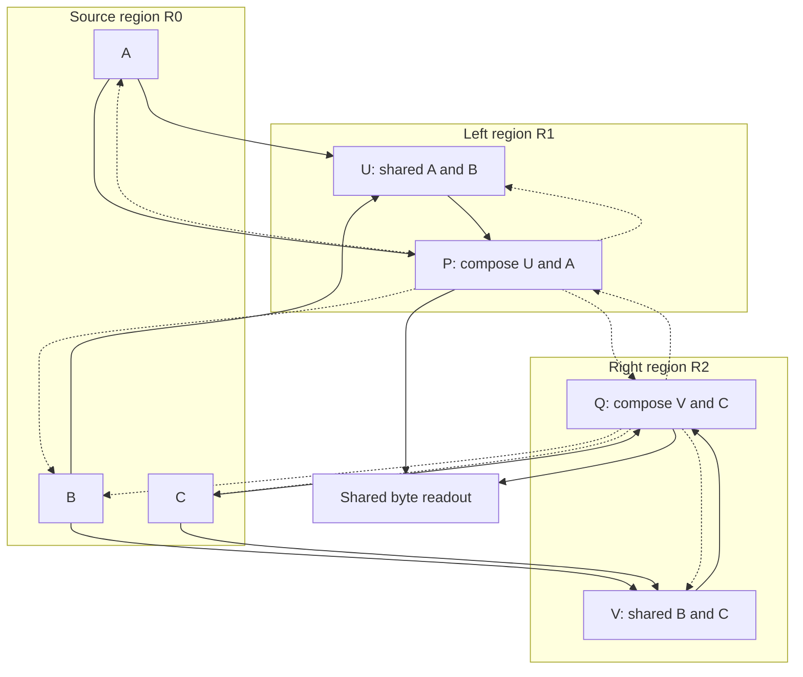

# SHoE Text Recurrent Regions Development Specification

The development target is a small CPU text model with seven HAT–SHoE nodes in three recurrent regions. It must retain information across text chunks, exchange useful information between overlapping regions, preserve dedicated information alongside shared representations, and improve a compositional result through another whole-region activation round.

Build the deterministic reference engine first. Keep the existing three-block SHoE node, minKron recurrence, sparse expert banks, and byte input vocabulary. Use native tensors for internal publications and fixed regional schedules. The first runnable language model arrives before the full learning proof of concept.

# Starting point

Baseline repository revision: [b4bb7cfea18c](https://github.com/JRowe47/Sparse-Hierarchy-of-Experts/blob/b4bb7cfea18c3833819f6ed08973fd014f15f107/experiments/hat_minkron/README.md).

| Existing component | Current behavior | Development decision |
| --- | --- | --- |
| Byte interface and HAT | UTF-8 bytes, exact link and slot identities, two learned symbol levels, source-indexed recurrent state | Preserve external input and provenance; reuse the symbol machinery for internal latent inputs |
| Recurrent child | Three minKron blocks with sparse expert execution; accepts continuous payload, priors, and state | Make this the reusable computational node |
| Local groups and laces | Learned prototype groups and relations among three internal layer spaces | Reuse as the first local SDR and lace representation |
| Shared expert banks | Shared parameters with separate child state | Extend parameter sharing across nodes while preserving independent state |
| Parent controller | Dispatches each event to one of two children | Keep for the old baseline; build a graph runner around reusable nodes |
| Stream state | Functional returns, detach, reset, serialization | Extend to all nodes, ports, clocks, and current publications |
| Training | Independent random windows with state reset | Add ordered streams with carried state and truncated backpropagation |
| Feedback | Signed routing associations committed explicitly after optimization | Extend to the inter-node paths actually used |
| Output ports | Persistent byte slots exist; full typed port lifecycle is a design | Implement the small synchronous tensor-port subset needed here |

The existing default has 1,624,588 unique parameters. Each child can address 1,024 logical experts across its three blocks; there are 1,536 physical experts across both children, with 48 expert executions per input event. These are baseline counts, not counts for the proposed graph.

# First model topology

Use three state-owning regions:

| Region | Nodes | Input access and purpose |
| --- | --- | --- |
| Source region R0 | A, B, C | Separate contextual representations of permitted text views; each node owns its own state |
| Left region R1 | U, P | U receives A and B; P composes U with a dedicated continuation from A |
| Right region R2 | V, Q | V receives B and C; Q composes V with a dedicated continuation from C |

R1 and R2 overlap through their access to B. B has one state owner, R0, and publishes to both. Shared information access never aliases runtime state. Source identities, views, or branches have no assigned cognitive professions.

Ordinary language training uses one text stream with three causal branch encoders. Controlled probes use separate text views and explicit availability masks to test restricted access. An unavailable input is marked absent rather than encoded as byte zero. The graph definition must permit additional nodes and regions without rewriting execution logic.

# Initial configuration

| Setting | Initial target |
| --- | --- |
| Vocabulary | All 256 byte values |
| Computational nodes | 7 |
| State-owning regions | 3 |
| Node width | 100 |
| Internal SHoE blocks per node | 3, preserving the current implementation |
| Logical experts per node | 384 total, divided into 128 per internal block |
| Sharing | At each block depth, 64 shared experts plus 64 private experts per node |
| Local groups | 16 per internal block |
| Expert selection | 2 groups × 4 experts = 8 executions per block |
| Internal laces | Keep 64 factors and top-2 selection initially |
| HAT | Preserve two levels, 64 symbols, top-2 selection |
| minKron | Preserve four 8×8 heads and FP32 accumulated state |
| Regional rounds | K=1 for integration; K=2 first recurrent target; K=1,2,4 for evaluation |
| Truncated backpropagation segment | Start with 128 external bytes |
| Initial batch size | 4, reduced only if needed for the measured CPU memory budget |
| Optimizer | Preserve the existing AdamW settings, clipping, and initial schedule |

With all seven nodes active, one complete graph round executes 7 × 3 × 8 = 168 expert MLP calls. Two rounds execute 336 calls per external byte. Count repeated execution separately from unique active weights.

The proposed sharing layout contains 3 × (64 + 7 × 64) = 1,536 physical expert MLPs. At width 100 and hidden size 4, their two weight matrices contain 1,228,800 parameters, matching the original experiment’s expert-matrix capacity. Instantiate the model to report the total unique parameter count; routers, contextualizers, edge maps, and heads add to this figure. Use a roughly 2–3 million parameter design budget, adjusting ancillary capacity only after measuring the actual total.

# Required engine contracts

## Reusable node

Wrap or extract the existing RecurrentChild execution path. A node accepts continuous input values, provenance, projected routing context, local state, and an execution mask. It returns a differentiable latent publication, local semantic header, proposed new state, auxiliary losses, and contributor records.

Expose the normalized latent immediately before the current decoder. Keep the baseline decoder path unchanged for parity checks. The existing feedback_prior is computed under no_grad and remains appropriate as a semantic target; it cannot be the only inter-node payload.

Retain byte HAT at ingress. Refactor the reusable SymbolLevel machinery behind a latent input adapter for internal ports. Expert computation remains in the existing recurrent blocks and expert banks.

## Publications and graph state

Implement a tensor publication containing a payload, source node and port, validity, publication version, external occurrence ID, internal round, local semantic header, and dependency IDs. The payload remains connected to autograd inside the retained training segment.

Use node and block IDs to namespace local group memberships. Each permitted projection translates source values and semantic evidence into the destination’s own coordinates. Start with small learned linear maps and gated aggregation. Fixed-size headers and top-k prototype memberships are sufficient; an adaptive clustering tree is not required.

GraphState owns ingress state, node states, latest publications, per-stream clocks, and any bounded routing traces. It supports detach, selective row reset, serialization, and byte accounting. Keep dependency traces and training activations bounded by the current backpropagation segment.

The runtime stages new outputs and commits them at explicit boundaries. Previous publications remain valid for readers already using them. Synchronous immutable tensor references are sufficient for this version; thread-safe pinning and general storage handles can come later.

## Causal execution

Process external bytes in order. For a byte at time t:

1. Ingest that occurrence once through byte HAT and publish its contextual latent.

2. Start round k with the committed lateral and descending messages from the preceding round.

3. Run A, B, and C on their permitted input views and commit their publications.

4. Run U and V, then P and Q. Acyclic forward edges can consume the current round’s completed publications.

5. Stage lateral and descending messages for the next round. No node reads a half-computed result.

6. Rerun the full participating node pipelines for another round, including contextualization, routing, experts, and state updates.

7. Decode the next byte from the selected P and Q outputs, then advance to external event t+1.

Internal contextualizers consume latent messages under a separate round clock. Reusing the external byte does not create another source occurrence. Regional working state may change on every round. The current implementation’s whole-window packing must not be reused across cross-region feedback without proving equivalent causality.

Use a fixed synchronous stage order initially. All nodes run in the reference configuration, while their experts remain sparsely selected. Per-node activation masks are supported for probes and inactive-state checks; learned node recruitment and asynchronous regional schedules are later extensions.

## Stream training

Create ordered per-row stream cursors. Carry state into the next contiguous chunk and reset only at a real document or episode boundary, or when assigning a new independent stream to a batch row. Truncated backpropagation detaches every carried tensor, including publications and summaries, at the segment boundary while preserving its values.

Keep all regional rounds inside the current training graph. Do not detach merely because a tensor crosses a node or region boundary. Training and validation use separate state, stream cursors, and RNG state. Checkpoints include graph configuration, weights, optimizer, RNGs, stream positions, node states, port values, validity, and clocks.

# Ordered development milestones

## M0 Preserve the baseline and define measurements

- [ ] Pin the baseline revision and retain the current experiment and recorded protocol.

- [ ] Run its existing verification checks before refactoring.

- [ ] Record parameters, expert executions, state bytes, peak memory, and CPU timing in a common result schema.

- [ ] Add the minimal synthetic episode generator and fixed evaluation splits.

Exit: the original model still trains and generates through its current interface, with reproducible measurements. No architecture comparison is made against a different tokenizer or target unit.

## M1 Expose a reusable latent node

- [ ] Return the normalized latent from RecurrentChild.execute without changing the baseline logits.

- [ ] Separate node computation from mandatory per-node byte decoding.

- [ ] Add latent contextualization using the existing SymbolLevel implementation.

- [ ] Preserve the three internal lace layers and existing minKron mechanics.

Exit: baseline logits and state agree within the existing numerical tolerances; a downstream loss has a nonzero gradient through the upstream latent payload. Shared weights can be used by two instances without shared state.

## M2 Implement tensor ports and complete graph state

- [ ] Add Publication, NodeState, and GraphState records.

- [ ] Implement stage, commit, snapshot read, invalidate, reset, detach, and checkpoint continuation.

- [ ] Add local representation namespaces and per-edge value/context projections.

- [ ] Track actual consumed dependencies without retaining unbounded historical tensors.

Exit: replacing a publication does not mutate an existing reader’s value; reset and resume work; inactive nodes retain state; detach severs the entire prior segment’s graph.

## M3 Assemble the fixed graph with one pass

- [ ] Construct R0, R1, and R2 with the seven-node topology.

- [ ] Wire the dedicated A-to-P and C-to-Q paths alongside the shared U and V paths.

- [ ] Add the shared 256-byte readout over P and Q.

- [ ] Run with K=1, fixed node activation, and no recurrent peer feedback.

- [ ] Add edge masks and diagnostic input substitution without changing the number of expert executions.

Exit: the model can overfit a tiny text fixture, train on next-byte prediction, and generate text. Removing or substituting an input affects the expected reachable consumers. This is the first runnable multi-region language model.

## M4 Add persistent streaming training

- [ ] Replace random window resets with ordered streams in the new experiment.

- [ ] Implement boundary masks and truncated backpropagation.

- [ ] Checkpoint and resume stream positions and full graph state.

- [ ] Add delayed recall and correction episodes spanning multiple training chunks.

Exit: with frozen weights, chunked and unchunked inference agree; carried training state stays bounded across optimizer steps; validation begins with independent state. Long-distance recall improves over a reset-state control.

## M5 Add whole-region recurrence

- [ ] Add the internal round clock and deterministic staged schedule.

- [ ] Enable P-to-Q and Q-to-P lateral context from the previous round.

- [ ] Enable descending context to the shared and source nodes on the specified edges.

- [ ] Support K=1,2,4 and reroute experts on every round.

- [ ] Log selected groups, laces, and experts by node and round.

Exit: later rounds can use earlier publications and change selected experts; gradients reach earlier rounds; the source occurrence count is independent of K; changing a future suffix cannot change any earlier prediction. Swapping the execution order of independent nodes preserves results.

## M6 Add shared representation and contribution learning

- [ ] Add small projection, prediction, and comparison heads using activations already produced by normal passes.

- [ ] Train a cross-view agreement or prediction loss together with variance and redundancy control to prevent collapsed codes.

- [ ] Apply view-availability masks and preserve dedicated paths for source-specific detail.

- [ ] Record eligibility for inter-node projections and selected internal laces.

- [ ] Extend explicit post-optimizer commit_feedback to those associations.

The language loss remains the main objective. Log every auxiliary term separately and provide independent enable flags. Begin the graph and recurrence experiments with language loss plus the existing routing balance losses; add each new objective after the corresponding engine behavior is verified.

For paired-view probes, independently encode the source descriptions before allowing their states to exchange information. Compare source-conditioned representations before fusion. A state that already contains the other view is not an A-only or B-only representation. These comparisons use the current forward activity; no replay store is introduced.

Reuse the current signed-gain approach for a first routing utility estimate: compare a baseline prediction loss with the regional result, record the gain before the optimizer step, and commit it afterward to eligible paths. This is an association update, not an exact estimate of each edge’s causal contribution. Labels and target views never enter the prediction payload or carried inference state.

Exit: missing-view recovery and private-detail retention both work; local codes remain informative; positive and negative outcomes update the intended associations; ordinary forward and evaluation calls never commit learning buffers.

## M7 Demonstrate the integrated capabilities

- [ ] Run the memory, shared/private representation, and composition probes.

- [ ] Run the small natural-text language experiment using the existing Tiny Shakespeare data preparation.

- [ ] Run the targeted ablations below, including equal-execution information interventions.

- [ ] Compare representative configurations across three seeds and report variation.

- [ ] Save final weights, resumable state, configuration, protocol, samples, traces, and result tables.

Exit: the integrated model has evidence for persistent memory, useful information exchange, retained private information, and useful recurrent computation. Scale or optimize only after identifying which mechanisms contribute.

# Capability probes and acceptance

| Probe | Construction | Required result |
| --- | --- | --- |
| Persistent recall and correction | Random entity facts, distractors, a changed value, and a later query; relevant information lies beyond the backpropagation segment | Carried state answers the updated fact; resetting state or withholding the update causes the expected degradation |
| Shared structure with private details | Independently render the same generated facts as separate text descriptions, each with distinct private information | Either view supports shared-fact recovery; dedicated paths retain the private details; new combinations of familiar factors generalize |
| Recurrent composition | Distribute randomized relation chains across A, B, and C, then ask multi-hop queries | More rounds can improve the answer from the same prefix state; shuffling bridge inputs harms relevant answers at unchanged execution cost |
| Natural text | Existing Tiny Shakespeare split, UTF-8 byte prediction | Stable held-out language loss and generation, with the cost of each added mechanism measured |

Use fresh identifiers, held-out combinations, randomized presentation order, and distractors. Begin with a tiny overfit check before wider generalization runs. For the controlled memory and shared/private probes, set an initial engineering target of at least 90% exact answer accuracy on their declared training-range difficulty, evaluated on at least 512 fresh episodes per seed. Report longer-distance or longer-chain generalization separately.

For recurrence, start from the same saved prefix state and compare K=1,2,4 query computation with the same weights and observations. A constrained transport fixture first verifies that messages need the stated number of rounds; it does not establish learned reasoning. The learned model must then improve compositional accuracy with additional rounds and be compared against a feedforward control using a similar expert-execution budget. A useful initial target is at least five percentage points of absolute improvement on a declared multi-hop difficulty over K=1; this is a development threshold, not a predicted result.

# Ablations and measurements

| Comparison | Question answered |
| --- | --- |
| Original HAT–minKron baseline vs graph K=1 | What changes when adding the regional organization? |
| Carried state vs reset state | Does information persist usefully? |
| Correct bridge inputs vs shuffled episode-matched inputs | Does another region supply useful information at the same execution count? |
| Dedicated and shared paths vs matched-budget dedicated control | Does overlapping access contribute? |
| Same weights and prefix state at K=1,2,4 | What does additional recurrent computation buy? |
| Recurrent model vs comparable-execution feedforward control | Is the gain more than extra computation? |
| View objective enabled vs disabled | Does the local representation objective help? |
| Routing utility commits enabled vs disabled | Do delayed associations improve use of the graph? |

Report cross-entropy in nats per byte and bits per byte, exact task accuracy, unique parameters, executed expert calls, external bytes seen, internal rounds, CPU training and inference time, routing versus expert time, state bytes, peak memory, and optimizer-state size. Parameter-matched, exposure-matched, and compute-matched comparisons answer different questions; label them separately. Additional rounds do not count as additional external data exposure.

# Proposed code layout

Add a new experiment at experiments/text_regions. Preserve experiments/hat_minkron as the baseline. Reuse its core modules through thin imports or a small shared-core extraction backed by parity checks; avoid copying the full old experiment.

| Proposed file | Responsibility |
| --- | --- |
| config.py | Node, graph, region, sharing, and round configuration |
| node.py | Reusable HAT–SHoE node and latent input adapter |
| ports.py | Publications, exact identity, validity, versions, snapshot reads |
| state.py | Node and graph state, detach, reset, serialization, accounting |
| graph.py | Permitted edges, learned projections, staged schedule |
| model.py | Event-major execution, regional rounds, final byte readout |
| objectives.py | Local heads, view loss, eligibility packets, feedback commits |
| data.py | Ordered byte streams, episode masks, stream cursors |
| train.py | Truncated-backpropagation training and resumable checkpoints |
| probes.py | Generated memory, multi-view, and relation-chain episodes |
| verify.py | Engine invariants and baseline parity |
| evaluate.py | Ablations, timing, memory, accuracy, and result aggregation |
| README.md | Exact commands, configuration, interfaces, and recorded outcomes |

The graph runtime must not hardcode seven nodes or three regions. The internal SHoE’s existing three-block constraint remains intact for this first version; it is independent of external graph depth.

# Features deliberately scheduled after the proof of concept

Vision, audio, video, sensors, computer control, weight streaming, external episodic databases, learned graph growth, cluster splitting and merging, a full LSA search tree, adaptive halting, learned node recruitment, asynchronous scheduling, fused kernels, sparse optimizer redesign, and large model scaling.

Keep the current learned prototype groups as local SDR memberships. First establish that their relationships and recurrent exchange are useful; then replace their indexing or clustering implementation while preserving the node and port contracts.

# Completion target

The proof of concept is complete when one small text model can retain and revise facts across chunks, use information supplied by another region, preserve both common and private structure, and improve a compositional answer through another complete regional round. The runtime must make these behaviors measurable and independently switchable.

Implementation begins with M0 and M1. M3 produces the first runnable model, M5 produces the recurrent engine, and M6–M7 establish the learning capabilities that justify further development.

# Source code anchors

- [HAT and minKron experiment and configuration](https://github.com/JRowe47/Sparse-Hierarchy-of-Experts/blob/b4bb7cfea18c3833819f6ed08973fd014f15f107/experiments/hat_minkron/README.md)

- [Recurrent blocks, child execution, stream state, and feedback](https://github.com/JRowe47/Sparse-Hierarchy-of-Experts/blob/b4bb7cfea18c3833819f6ed08973fd014f15f107/experiments/hat_minkron/model.py)

- [HAT and reusable symbol levels](https://github.com/JRowe47/Sparse-Hierarchy-of-Experts/blob/b4bb7cfea18c3833819f6ed08973fd014f15f107/experiments/hat_minkron/hat.py)

- [Local prototype groups and three-layer laces](https://github.com/JRowe47/Sparse-Hierarchy-of-Experts/blob/b4bb7cfea18c3833819f6ed08973fd014f15f107/experiments/hat_minkron/semantic_core.py)

- [Existing training loop and state policy](https://github.com/JRowe47/Sparse-Hierarchy-of-Experts/blob/b4bb7cfea18c3833819f6ed08973fd014f15f107/experiments/hat_minkron/train.py)

- [Existing verification checks](https://github.com/JRowe47/Sparse-Hierarchy-of-Experts/blob/b4bb7cfea18c3833819f6ed08973fd014f15f107/experiments/hat_minkron/verify.py)

- [Persistent output-port design](https://github.com/JRowe47/Sparse-Hierarchy-of-Experts/blob/b4bb7cfea18c3833819f6ed08973fd014f15f107/docs/output_ports.md)

