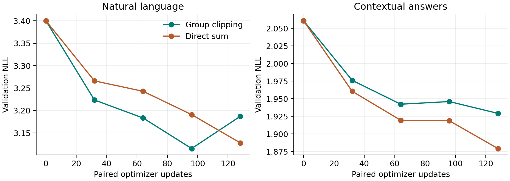

# SHoEbox: balanced learning through broader context

November 6, 2026 | Continuation of published checkpoint `7f3ce94`

Language and memory now train through the same graph in each optimizer update.
The new control caps each source's gradients separately in the core, readout,
recall and publication groups. Memory queries now follow natural-text distractors
and updates to competing facts. All 312,440 parameters train;
the inference architecture is unchanged.

## Completed comparison

| Held-out measurement | Group clipping | Direct sum |
|---|---:|---:|
| Selected update | 96 | 128 |
| Natural-byte NLL | 3.0922 | 3.0814 |
| All-answer NLL | 1.9282 | 1.8560 |
| Exact-answer NLL | 1.7051 | 1.6080 |
| Exact-answer accuracy | 21.7% | 26.5% |
| Exact NLL, long-delay documents | 1.6817 | 1.6204 |
| Exact NLL beyond 96 bytes | 1.6808 | 1.6325 |
| Exact accuracy beyond 96 bytes | 22.4% | 23.5% |
| Preceding task-test answer NLL | 2.0927 | 2.0187 |

Lower NLL is better. These scores use 2,048 natural-byte targets,
288 answer targets in 16 fresh contextual documents,
and a separate long-delay set with three times the configured retention gaps.
Acquisition questions remain short; the beyond-96-byte rows exclude them and
contain 98 exact-answer targets.
The preceding task test uses its original eight documents and seed.
The ordinary exact-answer subset contains 226 targets.
Uniform choice among its four valid values gives 25% accuracy; exact recall
remains close to that baseline even as answer NLL improves.

On these same held-out tests, the starting checkpoint scores
3.3672 language NLL, 2.0579 answer NLL,
and 1.9224 long-delay exact NLL.
Its exact-answer NLL beyond 96 bytes is
1.9497.

Group clipping changes language NLL by +0.0108, answer NLL by
+0.0721 and long-delay exact NLL by +0.0613
relative to direct summation at independently validation-selected checkpoints.
Both arms began at validation language/answer NLL of
3.4004/2.0608.

At the final update, clipping scores 3.1572 language
and 1.9056 answer NLL; direct summation scores
3.0814 and 1.8560.
Clipping remains an optional control alongside direct summation.

## Exposure and controls

Both arms complete 128 paired updates: 16,384 ordered natural-text bytes,
16,384 task-stream bytes, 727 answer targets, and
5,505,024 expert executions per arm.
Task-stream totals include their embedded natural text. Each pair uses two
forward/backward passes at identical weights, then one AdamW step. The language
cursor continues from the parent; optimizer and runtime states start fresh.

Batch 4, window 32 bytes, gradient segment 16, constant LR 0.001. Selection uses
mean validation language and answer NLL at updates 0/32/64/96/128. Natural
distractors respect train/validation/test corpus boundaries. The four-entity
task uses acquisition queries, corrections, two cycles, six questions per cycle,
and minimum delays of 4/48/96 bytes. Query labels and fact provenance are never
model inputs. No replay store is added.

Whole-rollout controls below start from fresh test state; positive deltas mean
worse answer NLL. These include changes to later computation and publication.

| Intervention | Clipping delta | Sum delta |
|---|---:|---:|
| Block regional reads | +2.2562 | +0.3714 |
| Always publish | -0.0000 | -0.0012 |
| Remove receiver demand | +0.0001 | +0.0003 |
| Always commit state | +0.0000 | -0.0003 |

## Retention and gradient behavior

| Producer reads at queries | Mean publication age, bytes | Older than 16 bytes |
|---|---:|---:|
| Group clipping | 0.00 | 0.0% |
| Direct sum | 0.16 | 0.0% |

Age covers selected valid A/B/C/U/V publications across receivers and rounds.
Publication age differs from fact age: recent publications can carry older
recurrent information. Long-held publications remain rare; the next target is to make useful information survive repeated publication updates.

| Group, clipping arm | Median language norm | Median memory norm | Language capped | Memory capped |
|---|---:|---:|---:|---:|
| core | 0.928 | 0.423 | 46.1% | 18.0% |
| readout | 0.634 | 2.851 | 0.0% | 99.2% |
| recall | 0.111 | 0.080 | 1.6% | 4.7% |
| publication | 0.019 | 0.008 | 0.0% | 2.3% |

Each source/group is capped at norm 1 before addition, followed by the common
global cap of 1. The direct-sum control retains the common global cap. Full logs
also retain gradient cosines and delayed-credit magnitudes for both sources.

## Verification and continuation

Regression verification passed 558 unique checks: 547 existing checks
and the complete 11-test new suite. The driver stopped reporting during the new
suite, which was then rerun separately and passed. New checks cover exact
gradient summation, simultaneous source weights, independent state and credit,
parent-cursor transfer, exact resume, corpus separation, target provenance,
publication-age accounting and evaluation-cache invalidation.

The execution resumed from completed pairs 119 and 121 after a session interruption. Exposure totals cover the retained trajectories; the validation schedule stayed fixed.

The publication/state/demand/payload controls remain independently ablatable.
Their intended coordination remains marked as a potentially threshold-dependent
emergent feature. Continue with task-driven retention and shared regional learning.



## Reproduce

```bash
python scripts/run_context_balance.py --parent artifacts/context_balance/parent.pt --parallel
python scripts/check_all.py
python scripts/evaluate_context_parent.py
python scripts/summarize_context_balance.py
python scripts/report_context_balance.py
```

The archive includes source, corpus, parent, selected/final checkpoints,
optimizer/runtime/credit states, full gradient logs, query traces and hashes.
Detailed protocol: `docs/context_balance.md`. Machine-readable results:
`experiments/text_regions/results/context_balance/summary.json`.
