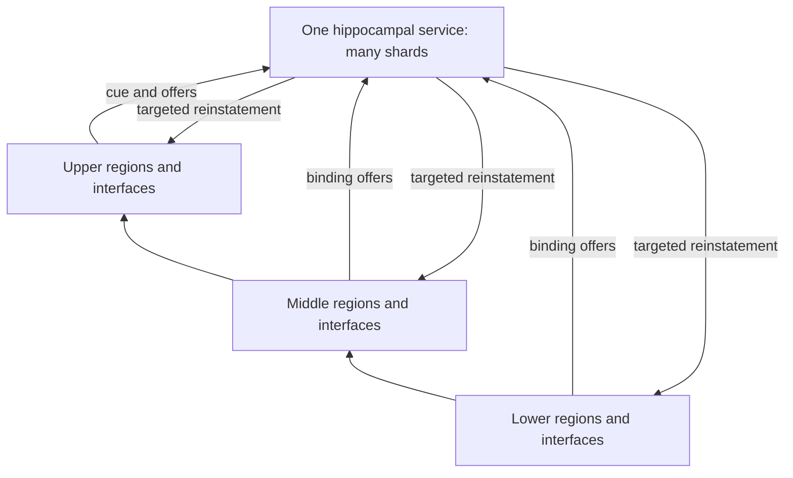

# SHoEbox: Explicit Hippocampus

Implementation specification v1.0 | November 7, 2026 | America/Denver

**One shared associative memory system; many shallow sparse shards; a replicated interface in every SHoE region.** This document specifies the next extension. The extension has not yet been implemented or benchmarked.

## 1. Decision and intended form

Build a logically unique hippocampal system above the regional hierarchy, with direct, addressable links to selected regions at every depth. Scale capacity and throughput laterally by adding shards and associative cells. Keep the local circuits shallow: they learn binding, separation, completion, relevance, revision and retrieval coordination. Detailed interpretation, prediction and general computation stay in regional experts.

The service is globally reachable within one model/world namespace. Global reachability does not mean global broadcast, a scan of every region, or a dense connection matrix between every pair of regions. Hundreds of regions may be active concurrently while each retrieval visits only a bounded subset.

The regional interface is an entorhinal-like adapter: it exports compact evidence, forms a distinct retrieval cue, manages local memory anchors and accepts reinstatement requests. Replicate the interface protocol and small shared adapter, not an independent hippocampus, in each region.

The diagram shows logical reach. Only selected links carry traffic. Existing forward, lateral and descending regional paths continue operating independently.

## Locked design decisions

- Computation remains in experts; hippocampal control does not become another full language model.
- Persistent binding state and temporary retrieval activation have separate lifetimes and learned controls.
- A dedicated cue path determines the request. Candidate payload pooling cannot be its sole source.
- A return link identifies an owner and a local memory pattern, not just a region's latest publication.
- All slow parameters remain trainable. Preserve the current global optimizer, objectives and decay configuration for the first comparison.
- Use state-based association and retrieval. Add no example replay buffer, frozen backbone, answer dictionary or task-specific parser.
- Default-off behavior preserves the existing model. Keep potentially threshold-dependent features ablatable for later larger runs.

---

## 2. What stays, changes, or moves

**No wholesale migration of regional intelligence is required.** Most new functionality is additional shared infrastructure. The current implementation has regional recall over configured incoming publications; it does not already contain the persistent global associative index proposed here.

| Existing responsibility | Decision | Resulting owner |
|---|---|---|
| Expert banks, contextualizers and MinKron state | Keep | Regional nodes |
| HAT byte encoding, local symbols and source clocks | Keep | Existing ingress and regional paths |
| Local SHoE groups, laces and semantic namespaces | Keep | Each local hierarchy |
| Publication admission, payload adaptation and producer-state commitment | Keep; add attributed recall feedback | Existing publication policy |
| Small working recall workspace and local direct edges | Keep | Regional composer |
| Recall request formed from incoming candidate mixture | Replace on the new path with a distinct cue channel | Regional interface |
| Cross-region episodic binding and association identity | Add one shared authority | Hippocampal shards |
| Global candidate routing and cross-region recall budgets | Add | Hippocampal directory and request fabric |
| Detailed retained traces addressed by the index | Add bounded anchors beside current state | Owner-region interface, read by experts |
| Delivery and arbitration across many concurrent regions | Extract orchestration into an explicit fabric | Scheduler/transport, not regional intelligence |

Current code grounds this split. `RegionalRecall` combines ingress with pooled incoming values before projecting its request. `GraphConnections` projects and examines every configured incoming candidate before selection. These remain useful small local mechanisms; they must not become an all-region global search implementation.

`RecallWorkspace` already supports distinct slots, null selection, coverage and feedback. Reuse these mechanisms where suitable. Its seven active slots are a working assembly budget, not the capacity of long-term hippocampal storage.

The existing graph has seven nodes grouped into three regions: R0 contains A/B/C, R1 contains U/P and R2 contains V/Q. Start with one interface per region, multiplexing its node ports. An engram handle includes the node owner as well as its region. Hundreds of future regions must not be confused with hundreds of copies of the seven-node graph.

## Ownership boundary

The hippocampus owns associations, retrieval selection and binding revisions. Regions own detailed representations and their interpretation. Interface caches are not competing authorities. A regional latent capsule is retained because an association references it; its content is generated and read through the region's learned machinery.

Existing local publication decisions remain valid even when the hippocampus is disabled, unavailable or returns null. Ordinary computation must continue without an obligatory hippocampal round trip.

---

## 3. Shallow functional circuits

DG/CA labels describe engineering roles inspired by hippocampal mechanisms. They do not prescribe a complete anatomical simulation. Sources [1]-[4] support indexing, separation, completion and comparison as useful motifs; the software choices below are this project's design.

| Circuit | Required behavior | Initial implementation boundary |
|---|---|---|
| Entorhinal-like interface | Translate local semantics; separate cues from offers; maintain provenance | Shared compact projections with small region adapters |
| DG-like separation | Distinguish overlapping bindings while retaining useful similarity | One small projection/nonlinearity/competitive sparse code |
| CA3-like association | Bind coactivity and complete a partial cue into candidate associations | Sparse fast-state records and bounded recurrent association steps |
| CA1-like comparison | Compare requested relation, expected support and returned evidence | Small learned match/mismatch, accept/null/refine controls |
| Return pathway | Reinstate selected patterns at several hierarchy depths | Gated requests to owner-local conditional readers |

**Separation.** DG codes include learned cue, role, contextual and temporal features. Never supply entity IDs, source answer positions or correct owner annotations from the evaluator. Structural region/node identities and causal versions are permitted transport metadata. New bindings compete for sparse capacity. Similarity supports reuse; distinct context or contradictory evidence supports separation.

**Association.** CA3 stores compact binding descriptors, sparse relationships and handles to local anchors. It models enough interaction to associate partial cues with relevant traces and to refine a retrieval. It does not model the entire content of every participating region. Use at most two associative refinement steps initially, with fixed per-request candidate and link budgets.

**Comparison.** CA1 receives both the original cue and returned evidence through separate channels. It learns whether the return matches the requested role/context, whether evidence conflicts, and whether to accept, return null, or spend remaining budget refining the request. It cannot see target labels during forward execution. It may compare or coordinate content but does not become the main answer decoder.

**Reinstatement.** A selected link supplies a learned local read cue and a stable anchor handle. The owner uses a query-conditioned operation over its capsule and optional current local context. Include a multiplicative or bilinear interaction, or equivalent expert conditioning; a fixed linear merge of all available values is insufficient as the sole reader.

## Three timescales

Transient request/assembly activation can fade quickly. Episodic binding and anchor state persists until learned revision, retirement or a capacity decision. Slow network parameters learn general semantics through the ordinary optimizer. No rule should repeatedly multiply persistent content by a transient attention gate merely because unrelated events occur.

---

## Reference numerical form

Use this minimal parameterization for the first implementation; alternatives require an explicit comparison. Dimensions refer to the shared address width unless stated otherwise. All projections and gates learn through the existing task objective.

**Cue and separation.** Form `q = normalize(Wq [cue; task_context])`. Form DG scores with one small projected nonlinear layer, then keep the top eight of 256 cells. Use the existing hard-forward/soft-backward sparse-selection convention with a checked estimator. Memory candidates are absent from this initial cue equation. Offer encoding uses a compatible address space plus distinct role/context features.

**Sparse lookup.** For each gathered candidate, combine cue/code similarity with learned context compatibility, age and utility terms. Normalize over only the bounded candidate set plus null. Transport validity masks are hard constraints. Learned age/utility biases cannot make a stale handle valid.

**Completion.** Run at most two sparse associative updates. Each update retains the original cue-driven score and adds gated support from stored binding-to-binding neighbors, then selects the active bindings again. Reintroducing the original cue at each step helps prevent completion from becoming an unconstrained self-exciting attractor. Each binding has at most eight associative neighbors, distinct from its at-most-four anchor links. Any newly visited neighbor consumes the original shard/candidate budgets.

**Local state update.** On an admitted write, use separate learned write and erase/revision gates. A minimal capsule update is `m_new = (1 - erase) * m_old + write * candidate`; key updates use an analogous gated interpolation followed by normalization or sparse recoding. Apply these updates only to selected records/anchors. A non-write retains content exactly, apart from a separately declared learned retention action. Allocation of a free/recycled slot increments its generation; identity and revision policy must never be inferred from slot number alone.

**Conditional regional read.** Supply the selected capsule, local context, local read cue and an explicit interaction such as `capsule * Wread(cue)` to the owner expert/composer. Preserve separate returned roles until composition. A reader must distinguish different cues applied to the same retained capsule set.

**Comparison and feedback.** Project requested, expected and returned descriptors into a common small space. A shallow CA1 head sees those descriptors, their differences and validity/provenance features, producing accept/null/refine and feedback signals. Correct answers remain training targets outside this forward computation.

Fast associative state updates operate during both training and inference from observed inputs. Slow parameter updates operate only during training. Reading a memory is distinct from admitting the retrieved activity as new evidence.

---

## 4. State and interface contract

Use typed structures with leading stream/batch dimensions in the differentiable reference implementation. The same logical messages must later work across actor or device boundaries. State namespaces isolate unrelated streams even when parameters and service code are shared.

| Structure | Required contents |
|---|---|
| CueRequest | Request ID; stream/reset namespace; requester region/node; learned cue and context; causal watermark; remaining work budget |
| BindingOffer | Offer ID; namespace; producer identity/version; compact content/role/context descriptors; ready anchor handles; admission evidence; external/derived/reinstated provenance |
| BindingRecord | Stable binding ID/generation; sparse code; compact association state; bounded binding neighbors and anchor links; revision/supersession state; utility/confidence; retention metadata; representation version |
| EngramHandle | Namespace; region/node owner; anchor slot; generation; anchor version; semantic namespace version |
| LocalAnchor | Fixed-width learned content capsule; local address/read features; validity and generation; source provenance; bounded retention/reference metadata |
| ReinstatementRequest | Request/binding identity; expected handle/version; original cue; link-specific read cue; requested support/role; remaining budget |
| RecallResult | Returned latent evidence; actual versions; confidence/mismatch features; contributors; null/stale/evicted status |
| CreditReceipt | Actual selected contributors, versions and controls; optimizer-window identity; apply-once identity; bounded derivative/eligibility data where supported |

A binding stores only a bounded number of links and compact relational detail. Local anchors retain the detail needed by their owner. Neither component stores unlimited byte histories or complete regional state snapshots per event.

## Detail cannot be recovered from an expired pointer

The current publication store contains the latest publication per owner. Its version tags do not constitute a historical payload archive. Therefore the new design requires a bounded anchor/capsule mechanism, or an equivalently demonstrated persistent cue-addressable local trace. A pointer to an overwritten publication is not a valid implementation.

For v1, use explicit fixed-width latent anchor capsules in the regional interface, produced from region outputs and read through the regional expert/composer boundary. Keep ordinary node recurrence unchanged. The hippocampal record retains the anchor handle and a compact reinstatement cue. Compression quality and exact-detail retention are measured properties; once both capsule and other supporting traces are gone, return null rather than substituting unrelated current content.

Transport identity and differentiable content are separate. Integer IDs provide routing, validity and attribution, not answer hints. Namespace/version checks gate both payload and semantic-header use.

---

## 5. Binding, retrieval and revision dynamics

## Binding a new event

1. Active regional experts publish ordinary outputs. Their interface forms a compact offer from selected local activity and its context; no event grammar is hard-coded.
2. A learned admission decision stages a bounded local anchor. The anchor becomes ready before any global record may reference it.
3. The directory routes the offer to a small shard set. DG forms its sparse code; CA3 compares a bounded candidate set for compatible bindings.
4. Learned controls choose reinforcement, revision, separation or no write. Coactivity offers can form one association with multiple region/depth links. Correlation windows are bounded and do not imply that every simultaneous event belongs together.
5. The owning shard commits the binding revision and acknowledges accepted anchor references. Unaccepted provisional anchors are reclaimed after a bounded grace period.

Empty-store bootstrap may admit valid activity to avoid a permanently closed write path. It must be generic, declared and ablatable, and must never use answer positions or source labels. Once populated, admission, novelty, utility and replacement controls remain learnable.

## Retrieving from a partial cue

1. Form the request from a dedicated current-cue/task-context trace. Candidate evidence can refine an existing request but cannot define its initial identity.
2. Route to bounded shards and postings; gather a bounded candidate set. DG/CA3 perform sparse matching and at most two refinement steps, including null selection.
3. Select binding links while preserving roles and source identities. Dispatch only the chosen local readbacks.
4. Each owner validates the handle, reads its capsule with the request-specific cue and returns latent evidence. A read is non-destructive and does not advance the external byte clock.
5. CA1 evaluates compatibility against the original cue. Accepted evidence enters the requesting region through a learned residual/gated interface. Existing experts compute the answer.
6. Task and usage feedback reaches the actual write/read/link decisions. Further refinement spends the original request's remaining budget; it cannot create an unbounded loop.

## Revision and forgetting

For sequential corrections to the same learned identity/context, supersede the appropriate binding while retaining declared version semantics for in-flight readers. A different entity, episode or relation should be separable. Identity matching is learned; the runtime only enforces causal versions and ownership.

Concurrent, incomparable claims retain distinct provenance until the learned context/consistency policy resolves them. Wall-clock arrival order alone cannot establish semantic truth. Retirement uses bounded capacity plus learned utility/recency/context, with lazy age accounting. Preserve independent read, admission, revision and retention ablations.

Reinstated activity carries a provenance flag. It cannot automatically re-admit itself as independent evidence and amplify indefinitely. Novel externally grounded or newly computed information may still form new associations through the normal learned gate.

---

## 6. Concurrency and causal execution

One logical hippocampus means a common namespace, protocol and association ownership scheme. It does not require one physical process or one lock around all queries. Shards own their records; regions own their anchors. Interfaces and routing entry points can execute concurrently and batch compatible tensor operations.

## Deterministic reference schedule

At each existing internal round, snapshot the visible binding and anchor versions. Construct cues from current ingress/task context, without reading future publications. Resolve bounded retrievals against that causal snapshot and inject accepted evidence through the regional input boundary. Run the ordinary regional computation. Stage resulting offers, anchor writes and feedback; commit them for the next eligible round.

Read-before-write ordering prevents a later event from answering an earlier request. Preserve the current external-event and internal-round clocks. Do not re-ingest a byte or add undocumented native processing rounds for every memory candidate. Hub refinement has its own small work budget. A result missing the current round's deadline is queued for a later eligible round or becomes an explicit null; it is never retroactively inserted into a past output.

The reference schedule is the semantic oracle for later event-driven execution. A deterministic execution mode remains available for reproducibility. Current region labels and stage batching do not, by themselves, demonstrate asynchronous execution of hundreds of regions.

## Concurrent implementation rules

- Assign each binding/anchor revision one owner. Use version-checked updates and idempotent request/offer IDs; duplicate delivery cannot duplicate a write or credit application.
- Read immutable versions or copy-on-write snapshots. Region progress does not wait for unrelated regions to finish a global barrier.
- Revise a referenced anchor by making the new version ready before retargeting its binding. Retain old versions only for a bounded reader grace period. If that capacity is exhausted, defer/reject the write or explicitly invalidate the affected read; never silently mutate a published version.
- Budget queues and service work. Apply backpressure, fair admission and explicit null/defer results under overload. Report dropped, deferred and expired requests.
- Reject stale generations and namespace mismatches. An evicted anchor produces a negative acknowledgement; index links are retired or repaired. Never silently read a recycled slot.
- Limit cycles by request identity, visited links and a cumulative hop/work budget. CA3 association edges and regional feedback cannot reset that budget.
- Checkpoints capture a consistent causal cut: shard/anchor versions, pending offers, queues, receipts, directory state and RNG. Restore must not reapply already committed actions.

Separate an independent-stream reset from a within-world episode boundary. Training-row reset clears or invalidates that row's memory namespace. A continuing world's episode change can preserve long-term associations while changing their contextual applicability. Neither event leaks memory across unrelated examples.

---

## 7. Lateral scaling and bounded work

Scale storage with more records/pages and service throughput with more shards. Keep DG/CA1 depth and CA3 refinement count fixed while increasing region count. Add globally reachable endpoints through a registry rather than expanding `GraphConfig.edges` into an all-to-all graph.

Use a bounded-branch directory followed by sparse postings or an equivalent sublinear candidate index. Writes and queries share a compatible address space. Full scans of all shards, records or regional payloads are permitted only as an explicitly small reference/oracle, never as the scalable path.

| Budget | Pilot default | Scaling contract |
|---|---:|---|
| Logical regions | Existing 3 | Exercise 64, 128, 256 and 512 |
| Hippocampal shards | 2 | Add 4/8/16/32 as load/capacity requires |
| Shared address width | 32 | Hold fixed initially |
| DG cells / active cells | 256 / 8 | Capacity grows laterally; activation stays bounded |
| Binding slots per shard | 128 | Pages can grow; query work must not follow capacity |
| Local anchors per region | 64 | Explicit independent capacity budget |
| Maximum shards visited per request | 2 | Includes retries and association hops |
| Posting entries read per visited shard | 64 | Count actual reads, not just final selections |
| Fine candidates per visited shard | 16 | At most 32 fine candidates per request |
| Selected bindings | 2 | Null is always available |
| Associative neighbors per binding | 8 | Expansion consumes the same total candidate budget |
| Links per binding / target readbacks | 4 / 8 total | Aggregate cap includes refinements |
| CA3 refinement steps | 2 | No depth growth with region count |

These are initial engineering settings, not measured capacity claims. Route-policy requests are constrained by hard execution budgets. A sparse top-k applied after scoring every record does not meet the contract.

Provide bounded route exploration and empty-index bootstrap within those same budgets, so an initially poor address mapping can discover useful associations. Use no evaluator-supplied destinations. Record exploration rate, shard coverage and routing misses separately from downstream reader failures.

For directory branching b, depth D, bounded beam a, visited shards k, posting cap P, candidate cap C and refinement steps h, per-request work should scale with bounded directory traversal plus kP, kC and the selected association/readback work. It must not scale as every region times every stored record. Directory depth may grow logarithmically; keep it shallow for the initial 32-shard envelope.

Cold storage scales with total binding and anchor capacity; active execution scales with selected work. Use lazily allocated pages and touched-page operations. Avoid full-bank zeroing, state copies, gradient buffers or optimizer moments for every query. Dense reference storage is acceptable for the tiny pilot only if a separate paged backend and scaling gate remain explicit.

Store stable handle identities separately from learned semantic keys. Address-space drift is tracked through representation versions, bounded re-key-on-use and declared background maintenance budgets. Repartitioning shards must preserve handles or bounded redirects; it cannot require rewriting every regional connection.

---

## 8. Learning, gradients and compatibility

Maintain the distinction between slow trainable weights, fast associative state and transport metadata. Shared interface/DG/CA1 weights may be replicated for execution; per-region and per-shard memory state retains explicit ownership. Sharing weights never implies sharing unrelated batch-row state.

The initial experiment preserves AdamW settings, language/task objectives, syntax weight, clipping and existing regional decay rules. New controls learn through ordinary task loss. Do not add a new answer-supervised binding loss, globally change loss weights, or introduce a new retention curriculum to obtain the first comparison. Optional later regularizers or learning rules require their own named ablation.

## Credit through the full retrieval path

Within the live training window, keep the graph connected through cue encoding, matching, sparse selection, local capsule writes/reads, return gating and the original regional outputs. A module, message boundary or shard boundary is not automatically a detach point. Existing straight-through sparse-selection conventions can be reused and must be checked against the reference path.

At the declared optimizer boundary, detach persistent values while preserving their content. Extend the existing bounded eligibility/credit machinery only for the controls and derivatives it actually supports. Do not claim exact historical content gradients from detached locator IDs. Credit receipts carry causal versions and are applied once; exact live autograd and historical boundary credit must not double-count the same contribution.

Hard write/allocation decisions need a declared differentiable training estimator or an explicitly measured alternative. Test source-write, query, selected-link and local-read gradients separately. A mechanism that only learns which owner to visit, with no learning path into its conditional reader, is incomplete.

## Compatibility and resource behavior

- Disabled mode preserves legacy logits, state values, source clocks, optimizer behavior and RNG consumption. No new bank allocation or all-region traversal is allowed in this mode.
- Warm-start shared weights and AdamW moments from the retained parent. Map optimizer state by stable parameter identity/name; initialize moments only for genuinely new parameters.
- Initialize the added residual path to preserve the baseline while maintaining an eventual gradient path. Do not simultaneously zero every factor of a multiplicative path so that all derivatives vanish.
- Serialize optional hippocampal state with an explicit schema upgrade. Support detach, clone/fork, row reset, device transfer, byte accounting and exact resume.
- Counterfactual query branches share the original live history for gradients, but have isolated subsequent fast-state updates and receipts. They must not contaminate one another through the shared service object.
- Count unique parameters and unique storage; state-dict aliases must not inflate model size. Report model weights, optimizer memory, persistent state and live training activations separately.
- Physical multi-device training must define differentiable transport or declared truncation. An inference RPC implementation is not evidence of preserved training gradients.

Localize adaptation in admission, association, read and reinstatement controls. The participating regional experts remain trainable, and changed retrieval naturally changes their inputs and gradients.

---

## 9. Repository implementation map

Baseline source: [JRowe47/SHoEbox, commit 2af7151](https://github.com/JRowe47/SHoEbox/commit/2af7151f7902b9fa8a0cf572eaadfb6a4ccc5841). Inspect newer commits before editing and preserve intervening work. Paths below are relative to the repository root; new filenames are proposed, not existing implementation claims.

| File or component | Required change |
|---|---|
| `config.py` | Add default-off hippocampus config, region-interface ownership, capacities, route/work budgets and independent ablations |
| `regional_recall.py` | Add distinct cue input for the new path; preserve legacy candidate-derived request when disabled |
| `recall.py` | Reuse slot/null/coverage mechanisms; preserve contributor roles; keep local workspace distinct from global capacity |
| `graph.py` | Add targeted recall delivery; keep ordinary edges and avoid constructing every possible global edge |
| `node.py` | Add expert/composer-boundary conditional capsule encode/read hooks and a gated reinstatement input |
| `graph_publication.py` | Preserve local write policy; consume attributed hippocampal usage/revision feedback without duplicating credit |
| `state.py`, `ports.py` | Add optional typed states, stable anchor handles, generation/version validation and reset/serialization support |
| `model.py` | Install service/interfaces and the deterministic causal schedule; preserve original event/round accounting |
| `content_credit.py`, `state_credit.py` | Extend explicitly supported live and historical credit paths; retain exact boundary semantics |
| New `hippocampus_interface.py` | Common cue/offer/result contracts, namespace translation and local anchor adapter |
| New `hippocampus.py` | DG/CA3/CA1 modules, learned policies and sparse association state |
| New `hippocampus_index.py` | Directory, posting lookup, ownership and dense-reference/paged-store contract |
| New `hippocampus_runtime.py` | Budgets, deterministic delivery, queues, snapshots and actor-simulation hooks |

All paths in the table belong under `experiments/text_regions/`. Add focused tests there and experiment entry points under `scripts/`. Avoid putting content interpretation into HAT or the network transport.

## Backend-independent operations

Expose small typed operations equivalent to `offer`, `query`, `read_local`, `feedback`, `commit`, `reset_namespace` and `snapshot`. Pass state explicitly in the reference backend. Keep transport adapters separate from neural policy modules. A remote backend must implement the same identities, causality and budget semantics.

Region adapters share a protocol and preferably a common parameter trunk, with small optional adapters for differing local spaces. Local facet/lace numbers have no universal meaning; namespace translation is learned. Adding a region should require registration and its interface, not new pairwise parameters against every existing region.

---

## 10. Experiments and acceptance

The retained starting model has 312,440 unique trainable parameters. In the latest fresh test, it retains a single fact at +64 bytes in 128/128 cases, while both conflicting questions pass in 0/192 cases. Paired supervision alone raises older-fact accuracy but weakens retention; its +64 paired score is only 1/192. Diagnostic readouts recover both old/new values from state after 32 text bytes. This motivates structural access and binding work; it does not establish that a global hippocampus is already implemented.

## Required comparisons

A: unchanged model with the paired-training schedule. B: dedicated cue lane plus local conditional anchor reader, without global associative routing. C: full shared DG/CA3/CA1 index and targeted readbacks. Report capacity and execution differences between arms. On C, additionally test disabled readbacks, shuffled binding-to-anchor links, pooled return roles and disabled refinement/feedback as inference ablations. Keep namespaces and causal availability intact during shuffles.

Use the same strong parent, source schedule, optimizer and fixed update budget across trained arms. The existing 64-update paired control may be reused only when its exact protocol/data/source trajectory is verified; otherwise rerun it. Primary comparison is the declared fixed-budget endpoint, with validation-selected candidates reported separately.

Initial training recipe: learning rate 0.003; 64 updates; paired/paired/single/correction cycle; added gaps 0/4/8/16/32; language weight 0.25; syntax weight 0.1; global clip 1.0. Inherit the parent's cursor and RNG. Use fresh validation seed 683/start 3000 and test seed 1201/start 80000. These are new banks for this phase; lock all cohorts before looking at their results.

## Behavioral and structural gates

- Principal behavior: both conflicting questions about one unchanged history must be correct. Report query-only switches, source-value sensitivity and each direction's accuracy separately.
- Proposed pilot promotion gate: at least 50% both-correct validation pairs at gaps 0 and 32, while single-fact accuracy drops by at most 2 percentage points, changed-value correction by at most 3 points, and natural-text NLL increases by at most 0.05 versus the parent on matching validation cohorts. These are acceptance targets, not predicted results.
- Use at least eight validation templates per controlled cohort. Final fresh evaluation retains 32 single templates, 16 two-fact templates, eight documents per ordinary stream and 1,024 natural bytes, plus declared cross-region probes.
- Test a third-region requester with two independent producers, availability masks and permuted region identities. Source labels/answers stay outside inference. Distinguish wiring tests with controlled fixtures from learned cross-region task results.
- Verify exact disabled behavior, causal snapshots, reset isolation, duplicate delivery, stale handles, corrections, eviction, checkpoint/resume and gradients through writes and reads.
- Simulate 64/128/256/512 regions with fixed and increasing loads. Measure actual candidate reads, visited shards/regions, p50/p95 latency, queues, throughput, persistent bytes, active bytes and gradient allocations. Mock-actor transport results are not learned-model or distributed-hardware scaling results.

If behavioral gates fail, preserve the experimental feature behind its switch, retain the stronger baseline and record the failed exit. Do not remove a plausible emergent mechanism solely because this small pilot has not trained it successfully.

---

## 11. Next-chat execution prompt and sources

**Implement the explicit hippocampus specified in this document for SHoEbox.** Begin by reading `STATUS.md`, the current source and this specification. Work from the retained strong memory parent, preserving all intervening user changes. The intended architecture is one shared, sparse, laterally scalable associative system with shallow DG/CA3/CA1-style circuits and a replicated interface in every region. Detailed computation remains in experts.

Carry the work through these milestones, reporting which exits actually pass:

1. **H0 - contracts and compatibility:** lock typed messages, namespaces, handles, state schemas and budgets; establish disabled parity and checkpoint migration.
2. **H1 - regional access:** implement the distinct cue lane, stable local anchors and conditional expert readbacks. Verify source/query/reader gradients and revision behavior.
3. **H2 - shared memory:** implement a two-shard DG/CA3/CA1 pilot with bounded lookup, sparse binding links, targeted multi-depth reinstatement and a deterministic causal schedule.
4. **H3 - controlled learning:** run matched paired-memory comparisons and ablations, with all existing parameters trainable and global learning settings unchanged. Preserve the strong parent unless promotion gates pass.
5. **H4 - scaling contract:** exercise the interface and memory service with 64-512 simulated concurrent regions, bounded requests, paging/backpressure and version races. Clearly distinguish reference dense storage from any implemented scalable backend.
6. **H5 - later deployment:** real large-model, multi-device and GPU scaling follows after the functional mechanisms and accounting are established. It is outside the initial implementation run.

The next development chat should complete H0-H3 and a bounded H4 conformance smoke where feasible, rather than stopping at a plan. If a milestone remains unresolved, report the concrete result and preserve a resumable checkpoint. Keep comments on potentially threshold-dependent features and independent ablations. Publish completed source/results under the project's standing authorization. Deliver ordinary downloadable Markdown/PDF reports and source/checkpoint archives; do not use Pages or Spaces.

## Recovery anchors

Working parent: `artifacts/memory_selectivity/selective/best.pt`. Experimental paired control: `artifacts/paired_recall/train/best.pt` (selected/final update 64). They are different roles; do not silently replace the working parent with the paired control.

The supplied `SHoEbox_Paired_Recall_Checkpoints.zip` contains both checkpoints, the exact corpus, evaluations and checksums. If the workspace is gone, recover that archive and the public repository. Historical working path: `/workspace/scratch/ad4838812e18/SHoEbox`; do not assume it exists in a new session. Current experiment evidence: `docs/paired_recall.md` and `experiments/text_regions/results/paired_recall/summary.json`. Original graph requirements: `docs/SHoE_Text_Development_Specification.md`.

## Research anchors

[1] Teyler and DiScenna (1986), [The hippocampal memory indexing theory](https://pubmed.ncbi.nlm.nih.gov/3008780/): an index can reinstate distributed cortical activity. This informs the shared-index/local-content boundary.

[2] McHugh et al. (2007), [Dentate gyrus NMDA receptors mediate rapid pattern separation in the hippocampal network](https://pubmed.ncbi.nlm.nih.gov/17556551/): motivates separation of overlapping event bindings.

[3] Nakazawa et al. (2002), [Requirement for hippocampal CA3 NMDA receptors in associative memory recall](https://pmc.ncbi.nlm.nih.gov/articles/PMC2877140/): supports partial-cue completion as a functional motif.

[4] Duncan et al. (2012), [Evidence for area CA1 as a match/mismatch detector](https://pmc.ncbi.nlm.nih.gov/articles/PMC3529001/): informs a separate consistency/comparison stage.

