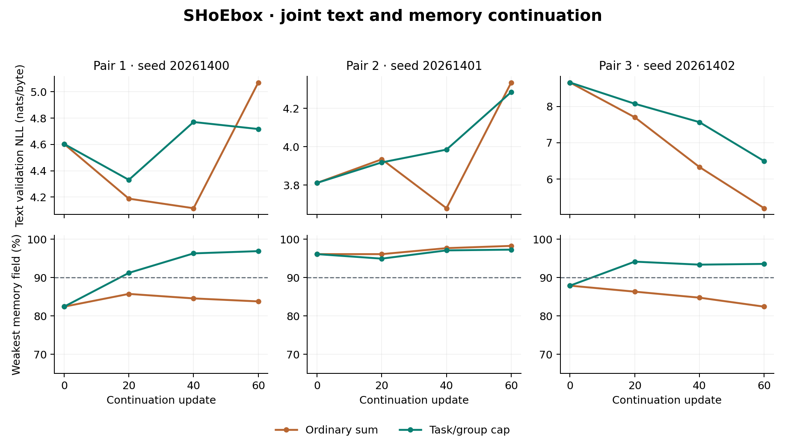

# SHoEbox: stable joint text and memory learning

Completed November 5, 2026 (America/Denver). Three matched parent/data pairs, two update rules, one shared regional model per run.

## Result

The validation-selected checkpoints in the capped arm meet every locked endpoint in 1 of three pairs. M7 remains open.
The cap improves mean selected text NLL by 0.7819 nats/byte.

| Seed | Update rule | Selected step | Text before | Text after | Memory minimum |
| --- | --- | --- | --- | --- | --- |
| 20261400 | Ordinary sum | 20 | 5.1022 | 4.4221 | 86.13% |
| 20261400 | Task/group cap | 20 | 5.1022 | 4.5080 | 91.21% |
| 20261401 | Ordinary sum | 40 | 3.5864 | 3.5193 | 96.29% |
| 20261401 | Task/group cap | 0 | 3.5864 | 3.5864 | 95.70% |
| 20261402 | Ordinary sum | 0 | 9.0613 | 9.0613 | 87.50% |
| 20261402 | Task/group cap | 60 | 9.0613 | 6.5627 | 96.29% |

Text values are nats per byte on 4,096 previously unscored test targets. Memory minimum is the weakest of 27 field scores across recall, four correction directions, and four withheld-correction conditions, each with 512 fresh episodes. Checkpoints are selected using validation only.



The dashed line marks the 90% minimum-field validation guard. The plot includes the initial parent and all three scheduled continuation validations.

The training-only unigram reference scores 3.4100 nats/byte on these same targets.

No selected checkpoint beats that reference; useful language learning remains the next target.

| Update rule | Mean text NLL | Worst memory score | Runs passing all endpoints |
| --- | --- | --- | --- |
| Ordinary sum | 5.6676 | 86.13% | 1/3 |
| Task/group cap | 4.8857 | 91.21% | 1/3 |

Selection retained the starting parent in these arms: 20261401 (Task/group cap), 20261402 (Ordinary sum). Their selected scores measure the starting checkpoint. The fixed-budget final results below measure the continuation.

## What changed

Text and memory gradients are captured separately from the existing backward passes. The new rule caps each task contribution at norm one within each optimizer group: core, shared byte readout, and memory producers. Contributions are then added and the common final global cap is applied. There are no extra model executions, task-specific decoders, or model parameters. The ordinary-sum control shares the same numerical norm calculation and logging.

The probe that motivated this change measured text/core norms of 18,866, 3.91, and 11,559 across the three parents. The corresponding memory/core norms were 10.83, 2.63, and 7.05. A global cap alone consequently scaled down decoder and producer contributions along with the large core gradients.

| Seed | Rule | Median text/core norm | Median memory/core norm | Median decoder text contribution |
| --- | --- | --- | --- | --- |
| 20261400 | Ordinary sum | 3005.719 | 8.779 | 0.000398 |
| 20261400 | Task/group cap | 3906.914 | 2.022 | 0.577752 |
| 20261401 | Ordinary sum | 8.939 | 1.033 | 0.083229 |
| 20261401 | Task/group cap | 8.718 | 0.690 | 0.549835 |
| 20261402 | Ordinary sum | 5227.929 | 11.863 | 0.000662 |
| 20261402 | Task/group cap | 9850.773 | 1.902 | 0.581618 |

The final column is the task contribution norm after both clipping stages and before AdamW. Per-node, connection, HAT, shared-expert, and memory-owner norms and cosine similarities are preserved in each training history.

## Broader checkpoint selection

The previous 64-episode, five-condition guard becomes a 512-episode, nine-condition guard. Every one of its 27 field scores must reach 90%; the eligible checkpoint with lowest text validation NLL wins. Exact ties keep the earlier checkpoint. Initial parents, selected weights, and fixed-budget final weights are all retained.

| Seed | Rule | Step 0 memory | Step 20 memory | Step 40 memory | Step 60 memory |
| --- | --- | --- | --- | --- | --- |
| 20261400 | Ordinary sum | 82.42% | 85.74% | 84.57% | 83.79% |
| 20261400 | Task/group cap | 82.42% | 91.21% | 96.29% | 96.88% |
| 20261401 | Ordinary sum | 96.09% | 96.09% | 97.66% | 98.24% |
| 20261401 | Task/group cap | 96.09% | 94.92% | 97.07% | 97.27% |
| 20261402 | Ordinary sum | 87.89% | 86.33% | 84.77% | 82.42% |
| 20261402 | Task/group cap | 87.89% | 94.14% | 93.36% | 93.55% |

Fixed-budget final results are a prespecified diagnostic, independent of primary checkpoint selection:

| Seed | Rule | Final text NLL | Final memory minimum |
| --- | --- | --- | --- |
| 20261400 | Ordinary sum | 5.8806 | 88.09% |
| 20261400 | Task/group cap | 4.9710 | 94.14% |
| 20261401 | Ordinary sum | 3.8637 | 97.66% |
| 20261401 | Task/group cap | 3.7502 | 96.68% |
| 20261402 | Ordinary sum | 5.4825 | 83.59% |
| 20261402 | Task/group cap | 6.5627 | 96.29% |

## Retained computation and source ownership

| Seed | Rule | K2 gain over K1 | Text target | Memory target | State / resume |
| --- | --- | --- | --- | --- | --- |
| 20261400 | Ordinary sum | 63.02 pp | fail | fail | pass |
| 20261400 | Task/group cap | 68.10 pp | fail | pass | pass |
| 20261401 | Ordinary sum | 73.44 pp | pass | pass | pass |
| 20261401 | Task/group cap | 72.92 pp | pass | pass | pass |
| 20261402 | Ordinary sum | 65.23 pp | fail | fail | pass |
| 20261402 | Task/group cap | 71.61 pp | fail | pass | pass |

The memory answers still require g(f(x)) through the regional composer. Additional controls include K4, no exchange, blocked/reset/shuffled memory, missing and erased sources, and 64-byte gaps. The four memory owners remain inactive during text. Interleaving 32 text bytes preserves their state exactly, and 128-byte autoregressive sessions reproduce their bytes, RNG, next logits, and complete state after saving at byte 41.

Mean held-out field accuracy across the three capped runs:

| Memory condition | Shared | Left private | Right private |
| --- | --- | --- | --- |
| Recall | 96.09% | 95.90% | 95.31% |
| Shared correction, K2 | 96.22% | 96.03% | 95.31% |
| Shared correction, K1 | 25.26% | 25.00% | 24.67% |
| Shared correction, K4 | 47.98% | 43.95% | 44.27% |
| No regional exchange | 25.26% | 25.07% | 24.74% |
| Blocked memory edges | 25.00% | 26.37% | 23.89% |
| Reset memory | 25.00% | 26.37% | 23.89% |
| Shuffled memory | 16.28% | 30.47% | 13.02% |
| Left source only | 96.03% | 95.05% | 25.52% |
| Right source only | 96.16% | 26.17% | 94.66% |
| Erase left source | 96.16% | 26.17% | 94.66% |
| Erase right source | 96.03% | 95.05% | 25.52% |
| Recall after 64 bytes | 95.38% | 95.70% | 95.25% |
| Correction after 64 bytes | 95.57% | 95.77% | 94.92% |

Mean text NLL across the three selected checkpoints in each arm:

| Text condition | Ordinary sum | Task/group cap |
| --- | --- | --- |
| Two regional rounds | 5.6676 | 4.8857 |
| One regional round | 5.6207 | 4.9457 |
| Reset state every 16 bytes | 6.6660 | 5.9787 |

## Samples

Fixed seed samples from every capped run, prompted with ROMEO and a newline at temperature 0.8. Escapes preserve non-ASCII bytes; raw samples are in the artifact package.

Run 20261400:

```text
eiioehSeAAAAAAAAAAAAAAAAADjHtnanwtoAerlrio,deeho   ts:oDDAA.on
tesAAAAAAAAAAAAAAAAAAAAAAAAAAAAAAAAAnnneADnaD oaetie\naeDhDdDBAB
```

Run 20261401:

```text
CCACACCAAAAABCCCCABCDCAABAlA d\n,AAA\nABDeenu rdwsewt neiacag  eltt\nneiauerasgmf isektbnns,,\nd hfr
enthrten Wges yvimnb oesaecaewy
```

Run 20261402:

```text
DDCAACBBADAAAADuCtCCCBeACrDC\neADDn
ADDDDBCDCDAAAAAACCCADDAAADDDDDDDAAAAAAAAAAAAAAAAAAAACCCDsACBADhBAADtDtD ACDCDDADAr DAAADsAAAA
```

## Training and verification

Each arm adds 60 updates, 7,680 ordered natural-text bytes, and 960 fresh procedural memory episodes to its parent. Each final lineage has therefore consumed 28,160 natural-text bytes during the joint-text phases. A selected checkpoint may contain fewer continuation updates. The three pairs share an earlier composition ancestor; each pair shares its starting weights, Adam moments, text cursor/state, and new data exactly.

The graph contains 510,958 parameters and 768 physical experts. AdamW rates remain core 0.0003, readout 0.002, and producer 0.0001, with a five-update warmup. The memory objective and fixed alignment targets are inherited. No replay store is introduced.

| Seed | Rule | Expert executions | Training minutes | Peak RSS MiB |
| --- | --- | --- | --- | --- |
| 20261400 | Ordinary sum | 4,469,760 | 18.16 | 1196.6 |
| 20261400 | Task/group cap | 4,469,760 | 19.60 | 1203.6 |
| 20261401 | Ordinary sum | 4,469,760 | 19.82 | 1193.8 |
| 20261401 | Task/group cap | 4,469,760 | 21.70 | 1194.5 |
| 20261402 | Ordinary sum | 4,469,760 | 18.29 | 1195.6 |
| 20261402 | Task/group cap | 4,469,760 | 22.99 | 1194.6 |

Training times sum recorded completed updates and exclude validation, audits, and interrupted unsaved work. Timings come from concurrent CPU workers.

All 416 regression tests and all six run audits pass. Audits reconstruct every training batch and counter, verify identical paired data and parent state, rescore every recorded validation and test memory field against regenerated targets, recompute all recorded text NLL values, rerun the weakest selected validation condition, three full held-out memory conditions, and 1,024 text targets per run, and reproduce serialized generation exactly.

## Reproduction

Extract source and artifact ZIPs into the same directory; both use the SHoEbox/ root. The package includes all three parent checkpoints, every initial/selected/final continuation checkpoint, full histories and predictions, raw sample bytes, data, and audit evidence.

```bash
python -m pip install -r requirements.txt -r requirements-reports.txt
python scripts/check_all.py
python scripts/run_joint_stability.py \
  --parents artifacts/joint_stability/parents --stage audit
python scripts/plot_joint_stability.py
python scripts/report_joint_stability.py
python -m experiments.text_regions.byte_stream \
  --checkpoint artifacts/joint_stability/study/20261400/group_clip/best.pt \
  --prompt "ROMEO:" --count 128 --out sample.bin
```

For a fresh matched study, run scripts/run_joint_stability.py with --parents artifacts/joint_stability/parents and a new --root. Repeat the same command to resume saved optimizer and stream state. Then run --stage evaluate and --stage audit against that root.

## Interrupted-run recovery

The saved in-progress archive passed all 839 file hash checks. The six runs resumed their full optimizer, stream, graph, and RNG checkpoints with the original locked source and protocol.

| Run | Restored update |
| --- | --- |
| 20261400/group_clip | 15 |
| 20261400/sum | 15 |
| 20261401/group_clip | 20 |
| 20261401/sum | 5 |
| 20261402/group_clip | 20 |
| 20261402/sum | 15 |

The recovery used PyTorch 2.15.0+cu132 and 6 concurrent CPU workers. The artifact package preserves the original environment record and the recovery provenance separately.

A saved step-zero text validation recomputed at 3.7440 rather than its recorded 3.8115 nats/byte in the recovery environment. The original validation history and selection rule were preserved. The same checkpoint reproduced all 1,536 answers in its weakest memory-validation condition exactly, with loss-reduction differences below 0.00000005. The audit requires exact discrete validation results and permits only 0.000001 absolute/relative tolerance for those floating-point loss reductions. Fresh held-out results and generation sessions are independently reproduced in the recovery environment.
