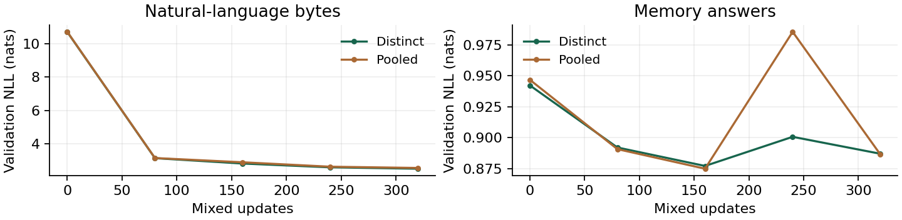

# SHoEbox: regional recall and mixed learning

November 6, 2026 | Shared recall ports across the graph and owned-memory model

**Recall is now a reusable regional interface, and the same owned-memory model learns from natural text and memory tasks.** The implementation retains role-specific input maps, item-or-null selection, overlap controls, feedback, producer-state holds and delayed payload credit. These controls remain available for broader training and later ablation.

## Ordinary regional graph

Each enabled receiver selects from its configured incoming publication ports. Separate slot maps preserve item roles at the sparse expert boundary. The receiver's previous computed output informs its next request, including when its public output is held. External bytes enter through the existing ingress path.

Forward edges read completed current stages; lateral and descending edges read the round-start snapshot. Masks apply to keys and values. Substitutions replace both payload and semantic headers. Selection telemetry includes source versions and occurrences. Dependencies identify examined inputs, because every candidate can influence selection; per-slot weights identify actual content reads. All candidate ports are still scored; selecting fewer items does not reduce expert executions.

The seven-node, two-round integration uses seven slots per receiver. It completed 32 updates on 2,048 natural-text bytes, executing 344,064 experts. The graph has 311,711 parameters, versus 246,142 without recall, and adds **896 bytes of feedback state per stream** at width 32. The existing publications remain the memory cells.

| Graph integration check | NLL, nats/byte |
|---|---:|
| Initial validation | 5.5321 |
| Final validation | 4.3244 |
| Separate 128-byte test | 4.2228 |
| Test with recalled content blocked | 4.4871 |

All seven receivers learn different slot maps and nonzero query/null feedback weights (smallest feedback norm: 0.129). Splitting a continued stream at byte seven, serializing its state and resuming reproduces logits and final state exactly. Pooled-role and feedback-off checks remain available alongside blocked reads.

## Mixed language and memory continuation

Both arms start from the same final distinct-slot checkpoint of the preceding recall pass, with fresh optimizers and runtime state. Each has **564,519 trainable parameters** and completes 320 updates: 81,920 natural-text bytes plus 81,920 memory-task bytes, with 9,830,400 expert executions. Odd updates read ordered Tiny Shakespeare; even updates read procedural documents containing corrections and interference. Batch size is eight, live context is 64 bytes, and the learning rate is 0.001. Initialization/data seeds are 71/271.

The same weights serve both sources. Each source owns its runtime state, cursor and version-bound credit traces. Source labels never enter the model. Producer-state holds and delayed gate/payload credit are enabled for both sources. Both sources produce nonzero delayed gate and payload gradients. The ordinary graph and this owned-memory topology are separate configurations sharing the recall module; graph publication gates retain their existing training path.

---

## Learning and held-out results

The distinct arm's natural-language validation NLL changes from 10.6860 to 2.5185; its all-answer memory NLL changes from 0.9423 to 0.8870.



Checkpoints are selected by the equal-weight mean of natural-byte and all-answer validation NLL. The table reports natural-text and exact-answer test NLL separately; lower is better. Language testing uses 4,096 targets. Each memory split contains 16 fresh documents; long-delay testing triples the configured gaps.

| Layout | Checkpoint (update) | Language | Exact answer | Long delay |
|---|---|---:|---:|---:|
| Distinct | Selected/final (320) | 2.5220 | 1.1422 | 1.1612 |
| Pooled | Selected/final (320) | 2.5703 | 1.1571 | 1.1792 |

## What the learned recall contributes

These interventions run from the start of each held-out stream. Positive NLL change means intact behavior helped. Memory changes below use **all answer types**, matching the selection metric. They measure whole-rollout effects, including changed subsequent writes and recurrent state.

| Distinct arm | Intervention | Language delta | Answer delta |
|---|---|---:|---:|
| Selected/final | Pool roles | +0.0051 | -0.0006 |
| Selected/final | Disable feedback | +0.1347 | -0.0003 |
| Selected/final | Block reads | +0.2563 | +0.2639 |

## Verification and next step

**530 checks pass across the five experiment suites**, plus the live-output example. New checks cover legacy initialization, hard/null selection, masking, delayed snapshots, gradients, held publications, inactive rows, exact graph continuation, source isolation, and exact restoration of shared weights, optimizer, both stream cursors and both delayed-credit states.

Next, bring the task-trained publication/credit interface into the ordinary graph, then increase mixed-data exposure through that unified path. Keep role and feedback controls trainable; their comments explicitly mark potential training-threshold dependence for later ablations.

```bash
python scripts/run_regional_recall.py --parent /path/to/parent.pt \
  --data data/tiny_shakespeare.txt --out artifacts/regional_recall
python scripts/check_all.py
```

The companion archive contains source, the exact corpus, common parent, selected/final mixed checkpoints, graph checkpoint, both stream states, optimizer and eligibility state, raw traces, metrics, checks and SHA-256 hashes.
