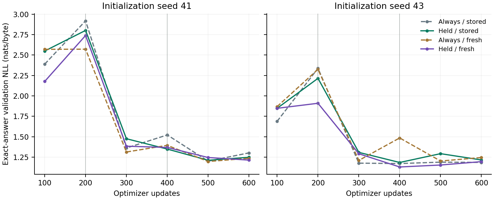

# SHoEbox: selective state commits

November 6, 2026 | Implementation: `483eb11` | Two paired seeds, eight matched arms

Selective owner-state commits are implemented and verified. Holding state lowers mean standard-delay exact-answer loss, especially with current-candidate reads, but does not produce a consistent long-delay advantage. **Protected producer contents had almost no effect on answers when altered at query start. The feature remains optional.**

## Held-out results

Exact-answer negative log-likelihood (NLL), in nats per answer byte; lower is better. These are equal-weight means across seeds 41 and 43. Long-delay evaluation triples the configured delays.

| Arm | Selected test | Final test | Selected long | Final long |
| --- | --- | --- | --- | --- |
| Always / stored | 1.2079 | 1.2063 | 1.3481 | 1.2554 |
| Held / stored | 1.2008 | 1.2035 | 1.3046 | 1.2649 |
| Always / fresh | 1.2195 | 1.2186 | 1.2677 | 1.3004 |
| Held / fresh | 1.1882 | 1.1949 | 1.3331 | 1.3083 |

With stored reads, the selected test improvement is 0.0072 NLL and the final improvement is 0.0028. The selected long-delay improvement of 0.0435 reverses to a 0.0095 disadvantage at the final budget. Fresh reads improve standard-delay test loss in both seeds, while their selected long-delay loss worsens in both.

| Seed / arm (selected step) | Test | Final test | Long | Final long |
| --- | --- | --- | --- | --- |
| 41 / Always (500) | 1.1690 | 1.2229 | 1.3375 | 1.2552 |
| 41 / Held (500) | 1.1954 | 1.1923 | 1.3490 | 1.2245 |
| 41 / Always fresh (500) | 1.2273 | 1.1940 | 1.3019 | 1.2601 |
| 41 / Held fresh (600) | 1.1925 | 1.1925 | 1.3429 | 1.3429 |
| 43 / Always (400) | 1.2469 | 1.1897 | 1.3587 | 1.2556 |
| 43 / Held (400) | 1.2061 | 1.2148 | 1.2601 | 1.3054 |
| 43 / Always fresh (500) | 1.2117 | 1.2431 | 1.2335 | 1.3408 |
| 43 / Held fresh (400) | 1.1839 | 1.1973 | 1.3234 | 1.2737 |

Selection minimizes all-answer NLL on 16 fixed-target validation documents. Final checkpoints are all at update 600. Each test uses 32 held-out documents: 215/209 exact questions for seeds 41/43; long-delay counts are 222/216. Four controls were restored from the completed payload-credit study with archive hashes verified; four state-hold runs are new.

---

## Did protected contents help?

Each intervention starts before the entire query. Positive NLL change means intact content helped. Producer shuffles replace owner recurrent contents while preserving publications, ingress, composer state and clocks. Normal query-time writes continue.

| Producer shuffle | Selected test | Final test | Selected long | Final long |
| --- | --- | --- | --- | --- |
| 41 / Always | +0.120951 | -0.001123 | +0.028255 | +0.008701 |
| 41 / Held | -0.000654 | -0.000370 | +0.001270 | +0.000305 |
| 43 / Always | +0.056124 | +0.159292 | +0.109245 | +0.120917 |
| 43 / Held | +0.000042 | -0.000049 | -0.000142 | +0.000375 |

The always-update controls depend on producer contents during several query evaluations. The held models barely do. This is the central finding: protecting those contents did not make them a useful query-time memory channel.

## Contents older than 64 bytes

The following cells show NLL change / number of actually changed exact queries. This cutoff exceeds the full live training window. A dash means no eligible content actually changed. Commit age measures time since the last update, not the age of every fact encoded in a recurrent state.

**Producer contents**

| Seed / held read | Selected test | Final test | Selected long | Final long |
| --- | --- | --- | --- | --- |
| 41 / stored | +0.000001 / 8 | - / 0 | -0.000023 / 45 | -0.000002 / 30 |
| 41 / fresh | -0.000620 / 4 | -0.000620 / 4 | -0.000110 / 9 | -0.000110 / 9 |
| 43 / stored | +0.000004 / 121 | -0.000007 / 121 | -1.6e-08 / 178 | +0.000010 / 173 |
| 43 / fresh | - / 0 | -0.000479 / 9 | -0.000908 / 8 | -0.001860 / 62 |

**Published contents**

| Seed / held read | Selected test | Final test | Selected long | Final long |
| --- | --- | --- | --- | --- |
| 41 / stored | -0.000017 / 8 | - / 0 | -0.000035 / 45 | -0.000503 / 30 |
| 41 / fresh | +0.000000 / 4 | +0.000000 / 4 | +0.000000 / 9 | +0.000000 / 9 |
| 43 / stored | +0.000085 / 121 | -0.000599 / 121 | -0.000363 / 178 | +0.000234 / 173 |
| 43 / fresh | - / 0 | +0.000096 / 9 | +0.000000 / 8 | -0.000039 / 62 |

Old producer-state effects are negligible or negative, including seed 43 stored reads where many old owners actually change. Older publications also show small, mixed effects. The preserved contents do not establish a repeatable retention gain.

---

## Implementation and verification

An optional `--state-commit publication` mode commits each owner's contextualizer and three recurrent block states only when that owner publishes. Held contents remain exactly unchanged. Shared byte ingress and composer state continue processing context, and all producer candidates still execute. The option adds no parameters or persistent state tensors; legacy configs retain always-update behavior.

The live graph trains state admission through a straight-through surrogate. Existing delayed credit still covers the conditional publication path; it does not reconstruct historical recurrent-state gradients. Fresh reads replace the read values only: publication-aware admission remains active and can affect later producer updates.

All arms have 549,075 parameters, consume 307,200 training bytes and execute 18,432,000 experts over 600 updates (200 acquisition, 200 bridge, 200 target). The held arms commit 23.95-24.83% of owner candidates. Trace storage remains 480,512 bytes at batch eight. This pass tests retention at matched candidate compute; it does not skip expert work.

Selected corrected-exact NLL changes from 1.1160 to 1.0936 with stored reads, and from 1.1168 to 1.1056 with fresh reads. Accuracy changes from 43.3% to 43.7%, and from 42.3% to 40.4%, respectively.

All **512 checks across five suites passed**, along with the live-output example. Ten new checks cover exact holds, owner isolation, reset behavior, initialization/RNG parity, independent state-gradient calculations, live policy credit, exact resume, and isolated state-content audits. All 32 checkpoint/split audits reproduced the uninterrupted predictions: zero changed answers and maximum logit error 0.000003815.



Vertical lines mark curriculum transitions. Every point evaluates the fixed target distribution; checkpoint selection uses all-answer NLL.

## Next development target

Keep state holds available as a controlled option. Next, test two contextual read slots against a parameter-matched single-read control, retaining separate retrieved pieces until the expert composer combines them. Keep the short-delay training mixture as a separate comparison. The target remains useful task-driven consumption of retained content.

Reproduce all eight arms from initialization, or resume existing runs:

```bash
python scripts/run_state_commit.py --out artifacts/state_commit --workers 4
```

The accompanying archive contains runnable source, the protocol, selected/final/stage checkpoints, optimizer and runtime state, raw histories and query audits, validation logs, baseline provenance, and SHA-256 file hashes.
