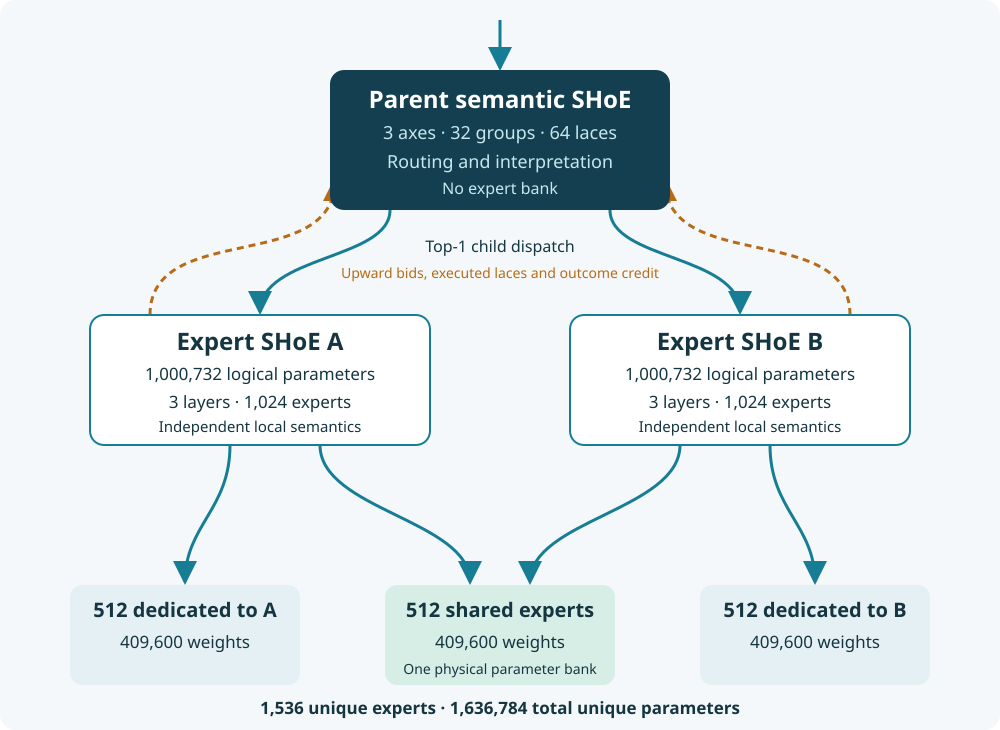

# Architecture

## Local semantics and laces

A semantic SHoE organizes its expert addresses into independently learned local groups. A token first scores group prototypes, then the expert addresses in selected groups. Only selected expert MLPs execute. Learned lace factors represent relationships between group identities at different layers; a selected factor sends a contextual prior into another layer's own address space.

The original three-layer model has 32 groups per layer and 64 lace factors. The six-layer model has 64 groups per layer and 256 lace factors. Both choose two groups, eight experts per chosen group, and two lace factors per target layer, with two routing-refinement rounds. The groups have no supplied semantic labels and do not assume aligned numbering across layers.

These two models also use their group geometry to retrieve attention keys. A query reads sixteen local positions plus up to eight older positions from each selected group. Causal posting lists avoid a dense sequence-by-sequence attention matrix. Controller refinement exchanges lightweight routing beliefs; expert outputs subsequently flow forward without replaying earlier blocks.

## A region with shared and private experts

The parent has semantic axes and laces but no experts. Each of two children has the original three-layer SHoE shape and can address 1,024 expert MLPs. Exactly 512 are shared by both children; 512 are private to each child. Child group memberships and address geometry remain local, even when the underlying expert matrices are shared.

Routing proceeds as follows:

1. The parent forms a provisional interpretation from the current input and causal context.
2. An established route can probe one child. Otherwise the parent probes both child semantic heads. A failed local match broadens discovery.
3. Each probe returns a match and endpoint distribution without running attention, recurrence or expert MLPs.
4. Learned parent-to-child relation tensors translate local group distributions in both directions. The parent combines bids, semantic compatibility and expected utility, selects one child, and supplies a downward prior.
5. The selected child performs its computation. In the attention hierarchy, it receives its assigned causal subsequence with original position IDs. In the recurrent model, only its assigned events advance its state.

The fast path requires confidence above 0.75, positive learned route value, sufficient eligibility mass, and an 80-update discovery warmup. Training adds 10% exploration and a parent load-balancing loss. A local match below 0.25 rejects the shortcut. These values are recorded configuration choices, not special requirements of the interface.

## Lower laces reinforce upper semantics

Executed child blocks provide endpoint evidence for a final cheap lace interpretation. That detached posterior supervises the parent's translated prediction through a KL term. A lightweight parent baseline supplies an outcome reference: realized gain is baseline cross-entropy minus selected-child cross-entropy, clipped to [-2, 2]. A selected-child utility head learns to predict that gain.

After the optimizer step, an explicit `commit_feedback` call updates eligibility-weighted route values using the signed outcome and EMA decay 0.97. The next forward pass can use those associations. Forward execution does not mutate route-memory buffers, evaluation never commits feedback, and labels cannot enter prediction computation. There is no target for an expert that did not run.

The no-reinforcement control retains live bottom-up bids and top-down priors while disabling the added semantic/utility losses, persistent reinforcement updates and shortcut reuse. It tests the reinforcement bundle as a whole.

## HAT: common symbols, exact bindings

HAT receives byte values with exact link and slot sidecars. Link 0 maps slots 0–255 to the same immutable byte values. Other links expose current payloads in persistent slots. The same numerical byte on different links or slots has distinct provenance even if its learned symbol representation overlaps.

Two HAT levels each combine a minKron memory with top-2 selection from a 64-entry learned symbol dictionary. Parameters are shared across sources; recurrent state is indexed by source link. A residual value path preserves current input information alongside contextual symbols. The hierarchy changes the representation, while keeping one event per input byte.

The dictionary is an interface, not a media decoder. Text can be UTF-8, and other producers can publish their existing bytes. Learned source/slot semantics and expert computation interpret those streams. Numeric outputs must be serialized by their producer; the current `ByteBatch` API rejects implicit float-to-byte conversion. The byte serialization boundary is not a differentiable connection into an upstream producer.

## minKron context

The HAT experiment replaces each child's attention mixer with minKron, retaining the sparse banks and semantic routing. There is one recurrent matrix per head of each child block, rather than one cache or matrix for every tiny expert. There is no token KV cache or growing historical-key index in the instantiated model.

For normalized query, key and value vectors, the recurrence applies vector forgetting to the old matrix, computes a separate write/erase correction, adds a rank-one key/value update, and reads with the query. The implementation preserves the recovered compact recurrence and checks outputs, final state and gradients against the authors' tokenwise reference. `references/README.md` explains the reference files and licenses.

The six child blocks consume 6,144 bytes of FP32 recurrent matrices per sequence. Both HAT levels consume 2,048 bytes per active link. Including integer clocks, one active link requires 8,208 bytes of carried state, and all eight configured links require 22,600 bytes. These counts exclude weights, the input payload, training activations and optimizer state.

Source memories remain unchanged when inactive. A child advances only when selected. Shared expert weights do not imply shared runtime state. Passing the returned state into the next call continues the stream; detaching state truncates the training graph; resetting a batch row begins a new independent episode. The 128-position training window is not an inference cache capacity.

## Computation stays in experts

HAT and SHoE provide addressing, semantic routing and context around the expert computation. Specialized convolution, diffusion or other transformations can live in dedicated expert banks. The current banks are latent MLPs; neither HAT nor the router implements such transformations.

The output-port specification extends this separation to completed module outputs. A producer publishes a stable payload and a cheap routing header. Downstream activation reads the selected payload. Completion criteria belong to the producing expert; buffers and routing need no modality-specific interpretation. See [output ports](output_ports.md) for lifecycle, indexing and decay semantics.
