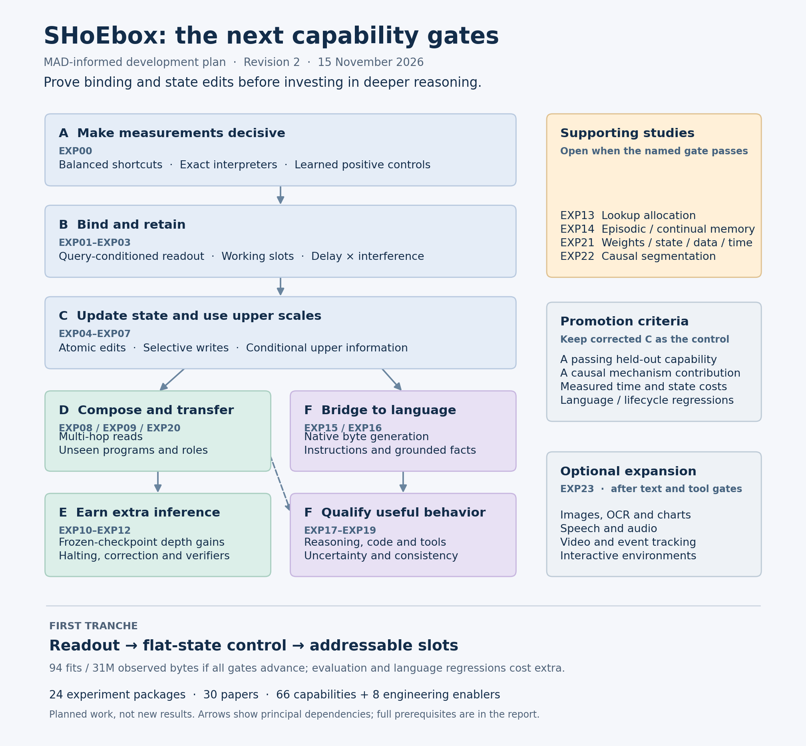

# SHoEbox capability research and development plan

**Revision 7 · 16 November 2026 (America/Denver)**

Current baseline: minimal corrected C, v19, at `317fbcd023b9d9b3c2b359ba8f99f3dadbf46783`. Revision 7 completes EXP01-D3 / EXP22 binding/access qualification and selects EXP01-E joint integration and production regressions.

**Development decision: repair query binding, retention, and state transitions first; then establish composition and useful upper-level computation; then return to inference-time reasoning.** Use the minimal corrected-C core as the production control and retain full C as a historical comparator. The paired constituent readout now passes binding, query counterfactual, boundary, padding-delay and cost gates in the frozen-core research adapter. The next build integrates joint learning and qualifies generic language/copy/reconstruction behavior. A matched-capacity working-slot alternative remains gated on demonstrated state limitations. Deeper recurrence remains a later intervention.

**Baseline revision — minimal v19.** The new default keeps expert banks at 1/4
bytes and ordered trainable summaries at 16/64 bytes, with existing memory and
bounded credit. Upper expert routing, forecast heads and dynamic modulation are
removed; loops and route-rate cycles remain explicit full-architecture research
controls. [Implementation and paired qualification](../../reports/minimal_core/SHoEbox_Minimal_Core_Baseline.md).
Historical results and EXP00 below still refer to full C; they are not relabeled
as minimal results. EXP01 now names minimal and full cores explicitly; continue
to recheck fixtures and attribute any change to the named architecture.

**Start the next development session with [DEVELOPMENT_HANDOFF.md](../../DEVELOPMENT_HANDOFF.md).**
The [minimal capability matrix](SHoEbox_Minimal_Capability_Matrix.md) is the current
implementation/evidence inventory. It replaces the older full-C status view;
prior assessments remain preserved separately in the backlog and git history.

This plan defines **24 experiment packages**, a **37-paper working bibliography**, and a mapping of **all 66 capabilities plus eight engineering enablers** to development work. The 66 include 62 core capabilities and four optional multimodal capabilities. Early packages specify focused mechanism tests; later packages contain separately scored qualification suites. The original research revision preceded execution; the updates below record calibration and the initial binding diagnosis. No native capability promotion follows from these results.

**Current execution update — 16 November 2026 (America/Denver).** EXP01-D3 / EXP22 passes the registered binding/access development gates: 99.22% native two-answer exactness on every seed versus 50.29% native; 99.63% all-offset mean, 98.44% worst offset, 96.88% both-query-orders exactness, and 100% at +64/+128/+256-byte delays. Inference retains 88.74% of native throughput, with zero added sequence state and 9,900 budgeted head weights. Actual fitting: 63.75M bytes including failed stages, pilots and controls. [Results, registration and code](../../reports/exp01d/SHoEbox_EXP01D_Report.md). EXP01-E: integrate and qualify joint native-core learning and a learned residual-applicability gate, then language/copy/reconstruction and 1M/5M capacity regressions. Keep the D3 binding/delay fixture as a regression and minimal v19 as production until those gates pass.

**Historical EXP01-C update.** Pooled views decoded the query but reached 44.56% native exactness. This motivated the now completed constituent-pairing repair; preserve [its evidence](../../reports/exp01c/SHoEbox_EXP01C_Query_Access.md).

**EXP01 diagnostic update — 15 November 2026 (America/Denver).** The initial
36-branch screen is complete on explicitly named minimal/full cores. Minimal
native two-answer binding is 49.45%; the generic rank-16 online heads remain near
the 50% shortcut. A train-only, separately supervised factorized probe of the
64-float L3 state recovers the first queried binding at 99.93% strict held-out
accuracy. This localizes the next work to query/key/value selection and credit.
**Historical next step (subsequently completed): EXP01-B, an online factorized readout over existing evidence**, followed
by native query counterfactuals, offset/delay tests, and regression qualification.
EXP02 slots remain gated. [Code, literature, costs, and evidence](../../reports/exp01/SHoEbox_EXP01_Query_Readout.md).

**Execution update — 16 November 2026 UTC.** EXP00 is complete: six new fixture families, eight settings, three seeds, 48 formal fits, and a locked held-out audit. Learned controls reach 100% exact on all six audited families. Corrected C scores 50.07% exact on balanced two-key binding versus the 50% input-order shortcut; none of the eight development settings clears the comparative calibration gate. **This completed calibration motivated the EXP01 screen reported above.** Expanded control training was registered separately: 897M formal encoded bytes plus 301.55M in retained development-only pilots. [Results, code, costs, and reproduction instructions](../../reports/exp00/README.md).

## 1. Evidence that changes the original plan

The historical full-C evidence below used `6384d8ca072075ec58010b4c3d5964e9e60fcd3e`; it predates minimal v19. The completed research campaign is pinned separately at `d899a1a49b1af2f4a2cf0c89b000da69ea5f3597`. The latter is research evidence, not an assumption that its adaptations have entered production. [S1–S4]

| Recorded result | What it establishes | Development consequence |
| --- | --- | --- |
| Selective copy: 87.76% held-out answer-token accuracy; removing memory reads costs 75.39 percentage points | Existing memory paths can carry useful short-context information | Preserve this as a regression fixture; diagnose how it fails |
| Four-extra-pass recall: 60.81% answer-token accuracy, but 30.99% exact episodes versus 53.12% for emitting supplied values in input order | The token score does not establish query-specific binding | Balance queries and make exact episodes the binding endpoint |
| Those same recall checkpoints score 60.42% with extra inference passes disabled | Almost all the measured improvement survives without repeated inference | Track training effects and inference effects separately |
| Independent 64-byte delay: copy falls 87.76%→14.84%; recall 55.86%→18.88% | Failure to generalize to this longer-delay distribution | Cross delay, interference, and binding count; add trained-delay controls |
| Direct-state supervision: 14.71% at 1M and 15.36% at 5M; initial-binding shortcut 71.48% | Additional state credit helps relatively, but the procedure remains unsolved | Decompose initialization, querying, and individual update operators |
| Frozen standardized readouts recover roughly 31–33% from direct-state models | Some information is recoverable; the current online head also underuses it | Isolate conditioning, fitting method, query access, and state capacity |
| Compression: 70.77% without loops, 58.33% with four extra passes | This refinement policy damages the tested bounded-state reconstruction | Do not promote it as a general improvement |
| Upper-level mean replacement changes language NLL by about −0.000031 nats/byte | Current changing upper outputs add little in the tested language setting | Give upper computation a controlled, necessary task and test its contribution |

The campaign completed **435 fits and 131.25M observed training bytes**. Its selected synthetic comparisons did not run a natural-language regression evaluation. Compression used a dedicated final-L3-state decoder; the historical long-delay cue success used routing A. Preserve both scopes. [S2,S3]

The pre-minimal inventory recorded **0 generally demonstrated, 5 narrowly demonstrated, 4 demonstrated in principle, 9 unworking at their tested operating point, and 48 untested capabilities**. These are historical counts, not minimal-v19 counts; use the current minimal matrix for present status. Implementation and evidence remain separate fields. In particular, “untested” stays distinct from “unworking.” [S2]

### What is already implemented, and what is still proposed

| Mechanism | Current minimal position | Treatment in this plan |
| --- | --- | --- |
| 1/4-byte exact corrected-C sparse experts | Implemented | Production baseline |
| 16/64-byte ordered trainable summaries; diagonal recurrence; constant output modulation | Implemented | Preserve; establish useful conditional information |
| MinKron context, addressed and retained reads, reconstruction and child credit | Implemented | Preserve measured copy/reconstruction contributions |
| Upper expert banks/routing/forecast heads and dynamic output modulation | Excluded from minimal | Restore only as a separately measured candidate |
| Upper constituent refinement and convergence stopping | Full-research only | Historical controls after useful state/composition gates |
| Route-local learning-rate cycles and experimental credit multipliers | Full-research only | Explicit compatible architecture; no silent minimal extension |
| Intermediate state-credit adapter | Existing full-C research adapter | Validate/port minimal compatibility before use |
| Independent query-addressable working slots | Proposed | EXP02 only if EXP01 identifies a state need |
| Revisable workspace, candidate answer and per-pass retrieval | Proposed | EXP08/EXP10 |
| Learned continuation, verifier search and tool execution | Missing integrated workflows | EXP11/EXP12/EXP18 |

**Historical depth notation:** `u` is extra passes and `K=1+u` total applications. The existing full-C MAD loop tests use `u∈{0,1,2,4}` at L2/L3; with L1 loops off, expert applications per 64 bytes are `85+5u`. This accounting belongs to the full architecture. Minimal uses one-pass prediction and has no upper expert applications; new workspace/query-loop candidates need their own accounting. [S4,S5]

## 2. Development sequence and gates

| Wave | Work | Exit decision |
| --- | --- | --- |
| A — trustworthy measurements | EXP00 | Exact interpreters, balanced shortcuts, a learned positive control, locked splits |
| B — bind and retain | EXP01–EXP03 | Correct query-specific retrieval, useful independent state, characterized delay/interference behavior |
| C — update and specialize | EXP04–EXP07 | Atomic state edits work; upper computation has a causal, input-dependent contribution |
| D — compose and transfer | EXP08, EXP09, EXP20 | Multi-hop retrieval and held-out compositions work beyond familiar surface forms |
| E — spend extra inference well | EXP10–EXP12 | Frozen-model depth or verifier curves buy accuracy at a measured cost |
| F — qualify a language assistant | EXP15–EXP19 | Native byte generation, instruction use, grounded answers, reasoning and tools pass their own suites |
| Supporting tracks | EXP13, EXP14, EXP21, EXP22 | Lookup, continual memory, scaling, or segmentation earn their specific cost |
| Optional expansion | EXP23 | Add modalities only after a text capability baseline exists |

These are dependency gates, not a requirement to finish every experiment in one wave before preparing the next. Language data and evaluators can be built early. Language qualification need not wait for adaptive halting, and useful one-pass solutions may advance without any looping module. Run EXP22 early only if boundary-offset tests in EXP06 identify a timing/segmentation bottleneck.

The roadmap image records the revision-2 dependency proposal, not completed work or the current architecture. The handoff and backlog carry current execution and minimal-core status.

### Proposed acceptance standards

The thresholds below are **new planning defaults**, not measured results or existing MAD rules. Register task-specific exceptions before running a comparison.

| Gate | Proposed standard |
| --- | --- |
| Fixture correctness | Independent interpreter: 100% on exhaustive tiny cases and generated audits; ignored-label and future-target invariance pass |
| Easiest binding / atomic transition | Mean exact-episode accuracy ≥95%, no confirmation seed below 90%; query counterfactuals behave correctly; unrelated-register error ≤1% where applicable |
| Trained delay/interference range | ≥90% exact episodes in every predeclared primary cell; report the worst cell, not only the average |
| Length/depth extrapolation | Claim only the tested extension; for the initial 2× extension, accuracy loss ≤10 points and accuracy remains above the strongest shortcut |
| Mechanism improvement | Paired gain on the declared primary endpoint, above the strongest shortcut; a planned intervention removes a useful part of the gain. Use ≥5 points as the default practically relevant gain when substantial headroom remains |
| Efficient replacement | Non-inferior quality within 1 point, with ≥10% lower measured inference or training time at the declared comparison point |
| Default-runtime promotion | Confirmed mechanism result plus language regression checks: proposed mean held-out degradation ≤0.01 nats/byte and no domain worse by >0.02; also preserve already passed capability fixtures |
| Useful new capability | A slower module may remain an opt-in capability winner if it crosses an absolute task gate and lies on the quality/time/state Pareto frontier |

“In principle” requires a controlled operation with a causal check. “Narrow” additionally requires held-out success and a documented operating range. “Generally” requires multiple materially different task/domain families, realistic generation, and transfer beyond the training format. A single synthetic pass never upgrades the whole generalist model.

## 3. MAD protocol revision

Preserve the existing byte adaptation and published task definitions for historical comparability. Version new generators and selection rules as a follow-up protocol. The original MAD work supplies the small-scale mechanism-design approach; our byte scores remain SHoEbox-specific. [P01,S4]

### 3.1 Calibrate the operation, not a shortcut

For every task, report both uniform chance and the strongest registered shortcut: majority supplied value, input-order output, last seen value, initial binding/ignore updates, and node-set guessing as applicable. Add blind-to-query, blind-to-operation, and answer-frequency controls. On development data, let `B` be the strongest shortcut under the **same exact-episode or token metric** and record `G=(A−B)/(1−B)`. Do not compute this score when `B=1`; repair that degenerate fixture. Keep the old chance-normalized score beside it for comparison.

Use a learnable, unsaturated development band for architecture comparisons, now checked against shortcuts as well as chance. If corrected C stays below shortcuts, report the setting as **uncalibrated for a comparative capability claim**. Continue with a diagnostic repair: reduce to one key, initialization-only, or one operator, and require an independent learned positive control to solve it. A symbolic oracle validates the labels; it does not demonstrate that the training setup can learn the task.

Randomize key identities, value identities, record order, query order, and irrelevant offsets independently. Start binding with distinct values so a correct query matters. Add collisions/repeated values as a separately scored follow-up. Train/dev/test folds must group all renamed or reordered versions of the same latent problem when testing structural generalization; otherwise surface randomization can leak the underlying graph or program across splits.

### 3.2 Preserve fair selection and independent evidence

- Screen at **500K nominal parameters** and record actual fitted counts, then confirm useful mechanisms at 1M and 5M separately. For every size, verify the selected architecture's actual topology, parameter count and state inventory rather than inheriting a historical size assumption.
- Use paired seeds **1, 7, 19** for development. Confirm locked finalists with **1, 7, 19, 31, 43** and reserved audit examples; publish every seed. Three-seed bootstrap intervals are exploratory, not strong precision estimates.
- Retain equal six-policy searches: base LR multiplier `{0.5,1,2}` × native auxiliary weight `{0,0.1}`. Select by mean final development task NLL with identical seed coverage. New gate/adaptation hyperparameters receive a separately counted, equally budgeted search.
- Keep initialization, finite training order, dataset hashes, observed-byte exposure, and document resets paired. Fix the schedule for the chosen horizon; do not simultaneously introduce route oscillation.
- Use at least **512 development and 1,024 reserved test episodes** per primary setting, plus exact enumeration where small enough. Larger final audits should be sized to resolve the registered practical difference. All transformations of an episode stay in one fold.
- Test only locked finalists. New model decisions made after viewing audit failures require a fresh audit fold in the next wave. Retain existing historical fixtures as regressions rather than repeatedly selecting on them.

### 3.3 Separate four resource axes

Record fitted parameters `P`, persistent state bytes `S`, observed training bytes `B`, and measured compute/time `T`. Expert-bank growth changes `P`; it does not automatically grow the current four recurrent vectors or 16 retained slots per level. Include MinKron/address matrices, keys, records, metadata, readout parameters, temporary tapes, and measured peak RSS—not just slot values. [S4]

Evaluate equal training bytes, equal training CPU time, and equal inference latency as separate views. A matched-parameter experiment may deliberately change state capacity; label it a state-capacity experiment. Compare slots with a flat state of the same usable byte capacity as well as with the unchanged control. Do not bypass the runner's capacity checks: extend them with an explicit experiment class and required inventories.

For language, report **nats per byte versus bytes**, **nats per byte versus time**, **bytes per second**, and the **best observed loss**. For tasks, replace loss with exact accuracy where appropriate and also report bytes/time to two consecutive development threshold checks. Do not turn the final checkpoint into an estimated saturation floor. Timing comparisons use actual stored checkpoints within a common budget. Run an additional single-pass generation benchmark: the existing MAD evaluation timer bundles multiple scoring passes and is not deployment generation latency.

### 3.4 Distinguish representation, readout, and inference

Always retain native 256-byte scoring beside restricted-alphabet scoring, teacher-forced beside autoregressive rollout, and exact episodes beside per-token accuracy. Specialized heads may establish a mechanism; they do not establish free-form byte generation. Structural tokens currently supplied by fixtures must eventually be generated and scored in EXP15.

Diagnostic probes use training-fold normalization and training-fold fitting only. To isolate centering, change centering with the **same optimizer, training data, feature dimensionality, and head capacity**. The prior standardized probe changed conditioning and fitting together. To isolate query use, give the diagnostic oracle query index only to explicitly labeled controls; the native route must obtain it from the observed byte stream.

For loops, run the full cross-table of **training depth × frozen inference depth**. Compare `A(θu,u)−A(θu,0)` for inference benefit and `A(θu,0)−A(θ0,0)` for training benefit. Current extra-pass budgets stop at four; eight extra passes would need a separate runtime/tape extension. Inspect bindings, read selections, register states and exact answers per pass after execution, without putting diagnostics into the production hot path.

## 4. Experiment catalog

EXP00 is complete on full C. EXP01's initial, B and C screens are complete; EXP01-D / EXP22 constituent-level key/value pairing is next. IDs are stable handles for implementation issues and future reports. Dependencies refer to usable results, not simply completed runs. The papers motivate an intervention or evaluation; the candidate designs are SHoEbox adaptations.

### EXP00 — Repair calibration and establish learned positive controls

**Priority:** P0 · **Wave:** A · **Capabilities:** E06, L01, M03, M04, E05  
**Dependencies:** None · **Papers:** P01, P02

**Question.** Can the fixture distinguish the intended operation from a cheap shortcut, at a difficulty a small trained model can actually learn?

**Experiment and controls.** Retain the nine published tasks as historical fixtures. Add balanced two-key binding, initialization/query-only, single set/copy/swap, and a one-hop graph with independently randomized queries. Verify labels with a separate interpreter. Add a small attention-based lookup model and a state-gated recurrent model as task-appropriate learned positive controls, with their own recorded training and state budgets. Their role is learnability, not an automatic efficiency ranking.

**Readout.** Score exact episodes, changed-target accuracy, unchanged-register preservation, native-byte rollout, all registered shortcuts, and counterfactual query/operation swaps. Group equivalent latent problems in one split. Add padding-offset sweeps and confirm ignored labels cannot change encoder state.

**Decision.** Advance comparative studies only on a calibrated setting. If the symbolic oracle passes but both learned controls fail, investigate training, encoding, or labels before redesigning SHoEbox. Preserve uncalibrated repair results as diagnostics rather than promotion evidence.

### EXP01 — Localize query binding versus readout failure

**Status:** initial, B and C screens complete; per-constituent key/value pairing is next. EXP01-C does not qualify promotion; see the current update above.
The online local-credit candidate reaches 83.37% native exactness, 65.10% both-query-order success and 26.73% across frozen offsets. No promotion. [Report](../../reports/exp01b/SHoEbox_EXP01B_Online_Factorized_Readout.md).
The successful offline probe uses intermediate labels and predicted-symbol
matching; it is not native online binding. The minimal default stays v19.

**Priority:** P0 · **Wave:** B · **Capabilities:** M05, M07, C02  
**Dependencies:** EXP00 · **Papers:** P02, P03, P31, P32

**Execution status:** 36 comparison branches and six single-value copy controls are complete, alongside frozen representation probes. Actual new online training totals 24.2M bytes including the pilot. Native binding remains near 50%; an offline factorized L3 probe recovers the first query at 99.93% on minimal. EXP01-B now learns that separation online with a narrow gain, and measures all 64 frozen offsets plus separate full-block delays. Candidate language/copy and scaling qualification remain gated on binding. See the handoff and EXP01 report for explicit core selection and accounting.

**Question.** Is the value missing, or is the model failing to select and decode an available value for the current key?

**Experiment and controls.** Begin with a single binding, then two distinct key/value pairs, no irrelevant records, both query orders and randomized names. Explicitly compare minimal v19 and full C with coverage-only warmup. Add a query-conditioned low-rank readout with the core frozen and then trained end to end, plus a matched-capacity generic head. Deduct head parameters from bank capacity. Fit raw/centered/standardized probes identically. Keep query-index oracle access outside scored native inference.

**Readout.** Require autoregressive whole-episode correctness and correct answer changes under query swaps; score full-256-byte output separately from restricted output. Probe addressed reads, retained reads and final L3 separately and jointly; distinguish immediate write availability, pre-query retention, query-conditioned selection and native decoding. Use one-binding initialization/query tests first, then the locked balanced two-key fixture.

**Decision.** A readout-only win selects the cheaper repair. If a matched probe can decode a value but native generation cannot, repair query/readout integration. If neither can recover it, pass the failure to EXP02/EXP03. Stop broad optimizer searches once this distinction is clear.

### EXP02 — Separate working-state capacity from expert-bank capacity

**Priority:** P0 · **Wave:** B · **Capabilities:** M04, M07, M15  
**Dependencies:** EXP00, EXP01 · **Papers:** P02, P10

**Minimal baseline scope.** Add working-slot research candidates only after EXP01 shows a state/capacity need; match actual usable state bytes and total fitted parameters.

**Question.** Does addressable, independently editable state solve binding more effectively than a larger undifferentiated state or more experts?

**Experiment and controls.** Add a research adapter for 0/2/4/8 working slots, initially width 64. Keep keys, values, write gates, and candidate output separate. Use the EXP01 readout across state arms. Compare added slots with equal usable bytes in a flat state; separately hold total state fixed while changing slot count/width. Run a bank-size control at unchanged state. Account for key storage, projections and metadata; reserve no hidden symbolic binding path.

**Readout.** Sweep distinct bindings 1/2/4/8 and reconstruction length/entropy. Report exact binding and exact reconstruction beside token scores. Ablate slots, shuffle slot keys, and zero only candidate-output state. Test whether adding slots helps at fixed weights and whether adding weights helps at fixed state.

**Decision.** Promote the smallest state arrangement that crosses the binding gate and outperforms the equal-state flat control, or retain a pure capacity win with that label. If only the head helps, do not add slots. If more slots merely postpone failure, characterize the capacity boundary before adding depth.

### EXP03 — Disentangle delay, interference, eviction, and retrieval

**Priority:** P0 · **Wave:** B · **Capabilities:** M03, M05, M08, M09, M13, M16  
**Dependencies:** EXP01 · **Papers:** P02, P08, P23

**Question.** What specifically destroys usable information between observation and query?

**Experiment and controls.** Start with crossed delay {0,16,64,256} bytes and binding count {1,2,4}; introduce repeated neutral filler, diverse irrelevant filler, and competing keyed writes separately. Train a delay mixture, then test both its range and 2×/4× longer delays. Contrast no-op clock advancement with normal writes, freeze-writes during distractors, and addressed/retained-read lesions separately. Reproduce the historical routing-A cue fixture beside C, then require multi-value evidence.

**Readout.** Measure exact binding, per-record occupancy/eviction, value decodability immediately after writing and before querying, query-dependent read quality, and precision under distractors. For noisy cues, vary substitution/edit noise independently of delay and key count; include ambiguous-key cases with a declared answer policy. The current fuzzy_recall task varies byte-string widths; add explicit corrupted-cue tasks rather than equating width with noise robustness.

**Decision.** If values remain decodable but queries fail, return to EXP01. If disabling distractor writes restores performance, prioritize EXP05. If failures follow record eviction, test the bounded-cache arm of EXP14. Report trained-range retention separately from delay extrapolation.

### EXP04 — Teach and verify atomic working-state transitions

**Priority:** P0 · **Wave:** C · **Capabilities:** M10, C02, R02  
**Dependencies:** EXP01, EXP02 · **Papers:** P06, P07

**Minimal baseline scope.** Existing structured_state adapter targets full C; verify or port explicit minimal selection before comparing state-credit arms.

**Question.** Can one operator update the intended register while preserving all others?

**Experiment and controls.** Stage initialization/query, set, copy, swap, then increment/modular-add/xor. Start with two registers and two values; increase to four registers and eight values only after the simpler operation passes. Balance changed and unchanged queried registers and exclude accidental no-ops from the changed-target endpoint. Compare final-only, extra-head-label, and direct-state-credit arms with the same head and parameter budget.

**Readout.** Use separate cloned prefix probes to query every register after each operation, so diagnostic queries do not alter the training stream. Score all-register exact state, changed-register correctness, untouched-register corruption, and native-byte answers. Compare raw versus conditioned readouts without changing their optimizer.

**Decision.** Require the atomic-state gate before chaining operations. If initialization fails, return to binding; if updates damage unrelated registers, move to selective writes; if correct states are unreadable, fix the readout. Intermediate-supervision gains alone do not close M10.

### EXP05 — Test selective writes and state-error correction

**Priority:** P0 · **Wave:** C · **Capabilities:** M08, M10, M13, R10  
**Dependencies:** EXP03, EXP04 · **Papers:** P03, P04, P05, P06, P07, P09

**Question.** Are retention failures caused by coupled erase/write decisions, insufficient transition expressivity, or accumulated drift?

**Experiment and controls.** Run separate arms: existing update; independent erase/write gates inspired by Gated DeltaNet-2/FG²-GDN; two or four DeltaProduct-style transition substeps; and a bounded nonlinear state-dependent correction. Add a small context-replay memory objective only if online overwriting remains the diagnosed issue. Keep the readout and target memory interface fixed; count all state/projection costs. A dense reference update must be validated before deriving a compressed MinKron equivalent.

**Readout.** Use overwrite-one-of-many, alternating updates, copy/swap cycles, and identity cycles that should return to the same symbolic state. Measure error after perturbing state, within-state spread versus between-state separation, exact rollout horizon, and unrelated-binding loss. Include a small state-gated RNN as an error-control reference.

**Decision.** Choose the smallest intervention that fixes the diagnosed failure. A higher-rank affine transition and a state-dependent error corrector answer different questions. SHoEbox already includes nonlinear computation, so the affine-model theorem is a diagnostic motivation, not a proof that the whole architecture must fail. Do not stack all update changes before isolating a winner.

### EXP06 — Give upper scales a necessary conditional computation

**Priority:** P0 · **Wave:** C · **Capabilities:** C01, R08, E03, E04  
**Dependencies:** EXP04 · **Papers:** P01, P07, P16

**Question.** Can L2/L3 preserve and transform information that the local byte path cannot solve from its immediate context?

**Experiment and controls.** Use balanced tasks with identical local suffixes and different correct answers determined by an earlier binding/operator. On minimal, expose completed 16/64-byte summary state, then require native-byte answers. Sweep all prefix offsets modulo 64 and compare frozen/mean/zeroed summary contributions with intact lower processing. Full C is a separately named historical comparator; upper-expert restoration is a candidate only if justified.

**Readout.** Require held-out improvement and useful input-dependent summary contributions. Track whether a fact is absent, encoded but inaccessible, or accessible only at group boundaries. Active-expert permutations apply only to expert-bearing arms; report their exchanged active-expert counts. No upper-expert permutation or specialization claim applies to minimal.

**Decision.** If timing is the failure, activate EXP22/query-time access. Restore upper experts only if a registered candidate beats the simpler summaries on held-out quality and measured cost. C01 requires actual upper experts and conditional specialization evidence.

### EXP07 — Compare future-structure and state-progress objectives

**Priority:** P1 · **Wave:** C · **Capabilities:** C01, C02, R08, R10  
**Dependencies:** EXP04, EXP06 · **Papers:** P11, P12

**Minimal baseline scope.** Minimal has no upper forecast heads; add any new auxiliary heads as explicit research candidates with full cost and gradient accounting.

**Question.** Which training target makes upper state useful beyond the next byte without conflicting with language learning?

**Experiment and controls.** Compare existing objectives; supervised next task-state/progress targets; occurrence-aware future constituent ordering; and detached soft future-byte distributions. Tag prediction horizons and sample negatives from similar local prefixes. Keep total auxiliary weight normalized across targets and depths; preserve final-only and extra-head-label controls.

**Readout.** Score state-transition correctness, held-out task accuracy, causal upper-level contribution, and language learning per byte and per second. Teacher future states enter only delayed training targets, never earlier input features or memory. For Soft-MTP, begin with an explicit leaf-probability objective and finite-difference checks: its shared-linear-softmax shortcut does not directly apply to SHoEbox's binary-tree byte head.

**Decision.** Keep only an objective whose upper information contributes to answers and whose language/time trade-off earns its cost. If the extra labels help only the head, keep that cheaper result and leave the upper-computation claim open.

### EXP08 — Learn multi-hop retrieval with changing queries

**Priority:** P1 · **Wave:** D · **Capabilities:** R01, M05, M07, R10  
**Dependencies:** EXP01, EXP03, EXP04 · **Papers:** P02, P08, P23

**Question.** Can one recovered value become the address for the next read?

**Experiment and controls.** Solve one-hop randomized graphs first, then train 1/2/4-hop mixtures with graph size, competing paths, record order, and delay controlled separately. Compare fixed-query repeated reads with queries updated from the current working state. Keep total read count and memory budget equal. A symbolic next-address oracle is a diagnostic ceiling, never part of the scored neural path.

**Readout.** Score exact terminal value and each selected supporting edge. Train on fresh graph identities and hold out graph structures and identifier remappings. Separate seen-hop accuracy from 8-hop extrapolation. Ablate query updates, shuffle retrieved values while preserving keys, and compare one wider read with serial narrow reads at measured equal cost.

**Decision.** Advance only when the changing query causes correct chain traversal. If one-hop lookup is below the supplied-node shortcut, return to binding; do not add more hops or recursion.

### EXP09 — Establish systematic composition and in-context rule use

**Priority:** P1 · **Wave:** D · **Capabilities:** R02, R08, R09, R10, R11  
**Dependencies:** EXP04 · **Papers:** P13, P14

**Question.** Do learned primitives combine correctly in unseen programs and role assignments?

**Experiment and controls.** Train successful atomic operators separately, then on a subset of two/four-operation combinations. Hold out operator pairs, program trees, role assignments, lengths, and names in distinct tests. Add small SCAN/COGS-inspired command-to-action and semantic-role tasks. In a separate in-context arm, remap labels or choose a new finite rule each episode and freeze fitted weights.

**Readout.** Score exact execution and intermediate states; compare memorized-template, initial-state, lexical-overlap and nearest-example shortcuts. For in-context learning, compare demonstrations present, shuffled, contradicted, and removed while holding query text fixed. Test grammar-known combinations and longer computation independently.

**Decision.** Promote narrow composition only after unseen combinations pass with correct primitives. In-context rule learning requires useful episode demonstrations; fixed-table memorization or a task ID is insufficient. If primitives fail inside compositions, inspect state interfaces before increasing parameter count.

### EXP10 — Revisit latent reasoning with a separate mutable workspace

**Priority:** P1 · **Wave:** E · **Capabilities:** C03, R01, R02, R07  
**Dependencies:** EXP06, EXP08, EXP09 · **Papers:** P10, P15, P16, P17

**Minimal baseline scope.** Minimal has no refinement loops. A new revisable workspace/retrieval loop is a separate candidate; existing full loops remain historical controls.

**Question.** Does additional inference computation improve the same model after binding and transitions work?

**Experiment and controls.** Preserve the current shared-expert refinement as a control. Add a separate candidate-answer state and a working workspace, anchored to immutable observed evidence. Compare a tied upper operator plus thought adapter with an equal-parameter small reasoning bank. Allow each thought to update its query; record reads and routes. Start with u={0,1,2,4}, fixed budgets and mixed-depth training; keep the observation clock, admissions, and target update count unchanged.

**Readout.** Evaluate every selected checkpoint at every frozen inference depth. Compare one-pass models at equal parameters and equal measured time. Score exact answers, correct-to-wrong revisions, query/slot interventions, and whether harder examples benefit more. Use short full-episode gradients first; normalize auxiliary losses and keep output supervision separate from meaningful subgoal supervision.

**Decision.** Require a positive same-checkpoint inference-depth effect across at least two calibrated task families before calling C03 useful latent refinement. If gains survive with u=0, retain a training-only option or distill it; if more passes hurt, keep the one-pass mode and revisit the update operator.

### EXP11 — Allocate computation and distill useful trajectories

**Priority:** P2 · **Wave:** E · **Capabilities:** C04, C05  
**Dependencies:** EXP10 · **Papers:** P17, P18, P19

**Minimal baseline scope.** Minimal has no loop/halting controller. Compare allocation only after a candidate demonstrates useful extra inference passes.

**Question.** Can the model buy the same useful reasoning with fewer passes and lower tail latency?

**Experiment and controls.** Compare fixed depth, existing state-delta stopping, random allocation at matched mean compute, and a learned online continuation head. Train on measured marginal extra-pass value with a cost penalty; force occasional continuation during training to collect counterfactual labels. Use held-out mixed-difficulty inputs. After useful long trajectories exist, distill shorter trajectories against detached longer results.

**Readout.** Report quality versus mean and p95 latency, average/p95 passes, missed-benefit cases, premature stops, correct-to-wrong revisions, and an explicitly labeled oracle stop ceiling. Count controller overhead and compare both matched-mean and matched-tail budgets. Test length extrapolation independently of difficulty correlation.

**Decision.** Keep learned allocation only if it improves the quality/time frontier over fixed and random allocation. State convergence alone retains its implementation label; accuracy-aware success is a different capability. Shortcut distillation starts only from a passing longer trajectory.

### EXP12 — Separate correction learning from verifier-assisted search

**Priority:** P2 · **Wave:** E · **Capabilities:** C06, C07, R04, R13  
**Dependencies:** EXP09 · **Papers:** P21, P22

**Question.** Can correction or verified candidate selection improve success more cheaply than one longer trajectory?

**Experiment and controls.** On executable small programs, arithmetic and explicit constraint systems, compare one candidate; several independent candidates; learned correction without a verifier; and correction/search with an exact verifier. Train on planted errors with training-only critiques, then remove critiques at evaluation. A CRAM-style energy solver is a separate specialist branch for tasks with explicit constraints.

**Readout.** Charge candidate generation, verifier calls, failed executions and repair passes. Compare two short trajectories with one longer trajectory at measured equal time. Report pass@1, oracle pass@k, actual selected success, fixes minus new errors, and verifier false acceptance. Use hidden execution cases, not only the examples available during repair.

**Decision.** Attribute verifier/tool wins to the combined system. Claim intrinsic correction only for the no-external-verifier arm. If the solver does all the work, keep it as a useful tool and do not describe it as improved neural reasoning.

### EXP13 — Allocate fitted capacity between lookup and computation

**Priority:** P2 · **Wave:** Support · **Capabilities:** M01, M02, L01  
**Dependencies:** EXP00, EXP15 · **Papers:** P20

**Question.** Can cheap learned lookup improve lexical/factual capacity without weakening compositional learning?

**Experiment and controls.** Compare 0/5/10/20% of a fixed parameter budget allocated to gated hashed byte/constituent lookup, removing equivalent expert-bank capacity. Count context-gating parameters and host-memory traffic. Separate a fixed-fact table test from newly introduced episodic bindings. Vary key length and collision rate; use fingerprints or multiple hashes for diagnostics.

**Readout.** Measure language NLL per byte/time, factual exact answers in new query contexts, collision-induced errors, composition regression, and total resident storage. In fixed-table memorization, facts intentionally recur but contexts and audits remain disjoint. Test whether context gates disambiguate identical local keys.

**Decision.** Promote only an allocation that improves the measured frontier and preserves required reasoning fixtures. A successful lexical lookup arm does not close novel binding or episodic-memory rows.

### EXP14 — Develop episodic retention, consolidation, and continual adaptation

**Priority:** P2 · **Wave:** Support · **Capabilities:** M06, M11, M12, M13, M14, C09, C10, E05  
**Dependencies:** EXP03, EXP04, EXP16 · **Papers:** P08, P09, P28

**Question.** Can useful facts survive sessions, be corrected or removed, and improve later learning without erasing earlier skills?

**Experiment and controls.** Split into three substudies: bounded retained evidence (16/32/128 records with explicit byte budgets); model-selected admission/query using the existing binding API; and sequential-task learning with no replay, reservoir replay, and selected replay. Include provenance, timestamps, correction and deletion semantics. Consolidation tests require a subsequent weights-only answer after runtime episodic memory is removed.

**Readout.** Test cold-start reload, unseen-session facts, competing sources, stale-fact suppression, read/write costs, and final neural answer correctness. Record a task-by-time accuracy matrix, old-task forgetting, new-task learning, and forward/backward transfer. Supervised correction learning and preference-ranking updates are separately scored.

**Decision.** An API payload pass remains an API result until model-selected writes, retrieval and answers work end to end. Memory caching cannot compensate for an unlearned query. Consolidation requires retained knowledge without access to the replay store at test time.

### EXP15 — Bridge synthetic competence to native language and instructions

**Priority:** P2 · **Wave:** F · **Capabilities:** L01, L02, L04, L05, L08, L09, L10, L11, L13, E01  
**Dependencies:** EXP01, EXP04 · **Papers:** P24, P29

**Question.** Do successful internal operations survive ordinary byte prompts, generated structure, and varied language?

**Experiment and controls.** Move the same problems through compact symbols, controlled natural language, then paraphrased instructions and dialogue. Mix a registered amount of verified task data with diverse prose/code language training. Compare language-only, task-only, sequential fine-tuning and mixed training with equal total exposure. Add strict instruction and JSON/schema checks; compare unconstrained generation with grammar-constrained decoding.

**Readout.** Require native byte generation of answers, delimiters and termination, not fixture-supplied structure. Score task success, syntax/schema validity and semantic field correctness separately. Include multi-turn corrections, untouched-content preservation in edits, long-output entity consistency, multilingual name/script stress, and blind fluency/style assessment.

**Decision.** A specialized head success remains narrow until this bridge passes. Constrained decoding receives system-level credit for validity; it must not conceal incorrect values. Use diverse task/linguistic audits before considering general demonstration. Larger generalist training follows measured learning curves, not an assumption that 1M parameters should already pass broad benchmarks.

### EXP16 — Qualify semantics, grounded answers, and provenance

**Priority:** P2 · **Wave:** F · **Capabilities:** L03, L05, L06, L07, L08, L12, M02, M12, T01, T04, T07  
**Dependencies:** EXP01, EXP03, EXP15 · **Papers:** P14, P23, P25, P29

**Question.** Can the model preserve meaning, select evidence, and attach a claim to the correct source?

**Experiment and controls.** Use generated document worlds with known facts before diverse real documents. Include paraphrase/negation pairs, entity and relation extraction, summaries, conflicting speakers/times, and unanswerable questions. Contrast supplied relevant passages, retrieved passages, shuffled evidence, and no evidence. Hold out document templates, entities, and relation combinations.

**Readout.** Measure semantic exactness, fact coverage, unsupported claims, answerability, citation precision/completeness, and claim-to-passage attribution. For RAG, report retrieval recall, answer accuracy given correct evidence, and end-to-end accuracy separately. Require changes when evidence changes while instruction wording is fixed.

**Decision.** Promote each capability row from its own result. Good source retrieval does not imply evidence use, and compression is not a summary metric. Use knowledge tests with documented data overlap separately from episode-created facts.

### EXP17 — Qualify logic, arithmetic, causal/spatial reasoning, and planning

**Priority:** P2 · **Wave:** F · **Capabilities:** R03, R04, R05, R06, R07, R12  
**Dependencies:** EXP09, EXP15 · **Papers:** P13, P14, P29

**Question.** Can the working primitives support varied, checkable reasoning procedures?

**Experiment and controls.** Run independent suites: Boolean/quantified reasoning; counting, carry arithmetic and units; generated causal worlds with observation versus intervention/counterfactual queries; temporal/spatial relation worlds; and small state-transition planning with goal changes. Add hidden-rule tasks where an observation distinguishes hypotheses. Specify causal structural equations and shared exogenous variables for valid counterfactual labels.

**Readout.** Use exact verifiers, balanced negation/label controls, unseen names, held-out structures and separate depth/length sweeps. For planning, score validity, goal attainment, plan cost and replanning after an obstacle. For hypothesis tests, measure whether informative evidence improves decisions more than irrelevant evidence.

**Decision.** Keep independent capability scores rather than averaging arithmetic success into causal or planning competence. Compare intrinsic one-pass/looped reasoning with explicitly labeled calculator/planner-assisted variants.

### EXP18 — Build tool calling, executable code repair, and task control

**Priority:** P2 · **Wave:** F · **Capabilities:** L11, R13, T01, T02, T03, T05, C12  
**Dependencies:** EXP15, EXP16, EXP17 · **Papers:** P26, P27

**Question.** Can the model select an action, supply correct arguments, use the result, and track completion?

**Experiment and controls.** Begin with an offline finite tool environment: key lookup, calculator, document search, and a sandboxed small-program executor. Add tool-error recovery, changed requirements and interrupted tasks. Compare direct answers, fixed scripted tool policies and learned calls. Train explicit goal/progress state before longer multi-step tasks; include tasks best solved by recall, reasoning, asking for a missing value, or calling a tool.

**Readout.** Score call schema, argument semantics, tool choice, answer use, hidden-test code correctness, retry cost and verified final goal completion. Keep persistent task state separate from the transient language stream and test save/reload. Count all external work and expose the no-tool baseline.

**Decision.** Promote the functioning system with its resource costs. Toolformer/ReAct motivate training and execution structure; neither implies the current raw byte predictor already knows tool use. Task completion requires verified environment state, not a fluent completion message.

### EXP19 — Qualify uncertainty, contradiction handling, and instruction boundaries

**Priority:** P2 · **Wave:** F · **Capabilities:** C08, T06, T07, T08  
**Dependencies:** EXP15, EXP16 · **Papers:** P24, P29

**Question.** Does the system know when the evidence is insufficient, maintain consistent facts, and distinguish instructions from data?

**Experiment and controls.** Add answerable/unanswerable/conflicting questions, repeated paraphrased queries, explicit factual corrections, role-priority conflicts and instruction-like strings inside quoted/retrieved material. Calibrate a task-confidence or abstention head on development data. Train intended behavior on an explicit task/behavior specification, with ordinary benign edge cases as well as conflicting inputs.

**Readout.** Report Brier score or task NLL, reliability plots, selective risk versus answer coverage, contradiction rates, accepted corrections, task success and boundary compliance separately. Calibration uses actual native answers, not merely restricted-alphabet probabilities. Measure unnecessary abstention alongside unsupported assertions.

**Decision.** Advance only the behaviors demonstrated across held-out formats. A calibrated synthetic confidence head does not qualify broad conversational uncertainty; add real language audits before that label.

### EXP20 — Test expert reuse and transfer across related tasks

**Priority:** P1 · **Wave:** D · **Capabilities:** C11, C01, R08, R09, R11, E02  
**Dependencies:** EXP06, EXP09 · **Papers:** P01, P13, P14

**Minimal baseline scope.** Test minimal reuse in the 1/4-byte banks. C01 upper specialization applies only to explicit expert-bearing candidates.

**Question.** Do experts learn reusable operations rather than task-specific encoding shortcuts?

**Experiment and controls.** Train related tasks sharing primitives and unrelated controls with equal total bytes. Compare fresh training, frozen pretrained banks with new readouts, joint training, and controlled expert/route swaps. Randomize task labels and surface forms. Test whether a reusable operator transfers to new roles, values and task combinations.

**Readout.** Measure bytes/time to task threshold, final old/new accuracy, negative transfer, conditional expert-permutation effects, and reuse under renaming. Inspect route statistics only as supporting evidence; use held-out behavior and causal interventions to qualify semantic reuse.

**Decision.** Promote reusable modules only if they improve learning or performance on held-out related tasks while preserving earlier skills. If task-ID shortcuts explain the result, retain task specialization but leave transfer unqualified.

### EXP21 — Measure joint scaling of weights, state, data, and compute

**Priority:** P1 · **Wave:** Support · **Capabilities:** L01, M15, R10, E06, E07  
**Dependencies:** EXP00, EXP02, EXP04 · **Papers:** P01, P29

**Minimal baseline scope.** Fixed-rate minimal is the baseline. Route-rate cycles and inference-depth sweeps require explicitly compatible research architectures; never enable them silently on minimal.

**Question.** Which resource actually moves the quality and capability frontier?

**Experiment and controls.** Carry at most two successful mechanisms forward. Vary expert-bank parameters at fixed state, working/retained state at fixed weights, inference passes at fixed checkpoint, and training exposure at fixed architecture. Start at feasible 500K/1M/5M sizes; add 20M/100M only after smaller curves identify a useful trend. Compare the fixed corrected-C rate policy with route-local control in a separate arm.

**Readout.** Produce PNG curves for loss versus bytes/time, throughput, exact capability versus state and depth, and bytes/time to threshold. Record tuning cost and hardware. Extend runs only when development curves remain informative; use fresh data and observed loss to distinguish memorization, optimization plateaus and capacity limits.

**Decision.** Scale the resource with demonstrated marginal value. Reject a universal bytes-per-parameter rule from these short synthetic horizons. A larger bank that leaves the same memory failure unchanged triggers a state/update study, not another blind size increase.

### EXP22 — Test causal segmentation and query-time access

**Priority:** P1 · **Wave:** Conditional · **Capabilities:** E08, E03, C01, L01, L10  
**Dependencies:** EXP06 · **Papers:** P16, P30

**Minimal baseline scope.** Test query-time access to minimal partial/completed summaries first; introduce segmentation only after a boundary-dependent failure.

**Question.** Do fixed boundaries prevent relevant state from becoming available when it is needed?

**Experiment and controls.** First compare fixed grouping under every answer offset and a query-time read of already observed partial/completed state. If that diagnoses boundary dependence, compare fixed groups with causal delimiter-based, entropy-based or learned segmentation in a separate backend. Match average event counts and report boundary-policy costs. Keep byte evidence and emitted targets causal.

**Readout.** Measure binding/transition accuracy by offset, language NLL/time, event counts, completion latency, checkpoint continuation and behavior on long unbroken spans. No target-driven boundary labels may enter inference, and no partial group may expose future bytes. Test worst-case work/state bounds as well as averages.

**Decision.** Adopt dynamic boundaries only if they solve a measured timing/composition problem at an acceptable cost. A cheap query-time access repair should win over a full hierarchy change when both achieve the same result.

### EXP23 — Add optional modality and environment adapters

**Priority:** P3 · **Wave:** Optional · **Capabilities:** X01, X02, X03, X04  
**Dependencies:** EXP15, EXP16, EXP18 · **Papers:** P29

**Question.** Can the qualified text core use non-text observations and actions without losing its established skills?

**Experiment and controls.** Keep four separate tracks: images/OCR/charts, speech/audio, video events, and interactive simulated environments. Define the observation/action interface and adapter budget for each. Start with exact extraction or state tasks before open-ended descriptions. Use frozen-core and joint-training controls; source modality-specific papers when the chosen track is opened.

**Readout.** Score source-grounded accuracy, cross-modal reference, temporal ordering, action consequences, and text-capability retention. Preserve original observations for audits and count encoder/decoder compute, storage and latency. Each modality gets its own train/dev/test provenance and operating-range report.

**Decision.** These four rows remain optional and untested until specifically developed. Do not let byte representability or a generic adapter stand in for demonstrated modality understanding.

## 5. First concrete development tranche

**EXP01-C is complete; execute EXP01-D / EXP22 constituent-level key/value pairing next.** Query cues are now readable, while second-query key selection and value decoding fail. Retain source identity through decoding and selection before adding state. The four-arm table below remains a conditional follow-up, not an instruction to launch EXP02. EXP03 can use frozen checkpoints for retention diagnostics.

The conditional comparison starts at **500K nominal parameters**, records actual fitted counts, and uses balanced two-key binding, distinct values, no additional distractor writes, and independent record/query order. The single-value copy control has now been run; it is not unseen-mapping qualification. Preserve minimal C and its byte interface; retain full C as a named comparator. Freeze a calibrated setting before a comparative sweep.

| Arm | Change | What it isolates |
| --- | --- | --- |
| A | Minimal corrected C | Current baseline; retain full C as a separate historical comparator |
| B | Query-conditioned readout; no added persistent state | Whether access/decoding is sufficient |
| C | B plus a flat-state capacity increase | Benefit from additional usable state bytes |
| D | B plus four addressable working slots, matched to C's total usable state budget | Benefit from organization and selective access |

All arms have matched total fitted parameters, with readout/projection costs deducted from bank capacity. C/D match actual key/value/metadata state bytes; A/B deliberately retain the smaller current state. Frozen raw/conditioned probes and explicit-query oracles are diagnostics outside the scored native path. This is a declared state-capacity comparison, so the current harness needs a new inventory/checking mode before C/D can run.

### Historical conditional training estimate

| Component | Calculation | Fits | Observed bytes |
| --- | --- | ---: | ---: |
| Corrected-C difficulty calibration | 3 settings × 3 seeds × 1 policy × 250K | 9 | 2.25M |
| Learned positive control | 1 easy setting × 3 seeds × 1 policy × 250K | 3 | 0.75M |
| Four-arm screen | 4 arms × 6 policies × 3 seeds × 250K | 72 | 18.00M |
| Locked control/challenger confirmation | 2 arms × 5 seeds × 1M bytes | 10 | 10.00M |
| **Total if all gates advance** | | **94** | **31.00M** |

This revision-2 table is a conditional planning estimate, not actual EXP00 spending or a current execution instruction. EXP00 completed with 897M formal bytes plus 301,552,768 development-pilot bytes. EXP01 has its own registered screen and costs (24.2M actual online bytes including pilots/controls). EXP01-B completed at 49.5M actual bytes. EXP01-C completed at 28M actual training bytes. Register a fresh EXP01-D budget and audit fold before fitting; do not rerun EXP00 or automatically launch this 94-fit screen. Calibration/positive-control failure stops the next stage. Confirmation keeps the selected architecture and optimizer policy fixed at 500K parameters while extending exposure to 1M bytes; larger parameter sizes are separate follow-ups. Exact/interpreter checks and frozen probes add evaluation time, not training fits. Natural-language regression runs, new positive-control searches, and expanded state sweeps require separately registered budgets; their costs must not disappear from a later total.

### First-tranche outcomes

- **B solves binding:** keep the readout repair; test delay/interference before adding state.
- **C and D solve it similarly:** state capacity is sufficient; choose on measured speed and retention.
- **D beats equal-state C:** selective organization/addressing has earned an architectural follow-up.
- **No arm solves it but the learned control does:** trace write → retained representation → query read → native answer, at one key/one update, before extending the budget.
- **The learned control fails:** repair calibration/training; do not label the target capability impossible.

## 6. Implementation and evidence backlog

| Area | Existing integration point | Planned addition / required check |
| --- | --- | --- |
| Task definitions | Historical `experiments/mad/tasks.py`; completed EXP00 `experiments/mad_next/tasks.py` | Reuse balanced binding/atomic-state fixtures and independent interpreters; add only missing one-binding, corrupted-cue or isolated boundary diagnostics |
| Model adapter | `experiments/mad/backend.py` / `BenchModel`; `experiments/query_readout/adapter.py` | Online factorized selection; current adapter already has frozen/joint heads, explicit cores, probes and lesions |
| Run registration | `experiments/mad/run.py`, protocol files | Shortcut-aware calibration beside legacy scoring, matched searches, fixed audit folds, actual budget accounting |
| Research namespace | `experiments/mad_next/` implements EXP00; `experiments/query_readout/` implements the initial EXP01 screen; `experiments/factorized_readout/` implements EXP01-B | `experiments/query_access/` implements EXP01-C; next: EXP01-D constituent-level pairing |
| Native model/readout | Current multiscale runtime and research bridge | Query conditioning, slot read/write interfaces, normalizer snapshot, bounded temporary state |
| Update policies | Selected memory block | Isolated write/transition variants; scalar references and derivative checks before optimized paths |
| Refinement | Full-research selective-loop interface; absent from minimal | Preserve the old cell as a named control; introduce separate observation/working/retrieval/candidate state only after prerequisites |
| Persistence | Current checkpoint/inference lifecycle | Exact continuation with new state; resets, pending updates and source-preserving frozen evaluation |
| Measurement | MAD inventory and reports | Single-generation latency, peak RSS, controller/verifier cost, paired seed and audit reporting |

Each experiment emits a compact evidence bundle: code commit and dirty-state status; generator/protocol hashes; resolved parameter and state inventories; dataset/fold seeds and hashes; every optimizer candidate; raw learning curves; chosen checkpoint rule; all seed results; exact/natively decoded scores; frozen interventions; timings; and the proposed capability-label changes. Label changes require the named gate and scope, not just a better macro score.

Retain small source patches/manifests, results JSON and primary PNGs. Keep selected reproducible checkpoint artifacts only when a continuation or expensive result warrants them; avoid repeatedly archiving entire datasets, build trees, and all candidate weights. Run the existing native/causality/checkpoint checks for changed execution paths and the existing MAD checks for changed adapters. Derivative and persistence tests apply to new math/state; no new training is implied by this document.

## 7. Papers to work with

The table prioritizes mechanisms and evaluators needed by this development sequence. Primary records were checked for this revision; targeted method sections were additionally inspected for Gated DeltaNet-2, DeltaProduct, and the error-control study. Paper findings motivate the experiments; the gates, slot sizes, budgets and candidate combinations above are proposed SHoEbox designs.

The most useful immediate reading order is **P01 → P02 → P03 → P04/P05 → P07 → P06**, with P10 for state/depth separation. P04 and P07 have November 2026 revisions and directly address the newly measured edit/retention problem. The original loop-focused papers move behind the binding and state-transition gates. Full latent-trajectory RL, broad stability regularizers and larger recurrence sweeps stay deferred until a specific measured failure calls for them.

| ID | Primary paper / status | When to use it | Specific contribution to the plan |
| --- | --- | --- | --- |
| P01 | [Mechanistic Design and Scaling of Hybrid Architectures](https://proceedings.mlr.press/v235/poli24a.html) — Poli et al.; ICML 2024 | Read now | MAD task calibration, controlled resource comparisons, and state/compute scaling. EXP00/06/20/21. |
| P02 | [Zoology: Measuring and Improving Recall in Efficient Language Models](https://arxiv.org/abs/2312.04927) — Arora et al.; 2023 record | Read now | Multi-query associative recall and query-dependent access. EXP00–03/08. |
| P03 | [Gated Delta Networks: Improving Mamba2 with Delta Rule](https://arxiv.org/abs/2412.06464) — Yang et al.; ICLR 2025 record | Read now | Separate adaptive forgetting from targeted association edits; small recurrent reference. EXP01/05. |
| P04 | [Gated DeltaNet-2: Decoupling Erase and Write in Linear Attention](https://arxiv.org/abs/2605.22791v2) — Hatamizadeh et al.; 6 Nov 2026 revision; record states NeurIPS 2026 acceptance | Read now | Independent erase/write gates; inspect §3.1 and gate ablations. Adapt one selected memory block, not the whole backbone. EXP05. |
| P05 | [FG²-GDN: Enhancing Long-Context Gated Delta Networks with Doubly Fine-Grained Control](https://arxiv.org/abs/2604.19021v3) — Sun et al.; 31 Aug 2026 preprint revision | Read with P04 | Per-coordinate update controls and independent erasure/write scaling; informs the same ablation family. EXP05. |
| P06 | [DeltaProduct: Improving State-Tracking in Linear RNNs via Householder Products](https://arxiv.org/abs/2502.10297v7) — Siems et al.; NeurIPS 2025 acceptance in record | Read now | Two/four transition substeps, state-tracking tests and transition-rank analysis. This is not automatically an inference reasoner. EXP04/05. |
| P07 | [Rethinking State Tracking in Recurrent Models Through Error Control Dynamics](https://arxiv.org/abs/2605.07755v3) — Chung et al.; 11 Nov 2026 revision; record states NeurIPS 2026 | Read now | Perturbation recovery, state separation and finite-horizon drift; compare state-dependent correction. EXP04–06. |
| P08 | [Memory Caching: RNNs with Growing Memory](https://proceedings.mlr.press/v306/behrouz26a.html) — Behrouz et al.; ICML 2026 | After retention diagnosis | Selected memory snapshots and explicit capacity/read-cost trade-offs. EXP03/08/14. |
| P09 | [ATLAS: Learning to Optimally Memorize the Context at Test Time](https://proceedings.mlr.press/v306/behrouz26b.html) — Behrouz et al.; ICML 2026 | If writes destroy older facts | Current-plus-past-context memory objectives; bounded replay as an isolated arm. EXP05/14. |
| P10 | [Universal Transformers Need Memory: Depth-State Trade-offs in Adaptive Recursive Reasoning](https://arxiv.org/abs/2604.21999) — Sapunov; April–May 2026 preprint | Read for state design | Scratchpad/depth separation and initialization diagnostics; choose SHoEbox slot counts empirically. EXP02/10. |
| P11 | [Predicting the Order of Upcoming Tokens Improves Language Modeling](https://proceedings.mlr.press/v306/zuhri26a.html) — Zuhri et al.; ICML 2026 | After atomic-state success | Ordering future constituents and graph-path targets rather than exact distant-byte guessing. EXP07. |
| P12 | [Multi-Token Prediction Done Right](https://arxiv.org/abs/2610.38331) — Teoh; 28 Oct 2026 preprint | After atomic-state success | Detached soft future distributions; derive the binary-tree-head objective explicitly. EXP07. |
| P13 | [Generalization without systematicity: On the compositional skills of sequence-to-sequence recurrent networks](https://arxiv.org/abs/1711.00350) — Lake & Baroni; SCAN, ICML 2018 | Before composition tests | Hold out compositions rather than just random examples; separate primitive, length and combination tests. EXP09/17/20. |
| P14 | [COGS: A Compositional Generalization Challenge Based on Semantic Interpretation](https://aclanthology.org/2020.emnlp-main.731/) — Kim & Linzen; EMNLP 2020 | Before semantic transfer | Role/structure generalization and semantic parsing controls. EXP09/16/17/20. |
| P15 | [Less is More: Recursive Reasoning with Tiny Networks](https://arxiv.org/abs/2510.04871) — Jolicoeur-Martineau; 2025 arXiv paper | After primitives and composition | Separate answer and reasoning state; short recurrent episodes and intermediate learning. EXP10. |
| P16 | [SpiralFormer: Looped Transformers Can Learn Hierarchical Dependencies via Multi-Resolution Recursion](https://aclanthology.org/2026.emnlp-main.1602/) — Yu et al.; EMNLP 2026 | After upper-state diagnosis | Causal multi-resolution computation; compare scheduling choices rather than repeat the existing failed cell. EXP06/10/22. |
| P17 | [LoopFormer: Elastic-Depth Looped Transformers for Latent Reasoning via Shortcut Modulation](https://arxiv.org/abs/2602.11451) — Jeddi et al.; ICLR 2026 in record | After fixed-depth gains | Budget/phase conditioning, variable-depth training, and compression of useful longer trajectories. EXP10/11. |
| P18 | [Think-at-Hard: Dynamic Looped Transformers for Improved Reasoning](https://proceedings.mlr.press/v306/fu26t.html) — Fu et al.; ICML 2026 | After fixed-depth gains | Hard-case selection and depth-specific refinement role. EXP11. |
| P19 | [Understanding Dynamic Compute Allocation in Recurrent Transformers](https://proceedings.mlr.press/v306/moosa26a.html) — Moosa et al.; ICML 2026 | Before halting qualification | Known task complexity, online versus early decisions, and independent size extrapolation tests. EXP11. |
| P20 | [Conditional Memory via Scalable Lookup: A New Axis of Sparsity for Large Language Models](https://arxiv.org/abs/2601.07372) — Cheng et al.; Engram, 2026 preprint | After language baseline | Matched-budget sparse lookup versus experts; inspect collisions and context gating. EXP13. |
| P21 | [Critique-Guided Distillation for Robust Reasoning via Refinement](https://proceedings.mlr.press/v306/kapusuzoglu26a.html) — Kapusuzoglu et al.; ICML 2026 | After checkable procedures | Training-only critiques and correction, evaluated without critiques. EXP12. |
| P22 | [Classical Energies Learn to Reason 1,000x Faster than Looped Models](https://arxiv.org/abs/2611.17309) — Hoover et al.; CRAM, 12 Nov 2026 preprint | Specialist solver track | Constraint-energy solving and solver controls for structured tasks; keep its role distinct from general language modeling. EXP12. |
| P23 | [RULER: What's the Real Context Size of Your Long-Context Language Models?](https://arxiv.org/abs/2404.06654) — Hsieh et al.; COLM 2024 record | During retention/grounding | Vary sequence length, retrieval multiplicity, multi-hop tracing and aggregation. EXP03/08/16. |
| P24 | [Instruction-Following Evaluation for Large Language Models](https://arxiv.org/abs/2311.07911) — Zhou et al.; IFEval, 2023 | During native-language bridge | Mechanically verifiable instruction constraints with held-out combinations. EXP15/19. |
| P25 | [Enabling Large Language Models to Generate Text with Citations](https://arxiv.org/abs/2305.14627) — Gao et al.; ALCE, EMNLP 2023 record | During grounded answering | Separate answer correctness, evidence retrieval, and citation support/completeness. EXP16. |
| P26 | [ReAct: Synergizing Reasoning and Acting in Language Models](https://arxiv.org/abs/2210.03629) — Yao et al.; ICLR 2023 camera-ready record | During tool execution | Observe/action/result loops, tracked goals and recovery from errors. EXP18. |
| P27 | [Toolformer: Language Models Can Teach Themselves to Use Tools](https://arxiv.org/abs/2302.04761) — Schick et al.; 2023 paper | During tool-call training | Choosing APIs, arguments and when a tool result helps prediction. EXP18. |
| P28 | [Gradient Episodic Memory for Continual Learning](https://arxiv.org/abs/1706.08840) — Lopez-Paz & Ranzato; NeurIPS 2017 | Before continual-learning claims | Old/new-task performance matrices and transfer/forgetting accounting; replay is the first control, not a mandate to implement GEM. EXP14. |
| P29 | [Holistic Evaluation of Language Models](https://arxiv.org/abs/2211.09110) — Liang et al.; HELM, 2022/2023 | For qualification design | Separate accuracy, calibration, robustness and efficiency across scenarios; avoids one aggregate capability label. EXP15–19/21/23. |
| P30 | [Byte Latent Transformer: Patches Scale Better Than Tokens](https://arxiv.org/abs/2412.09871) — Pagnoni et al.; 2024 paper | Only if boundaries are a blocker | Causal entropy-driven byte patches and matched-compute segmentation tests. EXP22. |
| P31 | [Hadamard Product for Low-rank Bilinear Pooling](https://arxiv.org/abs/1610.04325) — Kim et al.; ICLR 2017 | EXP01 readout control | Rank-16 multiplicative conditioning implemented and compared with an equal-capacity additive head; no native binding improvement in the initial screen. |
| P32 | [Key-Value Memory Networks for Directly Reading Documents](https://aclanthology.org/D16-1147/) — Miller et al.; EMNLP 2016 | EXP01-B implemented | Separate addressing from returned content; online local credit improves aligned binding, with boundary/access repair next. |
| P33 | [Generating Coherent Patterns of Activity from Chaotic Neural Networks](https://doi.org/10.1016/j.neuron.2009.07.018) — Sussillo and Abbott; Neuron 2009 | EXP01-B RLS control | Bounded recursive inverse-covariance address readout updates; not the FORCE feedback architecture. |

## 8. Complete capability coverage

The [minimal-baseline capability matrix](SHoEbox_Minimal_Capability_Matrix.md) is the authoritative current status table for all **62 core capabilities, four optional modalities and eight engineering enablers**. It includes each capability's experiment IDs and distinguishes retained mechanisms, incomplete workflows, excluded extensions and minimal-specific evidence.

The machine-readable `capability_coverage` rows in [the backlog](SHoEbox_Experiment_Backlog.json) carry the same current labels. Each row retains its previous full-C/API/research/routing-A label under `historical_assessment`. Historical failures do not become minimal failures; excluded loops and upper experts do not remain marked as implemented on minimal.

Minimal qualification establishes narrow next-byte learning, short selective copying and final-state reconstruction, plus causal memory use in principle. Broader language/reasoning capabilities remain unqualified. EXP01 adds a measured minimal failure at the tested two-key binding operating point and an offline representation diagnosis. EXP01-B adds a narrow online research-adapter gain with local credit, but fails the binding and offset gates; the default remains unchanged.

## 9. Source and revision record

- **S1 — Historical runtime:** [full corrected C](https://github.com/JRowe47/SHoEbox/commit/6384d8ca072075ec58010b4c3d5964e9e60fcd3e), used by the original research revision.
- **S7 — Current runtime:** [minimal v19 baseline](https://github.com/JRowe47/SHoEbox/commit/317fbcd023b9d9b3c2b359ba8f99f3dadbf46783), [qualification](../../reports/minimal_core/SHoEbox_Minimal_Core_Baseline.md) and [current capability matrix](SHoEbox_Minimal_Capability_Matrix.md).
- **S8 — Completed EXP00:** [report and actual costs](../../reports/exp00/README.md), historical full C.
- **S10 — EXP01-B:** [online factorized results and costs](../../reports/exp01b/SHoEbox_EXP01B_Online_Factorized_Readout.md), minimal v19 only; 49.5M actual training bytes including pilots and controls.
- **S9 — Initial EXP01 screen:** [report, citations and compact evidence](../../reports/exp01/SHoEbox_EXP01_Query_Readout.md), separately named minimal/full cores; 24.2M actual online training bytes plus offline diagnostic fits.
- **S2 — Capability inventory:** `SHoEbox_Generalist_Capability_Matrix.md`, 15 November 2026; current text read in full. Its 66 capability IDs and eight enabler IDs are preserved in the current matrix and backlog.
- **S3 — Completed measurements:** [SHoEbox MAD capability research](https://github.com/JRowe47/SHoEbox/blob/d899a1a49b1af2f4a2cf0c89b000da69ea5f3597/reports/mad_capabilities/SHoEbox_MAD_Capability_Research.md), read in full. All SHoEbox numerical findings quoted here are existing results.
- **S4 — Published evaluation contracts:** [MAD protocol and task definitions](https://github.com/JRowe47/SHoEbox/blob/6384d8ca072075ec58010b4c3d5964e9e60fcd3e/experiments/mad/README.md), read in full. Shortcut-aware calibration, additional audit sizes, and proposed acceptance thresholds in this plan are extensions to that protocol.
- **S5 — Full-research loop implementation:** [Selective multiscale refinement](https://github.com/JRowe47/SHoEbox/blob/6384d8ca072075ec58010b4c3d5964e9e60fcd3e/multiscale/SELECTIVE_LOOPS.md), read in full. This establishes the fixed selected expert, convergence-only stopping, extra-pass convention, and observation-clock contracts.
- **S6 — Superseded proposal:** the attached original `SHoEbox_Capability_Research.md`, 15 November 2026. Its loop-first order is replaced; useful separation of evidence, working state and candidate state is retained for the later reasoner experiment.

**Revision 3 changes:** minimal v19 becomes the explicit baseline throughout; current capability labels are separated from historical evidence; EXP00 stays completed; EXP01 starts with one-binding diagnostics; upper-summary work is separated from absent upper experts; full-only loops/rate controls are scoped explicitly; the old 94-fit/31M-byte estimate is labeled historical. No runtime or training changes.

**Revision 4 changes:** implements and executes the initial EXP01 online readout screen, adds six-paper targeted literature review and two bibliography entries, localizes accessible binding information with a separately supervised offline probe, updates M07 for the measured minimal failure, and sets EXP01-B online factorized selection as next. Production runtime v19 is unchanged.

**Revision 5 changes:** completes EXP01-B with rank-16 selection/value readout, local prefix reconstruction and online RLS control; records three-seed native/counterfactual/offset/delay results, one-pass costs and passing checks. M07/C02 distinguish the research gain from the unpromoted default. EXP01-C / EXP22 access repair is next.

**Companion files:** [DEVELOPMENT_HANDOFF.md](../../DEVELOPMENT_HANDOFF.md) is the next-session entry point. `SHoEbox_Minimal_Capability_Matrix.md` is the current capability view. `SHoEbox_Experiment_Backlog.json` contains experiment cards, paper URLs, current and historical capability assessments, execution status and separately scoped budget records. `SHoEbox_Development_Roadmap.png` retains the revision-2 dependency proposal.

**Revision 6 changes:** completes EXP01-C with matched-capacity views, all-offset training, separate query-position metrics, delay/counterfactual/lesion audits, read-only evidence-presence inspection and isolated costs. Query cues improve; native binding and throughput gates fail. Minimal v19 stays default. Next is EXP01-D / EXP22 per-constituent key/value pairing before pooling.

- **S11 — EXP01-C:** [query-access results and costs](../../reports/exp01c/SHoEbox_EXP01C_Query_Access.md); 28M actual training bytes, three seeds, minimal v19 only, no promotion.
- **P34 — Dai et al., ACL 2019:** [Transformer-XL](https://aclanthology.org/P19-1285/), completed context access across boundaries; adapted without a new cache.
- **P35 — Sun et al., 2023:** [RetNet](https://arxiv.org/abs/2307.08621), within-chunk versus recurrent contributions motivate the provisional/completed comparison; not a RetNet implementation.
