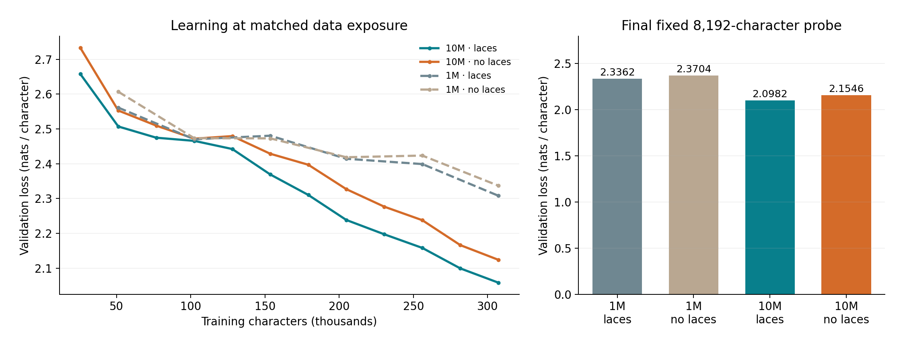
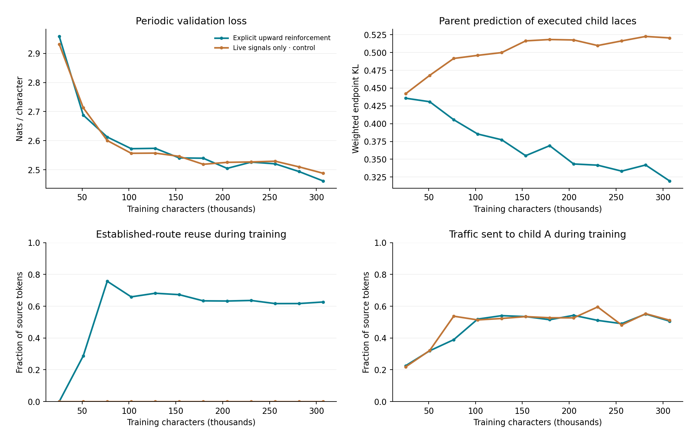
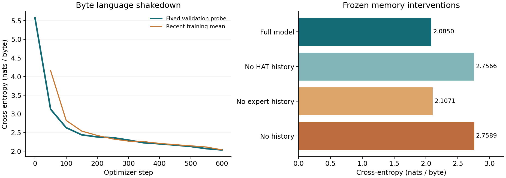

# Recorded experiments

The repository preserves the November 3, 2026 experiments and their raw protocols, histories, routing counts and unedited samples. Model and training source hashes are recorded in `SOURCE_MANIFEST.json` and the experiment provenance files. The current public package preserves that source unchanged.

## Depth and width

| Model | Parameters | Layers × width | Physical experts | Expert activations per position | Full validation loss | No-lace validation loss |
|---|---:|---|---:|---:|---:|---:|
| Semantic SHoE, 1M | 1,000,732 | 3 × 100 | 1,024 | 48 | 2.336218 | 2.370399 |
| Semantic SHoE, 10M | 10,027,388 | 6 × 180 | 4,096 | 96 | 2.098228 | 2.154563 |



The wider, deeper model reduces validation loss by 0.237991 nats/character at the same training exposure. Its laces improve loss by 0.056336 relative to the separately trained no-lace control. The 10M pair has matching initialization and minibatch hashes. The larger model uses more computation; this comparison holds exposure, not compute, fixed.

The 10M bank has 8,847,360 expert weights and activates 207,360 of them per token across six layers. Shared projections, routing and optimizer work are additional. The measured diagnostic exercised 4,010 of 4,096 physical experts and 204 of 256 laces.

Raw records: [1M full](../experiments/semantic_1m/results/demo/summary.json), [1M control](../experiments/semantic_1m/results/no_lace/summary.json), [10M comparison](../experiments/semantic_10m/comparison.json), [10M protocol](../experiments/semantic_10m/results/full/protocol.json), [frozen endpoint interventions](../experiments/semantic_10m/results/full/endpoint_probes.json).

## Breadth, shared weights and reinforcement

| Measurement | Value |
|---|---:|
| Complete hierarchy parameters | 1,636,784 |
| Unique expert matrix parameters | 1,228,800 |
| Shared / private physical experts | 512 shared + 512 per child |
| Full validation loss | 2.486354 nats/character |
| No-reinforcement control loss | 2.501743 nats/character |
| Average child semantic probes | 1.303223 per event |
| Probe reduction from always probing both | 34.8389% |
| Established-route fraction | 69.6777% |



The loss improvement is small, while routing learns to reuse established paths. Branch traffic remains approximately balanced and the recorded diagnostic uses 1,462 of 1,536 physical experts. This hierarchy changes the context graph: each selected child sees a routed subsequence. It is not a matched baseline against the standalone 1M model.

The control retains live semantic bids and downward priors. It disables explicit executed-lace supervision, utility calibration, route-memory commits and shortcut reuse together. Initialization and minibatch-stream hashes match. Frozen interventions separately disable upward messages, scramble endpoint relationships or force discovery; those measurements describe dependence of a trained model and are not additional trained controls.

Raw records: [comparison](../experiments/two_child/comparison.json), [full protocol](../experiments/two_child/results/full/protocol.json), [full summary](../experiments/two_child/results/full/summary.json), [routing measurements](../experiments/two_child/results/full/routing.json), [control](../experiments/two_child/results/no_reinforcement/summary.json).

## HAT and recurrent context

| Frozen model evaluation | Validation loss, nats/byte |
|---|---:|
| Normal mixed static/live inputs | 2.085045 |
| Static dictionary only | 2.085063 |
| Live link only | 2.080739 |
| HAT history disabled | 2.756625 |
| Child history disabled | 2.107083 |
| Both histories disabled | 2.758905 |



The language run uses the same underlying text and exposure but a 256-byte output alphabet. Its loss is not a matched comparison against the 65-character models. Static and live transport carry the same source bytes and task targets; the input address differs. The large HAT-history effect shows that the learned interface uses prior context in this run. The child-history contribution is smaller on this language check.

The 1,624,588-parameter model carries 8,208 bytes of state per sequence with one active link, or 22,600 with all eight configured links. These are recurrent matrices and clocks, excluding weights, current payloads and training storage. Streaming 513 addressed events in uneven chunks matches full-call logits within a maximum absolute error of 0.000044823. Checkpoint continuation is bit-exact in the recorded check.

### Addressed delayed recall

Each episode writes to two links × two slots, supplies eight distractor events, then queries a source and slot using the same query byte. Both checks train for 500 steps with batch size 32 and evaluate 512 fresh held-out episodes. Chance accuracy is 12.5%.

| Evaluation | HAT + small readout | Isolated child memory |
|---|---:|---:|
| Normal | 100.00% | 39.45% |
| History disabled | 12.89% | 12.11% |
| Source identity removed | 52.15% | 33.79% |
| Slot identity removed | 37.11% | 30.47% |

The child-memory arm disables HAT history and forces child 0, so stored information must come from its recurrent expert blocks. It learns useful recall but does not solve the task at this budget. All removals are frozen interventions.

Raw records: [language protocol](../experiments/hat_minkron/results/language/protocol.json), [language summary](../experiments/hat_minkron/results/language/summary.json), [HAT recall](../experiments/hat_minkron/results/learning/hat/summary.json), [child recall](../experiments/hat_minkron/results/learning/expert/summary.json), [trained streaming checks](../experiments/hat_minkron/results/delivery_checks.json).

## Reproduction

The four language experiments use the same Tiny Shakespeare bytes, SHA-256 `86c4e6aa9db7c042ec79f339dcb96d42b0075e16b8fc2e86bf0ca57e2dc565ed`. The contiguous split is 90% training, 5% validation, 5% untouched test. Character vocabularies are fitted on the training partition; HAT has a fixed byte alphabet. Final probes contain 8,192 sampled presentations; windows may overlap.

Run `python scripts/prepare_data.py` once from the repository root. Then run each block from its indicated experiment directory:

```bash
# experiments/semantic_1m
python train.py --steps 600 --threads 2 --out results/demo
python train.py --steps 600 --threads 2 --no-lace --out results/no_lace

# experiments/semantic_10m
python train.py --scale 10m --steps 600 --threads 2 --eval-every 50 --out results/full
python train.py --scale 10m --steps 600 --threads 2 --eval-every 50 --no-lace --out results/no_lace
python probe_endpoints.py

# experiments/two_child
python train.py --steps 600 --threads 2 --out results/full
python train.py --steps 600 --threads 2 --no-reinforcement --out results/no_reinforcement

# experiments/hat_minkron
python train.py --steps 600 --threads 2 --out results/language
python learning_checks.py --steps 500 --threads 2
python check_delivery.py
```

AdamW uses betas (0.9, 0.95), peak learning rate 0.002, gradient clipping at 1, warmup, a plateau and cooldown. Each `protocol.json` records the exact schedule, parameter treatment, seed, configuration and evaluation procedure. The trainers start fresh runs; they do not expose a resume flag. Checkpoints include optimizer state, but are generated locally rather than stored in git.

Timing and memory measurements describe the original CPU executions; some comparison runs overlapped. They are not isolated throughput benchmarks. The repository's correctness suites can run without data or trained weights.

## SHoEbox integrated capability training

From the selected second-lookup parent, a joint trainer now updates composition,
delayed correction and shared/private objectives on the same seven-node graph.
The matched 100-update comparison uses identical weights, AdamW moments, RNGs,
samples, streams and 9,084,288 expert executions per arm.

| Held-out composition | Accuracy |
|---|---:|
| Baseline, 100 updates | 94.43% |
| Per-task gradient cap, 100 updates | 99.83% |
| Baseline, 200 updates; validation-selected integrated candidate | 97.97% |

The balanced model retains all composition validation gates at both updates 50
and 100. Neither run learns reliable memory/correction or shared/private fact
recovery; M7 remains open. Inference keeps the existing 252,478 parameters,
384 physical experts and common 256-byte head. All 349 tests pass, alongside
training, selection, export and raw-prediction audits.

See the [integrated report](SHoEbox_Integrated_Report.md),
[declared protocol](SHoEbox_Integrated_Protocol.md) and
[raw results](../experiments/text_regions/results/integrated/README.md).

## SHoEbox complete-episode gradient horizon

Two matched 32-update continuations start from the regional-facts control at
update 100. Both train on the same 2,048 composition cases, 512 complete
correction episodes and 512 complete fact episodes. Their only paired
difference is detaching carried state every 16 events or retaining gradients
through the full episode. Query and local losses use whole-episode means in
both arms; each executes 6,561,792 experts.

| Held-out capability | Truncated | Full horizon |
|---|---:|---:|
| Composition, K=2 | 98.82% | 100.00% |
| Recall, gap 16 | 39.26% | 38.09% |
| Correction, gap 16 | 39.26% | 29.69% |
| Shared fact | 30.47% | 34.57% |
| Left-private fact | 26.76% | 29.30% |
| Right-private fact | 29.69% | 27.54% |

Validation selects the full-horizon update-32 checkpoint. Neither arm reaches
the integrated memory/fact targets, so M7 remains open. The inference graph
is unchanged. Composition uses all 592 held-out cases; stream conditions use
512 episodes each. Audits reconstruct training batches, verify equal budgets,
recompute 76 scored prediction groups and check exact inference exports.

See the [report](SHoEbox_Gradient_Horizon_Report.md),
[locked protocol](SHoEbox_Gradient_Horizon_Protocol.md), and
[raw results](../experiments/text_regions/results/gradient_horizon/README.md).

## SHoEbox joint natural text and retained memory

Three parent/data pairs complete 160 joint optimizer updates in the unchanged
510,958-parameter, eleven-node graph. Each sees 20,480 natural-text bytes and
2,560 fresh memory episodes. Text and structured queries share one decoder.

| Run seed | Selected update | Test text nats/byte | Weakest primary memory score |
| --- | ---: | ---: | ---: |
| 20261310 | 40 | 7.8371 | 90.82% |
| 20261311 | 40 | 8.5279 | 87.70% |
| 20261312 | 80 | 8.0587 | 91.99% |

The joint target is not met: all selected models miss the text threshold of
4 nats/byte, and one misses the 90% memory threshold. The separate final-weight
diagnostic reaches 3.4657 nats/byte and at least 96.09% on the five memory tasks
for pair 20261311. A post-test validation check expands that pair's weakest
condition from 64 to 512 episodes: its minimum rises from 87.50% to 95.90%,
with the original answers identical across batch sizes. Selection remains
unchanged. The full three-pair results and validation trajectories are in the
report. M7 remains open; broader retention validation and more reliable joint
learning are the next targets.

The byte-stream interface is implemented, with exact continuation of graph
state, logits and sampling RNG. Text leaves the independent memory owners
inactive. All 408 regression checks pass. The artifact package retains the
selected and final weights, complete training histories, predictions and audits.

See the [report](SHoEbox_Joint_Text_Report.md),
[locked protocol](SHoEbox_Joint_Text_Protocol.md), and
[portable results](../experiments/text_regions/results/joint_text/README.md).
