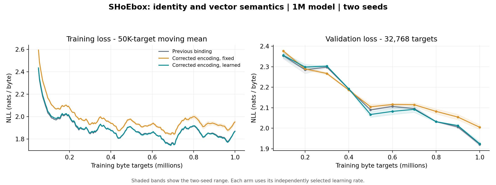

# SHoEbox: consistent identity and vector semantics

12 November 2026 | Second repair from the principled code audit | 1M-model study

## Result

The identity/vector mismatch is repaired on top of the multi-source binding implementation. Required structural distinctions now enter the content vector used by routing and local teaching, including L2's previously missing geometry and receiving-region distinctions. Exact structural IDs remain separate from learned semantic vectors and neural context.

**62 checks pass**, including the previous 35 checks, the binding suite against the new kernel, new semantic and gradient checks, and explicit checkpoint conversion. AddressSanitizer and UndefinedBehaviorSanitizer pass.

The learned version has **1,031,936 neural coefficients**, including 8,192 new semantic coefficients: **0.80% more** than the 1,023,744-parameter binding model. Each comparison model received one million training byte targets, using two seeds. The repaired learned model lowers mean reserved-test NLL by 0.012743 nats/byte (0.65%).

Same-core median training throughput is **6,218 bytes/s before and 5,284 bytes/s after**, or **15.0% lower throughput**. The corrected fixed-encoding control is measured separately below.

## Representation contract

| Object | Meaning and permitted changes |
| --- | --- |
| Exact content ID | 128-bit structural key. Includes receiving region, composition kind, ordered child IDs, source/recipe roles, present roles, relative starts and durations. Excludes absolute alignment, occurrence serial, expert choice and contextual activity. Byte atoms share the byte vocabulary; source distinctions enter compound roles. |
| Structural descriptor | Deterministic composition of children's immutable descriptors, plus an anchor derived from both halves of the compound ID. It carries role/geometry/namespace distinctions into the neural interface. |
| Semantic vector | Structural descriptor plus a learned bounded residual for that region. Learning may change this vector while keeping the exact ID fixed. |
| Neural context | The expert's recurrent, context-sensitive publication. It remains separate from content identity and descriptor. |

The local symbol is the exact content ID, not an expert number, a dictionary bucket, or an occurrence index. Count-table eviction therefore cannot reassign a symbol's vector. Parents build their own descriptors from immutable child descriptors, so a held child embedding from an earlier weight revision does not unpredictably change a parent's content code. Learned semantic adaptation belongs to each receiving region; learned neural publications continue to travel through the separate contextual path.

The learned code is a compact shared function of a local symbol's descriptor. It is not an unbounded per-symbol embedding table. Eight fixed signed projections yield eight bounded features. A regional 64-by-8 matrix maps these features into a residual bounded to +/-0.25 per coordinate. There are sixteen such matrices, for L2 through Y. They start at zero.

The exact ID remains the equality authority. A 64-dimensional similarity vector is not used as a collision-free identifier. The full-ID anchor makes required structural changes visible in the tested neural interface; learned residuals do not rewrite IDs or recognition counters.

## What was corrected

L2 now encodes constituent duration and source role in its ID, and carries the complete identity distinctions into its vector. A singleton still forwards its child's ID and vector. Mixed-source regions retain the declared slot positions and add the source namespace explicitly to the structural key. Their vectors now include an anchor for the completed compound ID, which covers the receiver namespace and present-role mask as well as the constituent fields.

This keeps identity, descriptor, semantic embedding and contextual response as separate concepts. Semantic learning does not use an expert's context-sensitive output as the symbol itself.

The following controlled probes use the same two child contents. Each cell shows **ID changed? / vector L2 distance**. The previous implementation's vector stayed exactly unchanged for every listed structural distinction.

| Controlled change | Previous binding | Repaired semantics |
| --- | ---: | ---: |
| Relative start: 1 to 7 | Yes / 0.0000 | Yes / 1.0240 |
| Second-child duration: 1 to 4 | No / 0.0000 | Yes / 1.1024 |
| Second-child source role | No / 0.0000 | Yes / 1.0308 |
| Receiving-region namespace | Yes / 0.0000 | Yes / 1.1087 |
| Absolute offset: +7,000 | No / 0.0000 | No / 0.0000 |

The inherited binding checks additionally exercise every immediate constituent slot in all fifteen mixed-source regions, absent inputs without role renumbering, and genuine older/newer occurrences.

## Semantic learning and saved provenance

Semantic matrices learn from local prediction and task/downstream credit entering a region's neural input, including retained-input credit. The update retains the publication's eight features, residual derivative, input scaling, tick and eligibility index. A later event cannot substitute its own embedding features for that saved producer.

The semantic residual is an input-side learned transform. It receives the saved expert-input Jacobian with the selected expert/gate held fixed; it does not differentiate hard routing decisions or turn this runtime into full backpropagation through time. The future-content target is read as a detached observed target. There is no update that moves the arriving target toward the prediction merely to reduce the error.

Finite differences verify the semantic-matrix derivative. Behavioral checks verify a loss-reducing semantic update with unchanged ID, preservation of saved features across later occurrences, unchanged parameters during evaluation, frozen-region behavior, and exact save/load/chunk continuation. Router cues and the local teacher's content input share the same content vector; the existing Y prefix-byte addition and normalization remain explicit.

Singleton cancellation of outstanding teaching and recognition status is still the next repair in the agreed sequence. This patch retains that behavior and does not claim to have repaired relay teaching.

## Matched language experiment

All three arms use the same Tiny Shakespeare byte stream, width 64, twelve experts per region, initial expert parameters, fixed transports and train/validation/test split. Each arm was screened on seed 3 at peak rates 0.02, 0.04 and 0.08 for 100,000 targets. Selection uses only 32,768 validation targets.

Selected peaks: previous binding **0.08**, corrected fixed encoding **0.04**, and corrected learned encoding **0.08**. Rates follow cosine decay to one tenth of the selected peak by one million targets. Local rate is one third of main; prototype rate is 0.002. Seeds 1 and 2 were then trained from fresh initialization for each arm.

The primary endpoint is the remaining **78,771 reserved-test targets**, evaluated from a fresh stream. As in the prior binding study, evaluation starts with cold episodic memory and permits causal memory admission from the observed test prefix. Neural weights, semantic coefficients and composition dictionaries stay frozen. The fixed-encoding arm holds the 8,192 semantic coefficients at zero throughout training.

| Seed | Previous binding NLL | Corrected fixed NLL | Corrected learned NLL |
| --- | ---: | ---: | ---: |
| 1 | 1.947177 | 2.037362 | 1.951143 |
| 2 | 1.971367 | 2.010167 | 1.941915 |
| Mean | 1.959272 | 2.023765 | 1.946529 |

The fixed and learned arms use independently selected rates, so their difference includes rate selection. The frozen intervention below isolates dependence on the learned semantic residual within each trained learned model.



## Learned residual contribution

Each learned checkpoint is evaluated with its semantic residual intact and then with all semantic matrices zeroed in a fresh evaluation copy. IDs, descriptors, dictionaries, expert weights and the evaluation protocol are retained. The intact pass reproduces the study's reserved-test loss to numerical precision. Positive changes mean that removing the residual worsens loss.

| Seed | Intact test NLL | Zero residual test NLL | Change |
| --- | ---: | ---: | ---: |
| 1 | 1.951143 | 2.016330 | +0.065187 |
| 2 | 1.941915 | 2.001391 | +0.059476 |

This intervention measures dependence on the learned residual after training, while the fixed-encoding arm measures retraining without it. Regional neural-publication contribution checks remain a separate later step after the relay repair.

Selected seed-1 semantic learning diagnostics:

| Region | Semantic update calls | Learned matrix L2 norm |
| --- | ---: | ---: |
| L2 | 641,998 | 0.078380 |
| L3 | 10,269,685 | 4.724133 |
| E4 | 2,249,986 | 3.419747 |
| V4 | 1,249,992 | 2.572980 |
| G5 | 4,249,969 | 3.402603 |
| EC-C | 7,999,971 | 1.326265 |
| EC-X | 3,999,979 | 0.061554 |
| Y | 4,249,990 | 8.494231 |

## Throughput and state cost

Timing uses one pinned CPU core, six trials per arm in alternating order, 1,024 warmup targets and 16,384 timed targets per trial, after the training workers have exited. It includes forward execution, routing, dictionaries, episodic admission and neural learning. Compilation, snapshot creation, checkpoint writes and evaluation are excluded.

| Implementation | Median training bytes/s | Projected seconds per million |
| --- | ---: | ---: |
| Previous binding | 6,218 | 160.8 |
| Corrected encoding, fixed | 6,265 | 159.6 |
| Corrected encoding, learned | 5,284 | 189.3 |

Composition state grows from **3,103,240 to 3,317,000 bytes**, an increase of **213,760 bytes**. That includes immutable descriptors, saved semantic eligibility and 32,768 bytes of learned coefficients. The learned arm also computes input Jacobians for semantic credit; the timing measures that cost. These comparisons match training targets, not elapsed compute.

## Delivery and continuation

The package contains the full runtime, six trained checkpoints, exact data, tests, raw training records, rate selection, intervention evidence and report-generation scripts. The previous binding kernel remains available for reproduction.

```
model = fresh_model(kernel="semantics")
model = Model.load("results/full_semantics_seed1/last.npz")
```

Semantic checkpoints use **version 30 / composition ABI 4**. Save/load is exact for the new kernel. The loader rejects a version-29 binding composition blob rather than reinterpreting it. To reuse old neural weights, `src/convert_to_semantics.py` explicitly creates a new checkpoint with fresh semantic matrices, dictionaries, working context, eligibility, preprocessing means and episodic associations. That operation is a weight conversion, not exact continuation.

```
python -m unittest discover -s tests -v
python tests/run_semantics_sanitizer.py
python src/run_semantics_study.py pilots
python src/run_semantics_study.py full
python src/encoding_probe.py
python src/semantic_contribution.py
python src/semantics_performance.py
```

Source provenance: the recovered binding package's 49 recorded source/configuration hashes all match. Its ancestor is [SHoEbox commit 6d06d60](https://github.com/JRowe47/SHoEbox/commit/6d06d60072c3032ac1ce13ceed04ee8f7d89a4cc). This delivery is a tested source package; no GitHub publication is included in this step.
