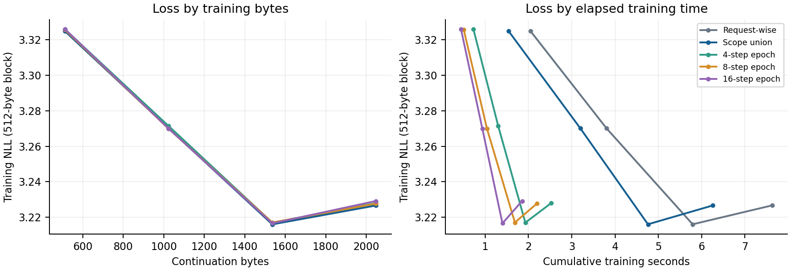

# SHoEbox: structural optimization stage 4

13 November 2026 (America/Denver) | Baseline: `961a18320f45ec60359f37d818cd928d202ea01a`

Stage 4 is implemented in the default reference runtime. Compatible teaching roots now share one reverse pass over their union of constituent ancestry. All reference regions, content/context channels, directional teaching and paired episodic memory remain active. Short, explicitly versioned expert-bank epochs are implemented as comparison policies.

## Matched throughput

| Workload | Stage 3 B/s | Stage 4 B/s | Change | Pairs |
| --- | --- | --- | --- | --- |
| 1M repeated, 1,024 bytes | 190.9 | 250.6 | +31.3% | 5 |
| 1M natural, 1,024 bytes | 278.1 | 323.2 | +16.2% | 5 |
| 5M repeated, 1,024 bytes | 138.4 | 165.6 | +19.6% | 3 |
| 1M repeated, 4,096 bytes | 96.5 | 147.6 | +53.0% | 1 |

Matched continuations start from real stage-3 checkpoints after 1,024 warmup byte targets, with seed 7, width 64, periodic training, LR 0.04 and local LR 0.04/3. One pinned CPU on INTEL(R) XEON(R) PLATINUM 8573C; alternating serial implementations. Timings include full logit export and exclude compilation, checkpoint IO, hashing and route tracing. The natural fixture is the same FineWeb stream used in the previous review. The 4,096-byte row contains one pair.

## Numerical comparison

| Workload | Max logit drift | NLL delta | Route differences | Top-byte differences |
| --- | --- | --- | --- | --- |
| 1M repeated, 1,024 bytes | 2.86e-06 | +1.61e-09 | 0 | 0 |
| 1M natural, 1,024 bytes | 3.81e-06 | -3.89e-09 | 0 | 0 |
| 5M repeated, 1,024 bytes | 2.86e-06 | -2.01e-09 | 0 | 0 |
| 1M repeated, 4,096 bytes | 4.77e-06 | +4.96e-09 | 0 | 0 |

Across 129,024 traced regional decisions, there were 0 expert and 0 mask disagreements, and 0 top-byte disagreements. Maximum logit drift was 4.77e-06; absolute NLL differences stayed below 5e-9. No content-coordinate or router-step clipping fired in these matched continuations or in the epoch sweep. Each implementation was deterministic across repeats; all timed continuations passed credit-integrity checks.

## Fixed bank-version epochs

The epoch comparison restores one 1M request-wise checkpoint after 1,024 FineWeb warmup targets, then trains another 2,048 bytes. Validation uses 1,024 targets from a separate FineWeb split with cold, frozen episodic memory. Each policy/scale has one measured continuation. Sweep timings exclude full logit export, held-out evaluation and generation; they are separate from the matched table above. The update-scale sweep changes constituent credit strength only; other learning rates stay fixed.

| Policy, 1x scale | B/s | Training NLL | Held-out NLL | Content VJPs |
| --- | --- | --- | --- | --- |
| Request-wise | 268.6 | 3.259442 | 3.206878 | 2,422,165 |
| Scope union | 327.2 | 3.259442 | 3.206878 | 1,216,574 |
| 4-step epoch | 811.5 | 3.260552 | 3.207250 | 267,990 |
| 8-step epoch | 933.2 | 3.260065 | 3.207578 | 162,619 |
| 16-step epoch | 1,104.3 | 3.260434 | 3.207904 | 97,706 |

Scope union at 1x reduced content VJPs by 49.8% and matched the request-wise held-out loss to 3e-9. The 16-step policy at 1x reduced VJPs by 96.0% and reached 1,104 B/s (4.11x the sweep control), with held-out NLL higher by 0.001026. Scope union at 1x remains the default because it retains the existing update boundaries and magnitude. The short sweep makes 4/8/16-step epochs available for longer quality comparisons; it does not change the default to an epoch schedule.

### Reverse update-scale sweep

| Policy | Held-out at 0.5x | Held-out at 1x | Held-out at 2x |
| --- | --- | --- | --- |
| Scope | 3.206888 | 3.206878 | 3.206752 |
| 4 steps | 3.207278 | 3.207250 | 3.207289 |
| 8 steps | 3.207583 | 3.207578 | 3.207689 |
| 16 steps | 3.207894 | 3.207904 | 3.207997 |



Block training NLL; one continuation per policy; all plotted policies use scale 1x.

## Implementation

- Union execution: group roots by teaching objective and complete regional teaching-scale vector. Fold each signed learning rate into the incoming adjoint, normalize by the sum of absolute rates, visit unique nodes in reverse creation order, and restore the rate mass at each parameter update. Frozen recipients still transmit derivatives. Singleton groups use the original arithmetic path.

- Learning policy 2: content-coordinate clipping applies to the group mean, while router clipping and normalization apply to the combined nonzero step. A cancelled router group performs no normalization. Linear adjoints and unclipped update factors combine algebraically, but this is an explicit learning rule, not a promise of request-wise clipping equivalence. Policy 1 remains available as the request-wise comparator.

- Mutation order: scope-level semantic VJPs finish before shared expert weights can change. Existing neural updates then run, followed by the existing content-bank commit. Exact source roles, masks, gates, receiver scales and content-expert eligibility remain in use. No ancestry depth or credit budget is shortened.

- Epoch scope: 4/8/16-step modes freeze reads of shared expert W, bias and router banks, accumulate neural bank writes in the original arrays, and queue constituent roots until the boundary. The decoder, predictors, learned bottom-state parameters, dictionaries and recurrent state stay online. These are expert-bank epochs, not whole-model frozen minibatches.

- Persistence: checkpoint v40 saves the learning policy, bank version, epoch position, bank snapshot and pending roots. Queued roots retain their ancestry during collection. Save/load and snapshot copies never force an epoch boundary; evaluation uses the visible bank version. Document draining and context reset finish pending teaching. A bank snapshot uses 3.48 MiB at 1M or 18.56 MiB at 5M, plus variable pending-root storage.

- Compatibility and diagnostics: v39 and earlier completion checkpoints load with request-wise learning. Existing constituent ABI 10 and content/neural ABI 1 remain unchanged. Old runtimes reject the new wrapper version. Visit and semantic norm counters describe executed union work; missing-producer counters continue to identify unresolved dependencies.

## Validation and compatibility

249 full-suite regressions passed, plus three targeted 5M checks for mixed policies/frozen regions, partial-epoch checkpoint continuation and visible evaluation weights. Eight focused 1M tests are included in the full-suite total. The scalar oracle verifies the unclipped union against request-wise updates and separately checks the changed clipping rule. ASan/UBSan passed with full reference training, document draining, all three epoch lengths, malformed-state rejection, queued-root ownership and live DAG growth beyond 16,384 records. Leak scanning is disabled on this host.

A real stage-3 checkpoint resumed under policy 1 with bitwise-identical logits, parameters, composition state, content routing, route traces and complete state fingerprint. Same-runtime irregular chunks, partial-epoch save/load and snapshot copies also passed bitwise continuation checks. The 28 matched timed continuations and all 13 sweep continuations passed credit integrity. No checkpoints, datasets or compiled binaries are included in Git or the change bundle.

## Generation examples

Same prompt, seed 17, temperature 0.8, 64 sampled bytes, ASCII plus newline; after the 2,048-byte continuation.

Request-wise:

````text
The river t nh-R`ar dn {t nn baimitqb hs.xk%lle olng t gaenioit ni e e eei
````

Scope union:

````text
The river t nh-R`ar dn {t nn baimitqb hs.xk%lle olng t gaenioit ni e e eei
````

4-step epoch:

````text
The river t nh.Ldip en {t nn baimitre gt%yf ooidmiol t haeiioer ni e e eei
````

8-step epoch:

````text
The river t nh-R`ar dn {t nn baimitqb hs.xl poidnfii t haelipit ni e e eei
````

16-step epoch:

````text
The river t nh-Sbio en {t nn bainhtpd hs wianle olni t haeiiogs ni e e eei
````

## Reproduction

Run src/compare_union_reverse.py against stage-3 runtime 961a183; add --corpus for natural text and SHOEBOX_EXPERTS=64 for the 5M case. Run src/sweep_union_epochs.py with separate --corpus and --validation paths, then src/check_union_compatibility.py. Raw results are results/stage4_*.json; validation logs are beside them. Rebuild this report with src/report_union_reverse.py.

## Remaining updates

| Stage | Update | Work remaining |
| --- | --- | --- |
| 5 | Native small-head MinKron and local event learning | Implement one/two small context heads, an exact active learning frontier, directional delayed credit and targeted replay. Preserve exact occurrence IDs and paired hippocampal episodes. |
| 6 | Persistent versioned forward/learning workers | Overlap previous-event learning with current forward work and fuse compatible bank reads/updates. Compare against the same serial update schedule. |

Stage 4 removes repeated derivative work while keeping the full hierarchy. Stage 5 is next and remains the main change aimed at 15,000+ bytes/s: make learning cost follow active new events rather than repeatedly revisited ancestry.
