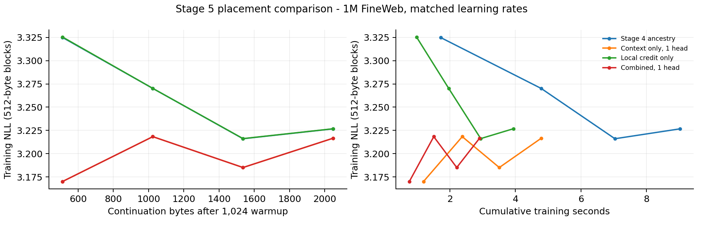

# SHoEbox: structural optimization stage 5

13 November 2026 (America/Denver) | Baseline: `4d2410ba0db3f87ea9ed565c6306fc5e49f6ba84`

Stage 5 is implemented as the event-v1 learning profile: native one/two-head MinKron context, an exact local frontier, directional delayed credit, and bounded targeted local replay. All 18 regions, learned constituent identities and paired EC episodes remain. Use fresh_model(profile="event"). The existing default keeps stage 4 full-ancestry learning; old checkpoints retain their saved policy.

## Matched throughput

| Workload | Stage 4 B/s | Stage 5 B/s | Speedup | Pairs |
| --- | --- | --- | --- | --- |
| 1M repeated, 1,024 bytes | 242.3 | 942.7 | 3.89x | 3 |
| 1M FineWeb, 1,024 bytes | 321.8 | 723.2 | 2.25x | 3 |
| 5M repeated, 1,024 bytes | 159.5 | 892.1 | 5.59x | 3 |
| 1M repeated, 4,096 bytes | 152.8 | 732.2 | 4.79x | 1 |

One pinned CPU on INTEL(R) XEON(R) PLATINUM 8573C; one training stream and one worker. Seed 7, width 64, periodic training, LR 0.04, local LR 0.04/3. Both policies start from the same base initialization and receive their own 1,024-byte warmup. Pairs alternate execution order and include full logit export. Timing excludes compilation, warmup, evaluation, serialization and generation. The final timing suite ran after the regression jobs finished. These are different learning contracts, not numerical-parity continuations.

At matched learning rates, the combined one-head policy removes 80.0% of content VJPs in the FineWeb placement comparison. Its held-out NLL is 3.187151, versus 3.206878 for stage 4 (-0.019727). The measured speeds remain below 15,000 bytes/s.

## Placement and learning

The isolated placement comparison trains 2,048 targets after 1,024 warmup targets and evaluates 1,024 targets from the separate FineWeb validation split. Cold frozen episodic memory is used for validation. One run per placement; full logit export is off. This table is separate from the paired throughput measurements. Curves show 512-byte block training NLL.

| Placement, 1x LR | B/s | Held-out NLL | Content VJPs |
| --- | --- | --- | --- |
| Stage 4 ancestry | 226.9 | 3.206878 | 1,216,574 |
| Context only, 1 head | 427.6 | 3.187156 | 832,069 |
| Context only, 2 heads | 415.9 | 3.186867 | 832,069 |
| Local credit only | 520.4 | 3.206883 | 373,441 |
| Combined, 1 head | 705.1 | 3.187151 | 243,736 |
| Combined, 2 heads | 703.6 | 3.186873 | 243,736 |



### Learning-rate sweep

The learning-rate sweep repeats the same 3,072-byte training prefix. Both main and local learning rates are multiplied by 0.5, 1 or 2; the directional predictor uses its fixed 0.05 update rate. Each cell is one seed/run. All policies improve with the larger rate in this short test. Sweep timings overlapped correctness work and are not used for throughput claims; the isolated placement and paired results above supply those timings.

| Policy | Held-out at 0.5x | Held-out at 1x | Held-out at 2x |
| --- | --- | --- | --- |
| Stage 4 | 3.360821 | 3.206878 | 3.124027 |
| Local credit | 3.360801 | 3.206883 | 3.123658 |
| Combined, 1 head | 3.305046 | 3.187151 | 3.106725 |
| Combined, 2 heads | 3.304836 | 3.186873 | 3.106288 |

## Implementation

### MinKron context

Upper regions reuse signed partitions of their 64 input features to make eight-dimensional keys and values. Each head reads its prior 8 x 8 state, then applies a decay-0.98, normalized delta write with gain 0.5. A learned 64 x 8 or 64 x 16 readout replaces the second dense neural expert transform. Saved local read/input derivatives are exact; the fixed memory recurrence has no backward temporal tape. The one-head profile adds 25,600 active fitted parameters (1,057,552 total in the 1M configuration).

### Content and context separation

Canonical content retains its own learned dense expert, routing, structural ID, role/order bookkeeping and completion. The context lane reuses the content expert identity for diagnostics, removes the old upper input EMA, and does not run a second feedback-conditioned router. Feedback still enters the context input. Capabilities explicitly report the replaced EMA derivative and neural feedback routing as inactive.

### Exact frontier and directional credit

The exact reverse frontier follows the latest four constituent encodes per region. Direct held/pending owners keep their local eligibility. Every older edge keeps immutable occurrence/role metadata plus an eight-dimensional saved content key. Its actual 64-component teacher trains a separate task or local credit predictor. New constituent encodes receive one predicted local update per objective at 0.1 of that objective rate. Predicted updates never train their own predictor. This replaces historical derivatives with learned interface credit; it does not declare them exact.

### Targeted replay and consolidation

One priority slot per region/objective keeps the hardest available old local record. Two records at most are replayed per byte, at 0.25 of the incoming credit rate. Replay differentiates that local record exactly and teaches its child interfaces; it does not replay an entire old DAG. Displaced candidates have already taught the predictor. Collection releases old detailed ancestry while retaining live owners and compact edge keys.

### Persistence and execution

Version 41 includes context state and eligibility, predictor weights, frontier keys and pending replay. Save/load and snapshots preserve the queue; document drain retires it. Changing policy requires an empty/reset context and preserves fitted event parameters. Stage 5 currently uses serial scope-union updates; bank epochs are rejected until their interaction is defined in stage 6.

## Coverage and memory

In the 4,096-byte repeated continuation, stage 5 executed 387,769 exact content-node visits, delivered 173,214 task and 641,729 local boundary teachers, and applied 8,192 exact local replays. It consolidated 18,445 old detailed records. Missing-event/producer counters stayed zero. Separate short coverage tests require task learning in every upper region, and frozen interventions verify decoder effects from L3, E4, V4, G5, EC-C, EC-X and Y.

For the 3,072-byte FineWeb run, serialized content-expert eligibility is 6.53 MiB (stage 4: 7.50 MiB), plus 6.75 MiB of event-profile state. The existing composition slab is unchanged. This short run does not establish lower total memory use: the new compact keys/context eligibility add storage. A forced chain beyond 16,384 nodes stays within the initial slab in the event policy, while the ancestry comparator retains its growth behavior.

## Validation and compatibility

260 full-suite regressions passed, plus three final targeted 1M checks, twelve 5M event checks and two final targeted 5M checks. Validation covers numerical MinKron VJPs, content/context independence, causal evaluation, all-region task coverage, frozen contribution effects, replay budget, malformed extension rejection, exact irregular chunks, save/load, snapshots and document boundaries. Both 1M and 5M also passed an 8,192-byte real-stream consolidation and exact continuation check. ASan/UBSan passed training, drain, reset, import/export, stage-4 epochs and both growing/reference and consolidating/event DAGs; leak scanning was disabled.

A real stage-4 v40 checkpoint from base 4d2410ba0db3f87ea9ed565c6306fc5e49f6ba84 resumed with bitwise-identical logits, fitted parameters and complete state fingerprint over 1,024 continuation targets. New event checkpoints use v41; no existing checkpoint is silently migrated.

## Generation examples

Prompt: “The river ”; seed 17, temperature 0.8; 64 sampled bytes restricted to ASCII plus newline. After 3,072 training bytes.

Stage 4 ancestry:

````text
The river t nh-R`ar dn {t nn baimitqb hs.xk%lle olng t gaenioit ni e e eei
````

Combined, 1 head:

````text
The river t ne iino en yt nn caingtoa itcxl,ing olnh t e.aniohs ni e e eel
````

Combined, 2 heads:

````text
The river t ne iino en yt nn caingtoa itcxl+eeaFleii t haeiloit ni e e eei
````

## Reproduction

Run src/measure_event_learning.py with --suite sweep, --suite placement, or --suite paired. Supply --corpus and --validation for FineWeb; use SHOEBOX_EXPERTS=64 for 5M. Run src/check_event_compatibility.py against the stage-4 runtime. Run unittest discovery for tests/test_event_learning.py and tests/run_completion_sanitizer.py. Raw results and validation logs are results/stage5_*. Rebuild this report with src/report_event_learning.py. The code bundle excludes datasets, trained checkpoints and compiled binaries.

## Remaining updates

| Stage | Update | Work remaining |
| --- | --- | --- |
| 6 | Persistent versioned forward/learning workers | Define one serial delayed-update schedule, then implement persistent workers and ordered bank versions; compare identical semantics with one and two workers. |
| 6 | Fuse bank reads and updates | Combine compatible prior-event updates and next forward reads after the new workload is profiled. Measure synchronization, readout and record-management costs. |
| Follow-up | Qualify the event profile at scale | Longer 1M/5M learning and stability comparisons, then 100M scaling and event-rate/budget tuning. Track bytes/s, held-out loss and total memory toward 15k. |

At matched learning rates, the combined one-head policy removes 80.0% of content VJPs in the FineWeb placement comparison. Its held-out NLL is 3.187151, versus 3.206878 for stage 4 (-0.019727). The measured speeds remain below 15,000 bytes/s.
