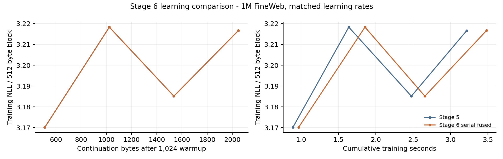

# SHoEbox: structural optimization stage 6

13 November 2026 (America/Denver) | Baseline: `fd3edf42819b880b6cf10fdb0fdde576c474d98a`

Stage 6 implements a persistent content-bank learning worker, a serial oracle for the same one-byte-delayed update schedule, ordered sparse bank versions, fused update kernels and fused weight installation/forward reads. All 18 regions and stage-5 event learning remain. Use fresh_model(profile="pipeline"); pipeline_workers=2 adds the learning thread. The default pipeline execution is serial with fusion.

## Matched throughput

| Workload / continuation bytes | Stage 5 B/s | Serial unfused | Serial fused | Two workers |
| --- | --- | --- | --- | --- |
| 1M repeated / 1,024 | 922.6 | 824.3 | 829.2 | 839.4 |
| 1M FineWeb / 1,024 | 703.0 | 620.4 | 625.7 | 627.0 |
| 5M repeated / 1,024 | 869.9 | 722.2 | 716.9 | 697.2 |
| 1M repeated / 4,096 | 741.9 | 613.5 | 657.3 | 641.4 |

One stream on an Intel Xeon Platinum 8573C. The caller is pinned to CPU 0; the two-worker case pins its learning thread to CPU 1, a separate reported core. Seed 7, width 64, periodic mode, LR 0.04 and local LR 0.04/3. Each policy receives its own 1,024-byte warmup. Results are medians of three rotated-order runs, except the 4,096-byte continuation (one run per variant). Full logit export and API quiescence are timed; compilation, warmup, evaluation, IO and generation are excluded. Timing suites run without concurrent validation jobs. Stage 5 and Stage 6 use different update schedules; the three Stage 6 execution variants are bitwise identical.

Stage 5 remains faster on all three paired workloads; retain it for current throughput. Two-worker Stage 6 delivers 0.80x to 0.91x Stage 5 throughput. Two workers deliver 0.97x to 1.01x the fused serial throughput across the three repeated comparisons. The fastest measured median is 922.6 bytes/s. The 15,000 bytes/s target remains unmet. Worker execution is available for measurement; the measured serial and two-worker results determine its value for each workload.

## Versioned schedule

| Boundary | Behavior |
| --- | --- |
| During byte t | Forward and content adjoints read the committed content-bank version. The worker processes factors captured during byte t-1. |
| End of byte t | Join the prior job, expose its ordered bank result, then snapshot only banks touched by the current factors and submit the next job. |
| Next forward read | A committed weight row can be installed into canonical storage and multiplied by the current input using the same loads. |
| API return / save | Wait for computation, retain its pending result without committing it. Snapshot and checkpoint preserve the exact next boundary. |

The content-bank update is one byte later than immediate stage-5 mutation. Each factor retains its immutable occurrence reference, input, feature mask and post-clipping update vector; local and task objectives are already differentiated before capture. Each batch records the adjoint read version, application base version and submission sequence. Scope order and per-scope router normalization remain explicit. The bank owner writes private tiles. The stream thread owns the model, live records and committed-version changes; worker code holds no pointers into those records.

DAG traversal, content input adjoints, synthetic-credit prediction, MinKron context learning, adapters, bottom banks and readout stay on the caller. This stage overlaps the numerical content-bank update tail with the next byte. Fixed 4/8/16-byte stage-4 epochs remain a separate schedule and cannot be combined with this profile.

### Fusion

The fused kernel forms and applies one update row without materializing a full dense gradient matrix. A second fused path uses the same vector loads to install a committed row and calculate its content forward product. The unfused control uses the same dense arithmetic and scope order, with separate materialization and installation. Per-job tile reservation avoids repeated vector growth. Sparse selected-bank snapshots are used instead of a full model copy.

### Persistence

Checkpoint v42 persists the committed version and the completed-but-uncommitted sparse bank result. Save/load, snapshots and irregular chunks preserve it; worker count, CPU affinity and fusion are execution choices. Document drain, reset and finish_pipeline() are explicit commit boundaries. Evaluation leaves the pending result parked and fitted parameters frozen. Existing v40/v41 policies are preserved; the ordinary default remains the full-ancestry reference.

## Learning comparison

Each policy trains the same 3,072-byte FineWeb prefix, then evaluates 1,024 separate validation bytes with cold frozen episodic memory. Main/local rates both scale by 0.5, 1 or 2; the directional predictor keeps its fixed rate. Each cell is one seed/run.

| Policy | Held-out NLL / 0.5x | 1x | 2x |
| --- | --- | --- | --- |
| Stage 5 | 3.305046 | 3.187151 | 3.106725 |
| Stage 6 | 3.305046 | 3.187151 | 3.106725 |



Stage 5 generation (The river prompt; seed 17, temperature 0.8, 64 ASCII/newline bytes):

````text
The river t ne iino en yt nn caingtoa itcxl,ing olnh t e.aniohs ni e e eel
````

Stage 6 generation (The river prompt; seed 17, temperature 0.8, 64 ASCII/newline bytes):

````text
The river t ne iino en yt nn caingtoa itcxl,ing olnh t e.aniohs ni e e eel
````

## Validation

274 regressions passed, followed by 13 final pipeline checks at 1M and 13 at 5M. Tests cover exact serial/unfused/threaded parity, one-byte and irregular chunks, pending saves, snapshots, worker changes, native training-mode changes, causal evaluation, corrupted-state rejection, all-region task coverage, frozen banks and document boundaries. An 8,192-byte continuation crossed record consolidation and retained exact worker/restart parity. ASan/UBSan passed the extended native lifecycle; leak scanning was disabled.

A real stage-5 v41 checkpoint from fd3edf42819b880b6cf10fdb0fdde576c474d98a resumed for 1,024 targets with bitwise-identical logits, fitted parameters and full-state fingerprint. Stage-6 execution controls also matched full-state fingerprints in every matched throughput comparison.

## Cost attribution

The instrumented serial pipeline samples 61 of 4,096 FineWeb continuation bytes after 1,024 warmup bytes. Categories are exclusive on the caller. The pipeline-boundary category includes serial bank computation, version preparation and commits. The instrumented run matches the uninstrumented logits and complete state; these percentages are attribution, not throughput claims.

| Exclusive category | Sampled time |
| --- | --- |
| other forward | 29.6% |
| pipeline boundary | 22.5% |
| reverse and event | 22.4% |
| record collection | 7.4% |
| content vjp | 6.8% |
| factor capture | 3.8% |
| archive slot | 2.5% |
| decoder head | 1.5% |
| content context forward | 1.2% |
| task other | 1.1% |

## Memory

| Workload | Peak queued payload MiB | Pending state MiB | Process peak RSS MiB |
| --- | --- | --- | --- |
| 1M repeated | 2.99 | 0.48 | 409 |
| 1M FineWeb | 3.03 | 1.48 | 315 |
| 5M repeated | 5.38 | 0.56 | 471 |

Queued payload counts owned factors and bank tiles for the largest submitted job; it excludes allocator overhead and the separate visible version. Pending state is the serialized result at the run end. Peak RSS is the whole process, including evaluation and diagnostic copies, so it is not a training-only resident measurement. Router-only jobs currently carry a full bank tile; compacting those results and reusing job storage are concrete follow-up opportunities.

## Reproduction

Use src/measure_bank_pipeline.py --suite paired (or sweep), with --corpus/--validation for FineWeb and SHOEBOX_EXPERTS=64 for 5M. Run tests/test_bank_pipeline.py, tests/run_completion_sanitizer.py, src/check_pipeline_long.py, src/check_pipeline_compatibility.py and src/profile_bank_pipeline.py. Raw results are results/stage6_*. The code bundle contains the patch, source and evidence; no datasets, models or compiled binaries.

## Remaining updates

The original six implementation stages now have implementations. The remaining work follows from measurement:

| Order | Update | Work remaining |
| --- | --- | --- |
| 1 | Reduce version preparation | Compact router-only versions, reuse queue/tile storage and measure copy/commit cost. |
| 2 | Reduce caller-side learning work | Profile and reduce reverse traversal, local adjoints and record maintenance; retest worker overlap after each reduction. |
| 3 | Qualify learning at scale | Longer paired 1M/5M runs, then 100M; tune learning rates, frontier size, replay budget and event rates with held-out loss and memory. |
| 4 | Recheck the 15k budget | Track single-stream bytes/s and loss per second; keep independent-stream aggregate throughput separate. |

Stage 5 remains faster on all three paired workloads; retain it for current throughput. Two-worker Stage 6 delivers 0.80x to 0.91x Stage 5 throughput. Two workers deliver 0.97x to 1.01x the fused serial throughput across the three repeated comparisons. The fastest measured median is 922.6 bytes/s. The 15,000 bytes/s target remains unmet. Worker execution is available for measurement; the measured serial and two-worker results determine its value for each workload.
