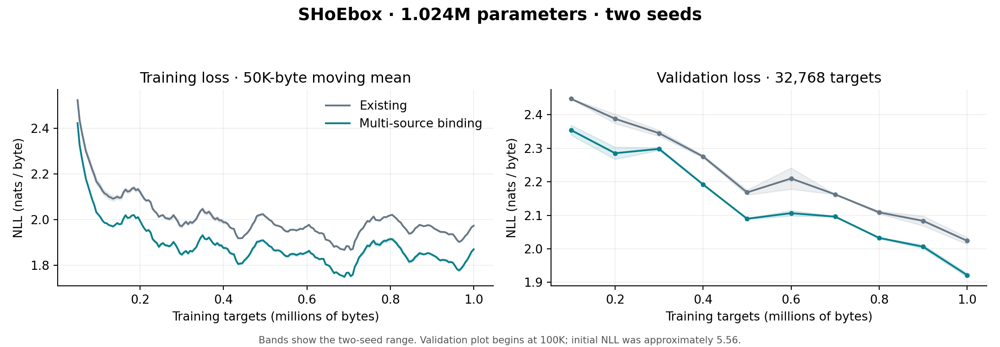

# SHoEbox: multi-source constituent binding

12 November 2026 | First repair from the principled code audit | 1M-model study

## Result

Multi-source binding is implemented and tested on the **1,023,744-parameter** configuration. After one million training byte targets per model, the new implementation reduces mean reserved-test NLL from **2.039970 to 1.959272 nats/byte**, a **3.96% reduction**, across two seeds.

The new message contract passes 16 new checks, the previous 19 checks remain green, and AddressSanitizer/UndefinedBehaviorSanitizer passes. The joint-source representation probe achieves 100% four-way accuracy, compared with the first-source control's 50% ceiling.

Same-core median training throughput is **14,282 bytes/s existing versus 5,304 bytes/s binding**, a **62.9% throughput reduction**. The model now executes more of its regional graph: seed 1 averages **5.34 versus 17.08 neural regional executions per input byte**. This is a structural and per-token learning improvement with a substantial compute cost; the comparison is token-matched, not compute-matched.

## What changed

L2 keeps its learned temporal grouping of A1 events. Every region with multiple immediate sources now forms an explicit role-bound composition from its declared recipe. For example, E4's content includes two distinct S3 occurrences, two distinct R3 occurrences, and one L3 occurrence. G5 includes E4, F4, and V4. The previous implementation used only the first source to define content and treated the other immediate inputs as context.

Each role retains its stable recipe-slot identity, source region, source sequence, span, and neural provenance. Two-occurrence slots read actual older/newer producer events. Removing one source does not renumber the surviving roles. Relative starts and durations participate in identity; absolute byte offsets do not.

The neural code uses the original slot-specific signed permutations and port weights, plus a small fixed identity/geometry tag (amplitude 0.125). This makes the binding distinctions visible to the router and local teacher instead of recording them only in metadata. Context remains a separately scaled transport with matching transpose/Jacobian. The tag is a deterministic structural encoding, not a new learned semantic embedding.

A new source occurrence is registered once per role. A composition is recomputed when any constituent role changes; unchanged roles are explicitly marked as held. Temporal recipes use overlapping older/newer frames: an occurrence may move to a different ordinal role in the next frame. The implementation does not claim that every occurrence appears in only one composition globally.

Mixed cortical regions wait for their required startup roles. EC and Y can use partial startup inputs; Y still predicts each byte. Delayed feedback remains contextual. These mixed regions now use event-triggered recipe fusion rather than the old first-source-only boundary rule, which explains much of the increased activity. Broader learned boundaries over joint bindings remain a later design step.

## Source contract

| Region | Bound immediate constituents | Delayed contextual sources |
| --- | --- | --- |
| A1 / B1 | External byte atoms; separate neural state | None |
| L2 | Learned sequence of A1 events | L3 |
| S2 | A1 + B1 | S3 |
| R2 | Two A1 occurrences + B1 | R3 |
| F2 | Two B1 occurrences + A1 | F4 |
| L3 | Two L2 occurrences + S2 | F3, EC-C |
| S3 | Two S2 occurrences + L2 | E4, EC-C |
| R3 | Two R2 occurrences + S2 | F3 |
| F3 | Two F2 occurrences + L2 + R2 | G5, M4, EC-X |
| E4 | Two S3 + two R3 + L3 | G5, EC-X |
| F4 | Two F3 + R3 + L3 | G5, M4 |
| V4 | Two S3 + F3 + B1 | G5 |
| M4 | R3 + F3 + B1 | F4 |
| G5 | Two E4 + two F4 + V4 | None |
| EC-C | L3 + S3 + S2 | EC-X; hippocampal return |
| EC-X | E4 + F3 | G5, M4, EC-C; hippocampal return |
| Y | Two L3 + F4 + S2 + EC-C; observed prefix byte | None |

## Structural and learning checks

The new tests verify every immediate role in all 15 mixed-source regions; independent influence of secondary inputs on both IDs and neural codes; absence of duplicate publication when nothing changes; secondary-source wakeup; explicit held/fresh roles; absolute-alignment invariance; relative-geometry sensitivity; separation of content and context; source removal without role renumbering; distinct temporal occurrences; context-transport finite differences; actual router-cue differentiation; a working EC-to-Y weight control; exact checkpoint/chunk continuation; evaluation/target isolation; draining and reset; old-state ABI rejection; weight conversion; and disabled-binding numerical parity.

The balanced joint-source probe asks a diagnostic readout to identify the pair (S3 bit, R3 bit) from E4's actual content representation. There are four equally represented classes. Either source alone contains only one bit and cannot exceed 50% accuracy. The probe is evaluated at a different absolute alignment from fitting.

| Representation/intervention | Accuracy | NLL |
| --- | ---: | ---: |
| Bound E4 representation | 100% | 0.009893 |
| First-source-only control | 50% | 0.695237 |
| Bound representation with R3 bit removed | 50% | 2.727313 |

This is a representation-accessibility probe using a separate diagnostic linear readout. It establishes that the joint information is available, distinct, and usable; the full-network language results below establish learning behavior in the 1M model.

## Matched language experiment

Each architecture was independently screened at peak learning rates 0.02, 0.04, and 0.08, using seed 3 and 100,000 training targets. Selection used the first 32,768 held-out targets. Both selected 0.08. Main/local rates follow the same cosine schedule to 0.008 over one million targets, with local rate one third of main and prototype rate 0.002.

Fresh seeds 1 and 2 then trained each architecture on the same first 1,000,000 Tiny Shakespeare next-byte targets. Width is 64 with 12 experts per region. Parameter arrays, fixed transport initialization, corpus ordering, target count, and rate schedule match. The remaining **78,771 held-out targets** were reserved from rate selection and used for the primary final comparison, each with a fresh stream.

| Seed | Existing test NLL | Binding test NLL | Change |
| --- | ---: | ---: | ---: |
| 1 | 2.043135 | 1.947177 | -0.095958 |
| 2 | 2.036804 | 1.971367 | -0.065438 |
| Mean | 2.039970 | 1.959272 | -0.080698 |

For continuity with the prior report, the complete 111,539-target held-out split gives:

| Seed | Existing full-split NLL | Binding full-split NLL |
| --- | ---: | ---: |
| 1 | 2.040394 | 1.938830 |
| 2 | 2.029891 | 1.958497 |

The original comparator reproduces the prior full-split results to displayed precision. These full-split values include the validation segment; the reserved-test table is the primary comparison. Evaluation uses the existing cold-episodic-start policy with causal online memory admission, identically for both architectures.



## Regional participation

The following seed-1 counts cover the entire million-target run. Credit counts are downstream deliveries, not unique tokens or independent optimizer steps.

| Region | Existing neural events | Binding neural events | Existing credit deliveries | Binding credit deliveries |
| --- | ---: | ---: | ---: | ---: |
| S2 | 81,897 | 1,000,000 | 900,761 | 16,999,941 |
| R2 | 81,897 | 999,999 | 76,920 | 3,999,981 |
| F2 | 81,897 | 999,999 | 346,936 | 3,999,982 |
| E4 | 13,818 | 999,997 | 25,790 | 3,999,977 |
| V4 | 13,818 | 999,998 | 5 | 999,994 |
| G5 | 6,977 | 999,996 | 8,989 | 5,999,956 |

In particular, V4 receives ordinary credit throughout the new run instead of only five deliveries. G5 executes its joint composition regularly. Activity alone does not establish usefulness, so the following interventions mute only neural publications while preserving constituent codes, event timing, and relay transport. Positive changes mean worse reserved-test NLL.

| Region muted | Seed 1 NLL change | Seed 2 NLL change |
| --- | ---: | ---: |
| L3 | +0.03198293 | +0.02882689 |
| E4 | +0.00001995 | +0.00004245 |
| V4 | +0.00001115 | +0.00001314 |
| G5 | +0.00030469 | +0.00022193 |

Each intervention kernel first reproduces ordinary execution exactly with muting disabled. The table measures current neural-output dependence, not the effect of deleting an entire source or retraining without a region.

Muting L3 costs +0.029 to +0.032 nats/byte. E4/V4 effects remain below 0.00005 and G5 below 0.00031: increased upper-region activity has not yet produced substantial neural-output dependence. Binding, encoding, and event frequency changed together, so the language gain cannot be attributed to binding alone.

## Throughput and state cost

Timing uses one CPU core, six trials per architecture in alternating order, a 1,024-target warmup and 32,768 timed targets per trial. It includes forward computation, routing, dictionary/memory updates, and neural learning, and excludes compilation, snapshot construction, checkpoint I/O, and evaluation.

| Measurement | Existing | Binding |
| --- | ---: | ---: |
| Neural parameters | 1,023,744 | 1,023,744 |
| Median training bytes/s | 14,282 | 5,304 |
| Seconds per million, projected from median | 70.0 | 188.5 |
| Neural region executions/byte, seed 1 | 5.3407 | 17.0819 |
| Composition-state bytes | 3,101,800 | 3,103,240 |

The added role masks are small. Most additional cost comes from doing the multi-source neural work on changing frames. The loss improvement should not be presented as a wall-clock learning-efficiency improvement.

## Delivery and continuation

Select the tested implementation with `fresh_model(kernel="binding")`. The `composition` kernel remains the reproducible comparator. Binding checkpoints are version 29, composition ABI 3; the package contains the two trained binding checkpoints and both matched comparator checkpoints, the exact data, source, tests, raw measurements, and curves.

```
python -m unittest discover -s tests -v
python tests/run_binding_sanitizer.py
python src/joint_probe.py
python src/run_binding_study.py pilots
python src/run_binding_study.py full
python src/binding_performance.py
python src/binding_contribution.py
```

For exact continuation, load `results/full_binding_seed1/last.npz` or seed 2 with `Model.load()`. `convert_to_binding.py` can explicitly import version-28 neural weights into fresh dictionaries, working context, eligibility, preprocessing means, and hippocampal associations. It writes a new checkpoint and rejects an existing destination; conversion is not exact continuation.

This step repairs multi-source binding and the input encoding needed to expose it. A general learned symbol embedding, retained-teacher/relay redesign, and joint hippocampal episode binding are separate remaining items from the audit. In particular, L2 still uses the earlier singleton and pending-teacher behavior. The code is delivered as a tested experimental package; no GitHub update was made in this turn.

Base source: [SHoEbox commit 6d06d60](https://github.com/JRowe47/SHoEbox/commit/6d06d60072c3032ac1ce13ceed04ee8f7d89a4cc).
