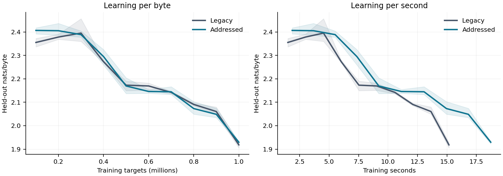

# SHoEbox: addressed multiscale memory

Implementation and matched comparison | 14 November 2026 | Base: d319c3e

The rebuilt multiscale runtime now combines fixed content/time write addresses, learned read queries, native rotary clocks and local constituent reconstruction. New models enable the complete path by default; version-1 checkpoints continue through an unchanged legacy backend.

Across three matched million-target runs, mean language loss is essentially unchanged: **1.97708 versus 1.97753 nats/byte**. Training retains **81.1%** of the original throughput. The new memory contributes to frozen language predictions, while the ordered delayed-cue task remains at **50% accuracy**.

## Implemented behavior

| Component | Behavior |
| --- | --- |
| Local feature learning | Reconstruct one rotating child role from the same canonical encoding used by composition; mean squared error weight 0.05. |
| Native prediction | Retain the existing causal next-unit contrastive objective, weight 0.1. Both objectives train the selected local expert. |
| Stable write addresses | Fixed raw-byte sketches and ordered child composition; separate current, previous and temporal address channels. |
| Learned reads | Queries depend on current learned content, previous contextual state and fixed clock phase; values combine learned and fixed features. |
| Native clocks | Eight sine/cosine pairs per slow scale; periods 4-256 native events; fixed rotations and phase renormalization. |
| Long-lived summaries | A 32-by-16 matrix at each 4/16/64-byte scale, with fixed row half-lives of 32-2,048 native events. |
| Local cost | Eight-event derivative blocks remain; no additional expert execution or cross-level backward traversal. |

Canonical content remains independent of time and recurrent context. Time enters the separate memory address. Every read precedes its write, and stored write coordinates do not move as the encoder learns. The clocks are Fourier/rotary features for associative memory, rather than transformer RoPE applied to content.

The three active address matrices total 6 KiB, excluding normalizers, sketches and derivative rings. New query/read/reconstruction parameters add 9,728 scalars per slow level. The budget allocator compensates with fewer experts: [104, 52, 31, 21], for 997,183 fitted scalars. The original four-scale profile has 997,567. The 8-by-8 MinKron recurrence remains at every level; the new memory runs only at slow events. Inference omits the reconstruction decoder.

## Matched language results

Fresh four-scale models train once on the first 1,000,000 Tiny Shakespeare next-byte targets. The final contiguous 10% supplies 111,539 held-out targets. Seeds are 7, 17 and 29; execution order alternates legacy/addressed between seeds. All results below are means from new runs on the same pinned CPU.

| Profile | Fitted scalars | Test nats/byte | Training seconds | Training bytes/s |
| --- | ---: | ---: | ---: | ---: |
| Legacy | 997,567 | 1.97753 | 15.17 | 65,928 |
| Addressed | 997,183 | 1.97708 | 18.72 | 53,435 |

Mean loss improves by only 0.000448 nats/byte, with mixed per-seed effects. Training takes 23.4% longer; throughput falls 18.9%. Teacher-forced inference averages 88,197 versus 103,840 bytes/s. These runs do not establish an overall language-quality gain.

| Seed | Legacy test NLL | Addressed test NLL |
| --- | ---: | ---: |
| 7 | 1.97440 | 1.96396 |
| 17 | 1.97946 | 1.98008 |
| 29 | 1.97874 | 1.98721 |



Curves use a fixed 16,384-target held-out subset every 100,000 training targets; shading is the seed range. Full-test figures in the tables use the entire held-out split after terminal local updates. Initialization, compilation, evaluation and checkpoint IO are excluded from training timing; terminal local updates are included.

## Contribution and delayed recall

Frozen interventions remove address channels throughout a cold evaluation prefix. Positive NLL changes mean that removal worsens prediction on the fixed 16,384-target subset.

| Removed component | Mean NLL change |
| --- | ---: |
| no_read | +0.010965 |
| no_time | +0.000152 |
| no_content | +0.010751 |

The content-addressed memory supplies most of the measured contribution. Temporal addressing has little effect in this short language run. These interventions measure reliance within a fitted model; the retrained comparison above measures the total architectural change.

The distant-cue test supplies AB or BA, identical distractors, then a binary query. Each model trains on 6,000 examples with gaps 16/48/96 and grouping shifts 0-3. Evaluation uses gaps 16/48/96/192 and shifts 0-7. Both profiles score 50% at every gap for all three seeds. The implementation therefore supplies the addressing and local learning mechanisms, but has not resolved the original delayed-recall failure.

## Verification and compatibility

The suite passes **1,347 native checks and 12 Python tests**, plus AddressSanitizer and UndefinedBehaviorSanitizer. Checks cover independent numerical derivatives for queries, values and carried matrices; reconstruction derivatives for all four roles; million-step clock phase stability; read-before-write causality; stable write coordinates under changed encoders; exact local block gradients; selected-bank updates; the minimum parameter budget; and checkpoint continuation at partial-block and group boundaries. LeakSanitizer was explicitly disabled on this ptrace-managed host.

Version-1 native sources are byte-identical to the base commit. Loading an older checkpoint automatically selects that backend and preserves continuation exactly. Fast-only models retain the original prediction arithmetic. Version 2 saves phases, clocks, stable sketches, normalization state, learned queries, reconstruction parameters and pending local records. Reopening all six benchmark checkpoints under the final source reproduces their full-test losses exactly. Minimum-budget allocation now reserves two experts for every level.

Effective capabilities are available through `stats()`. Frozen `no_read`, `no_time` and `no_content` controls are exposed through `evaluate(..., memory=...)`. Reconstruction can be independently ablated with `configure(reconstruction_weight=0)`. The existing cortical runtime and explicit episode-store policy are unchanged.

## Reproduction

```bash
python multiscale/tests/run_all.py --no-leak-check
python -m multiscale.compare_memory --data input.txt --out /tmp/shoe-memory
python -m multiscale.build_address_report
```

Use `Model(memory_profile="legacy")` for a fresh original-runtime control; new `Model()` instances use the addressed profile. Training and resume are also supported through `python -m multiscale.cli`. Resume chooses the saved policy automatically.

Hardware: AMD EPYC 9V74 80-Core Processor, one worker pinned to CPU 0. Python 3.12.14; NumPy 2.3.5; g++ (Debian 14.2.0-19) 14.2.0. Native build: C++17, -O3, -march=native, -ffp-contract=off. Local peak learning rate 0.08, shared head 0.16, route attraction 0.002; 1% warmup and cosine decay to 10% for language runs. No tuning was performed against these comparison results.

Dataset SHA-256: `86c4e6aa9db7c042ec79f339dcb96d42b0075e16b8fc2e86bf0ca57e2dc565ed`. Compact measurements, curves and source hashes accompany this report. Datasets, trained checkpoints and compiled binaries are excluded from the source package.

The fixed-address/learned-read separation adapts the design principle discussed in [Streaming Recurrent Memory](https://arxiv.org/html/2610.34833v1). This implementation uses its own compact state, fixed retention schedule and existing SHoE local learning; it does not import the full SRM architecture or its training machinery.
