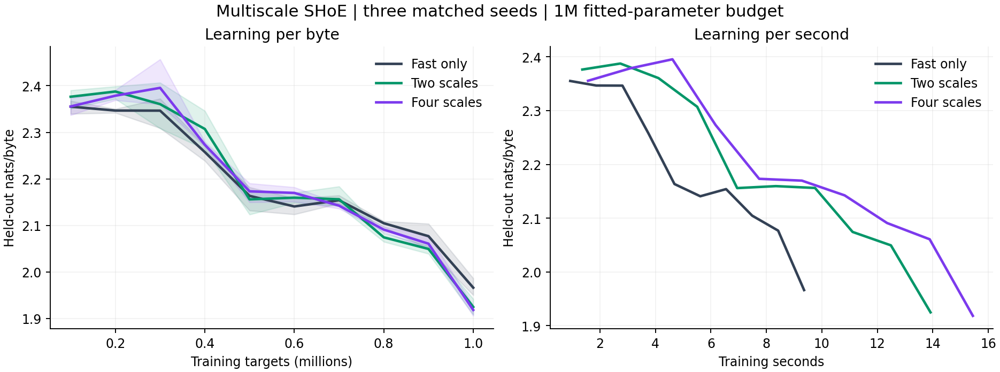

# SHoE multiscale rebuild: implementation and results

14 November 2026 | Base repository: JRowe47/SHoEbox, 5dc8166

The independent fixed-rate rebuild is implemented. Four scales average **1.97753 nats/byte at 64,746 training bytes/s** across three million-target Tiny Shakespeare runs. The deeper-dependency acceptance gate is **not passed**: the ordered distant-cue task remains at 50% accuracy. Learned boundaries and promotion as the selected generalist profile remain gated.

## What was delivered

The new `shoe_multiscale` entry point exposes a native C++17 runtime with Python/NumPy bindings. It supports one, two and four scales, width 64, top-one experts, ordered child composition, separate canonical content and recurrent context, compact 8x8 MinKron-style state, one shared binary byte decoder, cached slow gain/bias conditioning, native contrastive forecasting and eight-event local reverse sweeps.

The runtime has no cortical regional scheduler, publication DAG, replay machinery, historical parameter versions or cross-region credit traversal. Child values and entering local states are detached boundaries. Only selected expert weights receive updates. The existing `shoebox_reference` implementation is retained unchanged.

Versioned, checksummed checkpoints preserve pending blocks and partial groups exactly. Frozen inference, generation, explicit payload binding/retrieval, bounded indexed routing, CLI commands and reproducible benchmark/test runners are included. Models, datasets and compiled binaries are excluded from the published source package.

## Language results

All new models train on exactly the first 1,000,000 next-byte targets, once, in corpus order. Seeds are 7, 17 and 29. The final contiguous 10% is held out: 111,539 targets. Parameter budgets include all fitted routers, projections, prediction heads, embeddings and decoder parameters. Reported rows are three-seed means.

| Scales | Parameters | Test nats/byte | Train seconds | Train bytes/s | Seconds to 2.10 |
| --- | ---: | ---: | ---: | ---: | ---: |
| 1 | 996,415 | 1.99583 | 9.36 | 106,880 | 8.42 |
| 2 | 996,799 | 1.97997 | 13.92 | 71,902 | 11.11 |
| 4 | 997,567 | 1.97753 | 15.45 | 64,746 | 12.35 |

The four-scale model improves mean held-out loss by 0.01830 nats/byte over its retrained matched-budget fast-only control. It takes 1.65 times as long. At the measured 2.10 threshold, the fast-only control arrives sooner. These results support better learning per byte, not better learning per second from adding scales.

The 2.10 column uses the first checkpoint at or below 2.10 on the fixed 16,384-target curve subset, sampled every 100,000 targets. It is not an interpolated or full-test threshold. Full-test losses above use all held-out targets after terminal local updates. Curve points use the fitted weights present at each observation before a terminal drain.



The figure shows means after 100,000 targets; shading is the seed range. Untrained losses near 5.55 are omitted from its plotting range. Both axes use the same data and models.

| Seed | Scales | Full-test nats/byte | Training bytes/s |
| --- | ---: | ---: | ---: |
| 7 | 1 | 1.99093 | 103,860 |
| 7 | 2 | 1.97260 | 72,252 |
| 7 | 4 | 1.97440 | 64,482 |
| 17 | 1 | 1.99660 | 109,020 |
| 17 | 2 | 1.98466 | 74,283 |
| 17 | 4 | 1.97946 | 65,552 |
| 29 | 1 | 1.99995 | 107,761 |
| 29 | 2 | 1.98266 | 69,170 |
| 29 | 4 | 1.97874 | 64,205 |

## Historical comparison

The prior 14 November comparison used the same corpus, split, target order and AMD EPYC 9V74 host, seed 7. Those runs are reused as historical measurements; they were not rerun or extended to three seeds here. Their two-CPU placement differs from this rebuild's single native worker pinned to CPU 0.

| Historical model | Parameters | Test nats/byte | Training bytes/s |
| --- | ---: | ---: | ---: |
| SHoEbox | 1,014,800 | 1.97691 | 1,703 |
| nanoGPT | 1,033,600 | 2.27537 | 13,142 |

The new four-scale seed-7 result is 1.97440 nats/byte, versus 1.97691 for the prior SHoEbox run. Mean new training throughput is approximately 38.0 times that prior throughput. Generation and teacher-forced inference are measured separately in the raw JSON; neither is used as training throughput.

## Does the hierarchy contribute?

On the frozen four-scale models, masking a slow level worsens the 16,384-target held-out loss. A fixed coordinate permutation of that level's cached conditioning vectors also worsens loss. Other levels, events and learned weights are left intact. The baseline is recomputed after terminal updates for each model.

| Intervention | Mean mask NLL increase | Mean conditioning-shuffle increase |
| --- | ---: | ---: |
| Level 1 | +0.03303 | +0.11719 |
| Level 2 | +0.02963 | +0.08928 |
| Level 3 | +0.00284 | +0.00792 |

These tests demonstrate use of the slow conditioning. The retrained one/two/four-scale controls establish the small improvement per byte. Neither test establishes a learned long-distance dependency.

The separate ordered-cue task presents AB or BA, then an identical run of distractors, a query, and a cue-dependent binary answer. Both cues contain the same inventory; order carries the answer. Training mixes 16/48/96-byte gaps and shifts 0-3. Evaluation includes those gaps, an unseen 192-byte gap, and shifts 0-7. Each model trains on 6,000 examples per seed, about 360,000 bytes. All nine model/seed combinations score **50%** at all four evaluated gaps. Masking slow levels does not reveal useful cue retrieval. The result is recorded as a failed gate, not converted into a passing architecture test by checking gradients or changed logits.

## Association store and capacity

The store uses 256 buckets with four ways, up to sixteen semantic candidates and at most two returned records. Query precedes automatic write; a value is admitted only after its whole four-byte group is observed. Exact caller-provided keys and payloads have independent checked handles. Tests verify novel binding, delayed exact binary retrieval, checkpoint preservation, collision eviction, stale-handle rejection and invalidation across memory resets. This is explicit payload recovery, not learned free-form string reproduction by the byte decoder.

A one-seed language run with automatic association recall enabled reaches 1.97503 nats/byte at 60,346 bytes/s, compared with 1.97440 for the same-seed store-disabled model. Frozen cold evaluation uses no stored training episodes. This does not qualify enabling neural recall by default. The independent exact binding API remains available.

The 5M capacity check fits 4,997,695 parameters across banks [581, 290, 174, 117]. It executes the same 1.328125 selected experts per byte and completes one million targets at 59,112 bytes/s, with test loss 1.97900. Router tests bound comparisons to at most 48 per event in this supported range. Derived centroid paths update locally. The one-seed capacity check establishes execution and bounded routing, not a demonstrated quality gain from 5M capacity or qualification for 100M.

## Learning policy and verification

Each level freezes its parameters for eight native events. Output derivatives accumulate across each state's lifetime using the actual readout weights that made each prediction. One reverse sweep differentiates local expert, adapter, projection, recurrent-vector and MinKron matrix computations. Shared byte readout learning remains online. Task gradients average over served byte predictions; native gradients average over valid next-unit targets and are weighted by 0.1. The final cross-block forecast is truncated, avoiding retained old parameter versions. Targets and negatives are immutable detached emitted content vectors.

All language runs use local peak rate 0.08, readout peak rate 0.16, route attraction 0.002, 1% warmup and cosine decay to 10% of peak. Compiler flags are C++17, -O3, -march=native and -ffp-contract=off; floats are float32. Python is 3.12.14 and NumPy 2.3.5. Training timings include terminal local updates and exclude build/import, initialization, evaluation and checkpoint IO. No GPU is used.

The verification suite passes **387 native checks**, including independent double-precision finite differences for the MinKron read/write derivative, byte-block derivatives, slow composition/projection derivatives, scheduling, content/context separation, ordered composition, selected-bank updates, routing bounds and checkpoint continuation. **Eight Python tests** cover streaming phase boundaries, source-preserving evaluation, causality, interventions, exact payloads, reset invalidation, learning, generation and invalid inputs. **Eight existing cortical inference tests** also pass.

The native suite passes AddressSanitizer and UndefinedBehaviorSanitizer. LeakSanitizer cannot run under this host's ptrace-based execution, so leak scanning was explicitly disabled while ASan/UBSan remained active. No sanitizer finding is suppressed. Compiler warning checks and whitespace checks pass. Reopening saved seed-7 models under the final runtime reproduces all three full-test losses exactly.

## Build-plan status

| Plan item | Status |
| --- | --- |
| Fast SHoE core | Implemented and measured |
| Ordered composition with native and direct credit | Implemented; long-dependency gate failed |
| Four fixed-rate scales near 1M | Implemented and compared with retrained controls |
| Single bounded association store | Implemented; exact API verified; neural path remains off by default |
| Learned boundaries | Not implemented: prerequisite architecture gate did not pass |
| Bank capacity scaling | 5M runtime and routing exercised; larger-bank and batching qualification pending |

Held-out mixed prose/code selection, systematic familiar-part recombination, multiple-seed 5M comparisons and matched new runs of all historical baselines remain beyond this failed acceptance gate. The practical next development target is the local native objective and its retention of information needed after repeated irrelevant units. Adding learned boundaries before that works would bypass the supplied plan's stopping condition.

## Reproduction

Run from the repository root with a local copy of Tiny Shakespeare:

```bash
python multiscale/tests/run_all.py --no-leak-check
python -m multiscale.benchmark --data input.txt --out /tmp/shoe-1m
python -m multiscale.dependencies --out /tmp/shoe-dependencies
python -m multiscale.benchmark --data input.txt --out /tmp/shoe-5m --parameters 5000000 --levels 4 --seeds 7
```

On an ordinary host, omit `--no-leak-check` to run leak scanning as well. Dataset SHA-256: `86c4e6aa9db7c042ec79f339dcb96d42b0075e16b8fc2e86bf0ca57e2dc565ed`. Full source, tests, individual measurements and samples are under `multiscale/`; `shoe_multiscale.py` is the public import. Rebuild this report from its committed JSON with `python -m multiscale.build_report` (Matplotlib and ReportLab required).
