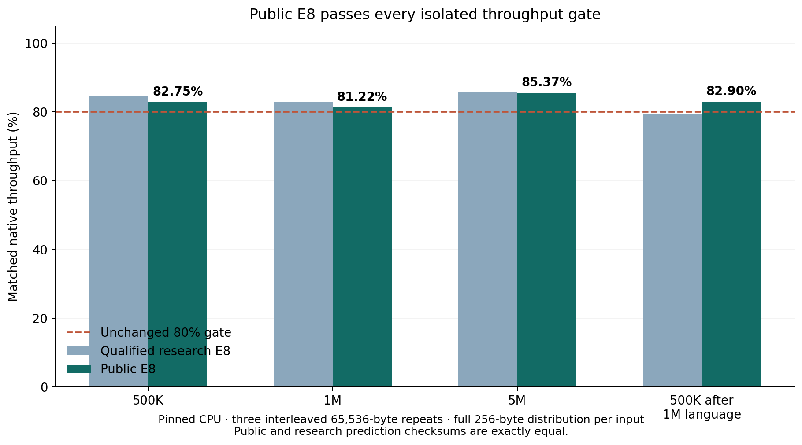

# SHoEbox E8 public integration

16 November 2026 (America/Denver). Starting main:
`28f3ec2f88c9b593528c81dcae4cdaec14d5964e`.

**E8 is now the public default.** Numerical parity, explicit checkpoint import,
exact continuation, historical compatibility, public lifecycle, Python/native,
causality, ASan/UBSan and all four isolated throughput gates pass. There were
**zero new research fitting bytes**, no prior sweep and no numerical revision.

## Public behavior and versioning

`shoe_multiscale.Model()` / `fresh_model()` with only parameters and seed now
select E8. `Model(policy="e8")` makes that choice explicit. `policy="v19"` and
`core="minimal"` retain v19. Explicit architectural constructors retain their
prior meanings, including full cores, historical routing and memory profiles.
The CLI follows the same default and accepts `--policy e8` / `--policy v19`.
Resume always preserves the saved policy and rejects policy overrides.

Public E8 has envelope `SHOEME01`, native magic `0x3850454f4853`, format 1,
and stats version `e8-public-1`; its nested core is v19. Research E8 retains
magic `0x38455041514853`. E7 and all experiment implementations are unchanged.
No historical checkpoint is implicitly converted. The explicit importer records
source/destination SHA-256 and keeps cursor and decoder bytes unchanged.

The new runtime owns a frozen copy of the qualified readout arithmetic; tests
verify that its only header difference is the magic value. The native core
source and headers are unchanged. The Python core binding was factored so the
public library exposes the same native lifecycle functions. The production
module imports no research modules; fixture helpers remain in experiments.

## Exact parity and compatibility

| Check | Result |
| --- | --- |
| All original research checkpoint/cursor hashes | 77 pairs intact |
| Eligible minimal joint E8 imports, including no-local controls | 29/29 exact |
| Continuation per import | 1,000 research = 1,000 public = 371 + save/load + 629 public |
| Full 256-byte predictions after continuation | Bit-identical, 256 observed inputs per pair |
| Reconstruction decoder | Every saved array exact through continuation |
| Historical constructors/checkpoints | 14 trajectories byte-identical to starting main |
| Python tests on final default | 183 unique: 60 runtime/public +123 historical/research |
| Existing native suite | 824,111 checks per optimized/sanitized build |
| Public E8 numerical/lifecycle suite | 723 checks per optimized/sanitized build |
| ASan / UBSan | Pass; LSan explicitly disabled on this host |

Imports include trained binding, post-language, 1M/5M capacity, fresh language,
copy and reconstruction snapshots. The checks preserve both RNG states,
remaining order, partial examples/documents, pending credit and scheduled finish
events. They run on discarded copies with pinned train/development data only.
No opened audit was rescored, selected against or used to alter the policy.

The historical comparison covers v1/v2/v3/v4 memory profiles, v7 routing A,
v8 routing B, both v9 C/D constructors, v10 full C, v11/v12 credit, v17 route
rates, v18 loops and v19 minimal. Earlier v5/v6 loader code is unchanged;
those formats were not independently instantiated in this comparison.

Public checks exercise train/run, exact loss sums, zero/mixed objective masks,
local labels, reset/finish, clone/frozen flags, observe/logits, evaluate/generate,
external binding lifecycle, file save/load, corruption rejection, invalid-label
atomicity, CLI resume and rejected cross-policy imports. Local labels cannot
enter frozen inference. The public default was changed only after numeric,
compatibility, sanitizer and isolated throughput gates passed; final default
selection and the historical research suite were then rerun.

## Isolated inference throughput

| Model | Native bytes/CPU-s | Research E8 | Public E8 | Public/native | >=80% |
| --- | ---: | ---: | ---: | ---: | --- |
| 500K | 21,154 | 17,867 | 17,506 | 82.75% | PASS |
| 1M | 20,349 | 16,850 | 16,527 | 81.22% | PASS |
| 5M | 20,159 | 17,278 | 17,209 | 85.37% | PASS |
| 500K after 1M language | 21,651 | 17,197 | 17,948 | 82.90% | PASS |

One pinned CPU, three interleaved repetitions per model, 65,536 input bytes
per repetition and a full 256-byte distribution on every input. Each repeat
has 1,024 warmup bytes. Compilation, clone and warmup are excluded from timed
intervals; all other fit/test jobs were stopped. Public/research checksums match
exactly. Raw timings, checkpoint hashes and corpus digest are in the evidence.

## Parameters, state and objectives

E8 retains the **1/256 local applicability prior**, **7,670 budgeted readout
weights**, **2,408 bytes of prediction scratch**, **zero added persistent
sequence state** and **zero optimizer moments**. Actual native/E8 parameter
counts remain 498,367/497,589 at 500K, 996,799/996,021 at 1M, and
4,996,927/4,996,149 at 5M. Existing stream/retained structs occupy 289,152 bytes;
this is not total allocation. The constructor deducts the readout from capacity.

`run(..., local_labels=...)` accepts optional observed-window labels. These are
fixture-local supervision, separately counted from the generic byte objective.
Generic language/copy/reconstruction omit labels and freeze local extraction
and applicability weights exactly as qualified. Native mixture-responsibility
learning remains intact. Inference adds no parser, byte-equality test, source
oracle, automatic exact store, new memory slot or restricted alphabet.

The inherited research result remains **98.2747% held-out binding retained
through 1M language targets**, with passing generic language/copy/reconstruction,
three-seed 1M/5M, boundary offsets, both query orders, independent padding delays
and ablations. The generic language increase is **0.006233 nats/byte**. These are
preserved E8 qualification results, not new fits or fresh audit estimates.

## Work and cost ledger

- New research training/pilots/prior sweeps: **0 bytes**.
- Imported-checkpoint correctness: **87,000 discarded input bytes** across
  three paths for each of 29 snapshots; 69,288 byte-objective targets,
  14,400 local projection-vector updates, 58,740 local presence updates,
  29,820 applicability updates and 37,050 local-training-window events.
- These trajectories contain **48,360 inputs equal to byte 9**, including
  synthetic padding and any literal tab. Original exact padding counts and
  unfinished positions remain in their cursors; this count is not relabeled
  as a new research fitting budget. Reconstruction decoder checks are exact.
- Historical trajectory verification: **221,238 discarded bytes**, including
  the initial 13-case check and the expanded 14-case check; both are charged.
- Imported frozen prediction checks: **14,848 input bytes**.
- Timing, including warmup: **2,396,160 inference bytes**.
- Metered verification processes: **989.95 CPU seconds**, including compilation,
  evaluation, repeat Python checks, native/sanitizer suites, I/O and timing.
  Whole-process costs are summed once; nested/subphase times are not added.

The initial compile/six-byte smoke and first eight Python tests were not separately
CPU-metered; nor was the one targeted cap check. Unit/native suites use additional fixed discarded microtrajectories;
their aggregate byte count is not instrumented. These limits are explicit in
`accounting.json`; no pilot or research fit is omitted. All internal native
reconstruction/child-credit updates are included in process CPU; reported local
counts are vector/objective events, not scalar writes. One staged-default verification failed on the nominal upper-budget rejection;
[the registered API correction](API_BOUNDARY_CORRECTION.md) restores the
100M limit before readout deduction, with no numerical changes. Its failed
log/CPU and the passing final rerun are retained. No research fit failed or
was run. Artifact production costs are separate.

The prior E8 ledger remains **106M research bytes**, including every pilot,
control, padding byte and auxiliary event; combined E1–E8 remains **236.25M**.
All prior failed research and exact cursor artifacts are retained in the archive.

## Reproduction and next work

Read [public API](../../multiscale/e8/README.md) and
[resume instructions](SHoEbox_E8_Public_Resume.md). The archive includes current
source, all 77 original checkpoint/cursor pairs, 29 public conversions with
receipts, both pinned corpora, source snapshots, original E1–E7 evidence,
verification logs and a complete SHA-256 manifest. Checkpoints, corpora and
compiled binaries are excluded from git; compiled libraries rebuild locally.

Next: EXP03/EXP05 interference and retention beyond padding, first diagnosing
failure in existing state. Preregister a focused revision and fresh folds before
fitting. E2-family binding and E7 generic audits are OPENED and must be excluded
from future qualification groups. Preserve all existing thresholds, matched
budgets and full-256-byte autoregression. Broader generic learning of local heads
is a separately named research objective.

Direct verified main publication remains authorized, including unsuccessful
research, while preserving unrelated work/history and never force-pushing.
