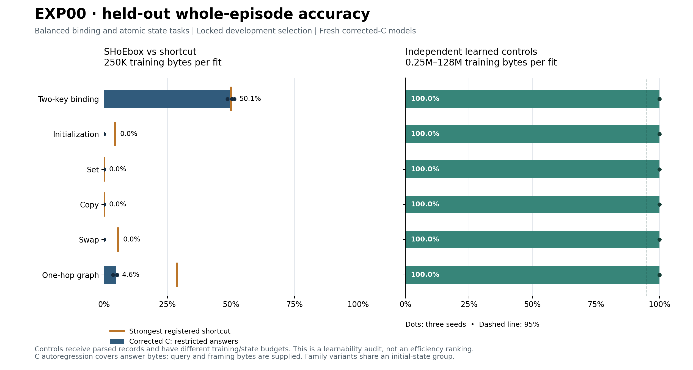

# SHoEbox EXP00 — calibration and learned positive controls

**Executed 16 November 2026 UTC · Plan published first as [`bd30bfc`](https://github.com/JRowe47/SHoEbox/commit/bd30bfc96f647155a44da2b98f413de8537cdb27).**

EXP00 is implemented and the formal training/audit is complete. **0 of eight settings pass the comparative calibration gate.** On held-out balanced two-key binding, corrected C scores **50.07% exact**, the input-order shortcut scores **50.00%**, and the learned attention control scores **100.00%**. The next step is EXP01's query/readout diagnosis; a broad architecture comparison has not passed its entry gate.

The six new fixture families now have independent label checks, grouped splits, shortcut scoring, trained controls and frozen counterfactual audits. Production model behavior and the original nine MAD tasks are unchanged. These are fresh small-model mechanism tests; no generalist capability label is promoted.

## Held-out results

Scores are means over seeds 1, 7 and 19. Parentheses give the observed seed range, not a confidence interval. Each selected setting has at least 1,024 test episodes. Presentation siblings share an initial-state group and are not independent trials.

| Task | C exact, restricted | C exact, 256-byte | Best shortcut exact | Learned control exact (seed range) |
| --- | --- | --- | --- | --- |
| Two-key binding | 50.07% | 50.07% | 50.00% | 100.00% (100.00%–100.00%) |
| Initialization | 0.00% | 0.00% | 4.30% | 100.00% (100.00%–100.00%) |
| Set | 0.00% | 0.00% | 0.02% | 100.00% (100.00%–100.00%) |
| Copy | 0.00% | 0.00% | 0.02% | 100.00% (100.00%–100.00%) |
| Swap | 0.00% | 0.00% | 5.47% | 100.00% (100.00%–100.00%) |
| One-hop graph | 4.65% | 4.65% | 28.65% | 100.00% (100.00%–100.00%) |

Both C decode modes generate the scored answer bytes autoregressively; query/framing bytes remain observed. The learned controls receive parsed records and predict in the task alphabet. They establish learnability through that adapter, not native-byte or matched-compute equivalence.

On binding, C's teacher-forced answer-token score is 74.82%, while its exact autoregressive score is 50.07%. That gap is why whole-episode decoding and the input-order shortcut determine the gate.

## Development selection, locked before the audit

The gate uses `G = (C exact − strongest shortcut exact) / (1 − strongest shortcut exact)`. A comparative setting requires `0.1 ≤ G ≤ 0.9`, learned-control mean >=95%, every control seed >=90%, three seeds and at least 512 development episodes. Final C selection uses autoregressive scores; its saved learning curves are explicitly teacher forced. A below-band setting remains a diagnostic.

| Setting | C exact | Shortcut exact | G | Control exact | Decision |
| --- | --- | --- | --- | --- | --- |
| binding_v2 | 50.59% | 50.00% | 0.0117 | 100.00% | diagnostic_repair_required |
| binding_v4 | 6.51% | 50.00% | -0.8698 | 100.00% | diagnostic_repair_required |
| binding_v8 | 11.33% | 50.00% | -0.7734 | 100.00% | diagnostic_repair_required |
| initialize | 0.00% | 3.91% | -0.0407 | 99.74% | diagnostic_repair_required |
| set | 0.00% | 0.02% | -0.0002 | 100.00% | diagnostic_repair_required |
| copy | 0.00% | 0.02% | -0.0002 | 100.00% | diagnostic_repair_required |
| swap | 0.00% | 5.47% | -0.0579 | 100.00% | diagnostic_repair_required |
| one_hop | 4.09% | 27.49% | -0.3226 | 100.00% | diagnostic_repair_required |

The first/easiest declared setting was retained for each family when none qualified. Test results did not select settings, checkpoints, training budgets or hyperparameters. Binding uses vocabulary 2 for its diagnostic audit; vocabulary 4 and 8 remain in the development evidence.

## Atomic updates: partial correctness does not establish an operation

C category scores below are teacher forced; the control predicts queries independently. Changed targets and untouched registers are reported separately. Ignoring the operation scores 0% exact on every atomic task, even when its answer-token score looks high.

| Task | C changed | C preserved | Control changed | Control preserved | Ignore-update token score |
| --- | --- | --- | --- | --- | --- |
| Set | 10.74% | 12.58% | 100.00% | 100.00% | 75.00% |
| Copy | 8.17% | 11.75% | 100.00% | 100.00% | 75.00% |
| Swap | 10.73% | 17.33% | 100.00% | 100.00% | 50.00% |

## Counterfactual and boundary checks

Query reversal changes only query order. Operation counterfactuals stay within the trained operator family: change the set value, reverse copy direction, or change the swap partner. All operations on a starting state remain in the same split. Scores here use one representative per initial-state group, up to 128 groups, so their denominator differs from the full balanced audit.

| Task | C reversed queries | Control reversed queries | C changed operation | Control changed operation |
| --- | --- | --- | --- | --- |
| Two-key binding | 50.78% | 100.00% | — | — |
| Initialization | 0.00% | 100.00% | — | — |
| Set | 0.00% | 100.00% | 0.00% | 100.00% |
| Copy | 0.00% | 100.00% | 0.00% | 100.00% |
| Swap | 0.00% | 100.00% | 0.00% | 100.00% |
| One-hop graph | 4.39% | 100.00% | — | — |

The 64-offset sweep uses up to 32 distinct held-out starting states per seed. Changing padding varies alignment and delay together; it is not a pure boundary-phase intervention. References omit padding in their syntax adapter, so their invariance is expected by construction.

| Task | C at offset 0 | C range over offsets | Control range over offsets |
| --- | --- | --- | --- |
| Two-key binding | 63.54% | 4.17%–64.58% | 100.00%–100.00% |
| Initialization | 0.00% | 0.00%–0.00% | 100.00%–100.00% |
| Set | 0.00% | 0.00%–0.00% | 100.00%–100.00% |
| Copy | 0.00% | 0.00%–0.00% | 100.00%–100.00% |
| Swap | 0.00% | 0.00%–0.00% | 100.00%–100.00% |
| One-hop graph | 2.08% | 0.00%–5.21% | 100.00%–100.00% |

Learned-control lesions, exact episodes:

| Task | Query removed | State zeroed | Operation record erased |
| --- | --- | --- | --- |
| Two-key binding | 0.00% | 0.00% | — |
| Initialization | 0.00% | 0.00% | — |
| Set | 0.00% | 0.52% | 0.00% |
| Copy | 0.00% | 0.00% | 0.00% |
| Swap | 0.00% | 0.00% | 0.00% |
| One-hop graph | 0.00% | 0.00% | — |

## What was built

- Balanced two-key binding; four-register initialization and individual set/copy/swap tasks; arbitrary three-node non-self one-hop mappings. Record and query positions are independently balanced using Cartesian cyclic rotations.
- Independent array-based interpreter alongside dictionary-based generation, including exhaustive repeated-value/no-op tiny cases and every offset 0..63.
- A learned attention compatibility table with value embeddings and a decoder; a 128-unit GRU with learned state transitions and register-addressed output heads. Syntax adapters never execute an instruction or read an answer label. Explicit register output addressing is a declared inductive bias.
- Protocol v2 folds grouped by task and concrete initial mapping. Operation changes and explicit presentation variants stay together; symmetric swap arguments share one semantic identity. This holds out initial mappings, not every isomorphic renaming or unseen program structure.
- Separate train/audit phases, exact charged-byte accounting, input fingerprints, source hashes, checkpoint restoration checks, source provenance and temporary checkpoint cleanup.

Implementation and reproduction commands: [`experiments/mad_next/README.md`](https://github.com/JRowe47/SHoEbox/blob/main/experiments/mad_next/README.md).

## Budgets and reproducibility

C is the unmodified corrected-C runtime: **496,959 fitted parameters**, four scales, width 64, no extra refinement passes. Requested capacity is 500K; bank granularity accounts for the difference. Its measured inventory includes 1,024 recurrent-vector bytes, 1,024 MiKron-matrix bytes, 8,192 address-matrix bytes, 32,352 retained-record bytes and 8,192 child-buffer bytes. The complete inventory is recorded for every fit.

| Selected family | Train episodes / state groups | Dev episodes / state groups | Test episodes / state groups | Control bytes per seed | Control parameters |
| --- | --- | --- | --- | --- | --- |
| Two-key binding | 2,048 / 512 | 512 / 128 | 1,024 / 256 | 0.25M | 2,434 |
| Initialization | 8,192 / 512 | 512 / 32 | 1,024 / 64 | 8M | 61,728 |
| Set | 65,536 / 1,003 | 512 / 30 | 1,024 / 63 | 32M | 61,728 |
| Copy | 65,536 / 1,005 | 512 / 30 | 1,024 / 58 | 128M | 61,728 |
| Swap | 65,536 / 998 | 512 / 31 | 1,024 / 62 | 128M | 61,728 |
| One-hop graph | 2,052 / 228 | 513 / 57 | 1,026 / 114 | 0.25M | 1,296 |

Each C fit receives 250K encoded input bytes. References use Adam at 0.05 for attention and 0.003 for the GRU, batch 32, norm clipping 1. Their budgets count the original encoded bytes, including padding, although their parser omits padding from neural inputs. Partial final episodes are charged without revealing their labels. State and optimizer budgets differ; no efficiency ranking is inferred.

- **Formal run:** 48 fits; **897,000,000 bytes**, comprising 6,000,000 for C and 891,000,000 for learned controls.
- **Development-only pilots:** 12 additional fits; **301,552,768 bytes**.
- **Total including exploration:** 60 fits; **1,198,552,768 charged bytes**.
- Formal training CPU time: C 138.0s; controls 391.1s. Overall train-phase elapsed time: 478.2s with two pinned workers. Evaluation/initialization is outside training timers; model timing scopes differ.
- Environment: Python 3.12.14, NumPy 2.3.5, PyTorch 2.15.0+cpu. Data seed 20261115; finite-epoch order seed 1067. Complete fingerprints and source hashes are in the raw result.

The original 31M planning estimate covered a later binding tranche. This run separately registered expanded learned-control budgets and additional atomic calibration tasks; it did not execute that four-arm tranche. The first small-data pilots exposed control-training limitations, so larger datasets and longer budgets were registered before the formal test audit. Earlier v1 results use a superseded, narrower split and are not combined with v2 scores:

| Pilot phase | Fits | Charged bytes | Final development exact scores |
| --- | --- | --- | --- |
| initial | 6 | 8,531,648 | binding 100.00%; one_hop 100.00%; initialize 34.38%; set 0.00%; copy 0.00%; swap 0.00% |
| larger_dataset | 4 | 53,011,904 | initialize 100.00%; set 99.22%; copy 78.91%; swap 34.38% |
| longer_training | 2 | 240,009,216 | copy 100.00%; swap 97.66% |

Pilot recipes and their exact fixture source are preserved under `reports/exp00/pilot_source_v1/`; their manifest is `pilots.json`. No weights, generated datasets or compiled artifacts are committed.

## Verification

**29 Python tests passed**: 15 existing MAD tests and 14 EXP00 tests. **23 native checks passed under AddressSanitizer/UndefinedBehaviorSanitizer.** The formal fixture checks passed **14,848 exhaustive tiny cases** and **864 oracle cases covering the original nine tasks**. Tests cover label exclusion, balanced positions, grouped split isolation, counterfactual semantics, all offsets, exact partial-byte accounting, native category-mask equivalence and optimizer/checkpoint continuation. Each formal fit also checks checkpoint prediction restoration.

## Next development action

Run **EXP01 as a diagnostic repair** using this fixed balanced binding fixture. First check a single binding, then trace values through write, retained/addressed state, query-conditioned reads and the native answer. Compare identically fitted raw/conditioned frozen probes and a matched-capacity generic head before adding working slots. C's failure on initialization makes broad state-update or deeper-loop searches premature. Re-enter comparative architecture testing only after a setting clears the shortcut-aware calibration gate.

Evidence: [raw results](https://github.com/JRowe47/SHoEbox/blob/main/reports/exp00/results.json), [summary](https://github.com/JRowe47/SHoEbox/blob/main/reports/exp00/summary.json), [pilot ledger](https://github.com/JRowe47/SHoEbox/blob/main/reports/exp00/pilots.json), and [published development plan](https://github.com/JRowe47/SHoEbox/blob/main/docs/capabilities/SHoEbox_Capability_Research.md).
