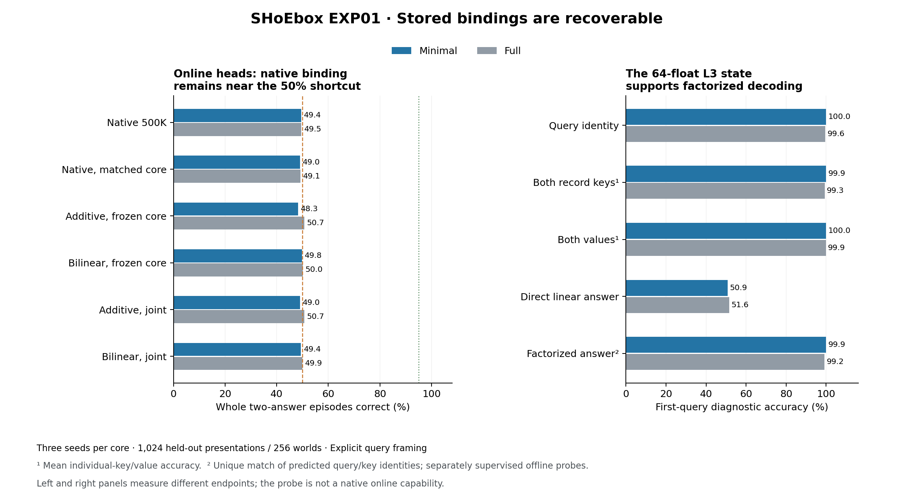

# SHoEbox EXP01 — query/readout diagnosis

**15 November 2026 · Baseline: `317fbcd023b9d9b3c2b359ba8f99f3dadbf46783` · Minimal v19 and full C.**

The first development item now has an implemented online readout experiment and a
completed diagnostic screen. **The minimal model retains enough information to
recover the first queried binding: a factorized L3 probe reaches
99.93% held-out strict accuracy.** Its native
two-answer decoder reaches 49.45% exact, near the 50% input-order
shortcut. Neither of the generic online readouts solves that selection problem.

**Decision:** keep minimal v19 as the production default. Continue EXP01 with an
online factorized query/key/value readout and direct selection credit. The
current evidence does not call for a larger state, more expert capacity, or
extra reasoning passes on this fixture. EXP02 slot expansion remains gated.

## What was implemented

- A native C++ rank-16 query-conditioned residual on the existing 256-byte
  hierarchical decoder: `W[tanh(Uq+bq) * tanh(Vm+bm)] + b`. Here `q` contains
  current states at all four scales and `m` contains the four retained reads.
- A capacity-matched additive head with the same projections and output weights,
  plus native full-budget and reduced-bank controls.
- Frozen-core head fitting and joint fitting through SHoEbox's existing bounded
  local credit. Both learn online, one observed target at a time.
- First-answer representation probes, raw/centered/standardized controls,
  query-order counterfactuals, head/query/read lesions, exact continuation, and
  independent timing. Literature references appear beside the implementation.

The added head has **10,511 fitted parameters**, deducted from the bank budget,
**42,044 weight bytes**, and **2,748 scratch bytes**. It adds **zero persistent
sequence-state bytes**, zero optimizer moments, no replay, and no extra model
pass. The generic head is a research adapter; it is not enabled in the public
minimal core. Code: `experiments/query_readout/`.

## Locked native audit

All values below are native 256-byte autoregressive scores. Both answer bytes
must be right for exact episode credit; supplied query/framing bytes are not
generated. Query-pair credit requires success in both original and reversed
query order, with the same observed records. Each run uses the same cases, so
three seeds do not triple the number of independent test worlds.

| Core | Arm | Exact episodes | Seed range | Both query orders | Fitted parameters |
| --- | --- | ---: | ---: | ---: | ---: |
| minimal | Native 500K | 49.45% | 49.22–49.71% | 16.67% | 498,367 |
| minimal | Native, matched core | 48.99% | 48.05–50.59% | 19.79% | 485,695 |
| minimal | Additive, frozen core | 48.27% | 47.17–49.61% | 17.45% | 496,206 |
| minimal | Bilinear, frozen core | 49.77% | 48.93–51.07% | 20.83% | 496,206 |
| minimal | Additive, joint | 49.02% | 48.24–50.29% | 18.23% | 496,206 |
| minimal | Bilinear, joint | 49.41% | 48.54–50.78% | 20.05% | 496,206 |
| full | Native 500K | 49.51% | 48.73–50.29% | 24.48% | 496,959 |
| full | Native, matched core | 49.12% | 48.14–50.39% | 17.19% | 488,511 |
| full | Additive, frozen core | 50.65% | 50.10–51.27% | 18.49% | 499,022 |
| full | Bilinear, frozen core | 50.03% | 48.83–51.37% | 16.15% | 499,022 |
| full | Additive, joint | 50.68% | 49.80–51.56% | 22.40% | 499,022 |
| full | Bilinear, joint | 49.93% | 48.54–51.17% | 21.61% | 499,022 |

No arm crosses the registered 95% easiest-binding gate or a 5-point practical
gain. No arm is promoted. Frozen head/query/read lesions and restricted-alphabet
scores are retained per seed in `audit.json`; they do not change this decision.

## Localization: value retention versus usable binding

The single-value control supplies one record and one query with the original
padding. Its source-world split is preserved, but concrete one-record mappings
can recur across those derived folds. It tests copying the sole supplied value,
not generalization to unseen one-key mappings. It receives 250K bytes per seed.

The representation diagnostic stops **before the first answer**; no earlier
answer or teacher-forced answer can supply the target. The selected source is
the final 64-float L3 state. All normalizers and ridge heads are fit on training
worlds only. Every conditioning arm uses ridge regularization 1 and an
unpenalized intercept. Raw and centered fits are mathematically equivalent;
standardization changes the feature metric while preserving the fitting method.

| Core | Single-value copy, native | Direct linear answer probe | Factorized strict first-query probe | Factorized seed range |
| --- | ---: | ---: | ---: | ---: |
| minimal | 99.35% | 50.88% | 99.93% | 99.80–100.00% |
| full | 98.70% | 51.60% | 99.22% | 98.83–99.51% |

The factorized probe decodes the query ID, both record key IDs, and both record
values separately. It matches the **predicted query** against **predicted keys**
and selects the corresponding **predicted value**. Strict success also requires
a unique match. It never uses the true query-to-record index to choose the
primary answer. A separate oracle-index score is retained as a diagnostic ceiling.
The five heads contain **9,620 fitted parameters** plus 128 normalization floats.

This gives a concrete localization: the slow representation can expose the
query, record addresses, and their corresponding values; generic final-answer
training does not learn to combine them reliably at this operating point. It
does **not** establish native online binding: the diagnostic uses intermediate
labels, a batch ridge fit, and a task-specific matching operation. That distinction
is the purpose of the experiment. The next task is to train this separation
online and recover native output accuracy.

Results for all 1,728 final diagnostic linear fits are retained in `probes.json`: six labels,
two observation points, eight sources, three conditioning choices, and six core/
seed checkpoints. The extra queried-value head is the direct linear control;
only five heads participate in factorized decoding. Sources include current
retained reads and a read-only address-matrix requery. The latter is explicitly
a diagnostic read, not the previously executed native addressed read.

## Literature reviewed and integration decisions

| Source | Relevant demonstrated mechanism | Decision for SHoEbox |
| --- | --- | --- |
| [R1] Kim et al., *Hadamard Product for Low-rank Bilinear Pooling*, ICLR 2017 | Project two inputs to a small shared dimension, multiply elementwise, and project to output; reduces the cost of full bilinear interactions. | Implemented as the rank-16 online candidate with an additive control. It did not solve this fixture. |
| [R2] Miller et al., *Key-Value Memory Networks for Directly Reading Documents*, EMNLP 2016 | Use different representations for memory addressing and returned content. | The factorized probe supports making query/key selection and value decoding explicit in the next online readout. Do not add a symbolic binding store to the scored native path. |
| [R3] Schlag et al., *Linear Transformers Are Secretly Fast Weight Programmers*, 2021 | Delta-rule fast weights update an association using its prediction residual rather than only accumulating outer products. | The current bounded memory already uses residual writes; replacing storage is not the first intervention when its contents are recoverable. |
| [R4] Yang et al., *Gated Delta Networks*, ICLR 2025 | Combine adaptive forgetting with targeted delta updates in recurrent associative memory. | Keep as the next retention/editing control if interference tests show write failures. Do not change write policy and readout together in this diagnostic. |
| [R5] Arora et al., *Zoology*, 2023 | Multi-query associative recall exposes failures that simpler recall tasks can hide; input-dependent access matters. | Keep independently ordered queries, whole episodes, and counterfactual queries. A high answer-token score alone is insufficient. |
| [R6] Poli et al., *Mechanistic Design and Scaling of Hybrid Architectures*, ICML 2024 | Small capability tasks and explicit parameter/state/compute comparisons guide architecture development. | Preserve separate accuracy, training exposure, state, and runtime accounting; qualify an online binding win before broad scaling. |

These papers motivate mechanisms and controls. The numerical SHoEbox results in
this report come from the new local experiments, not from those papers.

## Speed and exposure

| Arm | Minimal training bytes/CPU-s | Full training bytes/CPU-s | Minimal inference bytes/CPU-s | Full inference bytes/CPU-s |
| --- | ---: | ---: | ---: | ---: |
| Native 500K | 44,988 | 43,612 | 22,004 | 21,829 |
| Native, matched core | 42,188 | 44,296 | 22,519 | 22,183 |
| Additive, frozen core | 62,887 | 63,465 | 20,488 | 20,315 |
| Bilinear, frozen core | 62,541 | 64,014 | 20,246 | 19,026 |
| Additive, joint | 43,475 | 43,302 | 20,075 | 19,445 |
| Bilinear, joint | 41,871 | 41,035 | 19,594 | 20,065 |

Training rates cover the 500K-byte continuation, resets, and explicit retirement;
they exclude evaluation, compilation, and checkpoint I/O. Frozen-core rows fit
fewer parameters and therefore are not equivalent training algorithms. The
screen ran up to four processes; do not treat small timing differences as wins.
Inference is a separate one-process, pinned-CPU measurement: seed 7, three passes
of 32,768 observed bytes, full 256-byte prediction **at every byte**, with all
per-byte work inside C++. It measures teacher-fed streaming inference, not text
quality or sampling overhead. `benchmark.json` records the fixed stream hash and
all repetitions. The default public runtime executes none of the adapter code.

- **36 completed comparison branches:** six arms × two cores × three seeds.
- **250K warmup + 500K continuation bytes** per branch, a fixed recipe: default
  fast/slow/query/head rates and auxiliary weight 0.1; new-head rate 0.16.
- Shared reduced-core warmups avoid repeating identical work: **21M actual
  charged training bytes** for the formal screen, versus 27M logical exposure
  summed over its final branches. Formal training consumed **440.64 CPU seconds**.
- Additional one-seed development pilot: **1.7M bytes**. Six single-value copy
  controls: **1.5M bytes**. Total new online training: **24.2M charged bytes**.
- Train/dev/test: 2,048/512/1,024 balanced presentations, grouped by concrete
  two-key world. There are 512/128/256 underlying worlds. No test score selects
  an online arm, learning rate, checkpoint, or training horizon.
- The factorized diagnostic was chosen on pilot development data, then locked
  before its held-out audit. Its intermediate labels and offline fit are
  accounted separately from online model training.

This first fixed-recipe screen is not the planned six-policy promotion sweep or
a 1M/5M confirmation campaign. Its result is sufficiently clear to move from
generic output heads to factorized selection, rather than extend this sweep.

## Validation and compatibility

- **88 Python tests:** 48 public runtime tests and 40 MAD/EXP00/query tests,
  including 11 new query-adapter tests.
- **1,992 new native checks** pass in optimized and ASan/UBSan builds. They cover
  finite-difference derivatives of both heads, no-adapter parity, head-only core
  freeze, and continuation through unfinished stream boundaries.
- The complete existing native runtime suite also passes optimized and sanitizer
  checks. LeakSanitizer is explicitly disabled on this managed host; ASan/UBSan
  remain active. CI runs with leak checking enabled.
- Future/ignored labels do not alter observation state; first-answer extraction
  cannot consume an answer; normalizers do not use validation examples.
- Public runtime files, default v19 policy, and historical checkpoint semantics
  are unchanged. No weights, datasets, or compiled binaries are committed.

## Next implementation: EXP01-B

1. Replace the generic bilinear output with separately learned query/key
   selection and value readout over the **existing** evidence. Start with a small
   fixed-rank projection and one read; preserve byte-derived inputs and bounded
   online learning. Use [R2] for address/value separation.
2. Add direct local supervision for address selection and value reconstruction
   from already observed constituents. Compare this credit with answer-only
   training at matched capacity and exposure. Keep explicit record IDs confined
   to declared diagnostic controls.
3. Require native two-answer accuracy ≥95%, no seed below 90%, correct query
   counterfactuals, and measured one-pass cost. Then run the planned LR controls,
   offset/delay audits, and language/copy regressions before default promotion.
4. Revisit [R4] writes or EXP02 slots only if that experiment cannot preserve or
   select the needed evidence. The present probe demonstrates adequate state for
   this two-key fixture, not arbitrary delay or larger binding sets.

## Primary references

- **R1:** Kim et al. [Hadamard Product for Low-rank Bilinear Pooling](https://arxiv.org/abs/1610.04325), ICLR 2017; equations 3–5.
- **R2:** Miller et al. [Key-Value Memory Networks for Directly Reading Documents](https://aclanthology.org/D16-1147/), EMNLP 2016; section 3.
- **R3:** Schlag, Irie, and Schmidhuber. [Linear Transformers Are Secretly Fast Weight Programmers](https://arxiv.org/abs/2102.11174), 2021.
- **R4:** Yang, Kautz, and Hatamizadeh. [Gated Delta Networks: Improving Mamba2 with Delta Rule](https://arxiv.org/abs/2412.06464), ICLR 2025.
- **R5:** Arora et al. [Zoology: Measuring and Improving Recall in Efficient Language Models](https://arxiv.org/abs/2312.04927), 2023.
- **R6:** Poli et al. [Mechanistic Design and Scaling of Hybrid Architectures](https://proceedings.mlr.press/v235/poli24a.html), ICML 2024.

Reproduction commands and input/gradient contracts:
[`experiments/query_readout/README.md`](../../experiments/query_readout/README.md).
Compact evidence: `plan.json`, `train.json`, `audit.json`, `probes.json`,
`single_copy.json`, `pilot.json`, `benchmark.json`, `verification.json`, and `summary.json`.
