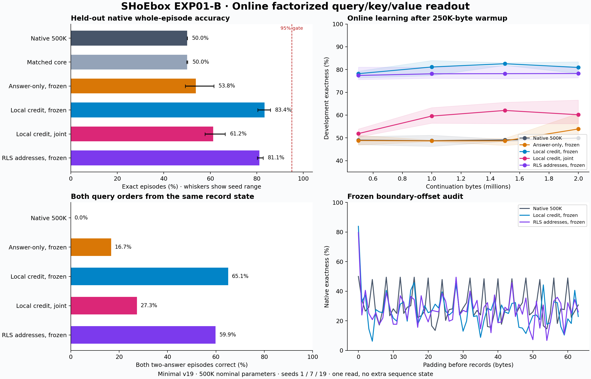

# SHoEbox EXP01-B — online factorized readout

15 November 2026 (America/Denver). Starting repository commit: `521771f`.
Production baseline: minimal corrected C, v19.

**Implemented and tested:** a one-pass online query/key selector and value
decoder over existing L3 state. Local reconstruction credit lifts held-out native
two-answer exactness from **50.03% to 83.37%**
across three seeds. It adds **9,535 fitted parameters**, deducted from the core,
and **zero persistent sequence-state bytes**.

**Decision:** retain the implementation as a research adapter. No arm passes the
95% mean / 90% minimum-seed binding gate. The public minimal-v19 runtime remains
unchanged. The next repair is address representation across query positions and
constituent boundaries, followed by stable joint credit; extra storage is not
the next intervention.

## Implementation

Five rank-16 projections decode a query, two keys and two value vectors from the
same existing 64-float L3 state. One soft selection computes
`a = sigmoid(q · (k0 − k1))`, then `v = a v0 + (1 − a) v1`.
A shared projection adds `v` to SHoEbox's native 256-byte hierarchical decoder.
These two lanes are recomputed views, not stored records or added memory slots.

The answer-only control has the identical graph and parameter count. The local
credit arm also reconstructs the observed query/key bytes and both observed
values. Its training adapter parses only the prefix, excludes scored answers,
and never computes or supplies the selected-record index. Inference receives
only neural state. This is task-specific intermediate training supervision,
not a language-model-only objective.

SGD uses online normalization and per-target updates. The RLS control replaces
only query/key fitting with a 65×65 recursive inverse-covariance update; value
learning remains SGD. RLS is frozen-core only and uses stationary raw-state
coordinates. No branch uses replay, batch optimization, a growing tape, an
external binding store, or additional inference passes.

## Locked held-out comparison

All rows use minimal v19, nominal 500K capacity, seeds 1/7/19, 250K warmup bytes
and 2M continuation bytes. The final horizon and .16 head rate were locked using
development pilots. All six registered arms were audited. Native output is
normalized over all 256 bytes; generated answer bytes feed subsequent state.
Query and framing bytes are supplied by the fixture.

| Arm | Exact episodes | Seed range | Both query orders | Fitted parameters |
| --- | ---: | ---: | ---: | ---: |
| Native 500K | 50.03% | 50.00–50.10% | 0.00% | 498,367 |
| Matched core | 50.03% | 49.80–50.29% | 0.26% | 489,919 |
| Answer-only, frozen | 53.78% | 49.22–61.52% | 16.67% | 499,454 |
| Local credit, frozen | 83.37% | 80.37–85.84% | 65.10% | 499,454 |
| Local credit, joint | 61.23% | 57.71–66.41% | 27.34% | 499,454 |
| RLS addresses, frozen | 81.12% | 80.18–82.71% | 59.90% | 499,454 |

The audit has 1,024 presentations from 256 independent concrete worlds. All
record-order/query-order siblings share a split, using a new salted fold. Seeds
share the same audit worlds; 3,072 scored presentations are not 3,072 independent
worlds. The strongest input-order shortcut is 50%. The separately trained,
record-encoded learned lookup control reaches 100.00%;
removing its query reduces exactness to 0.00%.
Its parsed inputs and task-alphabet output make it a learnability control, not a
native throughput comparator.

Query counterfactuals fork exactly the same frozen record-prefix state before
changing query order. The both-orders column requires all four generated answers
across the paired episodes to be correct, on 256 presentations / 64 worlds.

## Where the remaining errors occur

Frozen local-credit inspection separates selection from value reconstruction.
The table is teacher-fed diagnostic inspection on 256 presentations; its byte
decoders are not consulted by native inference.

| Answer position | Selection | Query byte | First key | Second key | First value | Second value |
| --- | ---: | ---: | ---: | ---: | ---: | ---: |
| 1 | 80.73% | 35.29% | 44.27% | 40.49% | 100.00% | 100.00% |
| 2 | 58.46% | 37.63% | 40.89% | 16.02% | 98.96% | 99.09% |

The additional development-only ridge diagnostic recovers all five byte labels
at 100% on the first-query development set. Fitting the same linear heads
across both query positions reduces first-key decoding to 76.95%, with value
decoding still 99.22%. Those batch fits are explanatory probes, not online
results. They show why the earlier first-query probe does not establish a
single stable address representation across the whole episode.

The native residual decoder can exploit answer-order regularities, so final
accuracy and direct selection accuracy are reported separately. Joint local
credit does not match the frozen-core gain at the registered rate. RLS does not
remove the remaining address problem; a larger optimizer sweep is not justified
by this result.

## Frozen interventions

Each lesion uses the same 256 held-out presentations. Values below are native
whole-episode exactness; the primary table uses the larger 1,024-case audit.

| Intervention | Local, frozen | Local, joint | RLS, frozen |
| --- | ---: | ---: | ---: |
| no_head | 49.48% | 49.09% | 49.48% |
| no_query | 50.13% | 49.48% | 50.52% |
| no_state | 49.74% | 49.09% | 49.61% |
| uniform | 50.13% | 49.48% | 50.52% |
| reverse | 18.36% | 37.63% | 13.28% |

`no_query` forces equal selection weights; `uniform` explicitly sets the same
weights. `reverse` swaps the learned selection weights. `no_state` zeros the
normalized source (for RLS, raw address projections remain available, so this is
only a value-source lesion there). `no_head` removes the added residual entirely.

## Offset and delay audit

All 64 byte phases were checked with frozen models on 64 presentations / 16
worlds per seed. Padding before the records changes absolute hierarchy phase
while keeping record-to-query/answer distances fixed. The separate delay test
inserts complete 64-byte blocks after the records, preserving answer phase.
These are out-of-training-distribution audits with no refitting.

| Arm | Mean across 64 offsets | Original offset, same cases |
| --- | ---: | ---: |
| Native 500K | 30.75% | 50.00% |
| Local credit, frozen | 26.73% | 83.85% |
| RLS addresses, frozen | 27.71% | 79.69% |

| Arm | +0 delay | +64 bytes | +128 bytes | +256 bytes |
| --- | ---: | ---: | ---: | ---: |
| Native 500K | 50.00% | 50.52% | 50.52% | 50.00% |
| Local credit, frozen | 83.85% | 42.19% | 38.54% | 26.04% |
| RLS addresses, frozen | 79.69% | 39.06% | 32.81% | 25.52% |

These tests make boundary and delay dependence explicit. They do not qualify
arbitrary-delay retrieval or larger binding sets.

## Cost and exposure

| Arm | Training bytes / CPU-s | Inference bytes / CPU-s |
| --- | ---: | ---: |
| Native 500K | 43,591 | 21,636 |
| Matched core | 41,069 | 22,151 |
| Answer-only, frozen | 60,421 | 21,270 |
| Local credit, frozen | 57,059 | 20,006 |
| Local credit, joint | 45,336 | 20,928 |
| RLS addresses, frozen | 61,868 | 21,351 |

Inference is an isolated, single-process, pinned-CPU measurement: seed 7, three
65,536-byte repetitions, full 256-byte prediction **at every byte**, all byte-loop
work in C++. The local frozen head changes throughput by -7.5%
relative to native. The stream hash and repetitions are in `benchmark.json`.
Frozen-core training fits fewer parameters than native/joint training, so their
training-rate difference is not an equivalent-algorithm speedup.

- Added weights: 38,140 bytes / 9,535 fitted parameters. Candidate total: 499,454.
- Added normalization: 1,032 bytes; scratch caches/errors: 2,180 bytes on this ABI.
- RLS-only optimizer state: 33,808 bytes, bounded independently of stream length.
- Added persistent sequence state: zero. Public runtime executes no adapter code.
- Formal model training: **37.5M actual charged bytes**, 750.75 CPU seconds.
  This includes shared reduced-core warmups and separate full-budget warmups;
  logical per-branch exposure sums to 40.5M bytes.
- Development pilots: **11.25M bytes**, 182.25 CPU seconds. These include
  five initial arms, four rate/horizon continuations and one RLS control.
- New-fold positive controls: **0.75M bytes**. Total training: **49.5M bytes**.
- Ten offline ridge diagnostic fits are accounted separately; their labels and
  batch solves are never part of online model training or scored inference.

## Validation and promotion status

**98 Python tests pass:** 48 runtime and 50 MAD/EXP00/readout tests, including ten
new tests. **27,253 new native checks pass** in optimized and ASan/UBSan builds.
They cover numerical derivatives, inverse-covariance correctness, core freeze,
native parity, and exact continuation through partial boundaries, including
normalization and covariance state. The complete existing native runtime suite
also passes optimized and sanitizer runs. LeakSanitizer is disabled explicitly
on this host; AddressSanitizer and UndefinedBehaviorSanitizer remain enabled.

The default source and historical checkpoint policies are unchanged. Binding,
counterfactual and offset gates are now measured; candidate language/copy and
1M/5M promotion campaigns remain gated on repairing binding. No new broad
language capability or default promotion is claimed from this screen.

## Next experiment: EXP01-C / EXP22 query-time access

Use the new local-credit head as a reproducible research control. Separate the
current query cue from stable key/value evidence using existing completed and
partial constituents, and verify first and subsequent queries independently.
Compare stable evidence views against the current shared-L3 projection with
matched capacity and state. Train across boundary offsets, then audit a newly
held-out world fold and separate longer delays. Once selection is stable, return
bounded local credit to the core with its scale controlled. Keep EXP02 slot
expansion and reasoning loops gated on evidence of a storage need.

## Literature integrated

1. Miller et al., [Key-Value Memory Networks for Directly Reading Documents](https://aclanthology.org/D16-1147/), EMNLP 2016, section 3.
   Adaptation: separate addressing from returned value content within existing state.
2. Sussillo and Abbott, [Generating Coherent Patterns of Activity from Chaotic Neural Networks](https://doi.org/10.1016/j.neuron.2009.07.018), Neuron 2009, equations 4–5.
   Adaptation: bounded online RLS for address readouts; no FORCE reservoir or feedback.
3. Arora et al., [Zoology](https://arxiv.org/abs/2312.04927).
   Evaluation: independently ordered queries and whole-episode recall.
4. Poli et al., [Mechanistic Design and Scaling of Hybrid Architectures](https://proceedings.mlr.press/v235/poli24a.html), ICML 2024.
   Evaluation: small capability tasks with separate accuracy, exposure, state and compute accounting.

Source and reproduction: [experiments/factorized_readout](../../experiments/factorized_readout/README.md).
The numerical results above are this SHoEbox experiment's measurements.
