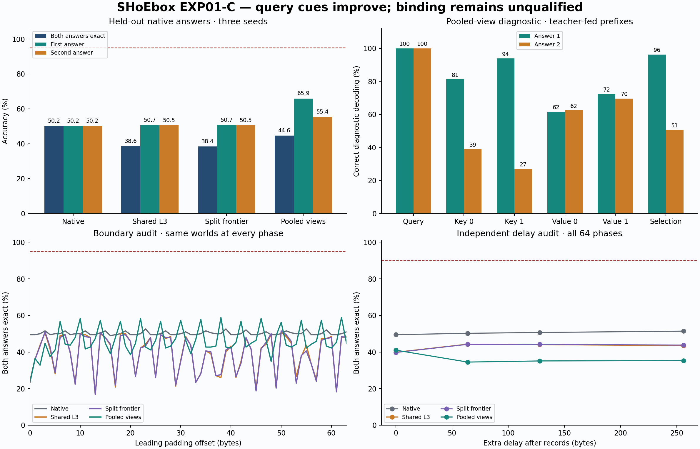
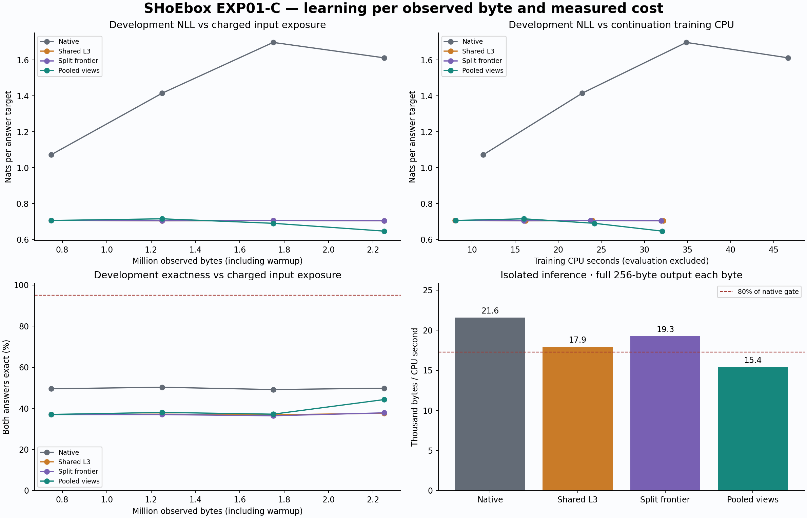

# SHoEbox EXP01-C / EXP22 — stable query-time access

16 November 2026 (America/Denver). Starting main: `bda7bc8`.
Production baseline: minimal corrected C, v19. **No candidate is promoted.**

The new pooled view recovers the **current query byte at 100% in both answer
positions** in the held-out diagnostic, but native two-answer exactness is only
**44.56%**, versus **50.20%** for native.
First-query selection reaches **96.22%**; second-query
selection falls to **50.52%**. Key/value association remains
the problem. The original query signature and record-containing constituents
remain present in every inspected phase/delay case, including native-generated
answer prefixes. This supports a record-preserving readout experiment next.

## Implemented comparison

All candidates retain EXP01-B's five rank-16 projections, one query/key selection,
and residual into the full 256-byte native decoder. The 9,535 fitted head
parameters are deducted from the core budget: 489,919 core + 9,535 readout =
499,454 actual parameters, versus 498,367 for nominal-500K native. This 0.22%
bank-rounding difference is reported; all three research heads match exactly.

- **Shared L3:** the EXP01-B local-credit frozen-core algorithm, now trained
  across offsets. Numerical output and training parity are tested against its
  original implementation. Five duplicated normalizers use the new common
  layout; the original EXP01-B implementation/checkpoints are unchanged.
- **Split frontier:** compose valid partial children at query time, without
  committing a constituent; use completed L3 state for key/value evidence.
- **Pooled views:** learn separate query/key/value pools over existing retained
  stable pairs, completed constituents and valid partial children. Each lane's
  first projection row also scores its source pool, with both gradient paths
  validated. Input coordinates carry content, scale, bounded occurrence age,
  source type and child role. They contain no task-defined record index.

The pool tests fixed stable-content channels, not the retained learned-value
half. Its global pooling can mix evidence from different records. No writer,
admission policy, persistent sequence state, optimizer moments, extra inference
iteration, symbolic store or task parser is added. All candidate cores freeze
after their shared warmup. Prefix-byte reconstruction is task-specific training
supervision; labels and oracle locations are absent from native inference.

## Registered held-out results

Three seeds (1/7/19), fresh grouped world folds, 250K warmup and 2M continuation
bytes per branch. All 64 leading offsets appear during training. Development
selected pooled views (44.27% versus
37.83% for split) before audit access.
All four registered arms were audited; no audit-based retuning occurred.

The primary audit has 1,024 presentations / 256 concrete worlds, balanced over
64 offsets and independent record/query order. All presentation siblings remain
in one split. Seeds share audit worlds; repeated presentations are not additional
independent worlds. Generated answer bytes feed later state.

| Arm | Both answers exact | Seed range | First answer | Second answer | Both query orders |
| --- | ---: | ---: | ---: | ---: | ---: |
| Native | 50.20% | 49.90%–50.68% | 50.20% | 50.20% | 1.56% |
| Shared L3 | 38.64% | 27.44%–46.00% | 50.72% | 50.52% | 2.86% |
| Split frontier | 38.44% | 26.86%–45.80% | 50.65% | 50.46% | 2.86% |
| Pooled views | 44.56% | 32.81%–50.78% | 65.92% | 55.37% | 19.01% |

| Seed | Native | Shared L3 | Split frontier | Pooled views |
| --- | ---: | ---: | ---: | ---: |
| 1 | 50.00% | 27.44% | 26.86% | 32.81% |
| 7 | 50.68% | 46.00% | 45.80% | 50.78% |
| 19 | 49.90% | 42.48% | 42.68% | 50.10% |

The record-encoded learned positive control reaches 100% on the new fold;
query removal reduces its exactness to 0%. Its parsed memory, task-alphabet
output and separate budget make it a learnability control, not a native cost
comparator. The strongest input-order shortcut is 50%.

EXP01-B's 83.37% used fixed-offset training/evaluation. These offset-trained
numbers answer a different question; comparing 44.56% directly with 83.37%
would confound the recipe. The matched shared-L3 control here reaches
38.64%. The pooled candidate improves on that control,
but remains below native whole-episode exactness.

## Failure localization

Teacher-fed inspection on 256 presentations per seed; decoded labels are only
diagnostics. These are neither native output scores nor an inference oracle.

| Answer | Selection | Query byte | Key 0 | Key 1 | Value 0 | Value 1 |
| --- | ---: | ---: | ---: | ---: | ---: | ---: |
| 1 | 96.22% | 100.00% | 81.25% | 93.88% | 61.59% | 72.27% |
| 2 | 50.52% | 100.00% | 38.93% | 26.95% | 62.37% | 69.53% |

The current query is now readable in both positions. Key decoding and selection
collapse at the second query, and value reconstruction remains weak in both.
The source-presence audit independently reconstructs exact stable signatures
for the current two-byte query pair and each eight-byte constituent pair that
contains a complete record. On seed 7, 64 presentations / 16 worlds × 64 offsets
× four delays × two prefix modes, all three signatures remain present at both
answers (100%). Teacher-fed and native-generated prefixes agree. This is exact
presence, not proof of a trained decoder's recoverability. Oracle span locations
are used only by the external inspector and never by native prediction.

## Boundaries, delays and counterfactuals

Boundary-only tests prepend padding before records while preserving every
record-to-query distance. Same 64 presentations / 16 worlds at every phase.

| Arm | Mean over 64 offsets | Worst offset, seed mean | Offset zero |
| --- | ---: | ---: | ---: |
| Native | 50.24% | 48.96% | 49.48% |
| Shared L3 | 39.10% | 16.67% | 24.48% |
| Split frontier | 38.99% | 16.67% | 23.96% |
| Pooled views | 46.28% | 23.44% | 23.44% |

Independent delays insert whole blocks after records, holding answer phase
fixed. Each delay is averaged across all 64 phases, on 16 presentations / four
worlds per seed. Delay worlds are separate from the boundary panel's worlds.

| Arm | +0 bytes | +64 | +128 | +256 |
| --- | ---: | ---: | ---: | ---: |
| Native | 49.48% | 50.23% | 50.68% | 51.40% |
| Shared L3 | 39.88% | 44.30% | 44.04% | 43.49% |
| Split frontier | 39.75% | 44.21% | 44.21% | 43.78% |
| Pooled views | 41.02% | 34.51% | 35.12% | 35.32% |

Counterfactuals fork exactly the same frozen record-prefix state and change
query order, preserving all padding. Pooled both-orders exactness is only
19.01%; it does not qualify query-specific binding.

Frozen pooled-view lesions, all on the same 256 presentations:

| Intervention | Native both-answer exactness |
| --- | ---: |
| unmodified_same_cases | 43.75% |
| no_head | 31.64% |
| no_query | 29.69% |
| no_state | 14.45% |
| uniform | 29.69% |
| reverse | 23.70% |
| no_completed | 0.39% |
| no_partial | 43.75% |
| uniform_pool | 0.00% |

Query removal costs 14.06 percentage points,
below the registered 20-point requirement. Removing completed sources nearly
eliminates success; removing partial sources has little effect on this fixture.
Uniform source pooling also removes success. These establish dependence on the
learned source selection, without establishing correct key/value pairing.

## Learning, compute and memory

| Arm | Training bytes / CPU-s | Inference bytes / CPU-s | Inference vs native | Audit NLL / answer target |
| --- | ---: | ---: | ---: | ---: |
| Native | 42,873 | 21,569 | 100.0% | 1.6020 |
| Shared L3 | 62,139 | 17,949 | 83.2% | 0.7007 |
| Split frontier | 62,635 | 19,263 | 89.3% | 0.7009 |
| Pooled views | 62,400 | 15,398 | 71.4% | 0.6415 |

Training rates include observation, reset/retirement, prefix labels and online
updates, excluding evaluations and dataset construction. Every observed padding
byte is charged. Candidate cores are frozen, so their training rate is not an
equivalent-algorithm speedup over joint native fitting. NLL is measured per
scored answer byte; learning exposure is all input bytes, not only labels.

Inference runs alone, pinned to one CPU: three × 65,536-byte repetitions, seed
7, native 256-byte prediction at every byte in a C++ loop. Pooled throughput is
28.6% below native, failing the <=20% cost gate.
This is a short CPU timing, with raw repetitions retained in `benchmark.json`.

| Resource | Pooled adapter |
| --- | ---: |
| Added fitted weights | 9,535 / 38,140 bytes |
| Online normalization state | 5,160 bytes |
| Persistent sequence-state addition | 0 bytes |
| Optimizer moments | 0 bytes |
| Owned readout cache + error buffer | 27,656 bytes |
| Complete adapter object (including head/cache/statistics/pointer) | 71,008 bytes |
| Existing core Stream + retained arrays, four scales | 289,152 bytes |
| Saved adapter checkpoint | 3,597,943 bytes |

The source bound is 80 allocated scratch entries (at most 77 populated).
The backward call also uses fixed stack gradient arrays: 38,140 bytes for the
head plus 1,280 bytes for five input gradients, and smaller local derivatives.
These are temporary compute buffers, not hidden sequence memory. The listed
289,152 bytes are the named core state arrays, not total process memory; process
RSS and complete checkpoint sizes are retained in `train.json`.

| Training category | Actual charged bytes | Training CPU seconds |
| --- | ---: | ---: |
| Development pilot | 1,750,000 | 30.18 |
| Formal native/head comparison | 25,500,000 | 463.33 |
| Positive controls | 750,000 | 0.13 |
| Total | **28,000,000** | **493.64** |

Formal accounting includes shared reduced warmups once and separate native
warmups. Logical per-branch exposure sums to 27M bytes; actual formal work is
25.5M. The pilot used 1.75M bytes and was not reused as formal training. No batch
probe or unreported fitting run was used. Source inspection is read-only, with
zero fitted parameters and zero training bytes. Compilation, evaluation and
correctness tests are separate from the training CPU totals.

## Qualification and next implementation

| Registered gate | Pooled result |
| --- | --- |
| binding mean | Fail |
| binding every seed | Fail |
| each answer | Fail |
| counterfactual | Fail |
| boundaries | Fail |
| delays | Fail |
| query mechanism | Fail |
| inference cost | Fail |
| no added sequence state | Pass |
| joint language copy scaling regressions | not run: binding gates failed |

105 Python tests pass: 48 runtime, 50 existing research and seven new access
tests. The new 36,497 native numerical/lifecycle checks pass optimized and
ASan/UBSan builds. The complete existing native runtime/sanitizer suite passes.
Checks cover gradients including tied pooling, causal labels, source-read
immutability, native/EXP01-B parity, exact checkpoint continuation across
partial boundaries and independent first/second-answer scoring. LeakSanitizer
was explicitly disabled for this host; ASan and UBSan remained enabled.

No production runtime file changes. Historical checkpoint policies and EXP01-B
remain available. Binding, boundary, delay, counterfactual and cost gates fail;
joint-credit, language/copy/reconstruction and 1M/5M promotion campaigns remain
gated, not passed or silently waived.

**Next: EXP01-D / EXP22 — preserve constituent-level key/value association.**
Decode keys and values together from individual existing retained constituents
before pooling, then apply shared query-conditioned weights to both. Handle
within-constituent phase explicitly and compare fixed stable versus learned
content channels at matched weights/state. Keep the now-readable current query
separate. First verify whether complete record pairs can be decoded across
phases and both queries; do not infer a need for new storage from a failed
global pool. Register fresh budgets/folds, preserve first/subsequent-query and
counterfactual gates, and return to joint credit only after native binding works.

## Primary literature and evidence

- [Miller et al., EMNLP 2016](https://aclanthology.org/D16-1147/), section 3:
  separates address and returned-value encodings. Adapted here to neural state.
- [Dai et al., ACL 2019](https://aclanthology.org/P19-1285/), sections 3.2–3.3:
  completed-context reuse across segment boundaries. No new cache is added here.
- [Sun et al., 2023](https://arxiv.org/abs/2307.08621), section 2.1:
  within-chunk versus recurrent contributions motivate the split-frontier view;
  this experiment does not implement RetNet.
- [Yang et al., ICLR 2025](https://openreview.net/forum?id=r8H7xhYPwz):
  targeted memory correction and forgetting motivate separating access failure
  from a write-rule problem. No delta-rule mechanism is implemented here.

The SHoEbox measurements above are original to this experiment, not claims from
those papers. [Preregistered protocol](PROTOCOL.md) ·
[Implementation and reproduction](../../experiments/query_access/README.md).
Raw plans, source hashes, curves, audit results, lesions, delays, counters,
timings, presence checks and verification logs accompany this report.
