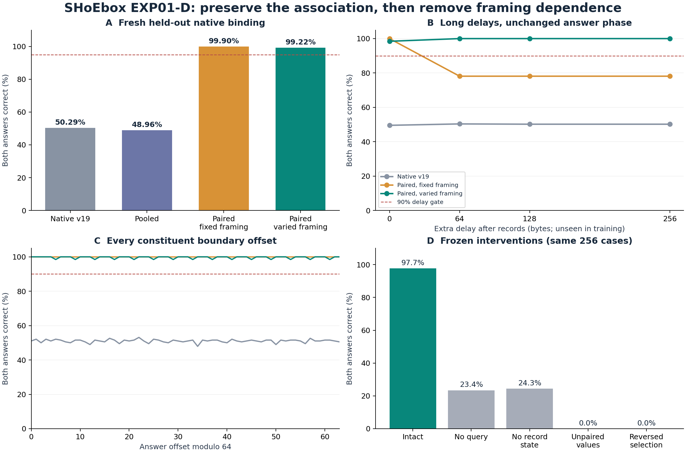
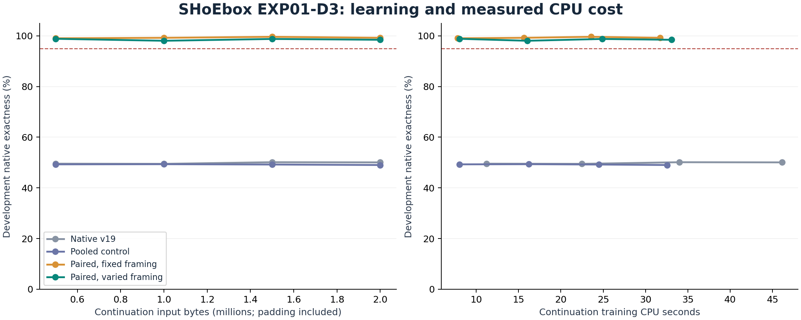

# SHoEbox EXP01-D / EXP22 — constituent pairing and stable query access

16 November 2026 · Minimal corrected C v19 · Seeds 1, 7, 19

**PASS: binding behavior and cost gates.** The final readout reaches **99.22% native two-answer exactness**, versus 50.29% native and 48.96% pooled. It preserves key/value pairing inside existing constituents, chooses the latest learned query cue, and learns independence from surrounding framing bytes.

All-offset mean: 99.63%; worst offset: 98.44%. Both query orders: 96.88%. Relative inference throughput: 88.74%. **No added persistent sequence state.** Production remains minimal v19; joint-core and language/copy/reconstruction/capacity promotion qualifications are pending.

## Final fresh audit

| Arm | Seed 1 | Seed 7 | Seed 19 | Mean exact | First answer | Second answer | Both orders |
| --- | ---: | ---: | ---: | ---: | ---: | ---: | ---: |
| Native v19 | 50.00% | 50.59% | 50.29% | 50.29% | 50.29% | 50.29% | 2.60% |
| Pooled control | 50.00% | 48.34% | 48.54% | 48.96% | 50.26% | 50.23% | 0.26% |
| Paired, fixed framing | 99.90% | 99.90% | 99.90% | 99.90% | 99.90% | 100.00% | 99.22% |
| Paired, varied framing | 99.22% | 99.22% | 99.22% | 99.22% | 99.61% | 99.61% | 96.88% |

Each seed uses 1,024 presentations / 256 concrete worlds. Record order and query order are independently balanced; sibling presentations remain in one split. Seeds share audit worlds, so 3,072 predictions are not 768 independent worlds. Task framing and query bytes are supplied. The two scored answer bytes use autoregressive argmax over all 256 bytes; generated first answers enter the second-query state. The record-encoded learned positive control is 100% for every seed, separately budgeted and never used by native inference. The strongest registered shortcut is 50%.

## What changed

1. **Preserve pairing.** Score all four possible phases of each existing eight-byte retained pair. Select two candidate constituents; decode each key and its value together. Query/key distances determine one shared pair of mixing weights. Only then combine the values.
2. **Separate recognition from recency.** A learned classifier recognizes query-containing two-byte constituents. Among positive candidates, select the most recent existing occurrence. Recognition confidence cannot override recency. If none is positive, use the historical score-minus-age fallback.
3. **Remove framing dependence during training.** Independently insert 0–7 padding bytes after records, and adjust leading padding so all 64 answer phases remain balanced. This varies the neighboring bytes inside a constituent. Long +64/+128/+256 delays never appear in training.

Inference receives only existing neural state. There is no hand-coded symbol parser, selected-record index, external exact store, extra slot, history tape, optimizer moment, or replay loop. Local training supervision does identify query/record syntax in already observed windows and reconstructs observed bytes; it never performs the requested lookup. This supervised research mechanism is separate from an unsupervised language-model capability.

## Registered gate checks

| Gate | Measured | Required | Result |
| --- | ---: | ---: | --- |
| primary mean native exact | 99.22% | ≥95.00% | PASS |
| minimum seed native exact | 99.22% | ≥90.00% | PASS |
| first_answer mean | 99.61% | ≥95.00% | PASS |
| first_answer minimum seed | 99.61% | ≥90.00% | PASS |
| second_answer mean | 99.61% | ≥95.00% | PASS |
| second_answer minimum seed | 99.61% | ≥90.00% | PASS |
| both query orders mean | 96.88% | ≥90.00% | PASS |
| both query orders minimum seed | 96.88% | ≥85.00% | PASS |
| all-offset mean | 99.63% | ≥95.00% | PASS |
| worst offset seed mean | 98.44% | ≥90.00% | PASS |
| +0 delay mean | 98.44% | ≥90.00% | PASS |
| +0 delay minimum seed | 98.44% | ≥85.00% | PASS |
| +64 delay mean | 100.00% | ≥90.00% | PASS |
| +64 delay minimum seed | 100.00% | ≥85.00% | PASS |
| +128 delay mean | 100.00% | ≥90.00% | PASS |
| +128 delay minimum seed | 100.00% | ≥85.00% | PASS |
| +256 delay mean | 100.00% | ≥90.00% | PASS |
| +256 delay minimum seed | 100.00% | ≥85.00% | PASS |
| query removal drop | 74.22% | ≥20.00% | PASS |
| reversed selection drop | 97.66% | ≥0.00% | PASS |
| relative inference throughput | 88.74% | ≥80.00% | PASS |

Offset sweep: identical 64 presentations / 16 worlds at every offset, per seed. Delay sweep: identical 16 presentations / four worlds crossed with all 64 offsets, separately per delay and seed. These delay checks cover padding, not arbitrary distractor writes or eviction. Counterfactual query orders fork the identical record-prefix state.

| Extra delay | Fixed-framing paired control | Final varied-framing readout |
| --- | ---: | ---: |
| +0 bytes | 100.00% | 98.44% |
| +64 bytes | 78.12% | 100.00% |
| +128 bytes | 78.12% | 100.00% |
| +256 bytes | 78.12% | 100.00% |

## Failed designs retained

D1 preserved constituent pairing but used confidence minus age for query routing. Final development exactness was 90.04%: first answers 99.41%, second answers 90.23%. Fitting increased confidence differences enough for an older query to win. D2 replaced that competition with latest-positive recognition; a frozen development intervention alone raised exactness to 99.02%. D1 checkpoint semantics and logits remain byte-identical under the new implementation.

D2 reached 99.41% on its primary audit and 100% over its offset sample, but approximately 86% on the longer-delay audit, failing the unchanged 90% threshold. A separate development diagnostic found query decoding stayed 100% while both-key decoding fell from 87.5% to 40.625%. The remaining failure was sensitivity to adjacent framing. D3 changed training coverage, retained the same runtime, and used a fresh audit excluding every world in the previously opened primary audit. No thresholds were relaxed.

## Capacity, memory and work

| Component | Fitted parameters |
| --- | ---: |
| Five local presence classifiers | 325 |
| Four record-key projections plus query projection | 5,200 |
| Four value projections | 2,080 |
| Native 255-node residual output | 2,295 |
| **Readout total** | **9,900** |

Candidate core: 489,919 parameters; combined: 499,819, within the nominal 500K budget. Native actual capacity is 498,367; pooled control is 499,454. Small differences reflect indivisible expert banks. New readout weights occupy 39,600 bytes; forward scratch and native error storage occupy 2,108 bytes. No normalization accumulators or optimizer moments. Existing stream/retained state remains 289,152 bytes in the reported inventory. At most 16 query candidates and 64 constituent-phase candidates are scanned; only two record key/value projections are evaluated.

| Arm | Full-distribution inference bytes/CPU-s |
| --- | ---: |
| Native v19 | 22,564 |
| Pooled control | 15,527 |
| Paired, fixed framing | 19,787 |
| Paired, varied framing | 20,024 |

Inference timing uses a pinned CPU, 65,536 bytes per repetition, three interleaved repetitions, full 256-byte distributions on every byte, one native C++ pass. Compilation, cloning and warmup are excluded. Candidate core freezing makes training timing a frozen-readout measurement, not a speed comparison between equally trained language models.

## Complete fitting cost

| Stage | Charged input bytes |
| --- | ---: |
| D1 pilot | 750,000 |
| D1 four-arm, three-seed comparison | 26,250,000 |
| D2 corrected query policy, three seeds | 6,750,000 |
| D2 positive controls | 750,000 |
| D3 development pilot | 2,250,000 |
| D3 four-arm, three-seed comparison | 26,250,000 |
| D3 positive controls | 750,000 |
| **Total** | **63,750,000** |

Every padding byte is charged. Local query/constituent reconstruction updates are additional supervised objectives within the same observed stream; counts and CPU costs are retained in raw inventories (the historical `normalization_samples` field contains local-window updates in D1–D3, not a normalizer). Correctness-test toy updates are excluded from fitted research costs. Evaluations are frozen and not training.

## Verification and reproducibility

See `verification.json` and its logs for the exact checks. Native parity, local derivatives, paired-source permutation, query routing, frozen read-only behavior, causal label timing, all-boundary checkpoint continuation and legacy D1-policy compatibility are checked. Optimized and ASan/UBSan checks pass. LeakSanitizer is disabled because this host runs under ptrace. Public production and historical runtime source files are unchanged. The selected checkpoints have companion training cursors containing both RNG states, remaining shuffled order and partial-episode position. A 1,000-byte continuation is byte-identical when interrupted at 371 bytes, saved/reloaded, and resumed for 629 bytes on every seed.

The source and commands are in [experiments/constituent_readout/README.md](../../experiments/constituent_readout/README.md). Protocol and stage-specific source hashes precede fitting. D2 and D3 selections were locked before their audits. All successful and unsuccessful fits are accounted for; compact raw results accompany this report.

## Literature and adaptation

- Miller et al., EMNLP 2016, sections 3.1–3.2: [Key-Value Memory Networks](https://aclanthology.org/D16-1147/). Separate address/value encodings, common attention weights for associated pairs, and position-sensitive window encoding motivate the readout. Our candidates are pre-existing neural constituent pairs.
- Arora et al., ICML 2024: [Simple linear attention language models balance the recall-throughput tradeoff](https://proceedings.mlr.press/v235/arora24a.html). Motivates multi-query recall, explicit state accounting and throughput qualification; no BASED cache is added.
- Wang, Shi and Fox, JMLR 2026: [Test-time regression](https://jmlr.org/papers/v27/25-0903.html). Separates memorization from retrieval and analyzes query/key normalization; here evidence availability and learned decoding are tested separately.

## Next development item

EXP01-E: integrate and qualify the successful paired readout with joint native-core learning. Register language, selective-copy and bounded reconstruction regressions, plus 1M/5M binding comparisons, before changing the production default. Include a learned applicability gate for the residual and distinguish local fixture supervision from generic byte-training objectives. Keep the D3 binding/delay fixture as a regression. New slots, optimizer sweeps and reasoning loops remain outside this repair.
