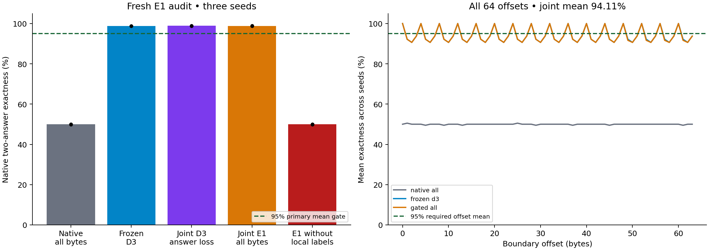
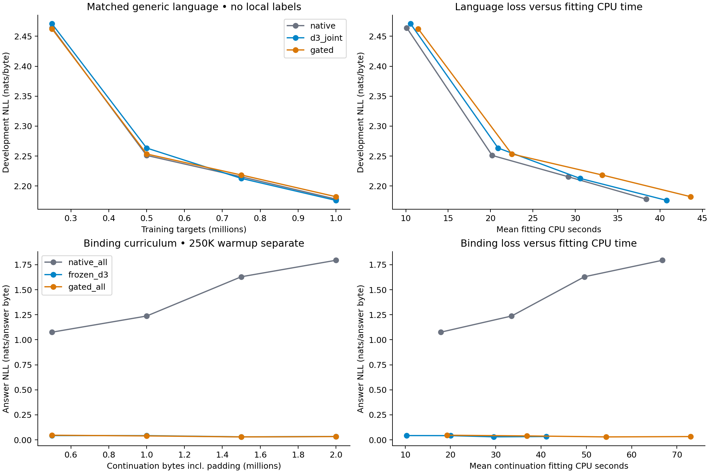
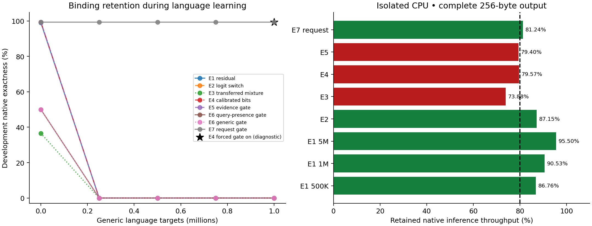

# SHoEbox EXP01-E: joint readout and applicability qualification

16 November 2026. Starting main: `428fb0b0272d81b832a8a10263b44218b23cff3d`.
Production remains minimal corrected-C v19. No candidate is promoted.

## Findings

The E1 joint residual readout reaches **98.83% native two-answer exactness**
across three seeds, within its nominal 500K budget, at **86.76% native inference
throughput**. Its fresh all-offset mean is **94.11%, below the unchanged 95%
gate**, and binding falls to zero after generic language continuation. Frozen
D3 also scores 94.14% across offsets on this fresh fold. The earlier D3 audit
remains valid on its own registered worlds; it does not guarantee every new
world sample passes. None of these audits was used to tune a revision.

Seven preserved revisions isolate two different failures: freely fitted output
calibration drifts, then generic-loss applicability suppresses a still-correct
readout. **E7 fixes retention in a seed-7 development pilot**: 99.41% native
exactness before and after 1M language targets, 98.05% offset mean, 95.31% worst
offset, 99.22% both query orders, and 100% at all registered padding delays.
It uses explicit observed-request local supervision. Its fresh three-seed
generic qualification fails, so this is not a production or general-language
result. E8's focused cold-start gate revision is registered but not fitted.

## Design and supervision

All inference is causal, online, bounded, and uses the existing constituent
state. The readout preserves each key/value pair, selects the latest recognized
query, and mixes values only after addressing. No hand-coded inference parser,
oracle source index, external exact store, new slots or history tape is added.
The stable constituent features are fixed byte-derived channels; successful
readout training does not prove learned upper-summary specialization.

E1 jointly teaches native core, residual output and a 65-weight sigmoid using
combined byte cross-entropy. Discrete source selection and key/value decoding
also receive **fixture-specific observed-window labels**. The local projections
are not trained end-to-end through the discrete top-two selector. The no-local
control measures this dependence. Generic language/copy/reconstruction fits
construct no such labels. E6/E7 freeze local applicability when labels are absent.
Their classifier is learned from fixture supervision, not generic byte loss.

Primary literature retained in code and registrations:

- Miller et al., [Key-Value Memory Networks, EMNLP 2016](https://aclanthology.org/D16-1147/): paired addressing and value representations.
- See et al., [Pointer-Generator Networks, ACL 2017 §2.2](https://aclanthology.org/P17-1099/): learned generation/retrieval switching. These experiments mix byte logits or distributions, not source pointers.
- Arora et al., [Simple linear attention language models balance recall-throughput tradeoffs, ICML 2024](https://proceedings.mlr.press/v235/arora24a.html): measure recall alongside throughput/state.
- Jaderberg et al., [Decoupled Neural Interfaces, ICML 2017](https://proceedings.mlr.press/v70/jaderberg17a.html): local credit context; no synthetic-gradient model is implemented here.

## Registered comparisons and data integrity

E1 compares six arms at 500K, seeds 1/7/19. Each receives its own 250K native
warmup plus 2M continuation bytes. Episode order, 0–7-byte record spacing,
balanced phases and budgets are matched; long delays are not trained. Answer
masks and every-byte objectives are explicitly separate controls. Final
snapshots and source hashes are locked before the audit, with no audit-based
selection. Full 256-byte autoregressive answers feed subsequent queries.

E1 has fresh grouped 2,048 train /512 development /1,024 audit presentations,
excluding opened D2/D3 audit worlds. E2–E7 use another grouped split excluding
D2/D3/E1 audit worlds. Their binding audit remains **unopened**. Sibling query/
record orders stay together. The E1 audit reuses worlds across seeds; seeds are
not independent task samples. Offset checks use the same 64 presentations at
each phase; each delay uses the next 16 at all 64 phases, preserving D3 sizes.

Generic data has document-grouped FineWeb splits, UTF-8, document resets and
pinned document/content/byte hashes. E7 uses new grouped generic folds excluding
all opened E1 audit groups. Its development failure stops the new audit, which
remains unopened. All original gates and margins remain unchanged.

## E1 audit and ablations

| 500K arm | Native exact mean | Seed 1 /7 /19 | All-offset mean |
| --- | --- | --- | --- |
| native_masked | 49.87% | 50.00% / 49.80% / 49.80% | 49.18% |
| frozen_d3 | 98.83% | 98.83% / 98.83% / 98.83% | 94.14% |
| joint_d3 | 98.86% | 98.83% / 98.83% / 98.93% | 94.14% |
| native_all | 49.93% | 50.00% / 49.80% / 50.00% | 49.96% |
| gated_all | 98.83% | 98.83% / 98.73% / 98.93% | 94.11% |
| gated_no_local | 49.93% | 50.00% / 49.80% / 50.00% | 50.03% |

The primary mean threshold is 95%, every seed 90%; the same thresholds apply
to each answer position. E1 first-answer scores are 99.61% / 99.61% / 99.71%;
second-answer scores are 99.22% / 99.12% / 99.22%. Both-query-order
exactness averages 98.18% (required 90% mean,
85% each seed). The worst offset averaged across seeds is 90.62%
(required 90%), but the all-offset mean fails 95%. Every seed is 100% at
independent +0/+64/+128/+256 delays.

On the matched 256-presentation intervention sample, unmodified exactness is
99.09%; no-query 31.77%,
no-state 22.66%, no-head 16.54%,
uniform addressing 31.77%, reversed addressing 0%,
and unpaired values 0%. The no-query drop exceeds 20 percentage points and
reverse strictly hurts. Full raw per-seed/offset/delay results are preserved.

## Generic regressions, retention and capacity

The independent E1 generic fits pass the registered mean margins: language
NLL increase at most 0.01 nats/byte; copy/reconstruction token-accuracy decline
at most one percentage point. These independent fits do not establish retained
binding. Continuing each E1 binding checkpoint on 1M generic targets produces
0% binding exactness in every seed, already by 250K targets.

| E1 held-out audit | Native | D3 joint | E1 gated | Gated minus native |
| --- | --- | --- | --- | --- |
| language | 2.385185 | 2.387556 | 2.390122 | +0.004937 nats |
| selective_copy | 68.88% | 71.88% | 70.57% | +1.693 pp |
| compression | 77.02% | 76.82% | 76.82% | -0.195 pp |

Reconstruction uses its separately budgeted final-L3 MLP, not native language
answers. Full-answer exactness and zero-bottleneck controls are in raw evidence.

| Nominal | Actual native /joint parameters | Joint exact | Offset mean /worst | Relative inference |
| --- | --- | --- | --- | --- |
| formal | 498367 / 499884 | 98.83% | 94.11% / 90.62% | 86.76% |
| 1m | 996799 / 998316 | 98.89% | 94.14% / 90.62% | 90.53% |
| 5m | 4996927 / 4998444 | 98.86% | 94.14% / 90.62% | 95.50% |

Here `formal` means nominal 500K. All three capacities pass primary binding,
query-order and padding-delay gates, but all fail the 95% all-offset mean.
Capacity does not repair the measured boundary-generalization failure. The
1M/5M results qualify only the E1 candidate, not later pilot revisions.

## Preserved revisions and measured diagnosis

| Revision | Experiment | Development outcome |
| --- | --- | --- |
| E1 | Joint residual logits + generic-loss gate | Binding succeeds; fresh offset audit and language retention fail |
| E2 | Independent absolute logits with learned switch | Fresh binding 99.41%; after language 0%; full-alphabet calibration drifts |
| E3 | Exact probability mixture, transferred E2 weights | 36.52% before language, 0% after; conditional from-scratch fit not triggered |
| E4 | Calibrated eight-bit value distribution | 99.41% before, 0% after; forcing gate on restores 99.41% |
| E5 | Add three query/record-presence gate features | 99.41% before, 0% after; features do not prevent gate suppression |
| E6 | Locally supervise current query presence | Both fresh arms 50% before, 0% after; label targets the query rather than delayed answer request |
| E7 | Locally supervise observed answer-request marker | 99.41% before and after language; generic development qualification fails |

E3 is a failed **transferred-policy** pilot, not evidence against a mixture
trained from scratch. E4 removes 2,295 fitted output weights; generic value-bit
calibration leaves 7,670 fitted readout/gate weights. After E4 language training,
local query/value diagnostics and forced-gate native NLL are unchanged. Natural
answer gating falls from 0.52071 to 0.15078; restoring only the old intercept does
not fix it. This identifies gate plasticity in addition to the earlier output
calibration drift.

E6's gate equals its trained query recognizer exactly, but at a delayed answer
the observed prefix is padding plus ANSWER, not QUERY plus key. Its supplied
target is negative there and answer gating is 0.0000676. E7's sixth training-only
label marks the already observed request byte, without inspecting the answer
mask or future target. Prefix causality and identical generic-control trajectories
are checked. E7 preserves every development binding gate before and after
language; the new generic screen below prevents promotion.

| E7 fresh development | Native | D3 joint | E7 request gate | E7 minus native |
| --- | --- | --- | --- | --- |
| language | 2.227511 | 2.239362 | 2.746686 | +0.519175 nats |
| selective_copy | 72.01% | 71.61% | 70.96% | -1.042 pp |
| compression | 77.41% | 77.93% | 77.93% | +0.521 pp |

E7 language worsens by 0.519175 nats/byte and copy declines 1.042 percentage
points, exceeding both margins. Its untrained, frozen 0.5 gate assigns half
the distribution to an untrained readout. Bypassing that gate after fitting
still gives 2.504123 mean development NLL: the mixture also weakened native
learning, so post-fit output rescaling alone is insufficient.
E8 registers a fixed cold prior of
1/256, then repeats development and full qualification; it also requires
measuring generic-text activation after local binding training. No E8 fit or
passing result is claimed. E7's conditional formal binding/1M/5M runners are
provided but were not launched after this prerequisite failed.

## Speed, parameters and state

E1 has 9,965 fitted adapter parameters, 499,884 actual combined at nominal 500K.
Frozen/joint D3 has 9,900 and 499,819. Native has 498,367. E4/E6/E7 use 7,670
adapter parameters and 497,589 combined; E5 uses 7,673 and 497,592. These small
undershoots reflect indivisible expert banks, not hidden extra parameters.
Additional persistent sequence state and optimizer moments are zero. The native
stream/retained structures reported by the adapter occupy 289,152 bytes; this
is **not** the complete native allocation. E1 adapter prediction scratch is
2,368 bytes; E7 is 2,408. The comparison wrapper reserves unused head storage
for the native control; allocated and fitted counts are separately recorded.

Isolated pinned-CPU timing uses all 256 outputs at every byte, 65,536 bytes,
three interleaved repetitions, with compilation/cloning excluded. E1 retains
86.76% native speed at 500K, 90.53% at 1M, 95.50% at 5M. E2 retains 87.15%;
E3/E4/E5 prototypes retain 73.88%/79.57%/79.40%, failing the 80% threshold.
E6/E7 cache eight repeated bit softplus values with exact numerical parity;
E7's isolated retained-pilot ratio is **81.24%**. This timing pass alone
does not qualify the failed generic candidate.

## Complete fitting ledger and verification

**130,250,000 charged bytes**, including **86,937,305 padding bytes**,
across 147 recorded fitting phases (warmups counted separately), use
**4419.83 fitting CPU seconds**. Frozen evaluations, compilation,
checkpoint I/O and discarded correctness-test updates are outside that timer;
no unmeasured total experiment CPU time is implied. Parallel jobs' CPU seconds
are summed, not confused with wall time. All pilots and failed continuations
are included. Transferred weights are charged once at their original fit.

| Campaign | Charged bytes | PAD bytes | Fit CPU seconds |
| --- | --- | --- | --- |
| pilot | 2,250,000 | 1,941,103 | 70.49 |
| formal | 40,500,000 | 34,939,854 | 1226.45 |
| 1m | 20,250,000 | 17,469,927 | 722.11 |
| 5m | 20,250,000 | 17,469,927 | 688.93 |
| regressions | 13,500,000 | 3,683,142 | 497.11 |
| retention-pilot | 1,000,000 | 0 | 42.44 |
| retention | 3,000,000 | 0 | 127.20 |
| switch-pilot | 3,250,000 | 1,941,103 | 121.76 |
| mixture-pilot | 1,000,000 | 0 | 43.89 |
| calibrated-pilot | 1,000,000 | 0 | 42.56 |
| evidence-gate-pilot | 1,000,000 | 0 | 37.50 |
| local-gate-pilot | 3,250,000 | 1,941,103 | 120.17 |
| local-gate-control | 3,250,000 | 1,941,103 | 121.96 |
| request-gate-pilot | 3,250,000 | 1,941,103 | 114.10 |
| E7-regressions | 13,500,000 | 3,668,940 | 443.17 |

Counters record 24,828,544 local projection-vector steps,
101,982,686 presence-classifier steps, 45,998,848
applicability steps, and 70,308 reconstruction-MLP steps.
These are objective/vector events, not counts of scalar coefficient writes.
Internal native auxiliary work is included in measured CPU/bytes; its individual
scalar updates are not instrumented. Formal binding worker peaks are about
58 MiB (500K), 80 MiB (1M), and 206 MiB (5M), including Python/evaluation;
other phases did not record peak RSS. See `accounting.json` for every fit,
target count, actual parameter/state inventory and exact padding accounting.

All **160 Python tests** pass (48 runtime, 76 existing research/E1, 6 E2, 7 E3,
4 E4, 5 E5, 6 E6, 8 E7). New native suites pass **2,860 checks per optimized
and ASan/UBSan build**, alongside the existing native suite. Tests cover
normalized full-byte probabilities, gate derivatives, observed-prefix causality,
frozen local heads/gates, all partial phases, checkpoint-policy separation and
exact continuation. Eight actual trained checkpoint/cursor pairs also pass
1,000 uninterrupted updates versus 371 + save/load +629 updates byte-for-byte.
Those discarded correctness updates are not selected research fits.

Production runtime and historical D1/D2/D3 source and checkpoint formats remain
unchanged. Each E policy has its own magic. No dataset, trained model, compiled
binary or temporary snapshot is committed. Downloaded evidence includes selected
resumable checkpoints, both RNG states, remaining shuffled order, partial episode
positions, document boundaries and corpus hashes, plus a source/evidence manifest.

## Continue

Read `AMENDMENT_E8.md`, then execute that fixed cold-start revision. Preserve
the original thresholds and all unopened folds. Promote only after complete
three-seed binding/retention, generic, 1M/5M and engineering qualifications pass.
Direct verified main publication is already authorized, including unsuccessful
research results; preserve remote history and never force-push.
