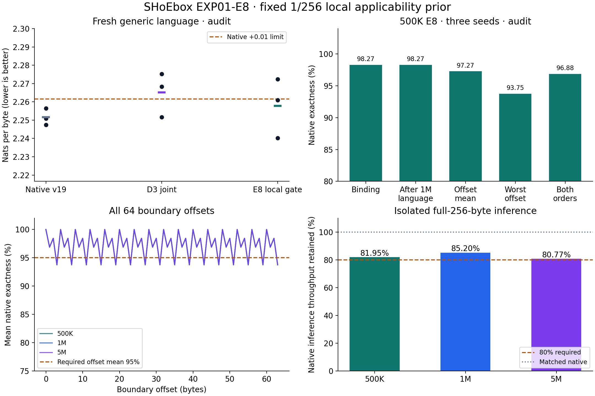
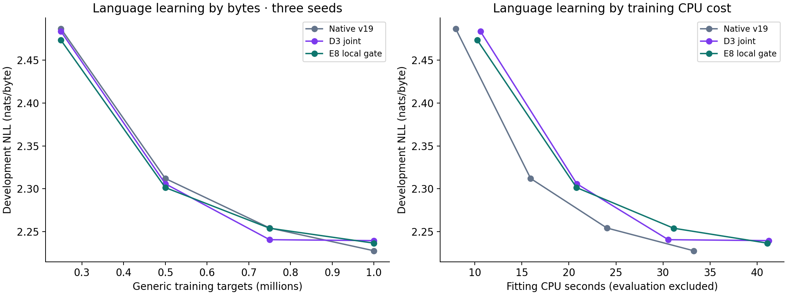

# SHoEbox EXP01-E8: cold-start applicability qualification

16 November 2026 · Starting main: `c29693f8a2bd2b1c11ed895dda26b455d3e7e847`

**E8 passes every registered research qualification gate.** Held-out native
binding averages **98.27%**, unchanged after 1M generic language targets.
Language increases by **0.006233 nats/byte**, within the 0.01 margin; selective
copy and reconstruction decline by only **0.1302 and 0.3255 percentage points**.
The 1M/5M capacity audits and isolated throughput gates also pass.

Public `shoe_multiscale.Model` remains minimal corrected-C v19. The qualified
implementation is the explicitly named E8 research adapter. The next work is
[public API integration and versioned promotion](PUBLIC_INTEGRATION_PLAN.md),
with numerical equivalence and historical compatibility checks before changing
the public default. E7 and all earlier checkpoint meanings are unchanged.

## The single registered model change

Only the local applicability intercept changes: zero becomes `-log(255)`,
i.e. `logit(1/256)`. Every other initial coefficient, rate, objective, state,
RNG stream and capacity rule is E7's. The new E8 outer checkpoint magic is
`0x38455041514853`; E7 and E8 reject each other's checkpoints. Tests establish
that restoring identical weights makes their numerical trajectories identical.

Local applicability and key/value extraction still receive explicit
**fixture-local observed-prefix supervision**. Generic language, copy and
reconstruction supply no such labels. Those heads remain frozen on generic
streams; native core learning uses the preserved mixture-responsibility credit.
Inference uses continuous existing constituent features, with no task parser,
byte equality test, answer/source oracle, exact store, new slot or history tape.
This does not establish learning those local heads from generic byte loss.

## Fresh three-seed held-out binding

Each arm receives its own 250K warmup +2M continuation bytes and then 1M
language targets. Seeds are 1, 7 and 19. Both generated answer bytes use the
full 256-byte alphabet, and generated first answers enter second-query state.

| Nominal 500K arm | Native exact before language | After 1M language | Offset mean before language |
| --- | ---: | ---: | ---: |
| Native, every-byte objective | 48.31% | 0.00% | 48.73% |
| Frozen-core D3, answer objective | 98.31% | 0.00% | 97.27% |
| Generic-loss applicability | 49.80% | 0.00% | 49.99% |
| **E8 local applicability** | **98.27%** | **98.27%** | **97.27%** |
| E8 without local labels | 49.19% | 0.00% | 50.24% |

The frozen-core D3 control freezes its native core; its output readout remains
trainable during language continuation. The control names do not imply all
weights were frozen. Every repeated control is charged anew.

| E8 audit gate | Before language | After language | Requirement |
| --- | ---: | ---: | ---: |
| Native exact, mean | 98.2747% | 98.2747% | >=95% |
| Native exact, minimum seed | 98.2422% | 98.2422% | >=90% |
| First answer, mean / minimum seed | 99.3490% / 99.3164% | same | >=95% / >=90% |
| Second answer, mean / minimum seed | 98.9258% / 98.9258% | same | >=95% / >=90% |
| Both query orders, mean / minimum seed | 96.8750% / 96.8750% | same | >=90% / >=85% |
| All 64 offsets, mean | 97.2656% | 97.2656% | >=95% |
| Worst offset averaged across seeds | 93.7500% | 93.7500% | >=90% |
| Each independent +0/+64/+128/+256 delay | 100% every seed | 100% every seed | >=90% mean / >=85% each |
| No-query exactness drop | 97.6563 points | 97.6563 points | >=20 points |
| Reversed selection | 0% exact | 0% exact | strictly hurts |

Per-seed primary exactness is **98.2422%, 98.3398%, 98.2422%**. On the same
256-presentation lesion sample, unmodified exactness is 97.6563%; no-head,
no-query, no-state, uniform addressing, reversed addressing, unpaired values
and gate-off all score zero. Gate-on preserves 97.6563%. Full raw position,
query-order, teacher-forced, restricted-output and native results are retained.

The audit uses 1,024 presentations /256 concrete worlds shared across seeds,
not independent world samples per seed. Query-order and lesion samples have
256 presentations. The same first 64 presentations are used at every offset;
the next 16 are crossed with all 64 offsets at each independent delay. Long
padding delays were never trained. These are padding-delay results.

## Generic language, copy and reconstruction

Independent fresh fits use the pinned E7 document/synthetic folds, excluding
previously opened E1 audit groups. Each arm/seed receives 1M language targets,
250K copy bytes and 250K reconstruction bytes. No local syntax labels are used.
The language corpus is UTF-8, document-grouped, hash-pinned and reset between
documents. Reconstruction uses its separately budgeted final-L3 MLP.

| Held-out audit | Native v19 | D3 joint | E8 | E8 minus native | Gate |
| --- | ---: | ---: | ---: | ---: | --- |
| Language NLL, nats/byte | 2.251579 | 2.265108 | 2.257813 | +0.006233 | PASS, <=+0.01 |
| Copy token accuracy | 69.7917% | 70.8333% | 69.6615% | -0.1302 points | PASS, >=-1 point |
| Reconstruction token accuracy | 78.2552% | 77.9297% | 77.9297% | -0.3255 points | PASS, >=-1 point |
| Copy whole-answer exactness | 39.5833% | 41.6667% | 39.3229% | -0.2604 points | reported |
| Reconstruction whole-answer exactness | 38.2813% | 36.9792% | 36.9792% | -1.3021 points | reported |

The registered reconstruction margin is **token accuracy**, not whole-answer
exactness; the latter is disclosed separately. Zeroing the reconstruction
bottleneck reduces E8 token accuracy to 4.88% /4.69% /5.47% across seeds.
D3 joint is a control, not the selected candidate; its +0.013529 language NLL
increase does not pass E8's candidate language margin.

Development triggered this audit with +0.008880 nats/byte, -0.1302 copy points
and +0.5208 reconstruction points. The failed E7 fresh generic fits remain
historical evidence: +0.519175 nats/byte and -1.0417 copy points. All 18 repeated
native/D3 generic checkpoint payloads reproduce E7's corresponding controls
exactly, including every reconstruction decoder array; ZIP timestamps differ.

## Applicability after local fitting

The seed-7 development pilot repeats E7's exact order and budget: 250K warmup,
2M binding, then 1M original pinned retention-corpus targets. It retains 99.41%
exactness, 98.05% offset mean, 95.31% worst offset, 99.22% both query orders and
100% padding delays. Pilot success is separate from the three-seed audit above.

On the **E7 generic development corpus**, after local binding fitting, mean
applicability falls from E7's **14.1820%** to E8's **1.8463%**. E8 exceeds 0.5
on 1.1795% of these positions. At fixture answer requests its mean gate is
99.9667%. Generic continuation leaves these local gate weights unchanged.

| Same retained seed-7 checkpoint, generic development text | Natural gate NLL | Forced-off gate NLL |
| --- | ---: | ---: |
| E7 | 2.496950 | 2.300721 |
| E8 | 2.292667 | 2.279720 |

Thus E8 substantially reduces post-fitting false applicability; its remaining
same-core mixture cost is 0.012946 nats/byte on this diagnostic. This comparison
is not the registered independent-fit native regression margin. It is retained
as a distinct measurement, with no threshold or coefficient selected from it.
No audit data informed the prior or any subsequent fitted change.

One frozen diagnostic initially cleared the forced-off intervention through a
nested clone. That field was discarded and remeasured directly. Both source
hashes, the superseded record and corrected results are retained. The helper
was not used by fitting; no weights, selection or qualifying score changed.

## Capacity, throughput and state

| Nominal capacity | Actual native /E8 parameters | E8 audit exact | Offset mean /worst | Relative native inference |
| --- | ---: | ---: | ---: | ---: |
| 500K | 498,367 /497,589 | 98.2747% | 97.2656% /93.7500% | 81.95% |
| 1M | 996,799 /996,021 | 98.2747% | 97.2656% /93.7500% | 85.20% |
| 5M | 4,996,927 /4,996,149 | 98.2747% | 97.2656% /93.7500% | 80.77% |

The post-language 500K comparison retains **80.37%** of matched native speed.
All exceed the unchanged 80% threshold. Timing uses one pinned CPU, three
interleaved 65,536-byte repetitions, and complete 256-byte output at every
input byte, with all other local jobs stopped. Compilation, cloning and
warmup are excluded. Raw timings and matched checkpoint hashes are recorded.

E8 has **7,670 fitted readout/applicability parameters**, deducted from bank
capacity, 2,408 bytes of prediction scratch, zero added persistent sequence
state, and zero optimizer moments. Existing stream/retained structures occupy
289,152 bytes; this is not total model allocation. Indivisible expert banks
explain small nominal-budget undershoots. Peak worker RSS and actual inventories
are in raw results and whole-process cost records.

## Complete research fitting ledger

**106,000,000 new charged input bytes**, including **69,666,442 padding bytes**,
across 111 fitting phases. All failed/control fits and warmups are retained.
There are 75,384,538 native objective targets, 21,008,768 local projection-vector
updates, 86,293,042 presence-classifier updates, 28,880,630 applicability updates,
and 35,154 separate reconstruction-MLP updates. These are objective/vector
events, not scalar coefficient-write counts.

| Campaign | Charged bytes | Padding bytes | Fitting CPU seconds |
| --- | ---: | ---: | ---: |
| E8 pilot and retention | 3,250,000 | 1,941,103 | 121.74 |
| Fresh generic comparison | 13,500,000 | 3,668,940 | 470.43 |
| Five-arm binding and retention | 48,750,000 | 29,116,545 | 1,709.59 |
| 1M capacity | 20,250,000 | 17,469,927 | 749.10 |
| 5M capacity | 20,250,000 | 17,469,927 | 730.10 |
| **Total** | **106,000,000** | **69,666,442** | **3,780.95** |

The prior E1–E7 ledger remains **130.25M bytes**. Combined E1–E8 fitting is
**236.25M bytes**; historical E7 pilot weights are compared without refitting
and are not charged twice. New repeated native/D3 controls are charged fully.

Fitting timers include reset/finish, augmentation and local label construction.
Whole-process records separately include fitting plus evaluation/compilation/I/O:
3,515.23 CPU seconds for the formal comparison, 1,370.57 for 1M, 1,349.24 for
5M, 2,749.90 for held-out audits, and 132.79 for isolated timing. Do not add the
first three to their fitting subtotals. Initial pilot/generic non-fit CPU and
unit-suite total CPU were not separately metered. All native internal auxiliary
work is included in fit CPU; individual native scalar writes are not instrumented.
See `accounting.json` for every phase, target/update count and cost scope.

## Verification, audit integrity and artifacts

- **171 Python tests:** 48 runtime, 112 historical/research, 11 E8.
- **691 E8 native checks per optimized and ASan/UBSan build**, plus the complete
  existing native suite. LeakSanitizer is explicitly disabled on this host.
- Causal prefix labels, normalized full-byte outputs, finite differences,
  frozen local heads, exact E7 trajectory parity at identical weights,
  historical checkpoint separation and partial boundaries are covered.
- **77 actual fitted checkpoint/cursor pairs** pass 1,000 uninterrupted updates
  versus 371 + save/load +629, including language document positions and
  partial copy/reconstruction episodes. Three earlier generic prechecks also
  pass: 160K total discarded real-checkpoint test updates, not research fitting.
- All 150 final non-pilot checkpoint/cursor files remain byte-identical to the
  lock created before audit access. No best-of-audit selection occurred.

The **E2-family binding and E7 generic audits are now opened**. Never tune
against them. New numerical research must use preregistered fresh groups
excluding these opened worlds/documents as well as the historical exclusions.

The downloadable archive contains current source, compact and raw evidence,
all 77 new checkpoints with exact cursors, corpus bytes/hashes/document bounds,
source registrations, initial-fit source snapshot, environment metadata and
resume instructions. It also preserves the previous E1–E7 evidence archive.
Checkpoints, datasets and compiled binaries are outside git. Public v19 and
historical D/E implementations remain unchanged.

## Primary grounding

- [Miller et al., EMNLP 2016](https://aclanthology.org/D16-1147/): paired key/value
  encodings with common addressing weights motivate the preserved constituent
  readout.
- [See et al., ACL 2017 §2.2](https://aclanthology.org/P17-1099/): learned
  generation/retrieval probability mixing motivates the preserved switch.
  This adapter combines two byte distributions, not source pointers.

The 1/256 prior is E8's preregistered design choice, not a result attributed
to either paper. No additional literature-driven mechanism was fitted here.
