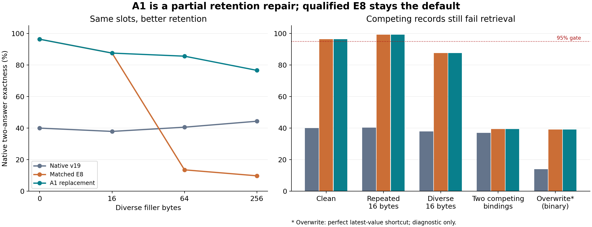
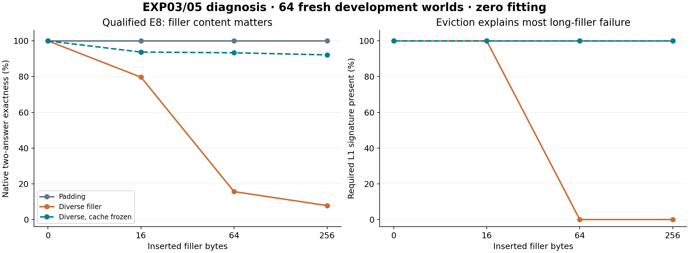
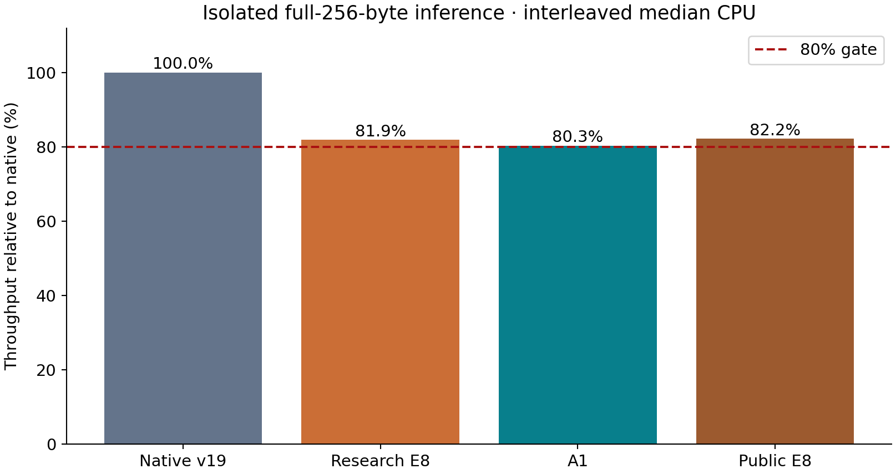

# SHoEbox EXP03/EXP05: retention beyond padding

16 November 2026. Starting main: `9e34d8075abbc495f966ab37d18ecfa532bb854d`.
Local diagnosis and A1 preregistration commit: `66747b2`; published with the
identical tree as `63be7b729772670ecb0f805d09c580e464670fa5`. The original
pre-fit source/data locks and timestamps are preserved.

**A1 repairs much of the measured eviction problem, but fails the development
gate. Qualified public E8 remains unchanged.** No fresh audit was evaluated.
A2 query-dependent selection before truncation is registered, not implemented
or fitted. Its three-value overwrite-fixture amendment is mandatory.

## Main results

Native two-answer exactness, full 256-byte autoregression; means of seeds 1, 7,
19 on 128 fresh development worlds, four order presentations per world.
“Matched E8” below is a fresh control fitted on this new interference curriculum,
not a replacement measurement of E8's original qualification.

| Condition | Native v19 | Matched E8 | A1 |
|---|---:|---:|---:|
| Clean binding | 39.97% | 96.29% | 96.29% |
| Repeated filler, 16 bytes | 40.30% | 99.22% | 99.22% |
| Diverse filler, 16 bytes | 37.89% | 87.50% | 87.50% |
| Diverse filler, 64 bytes | 40.56% | 13.54% | **85.55%** |
| Diverse filler, 256 bytes | 44.34% | 9.77% | **76.56%** |
| Two competing bindings | 36.91% | 39.45% | 39.45% |
| Binary overwrite, diagnostic only | 13.93% | 39.06% | 39.06% |

Repeated filler at 64 and 256 bytes is 99.22% for both E8 and A1. The 64/256
diverse lengths are 4×/16× the trained filler length and are reported separately.
All A1 seed scores equal the displayed A1 mean; E8 diverse-64 scores are
14.0625%, 13.671875%, 12.890625%. Raw per-seed/per-position results are retained.

## Diagnose state before changing it

The original qualified seed-7 E8 checkpoint was frozen and evaluated on 64
fresh development worlds within the historical 48-key vocabulary. No fitting
or prior search occurred. A trace follows required L1 stable signatures,
decoded fields, candidate inclusion, query selection and native output.

| Frozen E8 condition | Native exactness | Required signature present | Exactness with L1 cache writes frozen during filler |
|---|---:|---:|---:|
| Padding 0/16/64/256 | 100% | 100% | — |
| Diverse 16 | 79.69% | 100% | 93.75% |
| Diverse 64 | 15.63% | 0% | 93.36% |
| Diverse 256 | 7.81% | 0% | 92.19% |
| Two competing bindings | 47.66% | 100% | — |

The freeze is an externally timed diagnostic intervention, never a candidate
inference feature. It preserves required evidence and restores most long-filler
performance. Missing L1 signatures identify loss from that bounded cache, not
proof that every representation elsewhere in the model has disappeared.
With competing bindings, required signatures survive but top-two candidate
inclusion is only 61.72%. Eviction and selection are separate failures.

The first diagnostic attempt froze before the last original record's constituent
had completed and stopped on an assertion. The correction starts freezing at
the first four-byte completion at or after filler start. Both source locks,
the failed log and its exact partial byte accounting are retained; see
`DIAGNOSTIC_CORRECTION.md`. No weights were fitted in either attempt.

## A1: change replacement within existing state

A1 uses E8's existing learned record-presence classifiers when the existing
16-slot L1 cache is full. It replaces the oldest unrecognized unit first. If
every unit is recognized, an unrecognized incoming unit is rejected; a recognized
incoming unit replaces the oldest. Matching-signature refresh, pairing,
duplicate suppression and the existing top-two readout are preserved.

This adds zero fitted parameters, slots, persistent metadata or optimizer
moments. The measured E8/A1 models have 497,589 fitted parameters, including
7,670 local-readout weights. The mechanism uses explicit fixture-local learned
recognition; generic byte streams do not train these heads. No parser, selected
record label or answer oracle enters inference. A1 has its own outer checkpoint
magic, `0x3141353050584553`; research E8 and nested v19 formats are unchanged.

On a separate 32-world state-trace subset, required signature survival at
64/256 diverse bytes rises from 0%/0% to 100%/95.31%. With competing bindings,
both arms retain required signatures 100% of the time but include them in the
presence-only shortlist only 47.66% of the time. This directly motivates A2's
query-dependent candidate selection before truncation.

## Gates and the overwrite-fixture defect

Every original threshold remains. Primary conditions require >=95% mean and
>=90% each seed, including each answer position. The 64-offset gate requires
>=95% mean and >=90% worst-offset seed mean. Both-order and delay gates retain
90% mean /85% each seed. No-query must lose >=20 points, reverse selection must
hurt, and throughput must reach >=80% of native.

| E8 and A1 extended development condition | Mean across 64 offsets | Worst offset | Both-query-orders exactness |
|---|---:|---:|---:|
| Clean | 96.02% | 92.19% | 96.09% |
| Repeated 16 | 97.66% | 90.63% | 99.22% |
| Diverse 16 | 84.42% | 75.00% | 85.94% |
| Competing bindings | 36.13% | 21.88% | 41.41% |
| Binary overwrite, diagnostic only | 38.83% | 15.63% | 37.50% |

Each offset uses the same first 64 development presentations. The independent
padding check uses 16 presentations crossed with all 64 offsets: 99.90% at
zero delay and 100% at +64/+128/+256 for both arms, every seed.

Clean lesion checks give 97.27% unmodified A1, 18.23% no-head/gate-off,
0.13% no-query/uniform, 3.13% no-state, and 0.39% reverse/unpair; gate-on
is unchanged. Query and pairing matter, but these successes do not override
the failed diverse/competing and long-diverse gates.

The binary overwrite fixture is defective for qualification: flipping one of
two distinct binary values makes both answers equal. Repeating the latest value
without using the query scores **100%**. A1's original failed 39.06% remains in
the record, with 50% changed-key and 85.94% untouched-key accuracy, but cannot
establish selective updates. The prospective A2 amendment uses three values,
updates to the third distinct value, balances the changed key, and preserves a
fresh two-value canonical regression. First/last/constant shortcut controls
must pass before A2 fitting. The defect does not affect diverse-filler retention
or the competing-binding measurement.

The fresh audit stays closed. Fresh language, copy/reconstruction, post-1M
generic retention and three-seed 1M/5M qualifications were not started because
their development prerequisite failed. Their original thresholds remain
binding: language <=+0.01 nats/byte, copy/reconstruction <=1-point loss, and
every prior retention/scale/speed requirement. No original E8 qualification
number is replaced by this failed development study.

## Registration, exclusions and cost

The fresh initial-state grouping uses 64 keys, 512 train /128 development /256
reserved audit worlds, and four order siblings. Updates, filler, phases,
spacers and query orders stay within their initial world's fold. The generator
excludes the complete historical binding test folds from EXP00/01, B, C, D2,
D3, E1 and the E2 family, conservatively covering opened samples. No generic
documents/tasks were used; opened E1/E7 generic groups remain prohibited for
future qualification. The salt, RNG, folds, full source hashes and generated
world hashes were locked before fitting; all snapshots/results were locked
before extended evaluation. See `A1_REGISTRATION.md` and the archived plan.

Each of native v19, unchanged E8 and A1 receives an independently charged 250K
native warmup and 2M continuation for each seed. All arms see identical ordering,
0–7 record spacers and balanced 64 phases. The continuation mixes five conditions
equally by shuffled episodes. All input bytes, including padding and partial
terminal episodes, count. Local projection/presence/applicability labels are
observed-prefix supervision, separate from native byte targets.

| Charged fitting quantity, all arms/seeds/phases | Total |
|---|---:|
| Input bytes | 20,250,000 |
| Of which padding | 16,701,237 |
| Native objective targets | 18,026,883 |
| Of which answer targets | 226,827 |
| Local projection update events | 6,289,296 |
| Local presence update events | 23,566,746 |
| Applicability update events | 11,933,346 |
| Local training windows | 14,841,696 |
| Fitting CPU seconds | 739.58 |
| Preliminary/pilot fitting bytes | 0 |

Whole-process research and verification CPU is **2,511.98 seconds**, including
compilation, every repeated control, both diagnostic attempts, extended
evaluations and repeated engineering checks. The fitting CPU above is a subset,
not added again. Artifact production and delivery/packaging are metered separately;
their receipts are supplied with the archive. Initial setup,
source editing and the first figure render were not CPU-metered and performed
no research fitting.

Inference ledgers separately charge 592,555 bytes for the failed diagnostic,
2,355,712 for its corrected rerun, 9,900,288 for primary development, 34,337,280
for extended checks, 813,312 for overwrite/shortcut diagnostics and 798,720 for
timing including warmup. Padding subtotals are retained. Exact resume tests
consume 36,000 discarded training bytes with all local event counts; historical
comparisons consume 114,716 discarded correctness bytes. Unit/native regression
microtrajectories are engineering work with complete process CPU and test logs;
their aggregate scalar updates were not instrumented and are not represented
as research fitting. `accounting.json` records event counts, not individual
floating-point multiply/add operations.

## Numerical and lifecycle verification

- 192 distinct Python tests pass: 60 runtime/public, 123 prior research, and
  nine current harness tests; repeated invocations have separate cost receipts.
- 824,111 core native checks, 723 public-E8 checks and 664 A1 checks pass in
  optimized builds and again with ASan/UBSan. LeakSanitizer is disabled in this
  host configuration; no leak-check result is claimed.
- Fourteen historical constructor/checkpoint trajectories and resumed updates
  are byte-identical to starting main. The inherited comparison covers
  v1/2/3/4/7/8/9C/9D/10/11/12/17/18/19; it does not manufacture v5/v6 fixtures.
- All 18 actual warmup/final model-and-cursor pairs pass 1,000 uninterrupted
  versus 371 + save/load +629 updates exactly. A separate shortened schedule
  test crosses finish events. Source checkpoints remain unmodified.
- E8 instrumentation is numerically identical, diagnostic reads preserve model
  bytes, freeze is frozen-model-only, labels are causal, cross-policy loads
  reject, and reset/clone/load/free lifecycle tests pass.
- No public/runtime or historical research source was changed. Explicit v19/E7
  policies, old constructors, local/generic separation and checkpoint meanings
  are preserved.

Throughput was measured alone on one pinned CPU, using three interleaved
65,536-byte full-distribution repeats plus 1,024 warmup bytes per repeat.
Compilation, cloning and warmup are outside timed intervals and inside process
cost accounting. Rates use median CPU seconds.

| Arm | Bytes / CPU second | Relative to native |
|---|---:|---:|
| Native v19 | 21,742.8 | 100.00% |
| Research E8 | 17,804.7 | 81.89% |
| A1 | 17,465.4 | **80.33%** |
| Public E8, exact import of research control | 17,865.8 | 82.17% |

Public/research E8 prediction checksums match exactly. A1 passes this registered
speed measurement, but not the capability gate.

## Next registered experiment and resume

Read `A2_REGISTRATION.md` **together with** `A2_FIXTURE_AMENDMENT.md`. Keep A1's
admission rule and rank recognized record candidates by learned query/key
distance before selecting two. Preserve pairing, value decoding, gates,
rates, state size and E8 prior. Use fresh three-value initial states, fresh
folds excluding old audits and reserved A1 audit worlds, new exact source/data
locks, and matched E8/A1/A2 controls. The registered budget is another 20.25M
bytes if executed; no A2 fitting has occurred in this delivery.

The archive contains the published source, generated worlds, all 18 fitted
checkpoint/cursor pairs, the inherited frozen-diagnosis checkpoint, diagnostic
source snapshots, raw results, logs, ledgers and SHA-256 manifest. Read
`experiments/interference_retention/README.md` for exact resume and reproduction
commands. Resuming a failed candidate for additional research requires a new
registration; the archive itself does not authorize unrecorded tuning.

## Primary literature used

- Arora et al., *Zoology: Measuring and Improving Recall in Efficient Language
  Models*, ICLR 2024: [official paper](https://proceedings.iclr.cc/paper_files/paper/2024/hash/448fc91f669c15d10364ee01d512cc10-Abstract-Conference.html).
  Motivates separating content, distractor count and associative access.
- Arora et al., *Simple Linear Attention Language Models Balance the Recall-
  Throughput Tradeoff*, ICML 2024: [PMLR](https://proceedings.mlr.press/v235/arora24a.html).
  Motivates jointly reporting recall, fixed state and throughput.
- Miller et al., *Key-Value Memory Networks for Directly Reading Documents*,
  EMNLP 2016: [ACL Anthology](https://aclanthology.org/D16-1147/).
  Supports paired key/value addressing before value mixing.
- Schlag et al., *Linear Transformers Are Secretly Fast Weight Programmers*,
  ICML 2021: [PMLR](https://proceedings.mlr.press/v139/schlag21a.html).
  Motivates selective updates; A1's bounded replacement rule is our experiment,
  not an implementation or claimed result of that paper.
