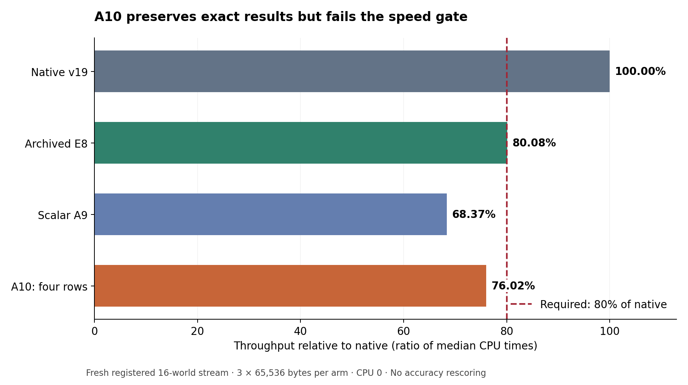
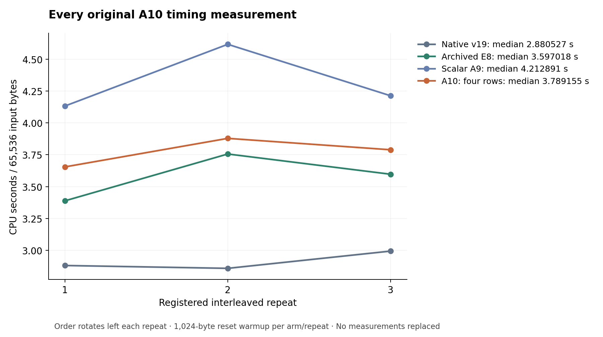

# SHoEbox EXP03/05-A10 report

16 November 2026 (America/Denver). **A10 fails its execution gate.** Exactness
passes, but throughput is **76.020287% of native**, below the mandatory 80%.
The candidate is **11.182846% faster than scalar A9** on the same fresh
stream. Public E8 remains unchanged. A9 still fails development; no accuracy
was rescored and no audit was accessed. Research fitting: **zero bytes**.

## Fixed experiment and result

Starting main: `8270e0d60bbefd75f7c7c9604d5961702615aac2`.
Passing source/control/workload lock was committed and published **before
timing** as [3bc9d54f84626c3c117f88419f8cdcec0564e325](https://github.com/JRowe47/SHoEbox/commit/3bc9d54f84626c3c117f88419f8cdcec0564e325).
Its tree is `68e09052a14c3c09bc0d1e780475953202f3b543`. The original local
commit `dd1435e` has that identical tree; the published commit was installed
locally before timing. All original computational sources and registrations
remain hash-identical. The sole execution addition is an explicitly selected
backend in `experiments/row_parallel_affine/`.

| Arm | Repeat 1 (CPU s) | Repeat 2 (CPU s) | Repeat 3 (CPU s) | Median (CPU s) | Bytes/CPU s | Native throughput |
| --- | ---: | ---: | ---: | ---: | ---: | ---: |
| Native v19 | 2.880526734 | 2.858245004 | 2.993643892 | 2.880526734 | 22,751.394 | 100.000000% |
| Archived E8 | 3.388286561 | 3.755905300 | 3.597018333 | 3.597018333 | 18,219.535 | 80.080958% |
| Scalar A9 | 4.132328055 | 4.617038516 | 4.212890693 | 4.212890693 | 15,556.065 | 68.374115% |
| A10: four rows | 3.654703352 | 3.878609612 | 3.789155297 | 3.789155297 | 17,295.675 | 76.020287% |

Candidate/scalar timed checksum: `-0x1.cc2217bf76a82p+16` in every repeat.
Their warmup checksum is `-0x1.12f8b02784500p+9` in every repeat. Exactness
and no-slowdown pass; native-speed and the combined execution gate fail.
All twelve first measurements are retained in `timing_raw.jsonl`.

## Exact mechanism

Four independent rows occupy four SSE lanes. A 4×4 register transpose supplies
coefficients. Every row starts at positive zero and accumulates coordinates
0–63 in the original order, with separate float32 multiplication and addition.
Bias is added afterward, followed by original scalar tanh. No FMA instruction
appears in the generated candidate library. The six replaced sites are query
key, recognized record key, fallback record key, selected value, hybrid local
key preprojection, and local value preprojection. Native core, source vectors,
presence/applicability, selection, chronology, candidate enumeration and local
gradient/update arithmetic remain unchanged.

There is no persistent or heap coefficient packing buffer. Local value output
adds 32 automatic bytes per invocation; the kernel has a source-level maximum
of 144 bytes of simultaneously live SIMD values, not a claim about compiler
register allocation or spill size. Existing query/key output storage is reused.
Register transpose operations are included in the full measured interval;
there is no separate packing pass, packing timer or profiler experiment.
Model fields, magic, saved bytes, exact cursors and historical backends remain
unchanged. E8/A8 loads dispatch to their original execution libraries.

## Controls completed before timing

- Original 20 A9 Python tests pass on scalar and candidate: 40 tests. This
  includes enabled A8 parity, omitted record-key isolation, exact partial
  cursor, all-256 output, generic/local separation and unchanged policy source.
- Independent affine cases cover 320 trials, five key phases, four value
  phases, 8/16 rows, signed zero, bias, cancellation, subnormal/extreme and
  random finite inputs. Per optimized/sanitized build: 35,840 candidate rows,
  35,840 independent scalar rows and 35,840 original scalar rows, with 71,680
  affine comparisons plus 35,840 tanh comparisons. The log groups these as
  71,680 combined affine/tanh checks. Both builds pass bitwise.
- On each scalar/candidate, optimized and ASan/UBSan paths pass 581 E8,
  110 request, 83 admission/lifecycle, 13,089 exhaustive selection,
  75,295 hybrid objective, 7,826 presence and 57,280 masked-credit checks.
  Address/undefined-behavior checks are active; leak detection is disabled.
- Public/runtime: 60 Python tests, 824,111 native checks per build and
  723 public E8 checks per build pass. All 209 inherited research tests and
  46 protected-loader rejection checks pass.
- Fourteen historical constructor/checkpoint trajectories match the unchanged
  starting repository exactly. Historical v5/v6 source remains unchanged;
  those two are not independently instantiated by that existing suite.
- All 18 actual A9-F1 warmup/final checkpoint-cursor pairs pass: scalar and
  candidate, uninterrupted 1,000 versus 371/save/load/629. Every step compares
  all 256 outputs, loss/target count, inventory and complete saved bytes.
  There are 36,000 paired steps, 9,216,000 float-output comparisons,
  18,000 uninterrupted/resumed trace-record comparisons, and
  143,384,656,320 directly compared saved bytes.
  All 36 frozen model/cursor file hashes remain unchanged.
- A separately charged test-only counter replay adds 36,000 discarded bytes,
  reproduces every stored output hash and final saved hash, and confirms that
  relocated row counts exactly equal the scalar projections they replace.
  It is not linked into the measured backend.

The initial lock collector failed because `lscpu` could not read the container's
restricted sysfs. It ran no model inputs or updates and no timing. Its original
receipt/log and 1.312434 CPU seconds remain. The collector now records the probe
failure and reads `/proc/cpuinfo`; the retry passed in 1.408669 CPU seconds.
No numerical/control test failed and no timing measurement was repeated.

## Locked timing workload and environment

The exact registered enumeration/exclusions leave 2,020 eligible identities
after excluding 10,076 of 12,096 worlds. The one shuffle with seed 20261202
selects 16. The unchanged A9 exclusion union, all 896 original primary worlds
and all 128 F1 binary worlds are excluded. Only identity manifests were read
for excluded groups; excluded audit episodes were never instantiated/scored.

Conditions, world order, four variants, zero offset/spacers and alternating
updated key follow the registration. An independent literal constructor
matches all 384 episodes. Stream: 70,400 bytes, 41,792 PAD and 18,432 nuisance.

- Stream SHA-256: `2c26341b8f06acc74ebda3b1f118a6f6c32141cfa829df20de44e0965e3b6290`.
- Ordered sample SHA-256: `a75d7cd3635d4a7968b95f0a351e0a2093c6309caa2f260be4f50e1f44be05e9`.
- Exclusion SHA-256: `4541847efd3fb077d7dc61effe984feca5d147712ce1ed823bcebdc654002adb`.

The 16 identities are opened for future allocation exclusions in
`timing_worlds.lock.json`. No labels or expected answers reach timing.
The fresh native v19 uses nominal 500K, seed 7; E8 and both A9 arms use the
original frozen seed-7 final files. All compute jobs had completed before
timing. CPU 0 was pinned; AMD EPYC 9V74, GCC 14.2.0. Candidate flags:
`-std=c++17 -O3 -march=native -ffp-contract=off -shared -fPIC`.
Full environment, linked libraries, generated source and binary hashes are
retained in the lock. Compilation/loading/cloning are outside timed intervals.

There are exactly three rotating interleaved repeats, with reset, 1,024-byte
warmup, reset, 65,536-byte timing. Total inference inputs: 798,720;
786,432 measured and 12,288 warmup; 494,988 PAD and 182,952 nuisance.
Every input produces all 256 outputs. Research fitting, pilots, sweeps,
replay fits, new diagnosis, accuracy rescoring and audit episodes are zero.

## Cost and event ledger

`ACCOUNTING.json` retains per-policy events, projection/update counts,
reference comparisons, scratch bounds and every child-process receipt.
The 72,000 primary discarded checkpoint inputs plus 36,000 counted replay
inputs execute 54,702 native targets,
178,812 local affine row updates,
11,507,364 scalar affine projections and
1,213,992 relocated vector-row projections
in 93,924 vector calls. Counter replay
outputs are discarded and do not extend any research checkpoint or budget.
The two 20-test suites separately execute 112,088
run inputs and 2,344 observe inputs;
their event and rejected-call receipts remain separate.

Historical adapter run inputs total 370,318;
the 14 historical comparison trajectories charge 114,716 inputs. Inherited
runtime/native microtrajectories retain full CPU, source and assertion counts,
but do not expose every individual byte/update or scalar-write count. Legacy
Python observe/teach calls outside the wrapped adapter run entry point are
also not separately tallied. Those missing counters are explicitly identified,
not recorded as zero or presented as a complete global event total.

| Process | Exit | Whole child-tree CPU seconds |
| --- | ---: | ---: |
| checkpoints | 0 | 660.363400 |
| counts | 0 | 63.774440 |
| history | 0 | 5.303774 |
| native_candidate | 0 | 450.363935 |
| native_scalar | 0 | 394.120420 |
| policy | 0 | 1.436037 |
| pre_timing | 1 | 1.312434 |
| pre_timing_retry | 0 | 1.408669 |
| public_native | 0 | 120.011798 |
| python_candidate | 0 | 48.484676 |
| python_scalar | 0 | 37.678149 |
| research | 0 | 80.694025 |
| runtime | 0 | 402.342045 |
| timing | 0 | 45.670583 |
| workload | 0 | 1.178990 |

Research/control/timing processes total **2314.143375 CPU
seconds** (38.569056 CPU minutes), including the failed metadata
probe and counted correctness repetition. Compilation belongs to these
process totals. Rendering, final file verification and packaging have separate
receipts. Interactive inspection, editing and publication CPU is not metered.
The original A9-F1 20.25M-byte campaign and every historical cost are preserved;
none is replaced or charged to a new fit.

## Interpretation and sole next registration

The exact kernel improves speed by 11.182846%, but the mandatory speed
gate fails. The original A9 68.202933% speed measurement used a different
registered stream and is retained separately. The paired scalar baseline
here is 68.374115%; these two historical measurements are not interchangeable.

A9's original competing 88.281250%, corrected overwrite 88.281250%, clean
94.531250% and diverse256 86.328125% remain its development results. Prior
teacher-fed subset diagnosis remains separate from full autoregression.
No result here repairs that accuracy failure or permits promotion. E8 remains
public and every development/qualification threshold stays unchanged.

The sole next registration is [A11 fixed eight-row exact affine execution](A11_REGISTRATION.md):
one fixed AVX2 8×8 register transpose with the same per-row arithmetic and
zero research fitting. It requires fresh timing identities excluding A10,
exact reference controls and complete inherited-event instrumentation before
timing, plus at least 80% native speed and no slowdown against scalar A9 or
A10. **A11 is not implemented, allocated, tested or measured.**
