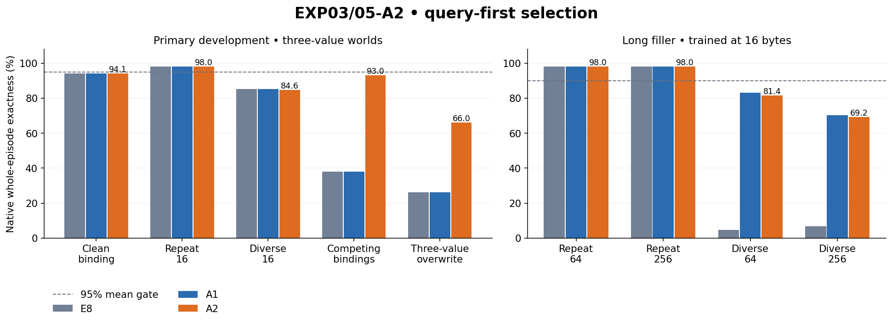
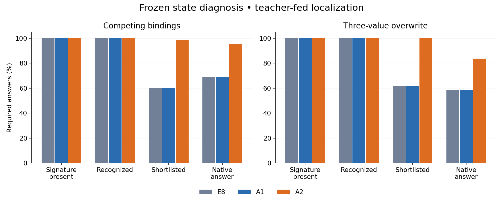
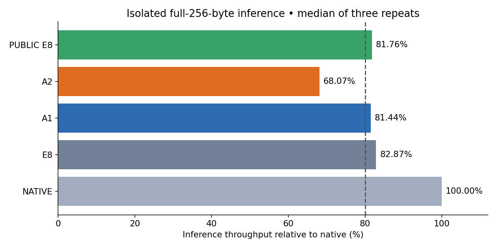

# SHoEbox EXP03/05-A2: query-first selection

16 November 2026 (America/Denver). Starting main:
`0cdbabaf12776673dd5c70dfd1382e58557494f9`.
Pre-fit implementation/source-lock commit: `e07cbae`.

**A2 improves access to competing bindings, but fails development. Public E8
remains unchanged. Both A1 and A2 audits stay closed.** A3 continuous chronological
matching is preregistered in `A3_REGISTRATION.md`; it is not implemented or fitted.

## Main findings

Native whole-episode exactness, full-256-byte autoregression. Three seeds
(1/7/19), 128 fresh development worlds and four order presentations per world.
The three arms are fresh fits on the same corrected three-value curriculum.
They do not replace E8's earlier, separately qualified audit measurements.

| Condition | Matched E8 | Matched A1 | A2 |
|---|---:|---:|---:|
| Clean binding | 94.14% | 94.14% | 94.14% |
| Repeat 16 | 98.05% | 98.05% | 98.05% |
| Diverse 16 | 85.16% | 85.16% | 84.57% |
| Competing bindings | 37.89% | 37.89% | 92.97% |
| Three-value overwrite | 26.17% | 26.17% | 66.02% |
| Repeat 64 | 98.05% | 98.05% | 98.05% |
| Repeat 256 | 98.05% | 98.05% | 98.05% |
| Diverse 64 | 4.69% | 83.20% | 81.45% |
| Diverse 256 | 6.90% | 70.31% | 69.21% |

Competing-binding improvement is **55.08 percentage points** over A1. Corrected
overwrite improves **39.84 points**, but both remain below the unchanged 95%
mean gate. A2 changed-key accuracy is **67.58%**, while untouched-key accuracy is
**96.88%**; matched E8/A1 give 50.00% and 70.31%. Per-seed values and each answer
position are retained in the compact evidence. The three seeds share worlds;
their presentations are not independent world samples.

## Exact registered change

A2 preserves A1 admission into the existing 16 L1 slots. It evaluates each
positively recognized record-phase key against the learned current query before
truncating to two candidates. Smaller squared distance wins; exact distance
ties prefer the latest stored occurrence, then stable slot/phase order. Missing
recognized candidates are filled from the historical presence ranking without
duplicates. Existing paired-value decoding and sigmoid attention remain intact.

All arms have **497,589 actual fitted parameters**, including **7,670 budgeted
readout weights**. A2 adds zero fitted coefficients, persistent sequence state
or optimizer moments. The existing 2,408-byte prediction scratch is unchanged;
selection uses bounded automatic candidate/source-vector scratch, with no heap
allocation. The distinct A2 checkpoint magic is `0x3241353050584553`, nested v19.
No A1/E8/E7 or public checkpoint is silently converted.

The current implementation is isolated in `experiments/query_first_retention/`.
Public/native and historical research sources, A1 sources and all prior reports
are unchanged. Explicit local observed-window labels remain separate from
native next-byte targets; generic byte streams do not train those local heads.
No parser, discrete key equality, selected-record oracle, new memory slot or
external exact store enters candidate inference.

## Where overwrite still fails

The frozen occurrence trace uses 32 development worlds/four order siblings,
teacher-fed state, and all seeds. Required signatures survive 100% of competing
and overwrite queries. Competing-target shortlist inclusion rises from
60.16% to **98.44%**.
Thus query-first selection repairs most of the measured access loss.

For changed keys, both old and new signatures survive and enter A2's shortlist
in **100%** of traced cases. A2 predicts the old value for
**29.69%** of changed-key answers. The new version is
closer to the learned query in **68.75%** of cases;
**no old/new distance ties exactly**. Recency only breaks exact ties, so it never
resolves these conflicts. These diagnostics explain the failure without changing
any fitted model or claiming teacher-fed scores as autoregressive qualification.

Long diverse filler remains a separate problem. A1/A2 protect more required
signatures than E8, but 256-byte retention still loses some signatures and misses
the unchanged endpoint. A3 changes chronological query matching only; all clean,
interference, long-delay and binary regression gates remain required.

## All original gates remain

| A2 condition | Mean across 64 offsets | Worst offset, seed mean | Both-query-orders exact |
|---|---:|---:|---:|
| Clean binding | 92.29% | 85.94% | 90.62% |
| Repeat 16 | 96.92% | 90.62% | 97.66% |
| Diverse 16 | 80.42% | 59.38% | 85.16% |
| Competing bindings | 91.15% | 81.25% | 89.84% |
| Three-value overwrite | 65.92% | 46.88% | 68.75% |

Primary and per-position thresholds remain 95% mean/90% each seed. Both-order
and every delay require 90%/85%; offsets require 95% mean and 90% worst-offset
seed mean. Independent padding delays 0/64/128/256 give
93.95%, 100.00%, 100.00%, 100.00%, respectively.

The separately reported fresh **two-value canonical regression** gives
93.16% primary exactness, 95.29%
offset mean, 84.38% worst offset and
93.75% both orders. Its failed prerequisites are
preserved. The three-value overwrite fixture cannot mask this regression.

A2 clean lesion exactness: None: 93.75%, no_head: 0.13%, no_query: 0.00%, no_state: 0.00%, uniform: 0.00%, reverse: 0.00%, unpair: 0.00%, gate_off: 0.13%, gate_on: 93.75%. No-query drop is
93.75 points; reversed selection hurts every
seed. State/pairing/gate interventions are all retained. Passing those causal
checks does not override failed primary, offset, delay or speed requirements.

No generic qualification or 1M/5M promotion fits were launched after failure.
Their thresholds remain language <=+0.01 nats/byte, copy/reconstruction <=1-point
loss, post-1M-language retention and all original three-seed capacity gates.
Qualified public E8 remains 98.2747% binding retained through 1M generic targets,
with +0.006233 nats/byte language and its passing copy/reconstruction/scale/speed
qualification. There was no further E8 prior sweep.

## Fixture integrity and fresh folds

The mandatory amendment supplies three possible values, two distinct initial
values, and writes the third value to the changed key. The untouched answer
stays distinct. Changed key is balanced independently of record/query order;
all operation, order, spacing and phase variants remain in their initial-world
fold. The original binary-overwrite defect, A1 scores and A1 costs stay intact.

Before fitting, independent byte interpretation agreed on 12,800 primary
train/dev presentations plus 5,120 both-operation/order presentations. Repeating
the first value, latest value or any constant gives **0%** whole-episode exactness
on every primary condition. With distinct answers and both query orders, any
fixed query-blind answer pair is bounded by 50%. Pre-fit causal tests verify
that future answer changes cannot affect observed-window labels.

Salt/RNG, generated world hashes and the full fitting dependency closure were
locked before fitting. Counts are 512/128/256 train/dev/reserved-audit worlds.
Every old opened binding test fold, including E2-family, and all 256 reserved
A1 audit worlds are excluded. Fresh binary regression uses the same new dev
fold and cannot overlap training or either reserved audit. No generic documents
were used; opened E1/E7 generic groups remain excluded from later qualification.

## Costs and verification

Every E8/A1/A2 arm and seed receives an independently charged 250K native
warmup plus 2M mixed continuation. No pilot or inherited warmup was used.

| Charged fitting quantity | Total |
|---|---:|
| Input bytes | 20,250,000 |
| Padding bytes, included above | 16,707,483 |
| Native objective targets | 18,026,883 |
| Answer targets, included above | 226,476 |
| Local projection-vector update events | 9,411,408 |
| Local presence update events | 35,351,307 |
| Applicability update events | 17,900,199 |
| Local training windows | 22,262,976 |
| Fitting CPU seconds | 673.91 |
| Pilot research bytes | 0 |

Whole-process research/verification CPU is **2,893.20
seconds** at report creation; fitting is a subset and is not added again.
All failed tests, repeated controls, compilation and descendants are charged.
Artifact generation/packaging have separate receipts. Workspace setup, source
editing, read-only inspection and lightweight syntax/report-text commands were
not separately CPU-metered; none performed research fitting.

Inference byte totals are primary: 10,639,872, extended: 71,435,520, updates: 813,312, conflicts: 369,792, timing: 998,400;
each has a separate padding subtotal. All 18 actual warmup/final model-cursor
pairs pass 1,000 versus 371 + save/load +629 updates exactly: **36,000
discarded correctness bytes**, with exact padding and local-event counts.
The pre-fit Python invocations consume **23,585** discarded bytes,
reconstructed by exact data/cursor-only replay without fitting weights. The
14 historical trajectories consume **114,716**
discarded bytes. Historical/native microtrajectory scalar writes were not
instrumented; their complete process CPU and logs are retained. Reported local
counts are vector/objective events, not individual floating-point writes.

- **198 distinct Python tests pass:** 60 runtime/public, 132 historical/research,
  six A2. Failed initial test invocations remain separately recorded.
- **824,111 core native checks**, **723 public-E8 checks**, and **810 A2 numerical,
  request, admission and selection checks** pass per optimized/sanitized build.
  ASan/UBSan pass; LSan is explicitly disabled on this host.
- **14 historical constructor/checkpoint trajectories** match starting main
  exactly, covering v1/2/3/4/7/8/9C/9D/10/11/12/17/18/19.
- Python/native routing, finite checks, exact ties/fallback, label causality,
  generic-local separation, read-only diagnostics, reset/clone/load/free,
  cross-policy rejection and finish-boundary continuation pass.

Pre-fit failures were test-fixture mistakes: a closed E8 control called an
A2-only diagnostic; a synthetic value test retained random coefficients instead
of zeroing them. Both were corrected before fitting, with no candidate arithmetic
change. A data-only accounting export initially encountered a NumPy integer
serialization error; its failed process is also charged. See preserved receipts.

## Isolated throughput

One pinned CPU, three interleaved 65,536-byte repeats plus 1,024 warmup bytes;
all other local CPU jobs stopped. Every input produces a full 256-byte
distribution. Compile/clone/warmup are outside timed intervals and inside process
costs. The native timing reference is a fresh full-budget v19 model with zero
fit bytes; the public E8 model imports the matched E8 checkpoint exactly.

| Arm | Bytes / CPU second | Relative to native | >=80% gate |
|---|---:|---:|---|
| native | 22,404.3 | 100.00% | PASS |
| e8 | 18,566.0 | 82.87% | PASS |
| a1 | 18,246.9 | 81.44% | PASS |
| a2 | 15,250.1 | 68.07% | FAIL |
| public_e8 | 18,318.8 | 81.76% | PASS |

## Resume and next experiment

The archive contains the git source bundle (including the pre-fit commit),
pinned worlds, every actual fitted model/cursor, raw results, source/data locks,
failed and passing logs, complete ledgers and a SHA-256 manifest. Checkpoints,
datasets and compiled binaries are outside git. See the experiment README for
exact resume commands; never reset, finish or replay a warmup at an arbitrary
cursor boundary. Extending a failed fit is new charged work, not qualification.

Read `A3_REGISTRATION.md` for the exact continuous chronological matching rule,
new exclusions, fixed budget and all unchanged gates. A3 has not been implemented
or fitted. Verified negative research may be committed/pushed directly to main
under the user's standing authorization, preserving unrelated history and never
force-pushing. `NEXT_CHAT_PROMPT.md` preserves that authorization.

Primary grounding: [Miller et al., EMNLP 2016](https://aclanthology.org/D16-1147/)
for paired key/value addressing, and [Arora et al., ICLR 2024](https://proceedings.iclr.cc/paper_files/paper/2024/hash/448fc91f669c15d10364ee01d512cc10-Abstract-Conference.html)
for input-dependent selection and multi-query associative recall. The exact
A2/A3 routing rules are registered project designs, not results attributed to
those papers.
