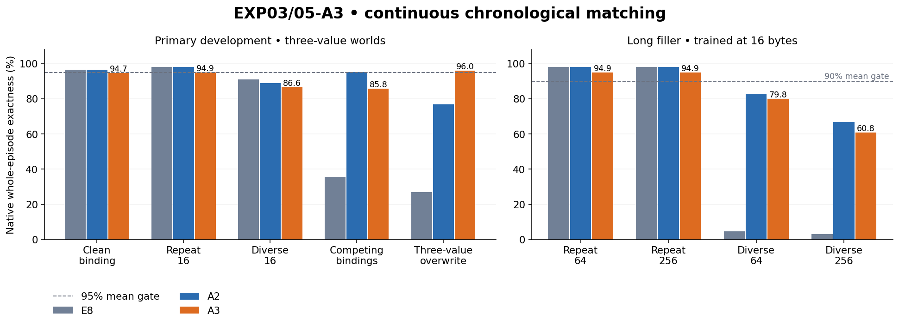
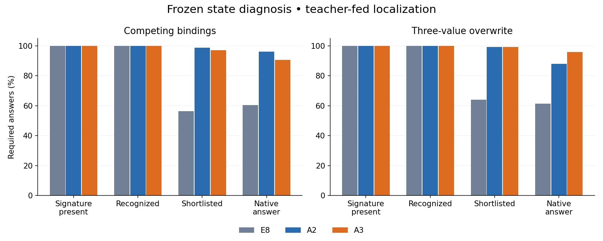
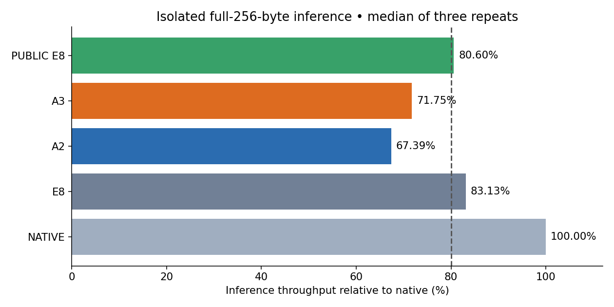

# SHoEbox EXP03/05-A3: continuous chronological matching

16 November 2026 (America/Denver). Starting main:
`48f93895e90563597418e6ea8a0b45565d88f472`.
Local pre-fit implementation and lock commit: `17d991f`. Its identical source
tree is published as `44c38f43572482e2922f51a70f4390401b33fdc8`; the original
source/data locks and timestamps remain unchanged.

**A3 development gate: FAIL. Qualified public E8 remains unchanged.**
A1/A2/A3 audits remain closed. The next measured revision is registered in
`A4_REGISTRATION.md`; it has not been fitted.

## Main findings

Full-256-byte autoregressive whole-episode exactness. Three seeds (1/7/19),
128 fresh development worlds, four record/query-order presentations per world.
These are new matched controls on the three-value curriculum, separate from
E8's original qualified audit. Seeds share worlds; presentations across seeds
are not independent world samples.

| Condition | Matched E8 | Matched A2 | A3 |
|---|---:|---:|---:|
| Clean binding | 96.42% | 96.42% | 94.66% |
| Repeat 16 | 98.05% | 98.05% | 94.92% |
| Diverse 16 | 90.89% | 88.93% | 86.59% |
| Competing bindings | 35.68% | 95.31% | 85.81% |
| Three-value overwrite | 26.95% | 76.82% | 95.96% |
| Repeat 64 | 98.05% | 98.05% | 94.92% |
| Repeat 256 | 98.05% | 98.05% | 94.92% |
| Diverse 64 | 4.69% | 82.81% | 79.82% |
| Diverse 256 | 2.99% | 66.86% | 60.81% |

Changed/untouched-key autoregressive accuracy on the corrected overwrite task:

| Arm | Changed key | Untouched key |
|---|---:|---:|
| E8 | 47.14% | 73.05% |
| A2 | 77.99% | 98.83% |
| A3 | 100.00% | 95.96% |

A3 improves overwrite relative to matched A2 by
19.14 percentage points.
The unchanged 95% primary gate applies to every condition and answer position.
No partial improvement overrides another failed prerequisite. All three seeds
reach 100% autoregressive accuracy on the changed key; remaining overwrite
errors concern the untouched key.

## Exact fixed implementation

Only the record-selection/mixture rule changes. A3 retains A1's existing 16-slot
admission, current-query extraction, key/value projections, objectives, rates,
full-byte calibration and E8's 1/256 applicability prior. For each recognized
record phase, float32 squared distance feeds the literal float64 expression
`4 * (7.84 - distance)`. Log-sigmoid and log-one-minus-sigmoid accumulate
chronological stick-breaking weights from newest stored occurrence to oldest.
Equal occurrence times use stable slot/phase order. The two largest weights
use stable slot/phase ties and are normalized for their paired-value mixture.
One recognized candidate gets all mass; no recognized candidate uses A2's
complete historical presence fallback and distance attention.

The only early stop is the registered strict bound: after two candidates are
retained, stop when remaining log mass is strictly below the second retained
log weight. Projections are cached only in per-call scratch. Optimized and
exhaustive scans agree exactly on 1,000 randomized states and targeted
zero/one/multiple-match, competing-key, occurrence-order and saturation cases.
A separate Python reference also checks the numerical mixture.

Actual fitted parameters: **497,589 per arm**, including **7,670 readout weights**.
A3 adds **zero fitted weights, persistent sequence state or optimizer moments**.
Its bounded selection scratch struct measures **2,096 bytes**, plus scalar and
algorithm call-stack temporaries; the existing 2,408-byte prediction scratch is
unchanged. A3 checkpoint magic is `0x3341353050584553`, nested v19. Historical
E8/A1/A2/E7 and public checkpoints retain their meanings and reject A3 imports.

Inference has no parser, decoded-byte equality, source oracle, new slot or tape.
Observed-window local labels remain explicit optional training supervision;
generic byte objectives leave these local heads frozen. Full 256-byte
predictions are the endpoints throughout.

## Frozen failure localization

First 32 development worlds, four order siblings, both answers, all seeds and
arms. These teacher-fed traces explain failures; primary scores above remain
autoregressive. Labels identify stable signatures only in analysis output.

| Condition / arm | Target present | Recognized | Shortlisted | Native answer |
|---|---:|---:|---:|---:|
| Competing bindings / E8 | 100.00% | 100.00% | 56.25% | 60.42% |
| Competing bindings / A2 | 100.00% | 100.00% | 98.70% | 96.09% |
| Competing bindings / A3 | 100.00% | 100.00% | 97.14% | 90.62% |
| Three-value overwrite / E8 | 100.00% | 100.00% | 64.06% | 61.46% |
| Three-value overwrite / A2 | 100.00% | 100.00% | 99.22% | 88.02% |
| Three-value overwrite / A3 | 100.00% | 100.00% | 99.22% | 95.83% |

For changed keys, both old and new signatures survive in
100.00% of A3 traced cases. Predicted-old-value rate
changes from 20.31% in matched A2 to
0.00% in A3. Changed-key teacher-fed correctness
is 100.00%. Exact per-occurrence distances,
chronological probabilities and selected mass categories are retained in the
archive. On competing traces, unrelated-key mass rises from 4.36% (A2) to
10.39% (A3); 7.55% of answers have a newer unrelated record above the fixed
matching midpoint. The next preregistered A4 uses a query-relative band of
1.96, the squared change of one ±0.7 code coordinate; it is not fitted here.
A3 selected slots/phases and attention are checked against an external
exhaustive calculation for every recognized-candidate trace.

Long-diverse signature loss is separately reported in `evidence/extended.json`.
The result does not combine memory loss with query matching or value decoding.
See `A4_REGISTRATION.md` for the measured next intervention.

## Unchanged extended gates

| A3 condition | All-offset mean | Worst offset, seed mean | Both orders |
|---|---:|---:|---:|
| Clean binding | 89.05% | 84.38% | 93.23% |
| Repeat 16 | 93.23% | 87.50% | 93.75% |
| Diverse 16 | 79.66% | 51.56% | 89.84% |
| Competing bindings | 76.56% | 62.50% | 82.55% |
| Three-value overwrite | 91.93% | 89.58% | 93.49% |

Primary/per-position gates: 95% mean /90% every seed. Both orders and each
delay: 90% /85%. Offsets: 95% mean /90% worst-offset seed mean. No-query drop
must be at least 20 points; reverse selection must hurt; every state/pairing/
gate lesion is retained. A3 clean lesions: None: 94.01%, no_head: 3.65%, no_query: 0.00%, no_state: 4.82%, uniform: 0.00%, reverse: 0.39%, unpair: 0.39%, gate_off: 3.65%, gate_on: 94.01%.

Fresh binary canonical regression is **93.16%** primary,
**93.46%** offset mean, **86.98%** worst
offset, and **87.50%** both orders. All original binary
position, padding and lesion gates are also applied, not replaced by the
three-value overwrite score. Complete gate decisions are in `verification.json`.

Each offset uses the same 64 presentations. Each independent padding delay
0/64/128/256 uses the next 16 presentations crossed with all 64 offsets.
Both-order and lesion samples contain 256 presentations. Primary conditions
and long diverse/repeat retention use 512 presentations. No counts were reduced.

No fresh generic or capacity qualification was launched after development
failure. Their thresholds remain language <=+0.01 nats/byte, copy/reconstruction
<=1-point token loss, post-1M-language retention and all three-seed 1M/5M gates.
Public E8 remains **98.2747%** held-out binding retained through 1M generic
language targets, **+0.006233 nats/byte** generic language, with its passing
copy/reconstruction/scale/speed evidence. No E8 prior sweep occurred.

## Isolated throughput

One pinned CPU, three interleaved 65,536-byte repeats per arm, full 256-byte
output on every input, and 1,024-byte warmup per repeat. All other local research
jobs stopped. Compilation, clone and warmup are outside timed intervals and
inside process accounting. Native is a fresh untrained v19 498,367-parameter
timing reference with zero research fitting. Public E8 imports the matched
research E8 payload exactly; their prediction checksums match.

| Arm | Bytes / CPU second | Relative native |
|---|---:|---:|
| NATIVE | 22,966.1 | 100.00% |
| E8 | 19,092.1 | 83.13% |
| A2 | 15,477.7 | 67.39% |
| A3 | 16,477.3 | 71.75% |
| PUBLIC E8 | 18,510.2 | 80.60% |

A3 fails the unchanged
**>=80%** native throughput gate.

## Integrity and costs

Fresh salt `SHoEbox-EXP0305-chronological-match-v3` plus NUL; world RNG 20261125.
512/128/256 train/dev/closed-audit worlds and 128 fresh binary development
worlds. Exclusions cover all historical opened binding test folds (including
E2-family), reserved A1/A2 audits, all A2 development and binary-regression
worlds. Their A2 union contains 498 distinct worlds. All operation/order/spacing/
phase variants stay grouped by initial world. No generic corpus was used;
opened E1/E7 generic document/task groups remain excluded from later work.

Pre-fit interpreter agreement covers 12,800 primary and 5,120 both-operation/
order presentations. First/last/constant repeated-value shortcuts score 0%
whole-episode exactness; distinct answers and balanced query orders bound any
fixed query-blind answer pair at 50%. Future-answer changes leave causal local
labels unchanged. Fresh source/data locks precede fitting; final snapshots and
development results are locked before extended diagnostics.

Each E8/A2/A3 arm and seed receives its own charged 250K native warmup plus 2M
mixed continuation. All order, spacing, changed-key and finish schedules match.
No pilot, inherited warmup, refit, optimizer/calibration search or hidden replay.

| Fitting quantity | Total |
|---|---:|
| Charged input bytes | 20,250,000 |
| Padding bytes, included above | 16,708,041 |
| Native objective targets | 18,026,793 |
| Answer targets, included above | 226,440 |
| Local projection-vector updates | 9,427,392 |
| Local presence updates | 35,351,100 |
| Applicability updates | 17,900,172 |
| Local training windows | 22,262,904 |
| Fitting CPU seconds | 653.54 |
| Pilot research bytes | 0 |

Whole-process research/verification CPU at report creation is
**2,840.49 seconds**, including
compilation, descendants and repeats. Fitting CPU is a subset, not added twice.
Inference input/padding subtotals, every local update event and all process
receipts are in `accounting.json`. Failed metered attempts: matching_analysis_process.
The initial read-only geometry summary stopped on a Python syntax error before
any inference or fitting; its source/log/cost are preserved, and the corrected
summary passes. Artifact generation/packaging have separate receipts. Setup, editing, read-only
inspection and lightweight syntax/text commands are not separately CPU-metered;
none performs research fitting. Historical unit/native microtrajectory scalar
writes are not instrumented; their full process costs and logs are retained.

All **18 actual model/cursor pairs** resume exactly across 1,000 uninterrupted
versus 371 + save/load +629 updates: **36,000 discarded correctness bytes**.
The two pre-fit Python invocations consume **23,764 discarded bytes**, with
exact data-only replay of padding and local events. Historical trajectory checks
consume **114,716 discarded bytes**. These are separate from research fitting.

- **206 distinct Python tests pass:** 60 runtime/public, 138 prior research,
  eight A3; the initial six-test invocation is separately charged.
- **824,111 core native**, **723 public E8**, and **7,853 A3 inherited/new checks**
  pass in optimized and ASan/UBSan builds. LeakSanitizer is explicitly disabled.
- Fourteen historical constructor/checkpoint trajectories match starting main.
  Original v5/v6 loaders remain unchanged but are not independently instantiated.
- Every fitting dependency, fold, checkpoint and exact outer cursor hash verifies.
  The source snapshot retains public E8, explicit v19/E7 and all old policies.

## Reproduce and resume

Read `experiments/chronological_retention/README.md` for commands. The downloadable
archive contains complete current source, all 18 actual model/cursor pairs,
generated worlds, locked source/data manifests, raw outcomes/diagnostics,
process receipts and file hashes. Checkpoints, datasets and binaries stay outside
git. Use the saved policy with the A3 cursor driver for this campaign's E8/A2/A3
files; earlier A2 cursors retain their original driver. Do not reset, finish or
replay warmup at arbitrary interruption points.

Verified completed work, including unsuccessful research, may be committed and
pushed directly to main under the user's authorization. Preserve unrelated
changes/history; never force-push. `NEXT_CHAT_PROMPT.md` preserves that authority.

Primary grounding: [Miller et al., EMNLP 2016](https://aclanthology.org/D16-1147/)
for paired key/value addressing; [Arora et al., ICLR 2024](https://proceedings.iclr.cc/paper_files/paper/2024/hash/448fc91f669c15d10364ee01d512cc10-Abstract-Conference.html)
for input-dependent selection and multi-query recall. The exact chronological
rule and constants are this project's preregistered design.
