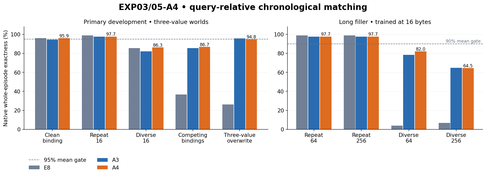
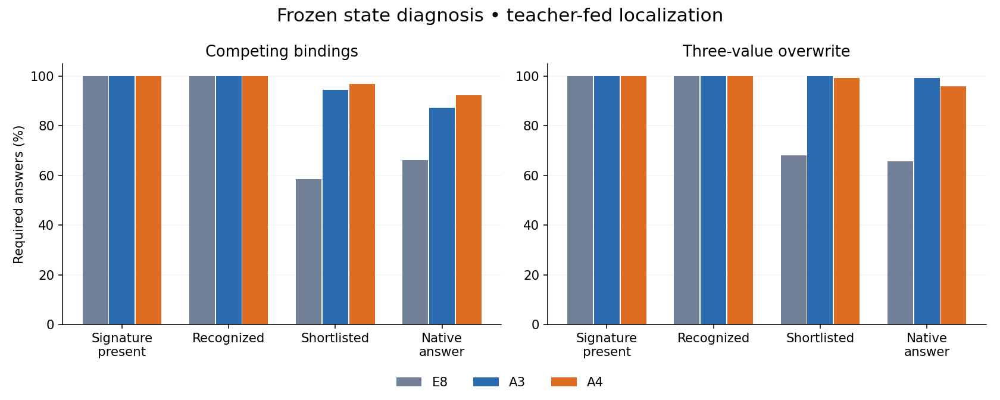
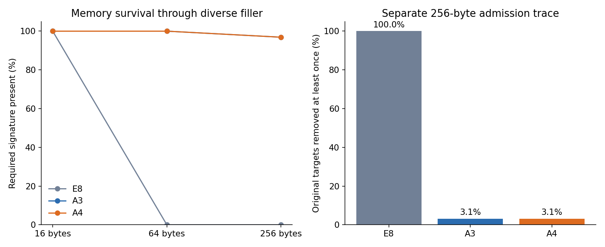
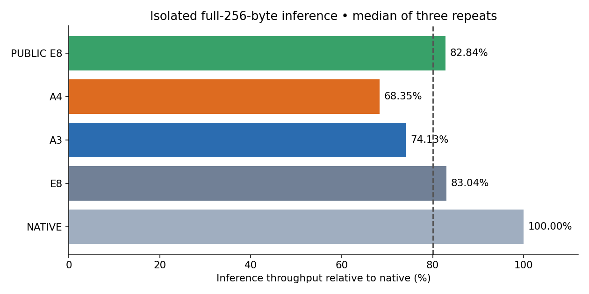

# SHoEbox EXP03/05-A4: query-relative chronological matching

16 November 2026 (America/Denver). Starting main:
`3eb05540355470ade64e9d433e3d6775e2dd27fc`.
Pre-fit implementation/source-data-lock commit: `59204fe` (retained in the source bundle).

**A4 development gate: FAIL. Qualified public E8 remains unchanged.**
A1/A2/A3/A4 audits remain closed. Read `A5_REGISTRATION.md` for the next focused
revision; it is registered, not implemented or fitted.

## Primary results

Full-256-byte autoregressive whole-episode exactness. Seeds 1/7/19 share
128 fresh development worlds, with four record/query-order presentations each.
These are fresh matched controls on the three-value curriculum; they do not
replace E8's original qualified audit. Seeds are not independent world samples.

| Condition | Matched E8 | Matched A3 | A4 |
|---|---:|---:|---:|
| Clean binding | 96.09% | 94.34% | 95.90% |
| Repeat 16 | 98.83% | 97.66% | 97.66% |
| Diverse 16 | 85.55% | 82.03% | 86.33% |
| Competing bindings | 36.59% | 85.42% | 86.72% |
| Three-value overwrite | 26.17% | 95.70% | 94.79% |
| Repeat 64 | 98.83% | 97.66% | 97.66% |
| Repeat 256 | 98.83% | 97.66% | 97.66% |
| Diverse 64 | 3.78% | 78.52% | 81.97% |
| Diverse 256 | 6.77% | 64.84% | 64.45% |

| Corrected overwrite | Changed key | Untouched key |
|---|---:|---:|
| E8 | 46.48% | 75.00% |
| A3 | 100.00% | 95.70% |
| A4 | 97.92% | 96.88% |

Relative to matched A3, A4 changes competing binding by
+1.30 points and overwrite by
-0.91 points.
Every condition, answer position, offset, delay and speed gate remains binding.
Passing overwrite alone cannot qualify this model.

## Exact implementation

A4 preserves admission into the existing 16 slots, query extraction, projections,
paired values, objectives, rates, calibration and E8's 1/256 cold gate. Every
strictly positively recognized record-phase key is projected in bounded scratch.
The minimum includes all candidates regardless of age. Float32 accumulated
squared distances feed the exact float64 expression
`4 * (double(d_min) + 1.96 - double(d_i))`.
The literal 1.96 is the squared change of one ±0.7 code coordinate, not a fitted
percentile or searched coefficient.

Newest born comes first, then stable slot/phase order. Float64 log-sigmoid
weights represent `p_i * product_previous(1-p_j)`. The two largest log weights
use stable slot/phase ties and normalize for the common paired-value mixture.
One recognized candidate gets all mass; zero uses the complete historical
A2/A3 presence fallback and distance attention. Every projection/minimum is
finished before an exact strict remaining-mass bound can skip scalar weights.

An independent exhaustive native implementation agrees exactly over 1,000
randomized states and targeted ordering, oldest-minimum, fallback, saturation
and stable-tie cases. A separate float32 Python calculation checks native
projections and mixtures. There is no inference parser, hard decoded-key equality,
source oracle, new slot, persistent cache or tape.

All arms have 497,589 fitted parameters, including 7,670 readout weights.
A4 adds zero weights, optimizer moments or persistent state. Its selection
scratch struct is **6,968 bytes**, plus scalar/algorithm call-stack temporaries;
existing prediction scratch remains 2,408 bytes. A4 magic is
`0x3441353050584553`, nested v19. Thirteen bidirectional protected-policy/import
rejection checks pass. Public E8, explicit v19/E7, historical constructors,
all prior numerical sources and original results/costs remain unchanged.

Local observed-prefix labels remain explicit optional fixture supervision.
Generic byte objectives freeze those local heads; all inference uses 256 bytes.

## Frozen matching diagnosis

First 32 development worlds ×4 orders, both answers, all seeds and arms.
These teacher-fed traces localize failure; the primary endpoint is autoregressive.
Labels identify signatures only in diagnostic output.

| Condition / arm | Target present | Recognized | Shortlisted | Native answer |
|---|---:|---:|---:|---:|
| Competing bindings / E8 | 100.00% | 100.00% | 58.59% | 66.15% |
| Competing bindings / A3 | 100.00% | 100.00% | 94.53% | 87.24% |
| Competing bindings / A4 | 100.00% | 100.00% | 96.88% | 92.19% |
| Three-value overwrite / E8 | 100.00% | 100.00% | 67.97% | 65.62% |
| Three-value overwrite / A3 | 100.00% | 100.00% | 100.00% | 99.22% |
| Three-value overwrite / A4 | 100.00% | 100.00% | 99.22% | 95.83% |

Competing-binding unrelated-key selected mass is 18.61% in matched
A3 and 12.41% in A4. Changed-key old/new signature survival is
100.00%; old-value prediction changes from
0.00% to 5.21%.
A4 changed-key teacher-fed accuracy is 94.79%.
Every A3/A4 recognized-candidate trace is checked against an external exhaustive
weight calculation. The archive retains all distances, occurrences, ownership,
projected energies and mass categories.

A separately registered frozen geometry trace finds nearest-query candidate
identity correct in 92.19%
of competing answers. For overwrite, identity is
100.00%
correct but the nearest version only
80.47%.
Old/new vectors for the same key have mean squared distance
3.3420;
their range overlaps different-key distances. This exposes representation
ambiguity that another recency band alone cannot remove. No alternative policy
was evaluated in this trace. A5 therefore registers a fixed local discriminative
key-reconstruction objective, preserving the A4 inference rule and all gates.

## Separate long-diverse retention diagnosis

| Arm | Signature present, 16 bytes | 64 bytes | 256 bytes |
|---|---:|---:|---:|
| E8 | 100.00% | 0.00% | 0.00% |
| A3 | 100.00% | 100.00% | 96.88% |
| A4 | 100.00% | 100.00% | 96.88% |

A separately registered external admission trace follows original target
signatures at every four-byte completion through 256 diverse bytes. Across A4
seeds it records **24 removal events**: 0
oldest-unrecognized replacements and 24 replacements
under all-slots-recognized pressure. Fully diverse incoming pairs are falsely
recognized as records in **16.97%** of checked completions. Per-event
logits, occupancy, filler-versus-query-tail timing and exact admission decisions
are retained. This is loss from the required L1 cache, separately from matching,
not a claim that every representation elsewhere vanished. No trace changes
inference or any fitted checkpoint.

## Every original gate

| A4 condition | All-offset mean | Worst offset, seed mean | Both orders |
|---|---:|---:|---:|
| Clean binding | 93.75% | 90.62% | 89.84% |
| Repeat 16 | 96.09% | 90.62% | 97.66% |
| Diverse 16 | 85.30% | 78.12% | 83.59% |
| Competing bindings | 81.20% | 68.75% | 85.94% |
| Three-value overwrite | 92.71% | 90.62% | 92.71% |

Primary/per-position: >=95% mean /90% each seed. Both orders and each delay:
>=90% /85%. Offsets: >=95% mean /90% worst-offset seed mean. No-query drop:
>=20 points; reverse must hurt. All state/pairing/gate lesions remain measured.
A4 clean lesions: None: 93.75%, no_head: 0.00%, no_query: 0.00%, no_state: 0.26%, uniform: 0.00%, reverse: 0.00%, unpair: 0.00%, gate_off: 0.00%, gate_on: 93.75%.

Fresh binary canonical regression is **93.95%** primary,
**97.27%** offset mean, **90.62%**
worst offset and **90.62%** both orders. Every original
binary per-position, padding and lesion requirement is also applied.

Primary/long-filler conditions use 512 presentations. Each offset uses the same
64 presentations; each independent 0/64/128/256 padding delay uses the next
16 crossed with all 64 offsets. Both-order/lesion samples have 256 presentations.
No threshold or count was reduced. Complete per-seed gate decisions are in
`verification.json`.

No generic or capacity promotion campaign was started after development failure.
Future gates remain language <=+0.01 nats/byte, copy/reconstruction <=1-point
token loss, post-1M-language retention and all three-seed 1M/5M requirements.
Public E8 retains its qualified **98.2747%** binding through 1M language targets
and **+0.006233 nats/byte** language result, with passing copy/reconstruction,
scale and speed evidence. No E8 prior sweep occurred.

## Isolated throughput

One pinned CPU; three interleaved 65,536-byte repeats plus 1,024 warmup bytes
each, full distribution at every byte; all other local research jobs completed.
Compilation, cloning and warmup are excluded from timed intervals and included
in process costs. Native is a fresh untrained v19 timing reference. Public E8
imports the matched E8 exactly; prediction checksums match.

| Arm | Bytes / CPU second | Relative native |
|---|---:|---:|
| NATIVE | 22,678.4 | 100.00% |
| E8 | 18,831.9 | 83.04% |
| A3 | 16,811.4 | 74.13% |
| A4 | 15,500.0 | 68.35% |
| PUBLIC E8 | 18,785.9 | 82.84% |

A4 fails the unchanged
**>=80% native** speed gate.

## Integrity, costs and exact continuation

Salt `SHoEbox-EXP0305-relative-chronological-v4` plus NUL; world RNG 20261126;
512/128/256 train/dev/closed-audit worlds plus 128 binary dev worlds. Exclusions
include complete historical opened binding folds, E2 family, reserved A1/A2/A3
audits and A2/A3 dev/binary worlds. Operations/orders/spacing/phases remain
grouped. No generic corpus was used; opened E1/E7 generic groups remain excluded.
Source closure, generated world hashes and passing receipts were locked before
fitting. Final outcomes/checkpoints/cursors were locked before diagnostics.

Independent interpreter checks cover 12,800 primary
and 5,120 both-operation/order
presentations. Repeating first/last/constant values scores 0% whole-episode
exactness. Distinct answers and balanced query orders bound a query-blind fixed
answer pair at 50%. Causal labels cannot inspect future answers.

Each E8/A3/A4 arm/seed receives its own charged 250K warmup and 2M continuation.
All order, spacing, changed-key and finish schedules match. No pilot, inherited
warmup, refit, uncharged control, optimizer or calibration sweep.

| Quantity | Total |
|---|---:|
| Charged fitting bytes | 20,250,000 |
| Padding bytes, included above | 16,706,358 |
| Native objective targets | 18,026,946 |
| Answer targets, included above | 226,602 |
| Local projection-vector updates | 9,425,232 |
| Local presence updates | 35,351,055 |
| Applicability updates | 17,900,163 |
| Local training windows | 22,262,886 |
| Fitting CPU seconds | 631.90 |
| Pilot research bytes | 0 |

Whole-process research/verification CPU at report creation is
**2,805.70 seconds**, including
compilation, descendants and repeats. Fit/evaluation subphase CPU is a subset,
not added twice. Inference input/padding counts and all local vector/objective
events are in `accounting.json`. Failed metered attempts: none.
Setup/source editing/read-only inspection were not separately CPU-metered;
a corrected environment-metadata typo is documented and consumed no research
bytes. Historical unit/native scalar writes are not instrumented; complete
process logs/costs remain. Artifact generation/packaging have separate receipts.

All **18 actual snapshot/cursor pairs** pass 1,000 uninterrupted versus
371 + save/load +629 updates: **36,000 discarded correctness bytes**. Pre-fit
Python checks consume **11,901**
discarded bytes with exact data-only replay of padding/local events; historical
trajectory checks consume **114,716**. These do not extend research fits.

- **214 distinct Python tests pass:** 60 runtime/public, 146 historical/research,
  eight A4. Thirteen additional cross-policy rejection checks pass.
- **824,111 core native**, **723 public E8**, and **13,863 A4 inherited/new checks**
  pass per optimized and ASan/UBSan build. LSan was explicitly disabled.
- Fourteen historical constructor/checkpoint trajectories match starting main;
  v5/v6 loaders remain unchanged but were not separately instantiated.
- All source, fold, model, cursor and final-result hashes verify. Every A1–A4
  audit remains closed.

## Reproduce, resume and continue

Read `experiments/relative_chronological_retention/README.md`. The downloadable
archive contains current source and git history, all 18 fitted snapshots with
exact cursors, generated worlds, raw outcomes/diagnostics, locks, process
receipts and member SHA-256 hashes. Checkpoints, datasets and binaries remain
outside git. Use this campaign's A4 cursor driver with each saved E8/A3/A4 policy;
older campaigns keep their own drivers. Never reset, finish or replay warmup at
an arbitrary interrupted boundary. `PUBLISHED_COMMIT.txt` identifies verified
main. `NEXT_CHAT_PROMPT.md` preserves direct-main publication authorization.

Primary grounding: [Miller et al., EMNLP 2016](https://aclanthology.org/D16-1147/)
for paired addressing/value reading; [Arora et al., ICLR 2024](https://proceedings.iclr.cc/paper_files/paper/2024/hash/448fc91f669c15d10364ee01d512cc10-Abstract-Conference.html)
for multi-query recall and input-dependent selection. The A4 relative band and
chronological rule are this project's preregistered design.
