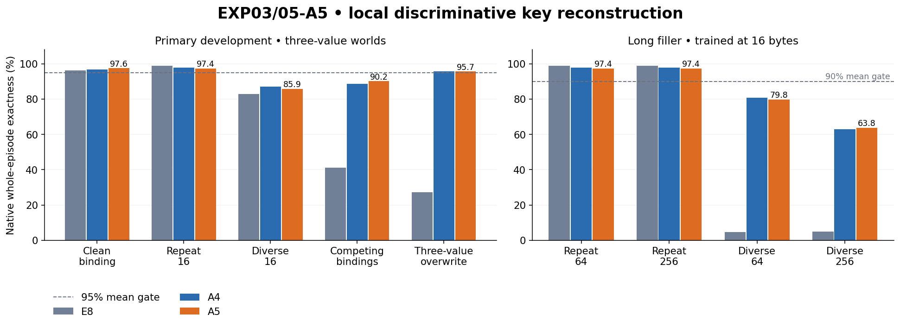
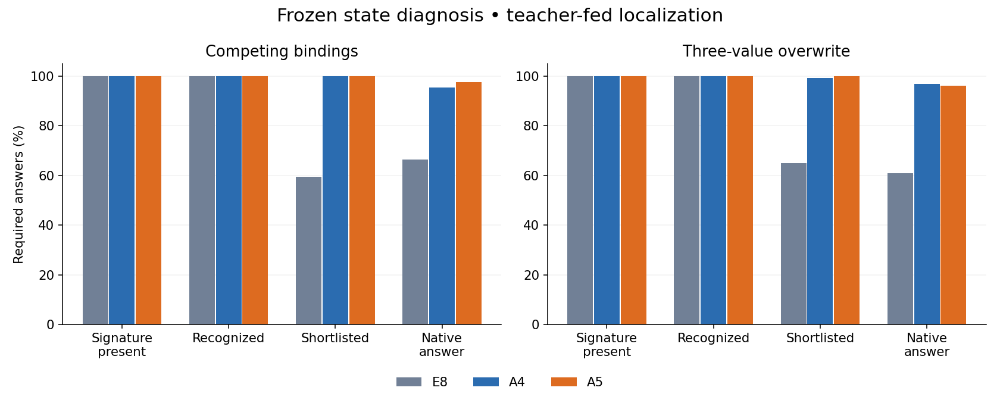
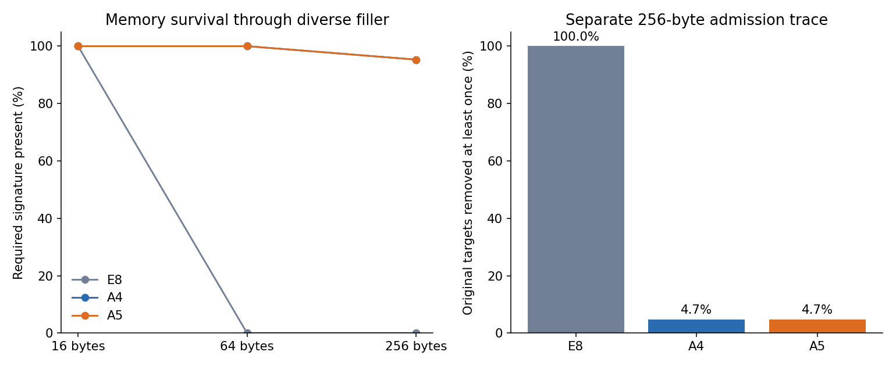
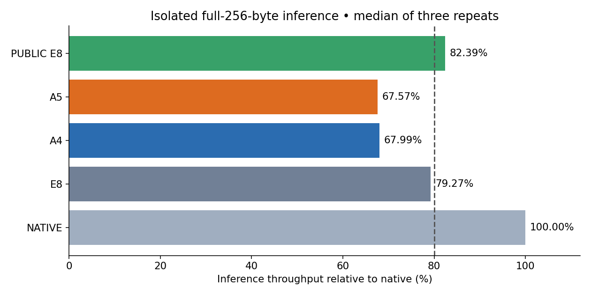

# SHoEbox EXP03/05-A5: local discriminative key reconstruction

16 November 2026 (America/Denver). Starting main:
`116efa345aa435780044e3ad5705350b6268f1a6`.
Pre-fit implementation/source-data-lock commit: `f28090a`.

**A5 development: FAIL. Qualified public E8 remains unchanged.**
All A1/A2/A3/A4/A5 audits remain closed. Every historical score, throughput
measurement, failed attempt and cost remains preserved. See `A6_REGISTRATION.md`
for the next focused revision; it is registered, not implemented or fitted.

## Primary results

Full-256-byte autoregressive whole-episode exactness. Matched E8/A4/A5,
seeds 1/7/19; 128 fresh development worlds x4 order presentations per condition.
Seeds share worlds and are not independent world samples. These are matched
fresh-curriculum controls, separate from public E8's original qualification.

| Condition | Matched E8 | Matched A4 | A5 |
|---|---:|---:|---:|
| Clean binding | 96.29% | 96.81% | 97.59% |
| Repeat 16 | 98.89% | 97.79% | 97.40% |
| Diverse 16 | 82.94% | 87.17% | 85.87% |
| Competing bindings | 41.02% | 88.67% | 90.23% |
| Three-value overwrite | 27.15% | 95.70% | 95.70% |
| Repeat 64 | 98.89% | 97.79% | 97.40% |
| Repeat 256 | 98.96% | 97.79% | 97.40% |
| Diverse 64 | 4.69% | 80.66% | 79.82% |
| Diverse 256 | 4.82% | 62.89% | 63.80% |

| Corrected overwrite | Changed key | Untouched key |
|---|---:|---:|
| E8 | 45.25% | 76.82% |
| A4 | 97.27% | 98.44% |
| A5 | 97.66% | 98.05% |

A5 versus matched A4: competing binding changes by
+1.56 points; overwrite by
+0.00 points.
Each condition, answer position, offset, delay, binary regression and speed
gate remains independently binding.

## Exact objective and isolation

Positive query and positive record-key labels use exactly the registered hybrid:

`L = 0.25 * sum_r (z_r-t_r)^2 + (1/16) * (-log P_observed)`

`P = softmax(-4 * squared_distance(z, code_b))`, over all **256** byte labels.

`e_r = 0.5 * (z_r+mu_r-2*t_r) * (1-z_r*z_r)`.

Every pre-update tanh projection uses the original float32 affine arithmetic.
Distance sums, max-subtracted softmax, normalizer and means use float64 in the
registered coordinate/byte order. Cast each gradient once to float32, then
apply the unchanged affine update at `rate*auxiliary*4` with `1+energy(x)`
normalization. Every gradient exists before any row update; FMA is disabled.

The existing codebook has **256 unique codes, zero collisions**, and minimum
Hamming distance one. SHA-256 is
`c8292df6bb4ea5e5a6c98daaf9796d008d03b0672107744637a13548a785559a`.
No code or label was changed or omitted. Fixed read-only training codebook:
16,384 bytes; objective scratch: 2,256 bytes; pre-update z: 64 bytes.
These do not enter sequence state or checkpoints. Existing A4 selection scratch
is 6,968 bytes; combined existing prediction scratch remains 2,408 bytes.

All arms have 497,589 fitted parameters, including 7,670 readout weights.
A5 adds zero fitted parameters, persistent sequence state, optimizer moments,
slots or projection cache. Its magic is `0x3541353050584553`, nested v19.
All protected loaders reject implicit conversion.

Inference is exactly A4: all recognized float32 distances, the float64
`4*(double(d_min)+1.96-double(d_i))` rule, chronological weights, stable ties,
paired top-two values, one/zero-candidate fallback, and unchanged admission.
The codebook is never evaluated by inference. No parser, target oracle,
discrete decoded-key match or restricted output alphabet is introduced.

Source isolation and same-weight cross-policy trajectories verify unchanged
inference and generic/native updates. Native controlled-label tests verify
unchanged value, five presence, applicability and native-state updates.
Generic byte objectives freeze local heads; observed-window labels are explicit
optional local supervision, separate from next-byte loss.

## Frozen identity/version diagnosis

First 32 development worlds x4 orders, both teacher-fed answers, all seeds/arms.
These traces localize failure; autoregressive results determine qualification.

| Condition / arm | Target present | Recognized | Shortlisted | Native answer |
|---|---:|---:|---:|---:|
| Competing bindings / E8 | 100.00% | 100.00% | 59.38% | 66.41% |
| Competing bindings / A4 | 100.00% | 100.00% | 100.00% | 95.31% |
| Competing bindings / A5 | 100.00% | 100.00% | 100.00% | 97.66% |
| Three-value overwrite / E8 | 100.00% | 100.00% | 64.84% | 60.94% |
| Three-value overwrite / A4 | 100.00% | 100.00% | 99.22% | 96.88% |
| Three-value overwrite / A5 | 100.00% | 100.00% | 100.00% | 96.09% |

Matched A4 and A5 nearest-candidate identity is 97.66%
on competing queries. On overwrite, nearest identity is
99.22%, and nearest version is
82.03%.
All candidate distances, vectors, occurrence order and selected mass categories
are retained. Every A4/A5 selected pair and weight agrees with an external
exhaustive calculation. The [separate diagnosis note](DIAGNOSIS.md) interprets these locked
measurements without a new inference candidate or coefficient sweep.

## Separate long-diverse signature loss

| Arm | Signature present, 16 bytes | 64 bytes | 256 bytes |
|---|---:|---:|---:|
| E8 | 100.00% | 0.00% | 0.00% |
| A4 | 100.00% | 100.00% | 95.31% |
| A5 | 100.00% | 100.00% | 95.31% |

The external admission trace records 36
A5 target-removal events. Event causes, incoming false recognition, cache
occupancy and target presence logits are retained in `retention.json` and
summarized in the diagnosis note. This measures loss from the required L1
cache separately from recognition, selection and value decoding; it does not
claim every representation elsewhere disappeared. Frozen checkpoints are intact.

## Unchanged extended gates

| A5 condition | All-offset mean | Worst offset, seed mean | Both orders |
|---|---:|---:|---:|
| Clean binding | 96.09% | 90.62% | 96.88% |
| Repeat 16 | 93.75% | 84.38% | 96.09% |
| Diverse 16 | 84.94% | 65.62% | 83.59% |
| Competing bindings | 89.06% | 81.25% | 91.41% |
| Three-value overwrite | 87.55% | 81.25% | 93.75% |

Primary and each answer position: >=95% mean /90% every seed. Both orders and
every padding/repeat/diverse delay: >=90% mean /85% every seed. Offsets:
>=95% overall mean /90% worst-offset mean across seeds. No-query drop >=20
points; reversed selection must hurt. Every state/pairing/gate lesion is retained.

Fresh binary canonical regression: 96.29% primary,
98.44% offset mean, 93.75% worst offset,
92.97% both orders. Every binary per-position,
padding-delay and lesion gate is applied. Full per-seed decisions are in
`verification.json`.

Each primary/long-filler condition uses 512 presentations. The same first
64 presentations are crossed with all 64 offsets. Each independent 0/64/128/256
padding delay uses the next 16 presentations x64 offsets. Both-order and lesion
samples contain 256 presentations. No threshold or sample count was reduced.

No generic/capacity qualification follows development failure. Future gates
remain language <=+0.01 nats/byte, copy/reconstruction <=1-point token loss,
post-1M-language retention and complete three-seed 1M/5M qualification.
Public E8 retains its qualified 98.2747% binding through 1M language targets,
+0.006233 nats/byte language result, and passing copy/reconstruction/scale/speed.

## Isolated full-distribution throughput

One pinned CPU; three interleaved 65,536-byte repeats plus 1,024 warmup each;
all other local research jobs stopped. Full 256-byte output at every byte.
Compilation/cloning/warmup are outside timed intervals and inside process cost.
Native is a fresh untrained v19 reference. Public E8 exactly imports matched E8;
prediction checksums match. The unchanged requirement is **>=80% native**.

| Arm | Bytes / CPU second | Relative native |
|---|---:|---:|
| NATIVE | 22,782.0 | 100.00% |
| E8 | 18,058.9 | 79.27% |
| A4 | 15,489.3 | 67.99% |
| A5 | 15,394.0 | 67.57% |
| PUBLIC_E8 | 18,769.6 | 82.39% |

## Locks, costs and verification

Fresh salt `SHoEbox-EXP0305-discriminative-keys-v5` plus NUL; world RNG 20261127.
512/128/256 train/dev/closed-audit worlds plus 128 fresh binary dev worlds.
Exclusions include the entire prior opened binding-fold union/E2-family,
reserved A1/A2/A3/A4 audits, and all A2/A3/A4 dev/binary worlds. Operation/order
siblings stay grouped. No generic corpus is used; opened E1/E7 generic groups
remain excluded later. 939 fitting source dependencies, passing receipts and
fold hashes were locked before fitting. Final outcomes/checkpoints/cursors
were locked before diagnosis.

Independent interpretation passes on 12,800 primary and 5,120 both-change/order
presentations plus 512 fresh binary presentations. Repeating first/latest/constant
values yields zero whole-episode exactness; distinct answers and both query
orders bound any fixed query-blind answer pair at 50%. Labels are causal.

Each arm/seed receives its own 250K warmup +2M continuation. No pilot, inherited
warmup, refit, replay or optimizer/codebook/band/prior sweep occurred.

| Fitting quantity | Total |
|---|---:|
| Charged input bytes | 20,250,000 |
| Padding bytes, included above | 16,705,845 |
| Native objective targets | 18,026,856 |
| Answer targets, included above | 226,503 |
| Local projection-row updates, all arms | 9,419,832 |
| Local presence updates | 35,351,100 |
| Applicability updates | 17,900,172 |
| Local training windows | 22,262,904 |
| A5 attraction-loss components | 153,015 |
| A5 discrimination-loss components | 153,015 |
| A5 hybrid gradient rows | 2,448,240 |
| A5 256-code distance comparisons | 39,171,840 |
| A5 coordinate distance comparisons | 626,749,440 |
| Fitting CPU seconds | 656.51 |
| Pilot fitting bytes | 0 |

Whole-process research/verification CPU at report generation:
**3372.84 seconds**, including
compilation, setup dependency installation, descendants and repeated checks.
Fitting/subphase costs are included, not added twice. Failed metered attempts:
research_attempt1_process. The first broader Python invocation
failed because PyTorch was absent; its log/cost remains. After dependency
installation all 154 historical/research tests passed. No research fit failed.

All 18 actual model/cursor pairs resume exactly: 1,000 uninterrupted versus
371 + save/load +629, totaling 36,000 discarded correctness bytes. Pre-fit
Python controls consume 14,087 discarded update bytes;
historical trajectories consume 114,716. Data-only replay verifies every
local component/gradient/code-comparison count, separately for formal fits,
pre-fit tests and cursor checks. Independent objective microchecks, inference
and padding have separate ledgers. Historical unit/native scalar writes remain
uninstrumented; complete CPU/logs are retained. Setup editing/read-only inspection
is not separately CPU-metered; artifact generation/packaging has separate receipts.

- **225 distinct Python tests pass:** 60 runtime/public, 154 historical/research,
  and 11 A5. All 15 extra protected-policy rejection checks pass.
- **824,111 core native**, **723 public E8**, **13,863 inherited A4/E8/admission**,
  and **75,295 A5 objective checks** pass in optimized and ASan/UBSan builds.
  LSan is explicitly disabled. Native independent gradient error is at most
  5.889e-8; finite differences and controlled descent pass.
- Fourteen historical constructor/checkpoint trajectories match starting main.
  v5/v6 loader sources are unchanged but not independently instantiated.
- Every source/fold/snapshot/cursor/result lock verifies. Public E8, explicit
  v19/E7, all historical constructors and previous reports remain unchanged.

## Reproduce and resume

Read `experiments/discriminative_keys/README.md` and `RESUME.md`. The ordinary
archive includes source and git history, all 18 fitted model/cursor pairs,
generated worlds, raw results/diagnostics, locks, failure/passing receipts and
member hashes. Checkpoints, datasets and compiled binaries stay outside git.
Use this campaign's cursor driver with each saved E8/A4/A5 policy; never reset,
finish or replay warmup at an arbitrary interrupted boundary. Extending a
failed model consumes newly registered research bytes.

Primary grounding: [Movshovitz-Attias et al., ICCV 2017](https://arxiv.org/abs/1703.07464)
uses learned distance proxies; A5 uses existing fixed codes and its own exact
hybrid. [Miller et al., EMNLP 2016](https://aclanthology.org/D16-1147/) supports
paired key/value reading; [Arora et al., ICLR 2024](https://proceedings.iclr.cc/paper_files/paper/2024/hash/448fc91f669c15d10364ee01d512cc10-Abstract-Conference.html)
supports multi-query recall measurement. None establishes A5's performance or
its constants. All empirical claims above come from this locked campaign.
