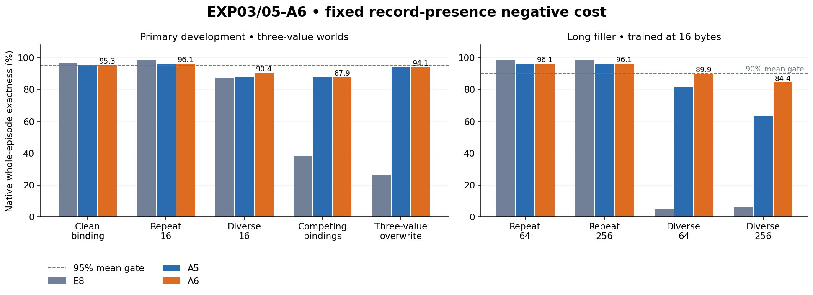
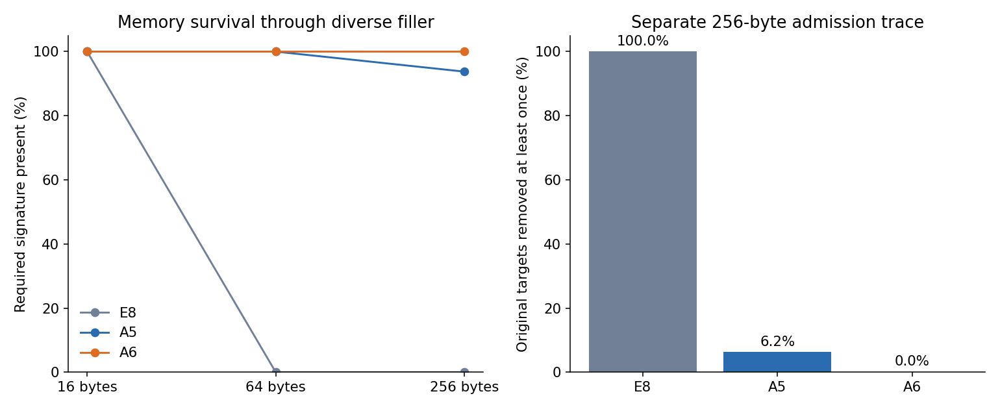
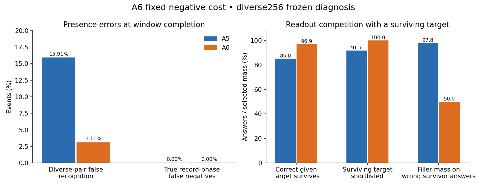
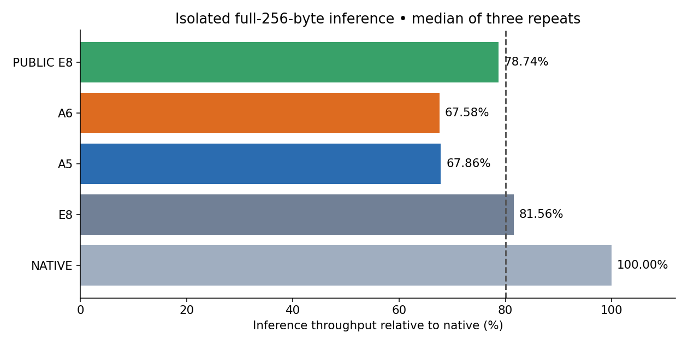

# SHoEbox EXP03/05-A6: fixed record-presence negative cost

16 November 2026 (America/Denver). Starting main: `803dc86e563ff048866023bb536830ce0f28ea98`. Pre-fit source/receipt lock: `1ddb724`.

**A6 development: FAIL. Qualified public E8 remains unchanged.** All A1–A6 audits remain closed. No generic/capacity qualification, pilot or sweep was run. Every earlier result, failed attempt and cost is preserved.

## Primary results

Full-256-byte autoregressive whole-episode exactness; 128 fresh development worlds ×4 order presentations per condition, seeds 1/7/19. Seeds share worlds. These newly fitted matched controls do not replace E8’s original qualification.

| Condition | Matched E8 | Matched A5 | A6 |
|---|---:|---:|---:|
| Clean binding | 96.8750% | 95.3125% | 95.3125% |
| Repeat 16 | 98.4375% | 96.0938% | 96.0938% |
| Diverse 16 | 87.3698% | 87.7604% | 90.3646% |
| Competing bindings | 37.8906% | 87.8906% | 87.8906% |
| Three-value overwrite | 26.1719% | 94.1406% | 94.1406% |
| Repeat 64 | 98.4375% | 96.0938% | 96.0938% |
| Repeat 256 | 98.4375% | 96.0938% | 96.0938% |
| Diverse 64 | 4.6875% | 81.5104% | 89.9089% |
| Diverse 256 | 6.3802% | 63.1510% | 84.3750% |

| Corrected overwrite | Changed key | Untouched key |
|---|---:|---:|
| E8 | 44.9219% | 73.8281% |
| A5 | 99.2188% | 94.9219% |
| A6 | 99.2188% | 94.9219% |

## Exact implementation and verification

The four record-presence classifier errors are `(p-y)*4.f`, with the original float32 affine/sigmoid arithmetic, phase/event order, `rate*auxiliary`, normalized affine step and disabled FMA. Positive updates remain bit-identical; negative error is exactly fourfold at identical pre-update input/weights. Stable softplus is used only for reference losses.

A6 inherits A5’s exact all-256-code hybrid, float64 softmax/gradients and pre-update coupling. Query presence, applicability, value reconstruction, native responsibility credit, A4 inference/chronology/ties/fallback, admission, prior and 16 slots remain unchanged. The source-isolation test reverses only the record-error line and magic to recover A5 exactly. Same-weight trajectories verify identical inference, admission and generic/native learning. No arithmetic reuse or vectorization was introduced.

There are 497,589 fitted parameters per arm, including 7,670 readout weights. A6 adds zero parameters, persistent sequence state, optimizer moments, slots or projection caches. Its outer magic is `0x3641353050584553`, nested v19; all historical constructors/loaders retain their meanings. Generic byte objectives do not supply or learn local labels. Inference uses the complete byte alphabet.

All 256 fixed codes remain present: zero collisions, minimum Hamming distance one; little-endian float32 SHA-256 `c8292df6bb4ea5e5a6c98daaf9796d008d03b0672107744637a13548a785559a`. Unchanged training-only codebook: 16,384 bytes; hybrid scratch 2,256 bytes plus 64-byte z. Existing selection scratch: 6,968 bytes; prediction scratch: 2,408 bytes. None is new persistent sequence state.

- 237 distinct Python tests pass: 60 runtime/public, 165 historical/research, 12 A6. Seventeen additional bidirectional protected-policy/import checks pass.
- Optimized and ASan/UBSan builds pass: 824,111 core checks; 723 public E8 checks; 13,863 inherited numerical/request/admission/exhaustive-selection checks; 75,295 hybrid checks; 7,826 A6 presence checks per build. LSan was explicitly disabled.
- Independent Python logistic and hybrid references, long-double native references, finite differences, all phases/label masks, unchanged other updates, exact positive steps and fourfold negative errors pass. Maximum native logistic-gradient discrepancy: 2.81436e-7; hybrid: 5.88852e-8.
- Fourteen historical constructor/checkpoint trajectories match starting main. Original v5/v6 loader sources are unchanged but were not separately instantiated.
- All 18 actual warmup/final model/cursor pairs pass 1,000 uninterrupted versus 371 + save/load +629 updates exactly, including interrupted schedule boundaries. Those 36,000 discarded correctness bytes do not extend selected fits.

## Separate memory and readout diagnosis

Frozen first-32-world ×4-order teacher-fed traces localize errors; they do not replace autoregressive gates. Incoming false recognition below is the maximum over four phase classifiers on fully diverse eight-byte pairs.

| Arm | Diverse256 signature survival | Incoming false recognition | True-record phase false negatives | Removed target events |
|---|---:|---:|---:|---:|
| A5 | 93.7500% | 15.9137% | 0.0000% | 48 |
| A6 | 100.0000% | 3.1124% | 0.0000% | 0 |

| Arm | Correct given target survives | Surviving target recognized | Surviving target shortlisted | Recognized filler phases/answer | Filler mass on wrong survivor answers |
|---|---:|---:|---:|---:|---:|
| A5 | 85.0000% | 100.0000% | 91.6667% | 11.1562 | 97.8184% |
| A6 | 96.8750% | 100.0000% | 100.0000% | 1.9375 | 49.9913% |

| Arm | Competing nearest-key identity | Competing unrelated-key mass | Changed-key old-value predictions |
|---|---:|---:|---:|
| A5 | 96.8750% | 4.2089% | 0.0000% |
| A6 | 96.8750% | 4.2089% | 0.0000% |

Every recognized A5/A6 selected pair and weight agrees with the external exhaustive calculation. Signature absence, presence rejection, surviving-target selection and identity/version ambiguity remain separate fields. Exact removal reasons, incoming/target logits, selected masses and all vectors are retained in the archive and summarized in `DIAGNOSIS.md`.

The first-32-world diagnostic is easier than the full endpoint: A6 diverse256 autoregressive whole-episode exactness is 93.75% on those worlds, 81.25% on the remaining 96, and 84.375% overall. Teacher-fed answer accuracy of 96.875% is a different measure on that subset. It does not establish full-population signature survival or readout accuracy.

Data-only traversal finds 26,255 of 28,856 positive record-key windows (90.9863%) contain PAD, with 5,997 distinct key/phase/raw-window combinations. The 9,963 fully diverse negative windows cover 3,252 unique windows. Competing-trace record-key reconstruction squared error is 3.288515 versus 0.158972 for queries; wrong nearest identities differ by 4–6 fixed-code bits, so they are not code collisions. This motivates the fixed A7 record-context curriculum registered below.

## Unchanged extended gates

| A6 condition | All-offset mean | Worst offset, seed mean | Both orders |
|---|---:|---:|---:|
| Clean binding | 96.3542% | 90.1042% | 94.5312% |
| Repeat 16 | 97.6562% | 90.6250% | 96.0938% |
| Diverse 16 | 91.4062% | 84.3750% | 92.1875% |
| Competing bindings | 93.7012% | 78.1250% | 89.0625% |
| Three-value overwrite | 93.7500% | 87.5000% | 94.5312% |

Fresh binary canonical regression: 96.6797% primary; 96.8750% offset mean; 90.6250% worst offset; 96.0938% both orders.

Primary and each position require ≥95% mean/90% every seed. Both orders and every padding/repeat/diverse delay require ≥90%/85%. All-offset mean requires ≥95%, worst-offset seed mean ≥90%. No-query drop ≥20 points; reverse must hurt. All state/pairing/gate lesions and every binary gate remain binding.

Primary/long-filler conditions use 512 presentations. The same first 64 are evaluated at all 64 offsets. The next 16 are crossed with every offset at each independent 0/64/128/256 padding delay. Both-order and lesion samples use 256 presentations. Every per-seed decision is in `verification.json`; no sample or threshold was reduced.

## Isolated throughput

| Arm | Bytes / CPU second | Relative native |
|---|---:|---:|
| NATIVE | 22,579.5 | 100.0000% |
| E8 | 18,416.1 | 81.5611% |
| A5 | 15,321.8 | 67.8570% |
| A6 | 15,260.1 | 67.5838% |
| PUBLIC_E8 | 17,778.1 | 78.7356% |

One pinned CPU, three interleaved 65,536-byte repeats plus 1,024 warmup each, full 256-byte output every byte. All other local research jobs had finished. Compilation/cloning/warmup are outside timed intervals and inside process cost. Native is a fresh untrained v19 reference; public E8 imports matched E8 exactly and prediction checksums agree. The unchanged candidate gate is ≥80% native.

The separate public-E8 import control measures 78.74% here, also below 80%, despite its exact prediction-checksum match. This timing is retained without retry or replacement. It does not overwrite the original qualified E8 measurement; no public runtime source changed.

## Folds, locks and costs

Salt `SHoEbox-EXP0305-record-presence-cost-v6` plus NUL; world RNG 20261128. Counts: 512/128/256 train/dev/closed-audit worlds plus 128 fresh binary dev worlds. Exclusions cover the complete historical opened binding-fold union/E2-family, reserved A1–A5 audits and all A2–A5 dev/binary worlds. Operations/orders stay grouped. No generic data is used; opened E1/E7 generic groups remain excluded from later qualification.

The pre-fit commit locks 967 source dependencies, passing receipts, exact folds and independent interpreter/shortcut results before fitting. Interpreter agreement covers 12,800 primary, 5,120 changed-key/order and 512 binary presentations. First/latest/constant repeated answers score zero; a fixed query-blind answer pair is bounded at 50% by distinct answers and both query orders. Causal labels never inspect future answers.

Each arm/seed independently receives 250K native warmup +2M continuation, order RNG 8701/8702 and augmentation +1000. No pilot, inherited warmup, refit, extra control, replay or sweep. Final outcomes/checkpoints/cursors are locked before diagnosis.

| Fitting quantity | Total |
|---|---:|
| Charged input bytes | 20,250,000 |
| Padding bytes, included above | 16,706,619 |
| Native objective targets | 18,026,973 |
| Answer targets, included above | 226,476 |
| Local projection-row updates | 9,425,088 |
| Local presence updates | 35,351,568 |
| Applicability updates | 17,900,244 |
| Local training windows | 22,263,075 |
| Fitting CPU seconds | 664.67 |

| Per-arm local cost, three continuations | E8 | A5 | A6 |
|---|---:|---:|---:|
| record positive loss components | 86,568 | 86,568 | 86,568 |
| record negative loss components | 5,730,540 | 5,730,540 | 5,730,540 |
| record positive gradient rows | 86,568 | 86,568 | 86,568 |
| record negative gradient rows | 5,730,540 | 5,730,540 | 5,730,540 |
| hybrid attraction components | 0 | 153,072 | 153,072 |
| hybrid discrimination components | 0 | 153,072 | 153,072 |
| hybrid gradient rows | 0 | 2,449,152 | 2,449,152 |
| hybrid code comparisons | 0 | 39,186,432 | 39,186,432 |

Whole-process research/verification CPU at report generation: **3,106.35 seconds**. This includes descendants, compilation, repeated controls and failed commands; fitting/subphase CPU is included, not added twice. Failed metered attempts: none.

The A6 Python pre-fit tests consume 14,087 discarded update bytes; historical trajectories consume 114,716. Exact data-only cursor traversal verifies all fitting/local positive/negative loss-component and gradient-row counts without recomputing weights. Counts are loss/gradient events, not loss-value sums or scalar floating-point writes. Per-phase, query-presence, applicability, hybrid/code-comparison, cursor and microcheck counts are retained separately. Historical unit/native scalar writes are uninstrumented; their complete CPU and logs are preserved. Setup/editing/read-only inspection is not separately CPU-metered. Artifact generation and packaging have separate receipts.

## Resume and next work

Read `RESUME.md`, `DIAGNOSIS.md` and [A7_REGISTRATION.md](A7_REGISTRATION.md) in full. A7 is registered, not implemented or fitted: replace only continuation training’s existing 0–7-byte record spacers with fixed per-occurrence diverse bytes, preserving lengths, masks, labels, order and budget. Keep A6 model arithmetic and all gates. The ordinary archive includes published source and git history, starting-main source, all 18 fitted model/cursor pairs, generated world manifests, raw traces, source/data/results locks, process receipts and per-member SHA-256. No checkpoint, dataset or compiled binary enters git. Never reset, finish or replay at an arbitrary saved cursor boundary.

Failure retains E8 and the closed A6 audit. Passing development would require separately registered fresh generic/capacity qualification: language ≤+0.01 nats/byte, copy/reconstruction ≤1-point token loss, post-1M-language retention, all three-seed 1M/5M and speed gates. Partial improvement cannot override a failed gate.

The user explicitly authorizes committing/pushing completed verified work, including failure, directly to main without further confirmation. Preserve unrelated changes and history; never force-push. Deliver downloadable Markdown, primary PNGs, resumable archive and a copy/paste prompt with this authorization.

Primary grounding: [Elkan, IJCAI 2001](https://cseweb.ucsd.edu/~elkan/rescale.pdf) analyzes distinct misclassification costs. The factor four is this project’s prospective choice. A5/A4 addressing references and all historical findings remain preserved; no paper establishes A6’s empirical outcome.
