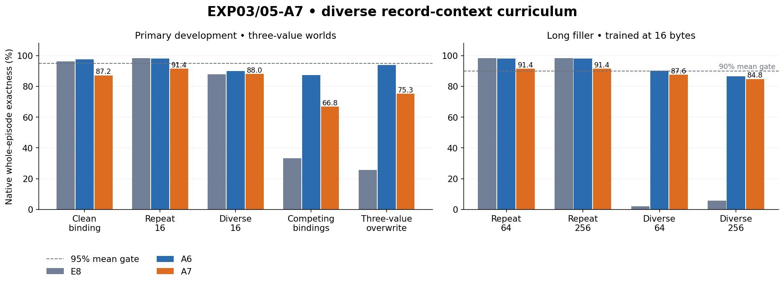
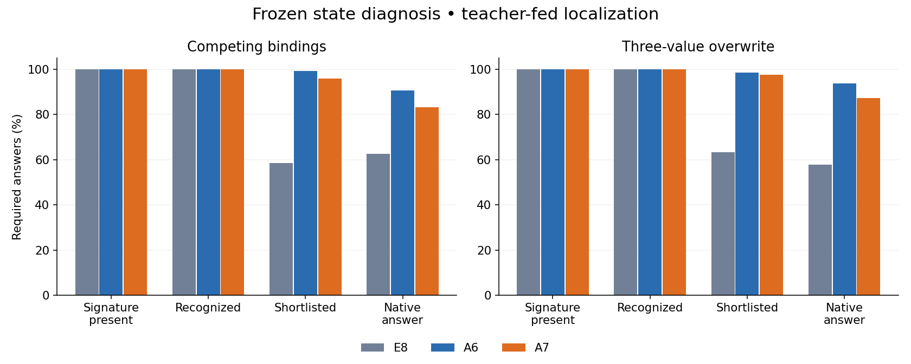
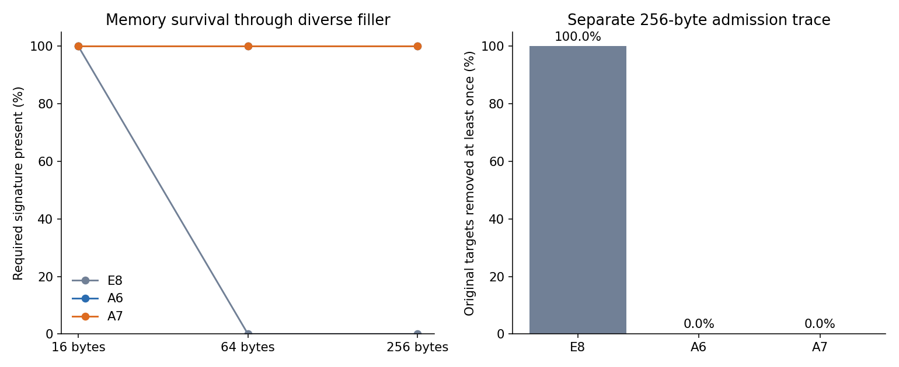
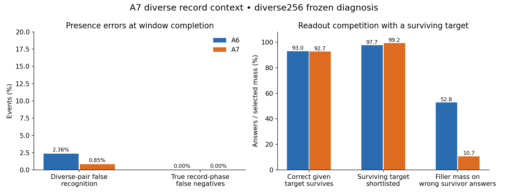
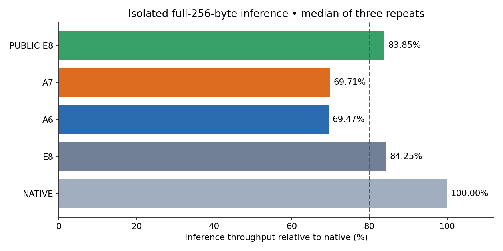

# SHoEbox EXP03/05-A7: diverse record-context curriculum

16 November 2026 (America/Denver). Starting main: `a04e7ee50bcb3f9cc40ad2ce2d9d901b551b061b`. Pre-fit source/receipt commit: `80f1e351a37343db0ed24619144a0c587a8b4a30`.

**A7 development: FAIL. Qualified public E8 remains unchanged.** All A1–A7 audits remain closed. Exactly 20.25M fitting bytes; no pilot, extra fit, sweep, inherited warmup or generic/capacity qualification. Every earlier result, timing and cost remains preserved.

## Full autoregressive results

Native full-256-byte whole-episode exactness. Matched E8/A6/A7, seeds 1/7/19, 128 fresh worlds ×4 record/query-order presentations per condition. Seeds share worlds. These fresh controls do not replace E8’s original qualification.

| Condition | Matched E8 | Matched A6 | A7 |
|---|---:|---:|---:|
| Clean binding | 96.289062% | 97.460938% | 87.174479% |
| Repeat 16 | 98.437500% | 98.046875% | 91.406250% |
| Diverse 16 | 87.760417% | 89.843750% | 88.020833% |
| Competing bindings | 33.203125% | 87.369792% | 66.796875% |
| Three-value overwrite | 25.781250% | 93.750000% | 75.260417% |
| Repeat 64 | 98.437500% | 98.046875% | 91.406250% |
| Repeat 256 | 98.437500% | 98.046875% | 91.406250% |
| Diverse 64 | 2.083333% | 90.169271% | 87.630208% |
| Diverse 256 | 5.729167% | 86.653646% | 84.765625% |

| Corrected overwrite | Changed key | Untouched key |
|---|---:|---:|
| E8 | 44.140625% | 75.781250% |
| A6 | 96.484375% | 97.265625% |
| A7 | 84.505208% | 87.890625% |

## Exact intervention

Only A7 continuation replaces the existing 0–7-byte spacers after the two original records with per-occurrence bytes in [160,255]. The literal registered SHA-256 prefix, raw group-key bytes, little-endian episode/physical-position/block encoding and rejection rule are used. Both existing RNGs, lengths, phases, order, labels, masks, finish schedule and budgets stay unchanged. Every independent warmup and the E8/A6 controls retain PAD. Evaluation fixtures are unchanged.

The generated A7 header is byte-identical to A6 after reversing only its save/load magic `0x3741353050584553`; its native source is identical. Record costs stay 4/4, with A5’s all-256-code hybrid, float64 softmax/gradient and pre-update coupling. Query presence, applicability, values, native credit, A4 inference/chronology/ties/fallback, admission and existing state stay exact. No arithmetic reuse or optimization was introduced; FMA remains disabled.

Every arm has 497,589 fitted parameters, including 7,670 readout weights. There are no new parameters, persistent sequence state, moments, projection caches or slots. The outer cursor `exp0305-a7-cursor-1` records policy, curriculum and exact episode/partial-example position. Generic byte objectives and optional fixture-local supervision remain separate; inference supports all 256 bytes.

The independent spacer/interpreter traversal checks every augmented continuation episode and locks six per-arm/phase streams. Input/target digests change only for A7 continuation; masks, labels, RNG states, schedules and warmup bytes match. Both physical record orders, zero lengths, rejection boundaries, additional hash blocks, future-answer causality and partial-spacer resumes pass.

## Frozen failure localization

First 32 development worlds ×4 orders, both teacher-fed answers, all seeds. These subset measurements localize failure; full autoregressive outcomes set the gates. Final fits and complete evaluation outcomes were locked before these traces.

| Arm | Diverse256 signature survival | Incoming false recognition | True-record phase false negatives | Target removals |
|---|---:|---:|---:|---:|
| A6 | 100.000000% | 2.359438% | 0.000000% | 0 |
| A7 | 100.000000% | 0.853414% | 0.000000% | 0 |

| Arm | Correct given signature survives | Surviving target shortlisted | Recognized filler phases/answer | Filler mass on wrong survivor answers |
|---|---:|---:|---:|---:|
| A6 | 92.968750% | 97.656250% | 1.609375 | 52.822656% |
| A7 | 92.708333% | 99.218750% | 0.531250 | 10.740741% |

| Arm | Competing nearest-key identity | Competing other-key selected mass | Changed-key old-value predictions |
|---|---:|---:|---:|
| A6 | 95.833333% | 8.934958% | 4.687500% |
| A7 | 89.062500% | 19.176680% | 13.541667% |

Admission and exhaustive selection are independently reconstructed. Missing signatures, surviving-target competition and identity/version errors remain separate. Detailed geometry, mass, phase and occurrence records remain in the evidence archive.

| A7 autoregressive episode exactness | First 32 worlds | Remaining 96 | All 128 |
|---|---:|---:|---:|
| Clean binding | 86.718750% | 87.326389% | 87.174479% |
| Diverse 256 | 85.416667% | 84.548611% | 84.765625% |
| Competing bindings | 70.312500% | 65.625000% | 66.796875% |
| Three-value overwrite | 75.520833% | 75.173611% | 75.260417% |

## Measured training-window coverage

Exact data-only traversal of each 2M-byte continuation, with no model calls. Counts are per arm/seed; the generated data schedule is shared across seeds.

| Arm | Positive record-key events | Events containing PAD | Distinct key/phase/windows | Fully diverse negative events | Distinct diverse negatives |
|---|---:|---:|---:|---:|---:|
| E8 | 28,829 | 26,266 | 5,900 | 10,046 | 3,282 |
| A6 | 28,829 | 26,266 | 5,900 | 10,046 | 3,282 |
| A7 | 28,829 | 11,451 | 22,791 | 13,944 | 6,773 |

## Unchanged extended gates

| A7 condition | All-offset mean | Worst offset, seed mean | Both orders |
|---|---:|---:|---:|
| Clean binding | 91.748047% | 85.416667% | 82.031250% |
| Repeat 16 | 95.052083% | 87.500000% | 88.541667% |
| Diverse 16 | 93.945312% | 85.416667% | 84.635417% |
| Competing bindings | 73.714193% | 62.500000% | 65.885417% |
| Three-value overwrite | 71.582031% | 48.958333% | 73.177083% |

Fresh binary regression: 90.169271% primary; 92.578125% offset mean; 88.541667% worst offset; 87.239583% both orders.

Every primary condition and answer position requires ≥95% mean/90% every seed. Both orders and each padding/repeat/diverse delay require ≥90%/85%. All-offset mean requires ≥95%, worst-offset seed mean ≥90%. No-query drop ≥20 points; reverse must hurt. All state/pairing/gate lesions and every binary gate remain binding.

The same first 64 presentations are tested at all 64 offsets. The next 16 cross all offsets independently at 0/64/128/256 padding delays. Both-order/lesion samples contain 256 presentations. No sample count or threshold was reduced. All per-seed scores/decisions are retained.

## Isolated throughput

| Arm | Bytes/CPU second | Relative native |
|---|---:|---:|
| NATIVE | 22,296.5 | 100.000000% |
| E8 | 18,785.9 | 84.254881% |
| A6 | 15,490.2 | 69.473469% |
| A7 | 15,543.7 | 69.713538% |
| PUBLIC_E8 | 18,695.2 | 83.848205% |

One pinned CPU; three interleaved 65,536-byte repeats plus 1,024 warmup each. Full byte distributions at every input; all other jobs stopped. Compilation/cloning/warmup are outside timed intervals and inside process costs. Native is the fresh untrained v19 reference; public E8 imports matched E8 exactly, with identical prediction checksums. The unchanged speed requirement is ≥80% native.

## Folds, costs and verification

Salt `SHoEbox-EXP0305-diverse-record-context-v7` plus NUL; world RNG 20261129. 512/128/256 train/dev/closed-audit and 128 fresh binary dev worlds. Exclusions include all historical opened binding folds/E2 family, reserved A1–A6 audits and every A2–A6 dev/binary world. Operations/orders remain grouped. No generic data is used; opened E1/E7 generic groups remain excluded later.

Each arm/seed independently receives 250K native warmup +2M continuation. Order RNG 9701/9702, augmentation +1000. No replay, extra fit or inherited warmup. Passing source/data/receipt hashes were committed before fitting; final model/cursor/outcome locks verify.

| Fitting quantity | Total |
|---|---:|
| bytes | 20,250,000 |
| padding bytes | 16,473,834 |
| nuisance bytes | 872,982 |
| replaced padding bytes | 232,470 |
| targets | 18,026,838 |
| answer targets | 226,386 |
| local projection steps | 9,419,976 |
| local presence steps | 35,351,397 |
| gate targets | 17,900,217 |
| local training windows | 22,263,012 |
| Fitting CPU seconds | 667.11 |

PAD/nuisance/replaced-padding counts are included in the 20.25M budget, not added to it. Replaced padding is a subset of nuisance bytes.

| Local cost across three continuations | E8 | A6 | A7 |
|---|---:|---:|---:|
| record positive loss components | 86,487 | 86,487 | 86,487 |
| record negative loss components | 5,730,573 | 5,730,573 | 5,730,573 |
| record positive gradient rows | 86,487 | 86,487 | 86,487 |
| record negative gradient rows | 5,730,573 | 5,730,573 | 5,730,573 |
| hybrid attraction components | 0 | 153,006 | 153,006 |
| hybrid discrimination components | 0 | 153,006 | 153,006 |
| hybrid gradient rows | 0 | 2,448,096 | 2,448,096 |
| hybrid code comparisons | 0 | 39,169,536 | 39,169,536 |

Whole-process research/verification CPU at report generation: **3,125.88 seconds**. Fitting/subphase CPU is included once. Failed metered attempts: delivery_check_process, prefit_python_initial_process, prefit_native_process.

A7 Python correctness invocations consumed 24,400 discarded update bytes, including the failed initial E8/A6 control work. All 18 saved warmup/final pairs pass 1,000 uninterrupted versus 371 + save/load +629 updates: 36,000 separately charged discarded correctness bytes. Historical trajectories consumed 114,716 discarded bytes. Native independent microchecks retain event counts in their logs. Historical unit/native scalar writes remain uninstrumented; complete process CPU and logs are retained. Setup/editing/read-only inspection is not separately CPU-metered; artifact production/packaging has separate receipts.

- 252 distinct Python tests pass: 60 runtime/public, 177 historical research and 15 A7 tests; 19 additional protected-policy checks pass.
- Optimized and ASan/UBSan pass: 824,111 core checks, 723 public E8 checks, 13,863 inherited selection/lifecycle checks, 75,295 hybrid-objective checks and 7,826 record-presence checks per build. Leak checking was explicitly disabled.
- Independent logistic/hybrid gradients, finite differences, all-256-code inclusion and pre-update coupling pass. Codebook has 256 unique codes, no collisions; minimum Hamming distance one. Exact same-weight local/native/inference/admission trajectories pass.
- All 14 instantiated historical constructor/checkpoint trajectories match starting main. v5/v6 loader sources are unchanged but were not independently instantiated. Public/historical numerical sources and earlier reports remain untouched.

## Resume and next work

Read `DIAGNOSIS.md`, `RESUME.md` and `A8_REGISTRATION.md`. A8 registers one phase-balanced PAD/diverse curriculum, alternating 64-episode blocks beginning with PAD. It is not implemented or fitted. The archive contains source/git history, starting-main source, all 18 model/cursor pairs, generated worlds, exact stream/source/outcome locks, raw diagnostics, failed/passing receipts and per-member SHA-256. Checkpoints, datasets and compiled binaries remain outside git. Never reset, finish or replay at an arbitrary cursor boundary.

Failure retains qualified E8 and keeps the A7 audit closed. Passing development would require separately registered fresh generic/capacity qualification at every original margin: language ≤+0.01 nats/byte, copy/reconstruction ≤1-point token loss, post-1M-language retention, all three-seed 1M/5M and speed gates.

Completed verified work, including unsuccessful research, is explicitly authorized for commit/push directly to main without confirmation. Preserve unrelated changes and remote history; never force-push. Deliver ordinary downloadable Markdown, PNGs, resumable archive and copy/paste prompt. No Pages/Spaces.

Primary grounding remains [Miller et al., EMNLP 2016](https://aclanthology.org/D16-1147/) for paired addressing and [Arora et al., ICLR 2024](https://proceedings.iclr.cc/paper_files/paper/2024/hash/448fc91f669c15d10364ee01d512cc10-Abstract-Conference.html) for multi-query recall measurement. The fixed A7 curriculum is this project’s registered intervention.
