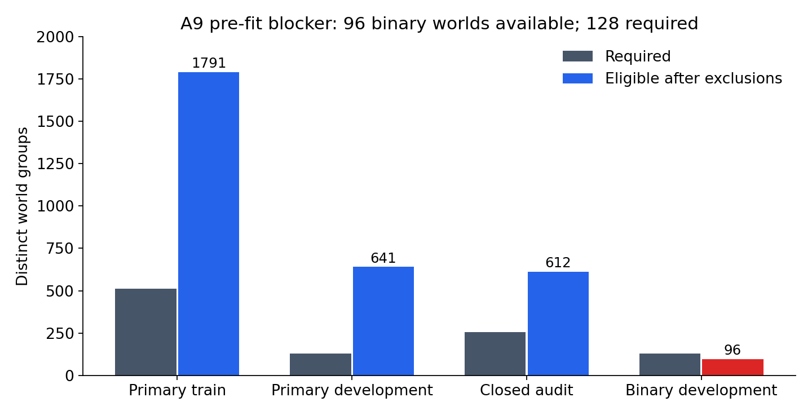
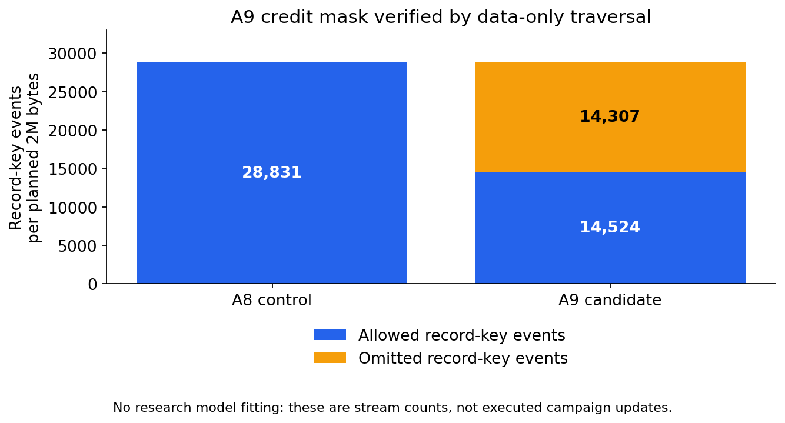

# SHoEbox EXP03/05-A9: implemented, blocked before fitting

16 November 2026 (America/Denver). Starting main:
`3c24b6623e8f03ae39f2d7d6266609bfcc9344ba`.

**A9 cannot satisfy its original pre-fit data requirements: 128 fresh binary
development worlds are required, but only 96 are eligible. Research fitting:
0 bytes.** Public E8 and every original A1–A8 result, timing, cost and closed
audit remain unchanged. No A9 capability or throughput result is claimed.

## The exact blocker

The original v9 salt plus NUL, RNG 20261201, 64-key pool and all mandatory
historical exclusions are preserved. Exhaustive independent enumeration of
canonical world JSON, SHA-256 fold assignment and the complete exclusion union
agrees exactly with the production generator and seeded ordering.

| Split | Required worlds | Eligible after exclusions | Status |
|---|---:|---:|---|
| Three-value training | 512 | 1,791 | Available |
| Three-value development | 128 | 641 | Available |
| Three-value closed audit | 256 | 612 | Available; no answers scored |
| Binary development | 128 | **96** | **Blocked: 32 missing** |

There are 4,032 possible binary worlds. The v9 development bucket contains 784
before exclusions and 96 afterward. Across all buckets, 491 binary worlds
remain eligible (303 train, 96 development, 92 audit). Excluding the 896 selected
primary worlds leaves 336 unused binary worlds, which supports the prospective
allocation repair below. None has been scored or used for a fit.

The full pre-fit suite retains its 128-world requirement and raises
`ValueError: only 96 dev worlds at pool 64`. The shortage was independently
confirmed and rechecked after cleaning a duplicate explicit exclusion in the
test. No salt, exclusion, seed, count or gate was altered. There is no passing
pre-fit receipt, and the fitting driver cannot start without that committed receipt.

## Implemented and verified change

A9 retains A8's alternating 64-episode PAD/diverse curriculum. It passes a
training-only `allow_record_key_update` flag, separate from the six labels and
answer mask. Every positive record-key event in a diverse continuation episode
skips its 16-row hybrid update. All positive record labels still train presence
and values. Query-key, applicability and native rules remain unchanged.

The flag is derived from the exact saved episode index. It is not a parameter,
model field, inference argument or saved model state. Standalone local calls
default to enabled credit; generic calls ignore it and cannot update local heads.
A9 has checkpoint magic `0x3941353050584553`, nested v19, and outer cursor
`exp0305-a9-cursor-1`. FMA is disabled. No slots, caches, moments, codebook,
matching coefficients or inference arithmetic were added or changed.

Enabled credit matches A8 byte for byte after reversing only the envelope
identity, including every-byte local/native updates, full-256 predictions,
admission and saved state. Independent native checks show disabled credit
changes only eligible record-key rows and the projection counter for an isolated
local call. Test-only hybrid-call instrumentation confirms omitted events
perform no hidden hybrid/code comparisons. Unaffected heads equal the original
A8 reference. Gradients, finite differences, all 256 codes, coupling, selection,
causality, occurrence/lifecycle and exact partial-block resumes pass.

## Exact stream and credit accounting

All six per-arm warmup/continuation streams were traversed without model
weights. A8/A9 input/target/label/mask digests match exactly; their continuation
credit digests differ. Both RNGs, order, episode positions, lengths, labels,
64 phases and finish schedule match. Boundaries 63/64/127/128, zero spacers,
hash rejection/additional blocks and partial-spacer/block resumes are checked.
Each continuation encounters 11,090 episodes, including its partial last episode.

| Per planned 2M continuation | E8 | A8 | A9 |
|---|---:|---:|---:|
| Eligible positive record-key events | 28,831 | 28,831 | 28,831 |
| Allowed record-key events | 28,831 | 28,831 | **14,524** |
| Omitted record-key events | 0 | 0 | **14,307** |
| Total local projection rows | 1,046,808 | 1,046,808 | **817,896** |

A9 omits 228,912 key-gradient rows, 3,662,592 code comparisons and 58,601,472
coordinate-distance comparisons per planned continuation. These are **data-only
planned counts**, not executed research updates. Actual discarded correctness
updates and their executed/omitted ledgers are reported separately.

## Verification and cost

- 60 public/runtime and 209 historical research Python tests pass.
- A9's complete 20-test invocation has 19 passes and one data-feasibility error.
  The single affected grouping check was rerun and preserves the same failure.
- 23 protected-loader rejection checks and 14 historical checkpoint trajectories pass.
- Optimized and ASan/UBSan checks pass: 824,111 core, 723 public E8,
  13,863 inherited selection/lifecycle, 75,295 hybrid, 7,826 presence and
  **57,280 A9 masked-credit checks per build**. Leak checking was disabled.
- All 256 fixed codes remain unique; enabled A8 parity, generic/local separation
  and exact cursor correctness pass. v5/v6 loader sources are unchanged but
  were not independently instantiated, matching the historical check scope.

Research fitting, pilots, inherited warmups, replay, development inference,
audit scoring and qualification: **zero**. The planned 20.25M-byte campaign was
not launched. A9 Python controls consumed **56,044 discarded update
bytes**; historical trajectories consumed **114,716**. Direct Python
observe calls total 1,172. Six data-only stream traversals cover 6.75M bytes,
not model training. Every failed command and repeated control is retained.

Whole-process research/verification cost at report creation is **1025.614 CPU
seconds**, including descendants and compilation. Setup/editing/read-only
inspection is not separately metered. Historical/native microtrajectory scalar
writes and implicit prediction calls are not exhaustively counted; their full
CPU/logs remain. Artifact generation, final validation and packaging have
separate receipts. `accounting.json` records exact successful Python event
counts, native masked-reference calls and every process cost without double
counting subphase CPU.

The first public-native command used a nonexistent module and exited before
model work; the corrected command passed. Both logs/costs remain. The binary
shortage is the sole remaining pre-fit blocker. There are no fitted A9
checkpoints and no 18-pair fitted-cursor claim.

## Gates deliberately not executed

The full primary/position/offset/order/padding/repeat/diverse/lesion/binary
measurements and isolated **>=80% native throughput** require the registered
fitted snapshots. None was executed or replaced by an untrained-model estimate.
There are no full outcomes to lock or diagnose. Teacher-fed subset diagnosis,
post-1M-language retention and fresh generic/1M/5M capacity qualification also
remain unexecuted. Every original threshold and sample size remains binding.

## One focused next preregistration

`A9_F1_REGISTRATION.md` changes only binary development allocation: use the
128-world seeded sample from all eligible binary worlds outside the unchanged
896 selected primary groups, instead of requiring the exhausted v9 development
bucket. All historical exclusions remain; 336 candidates exist. The same
20261201 RNG and original enumeration order are fixed. No F1 identities were
selected, no F1 code was implemented and no fitting occurred.

A subsequent execution must read the original A9 registration and F1 together,
implement the allocation, pass every prerequisite and commit complete source/
world/stream/credit locks before the original exact 20.25M-byte comparison.
Failure retains E8 and closed audits; development success still requires separate
fresh generic/capacity qualification. The A9 mechanism has no empirical outcome
from this turn, so no numerical successor or gate relaxation is justified.

## Delivery and resume

`RESUME.md` and the archive preserve source/history, raw availability proof,
all six exact stream/cursor/credit manifests, failed/passing controls and CPU
receipts. The archive resumes **pre-fit development**, not a partially trained
campaign. Datasets and compiled binaries remain outside git; no trained model
exists. The verified publication and copy/paste prompt accompany the download.

The user's explicit authority to commit/push completed verified work directly
to main, including unsuccessful research, remains in force. Preserve unrelated
changes and remote history; never force-push. Deliver ordinary Markdown, PNGs,
a resumable archive and the next prompt; no Pages or Spaces.
