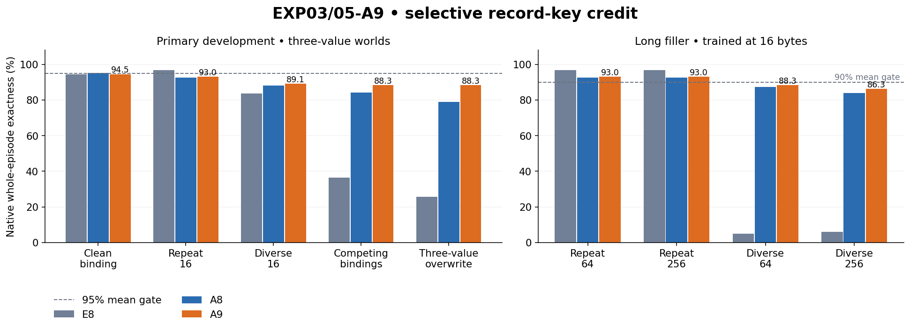
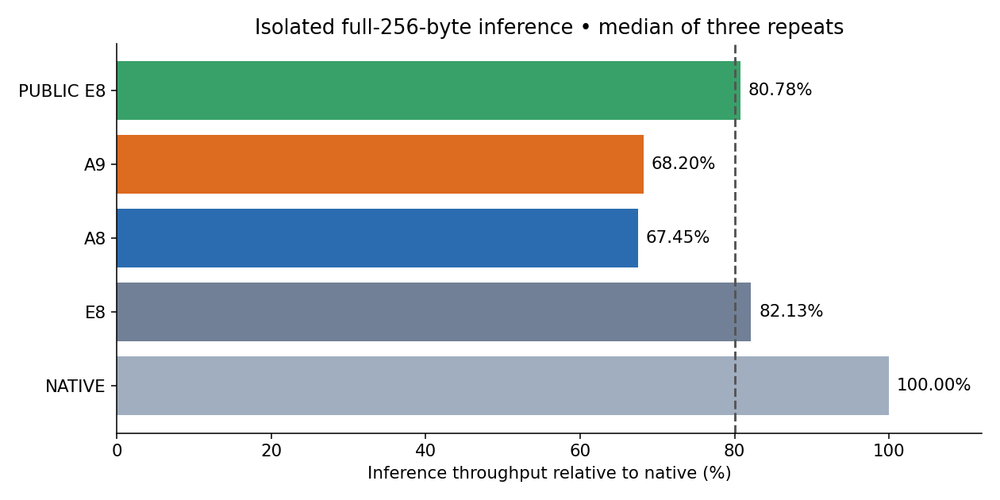
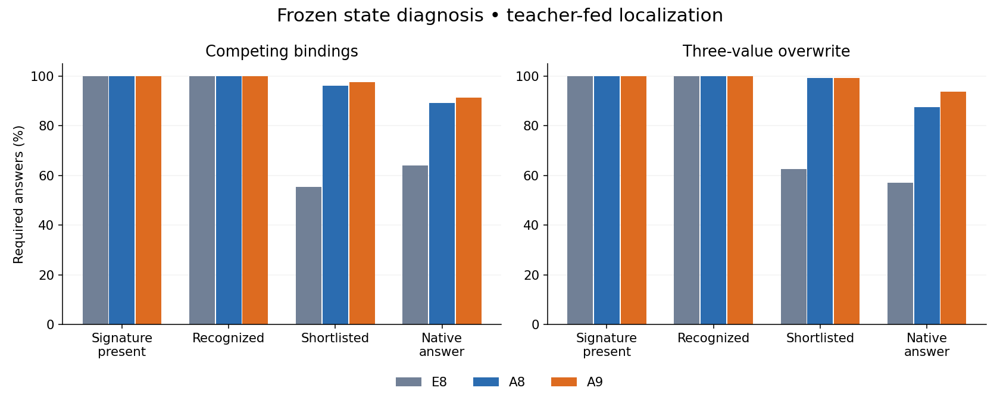
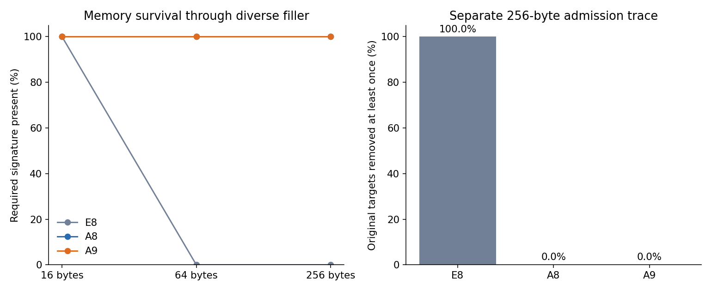
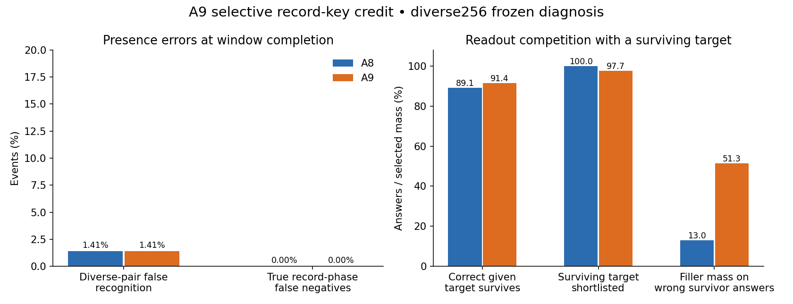

# SHoEbox EXP03/05-A9-F1: selective record-key credit

16 November 2026 (America/Denver). Starting main: `fa54cbd1c8c90be756ea4da8cfef2ccb735ed183`. Pre-fit lock: `00d5cb393c075710925a6fd9add8606915ca3a5a`.

The local pre-fit commit preceded fitting. Its identical tree was published as `7dc8b5c275d00b469f068d788064b63025833120` after terminal Git credentials were unavailable; both commits and the exact tree mapping are preserved.

**A9 development: FAIL. Qualified public E8 remains unchanged.** The complete fixed comparison consumed exactly **20,250,000 fitting bytes**. All A1–A9 audits remain closed. No pilot, sweep, replay, inherited warmup, extra fit or generic/capacity qualification ran.

## Binary allocation repair

F1 changes only binary development allocation. Independent enumeration and seeded shuffle select 128 unique worlds from 336 eligible candidates, excluding all historical groups and all 896 primary worlds. Every primary identity and all six original stream/credit manifests are byte-identical to blocked A9. The original 96-world failure and all its receipts and costs remain preserved. Binary worlds cannot enter training or audit allocation.

| Lock | SHA-256 |
|---|---:|
| train | ee2b86a802e66409daa0c1a014668fc59d68ab4071ad9d3270d1b74df594e693 |
| dev | ae38b19abf23f862663a5a9fd49ac79040e43d594eea8262a1ed46f2f87c3a78 |
| audit | 93cc7bbb077cce018369f0730e16e6ae5d3b24719c392d1eb51adf652a976c4a |
| Binary ordered sample | a6bf7c3adf4a26bd723a49f6271817da3e87206409714ed7deacfb8e26852640 |
| Complete original stream manifest | 41d78aee9983c62f04fb92125b8daa8c102c17016281bac28fe65aaddab6d392 |

The raw world file and full stream/credit ledgers are in the archive. The committed pre-fit receipt pins their hashes, exact selected identity hashes and order, source closure, independent proof, and passing controls before fitting.

## Full autoregressive outcomes

Native full-256-byte whole-episode exactness; matched E8/A8/A9, seeds 1/7/19, 128 fresh primary worlds ×4 record/query-order presentations per condition. Generated first answers enter the second-query state. Seeds share worlds. These fresh controls do not replace earlier E8 or A8 results.

| Condition | Matched E8 | Matched A8 | A9 |
|---|---:|---:|---:|
| Clean binding | 94.335938% | 95.312500% | 94.531250% |
| Repeat 16 | 96.875000% | 92.578125% | 92.968750% |
| Diverse 16 | 83.593750% | 88.151042% | 89.062500% |
| Competing bindings | 36.328125% | 84.244792% | 88.281250% |
| Three-value overwrite | 25.781250% | 78.906250% | 88.281250% |
| Repeat 64 | 96.875000% | 92.578125% | 92.968750% |
| Repeat 256 | 96.875000% | 92.578125% | 92.968750% |
| Diverse 64 | 4.817708% | 87.369792% | 88.281250% |
| Diverse 256 | 5.859375% | 83.854167% | 86.328125% |

| Overwrite answer | E8 | A8 | A9 |
|---|---:|---:|---:|
| Changed key | 41.796875% | 86.328125% | 95.703125% |
| Untouched key | 75.390625% | 91.015625% | 92.187500% |

## Exact selective-credit intervention

A8 and A9 receive identical inputs, targets, six local labels, answer masks and alternating 64-episode PAD/diverse blocks. A9 alone suppresses positive record-key hybrid calls in diverse continuation blocks. Presence, value, query-key, applicability and native rules are unchanged. Each arm/seed has an independent 250K native-only PAD warmup and 2M continuation.

The flag is ephemeral training input derived from the exact episode cursor, separate from labels and masks. It never enters inference or model state. Generic calls cannot train local heads. Enabled credit is byte-identical to A8 after reversing only the envelope identity; isolated disabled-credit checks change only eligible record-key rows and counters. Omitted events perform no hidden hybrid gradients or code comparisons. FMA remains disabled.

A9 magic is `0x3941353050584553`, nested v19; cursor schema is `exp0305-a9-cursor-1`. Every arm has 497,589 fitted parameters, including 7,670 readout weights. No new slots, sequence state, optimizer moments, cache, decoder, codebook or inference parser was added.

| Per 2M continuation | E8 | A8 | A9 |
|---|---:|---:|---:|
| Eligible record-key events | 28,831 | 28,831 | 28,831 |
| Executed record-key events | 28,831 | 28,831 | 14,524 |
| Omitted record-key events | 0 | 0 | 14,307 |
| Executed total projection rows | 1,046,808 | 1,046,808 | 817,896 |

These are executed counts, reconciled against all fitted model inventories and exact cursors. The incomplete terminal episode is retained; there is no rebalancing or compensation for omitted credit.

## Every registered gate

| A9 condition | Offset mean | Worst-offset mean | Both orders |
|---|---:|---:|---:|
| Clean binding | 86.816406% | 81.250000% | 92.968750% |
| Repeat 16 | 89.892578% | 84.375000% | 90.625000% |
| Diverse 16 | 85.644531% | 78.125000% | 89.843750% |
| Competing bindings | 84.375000% | 78.125000% | 85.156250% |
| Three-value overwrite | 86.669922% | 81.250000% | 88.281250% |

| Independent padding delay | Mean | Minimum seed |
|---|---:|---:|
| 0 | 73.535156% | 73.535156% |
| 64 | 68.554688% | 68.554688% |
| 128 | 68.554688% | 68.554688% |
| 256 | 68.554688% | 68.554688% |

| Fresh binary regression | Result |
|---|---:|
| Primary mean | 94.921875% |
| Primary minimum seed | 94.921875% |
| Offset mean | 99.218750% |
| Worst-offset mean | 98.437500% |
| Both orders | 96.875000% |

Primary and each answer position require ≥95% mean/90% each seed. Both query orders and every delay require ≥90%/85%. Offsets require ≥95% overall mean and ≥90% worst-offset mean across seeds. No-query drop must be ≥20 points and reversed selection must hurt. All state/pairing/gate lesions and all binary position/padding/lesion gates were evaluated; complete individual decisions are in `verification.json`.

Each offset uses the same first 64 presentations. Each independent 0/64/128/256 padding delay uses the next 16 presentations ×64 offsets. Both-order/lesion samples have 256 presentations. Primary and long-filler conditions have 512. No sample or threshold was reduced.

## Isolated throughput

| Arm | Bytes / CPU second | Relative native |
|---|---:|---:|
| NATIVE | 22,976.5 | 100.000000% |
| E8 | 18,871.4 | 82.133332% |
| A8 | 15,498.4 | 67.453152% |
| A9 | 15,670.6 | 68.202933% |
| PUBLIC_E8 | 18,560.1 | 80.778434% |

One pinned CPU; three interleaved 65,536-byte repeats per arm plus 1,024-byte warmups, with all other local research jobs finished. Full 256-byte output is produced at every input. Compilation, cloning and warmup are excluded from timed intervals and included in process costs. Native is an untrained full-budget v19 timing reference. Public/research E8 checksums agree exactly. The unchanged candidate gate is ≥80% native. Raw times/checksums are retained without result replacement.

## Frozen subset diagnosis

All fits, 18 model/cursor pairs and every full outcome, including timing, were locked before diagnosis. The following uses only the first 32 worlds ×4 orders, both teacher-fed answers and all seeds. These per-answer subset measurements do not replace full autoregressive outcomes.

| Arm | Diverse256 signature survival | False recognition | Target removals | Survivor answer accuracy | Competing nearest identity | Changed-key old predictions |
|---|---:|---:|---:|---:|---:|---:|
| A8 | 100.000000% | 1.405622% | 0 | 89.062500% | 90.625000% | 9.375000% |
| A9 | 100.000000% | 1.405622% | 0 | 91.406250% | 93.750000% | 1.562500% |

| A9 autoregressive episode exactness | First 32 worlds | Other 96 | All 128 |
|---|---:|---:|---:|
| Clean binding | 91.406250% | 95.572917% | 94.531250% |
| Diverse 256 | 82.812500% | 87.500000% | 86.328125% |
| Competing bindings | 82.812500% | 90.104167% | 88.281250% |
| Three-value overwrite | 87.500000% | 88.541667% | 88.281250% |

Matched A8/A9 geometry, query/record reconstruction errors, latest/old/unrelated/filler mass, target recognition, shortlist membership, true-record false negatives, signature survival at 16/64/256 bytes, and externally reconstructed admission/selection remain in raw and compact evidence. Data-only window coverage and credit counts retain block, condition, key and phase. See `DIAGNOSIS.md` for the measured interpretation and sole next preregistration.

## Accounting and verification

| Fitting quantity | Total |
|---|---:|
| bytes | 20,250,000 |
| padding bytes | 16,474,029 |
| nuisance bytes | 872,346 |
| replaced padding bytes | 231,402 |
| targets | 18,026,838 |
| answer targets | 226,440 |
| local projection steps | 8,734,536 |
| local presence steps | 35,351,226 |
| gate targets | 17,900,190 |
| local training windows | 22,262,949 |
| Fitting CPU seconds | 661.902 |

PAD, nuisance and replaced-PAD bytes are included in fitting bytes, not added to them. Replaced PAD is a subset of nuisance input.

| Across three continuations | E8 | A8 | A9 |
|---|---:|---:|---:|
| record positive gradient rows | 86,493 | 86,493 | 86,493 |
| record negative gradient rows | 5,730,519 | 5,730,519 | 5,730,519 |
| hybrid attraction components | 0 | 153,030 | 110,109 |
| hybrid discrimination components | 0 | 153,030 | 110,109 |
| hybrid gradient rows | 0 | 2,448,480 | 1,761,744 |
| hybrid code comparisons | 0 | 39,175,680 | 28,187,904 |
| hybrid coordinate distance comparisons | 0 | 626,810,880 | 451,006,464 |
| omitted hybrid components | 0 | 0 | 42,921 |
| omitted hybrid code comparisons | 0 | 0 | 10,987,776 |
| omitted hybrid coordinate comparisons | 0 | 0 | 175,804,416 |

Whole-process research/verification CPU at report creation: **3,237.997 seconds**. Fitting and other nested subphase timers are included once. Failed metered attempts: none. Artifact generation, publication and packaging have separate receipts.

The original blocked A9 report's **1,025.614 CPU seconds** remains unchanged. Its complete preserved process receipts, including later delivery work, are separately retained in `prior_a9/`; no prior cost is reset or attributed to this new fit.

During report preparation, an initial syntax check found a duplicate keyword introduced by arm-name replacement. It executed no module, model, fit or inference. The failed source and correction receipt are preserved; that initial editor command was not separately CPU-metered. The failed terminal push changed no remote ref and is also retained.

Current A9 Python controls consumed **56,044 discarded update bytes**. All 18 actual saved pairs pass 1,000 uninterrupted versus 371 + save/load +629 updates, totaling **36,000 discarded correctness bytes**. Historical trajectory checks consumed **114,716**. Executed/omitted local events and native masked-reference comparisons have separate ledgers. Historical/native microtrajectory scalar writes remain uninstrumented; full CPU/logs are retained. Setup, editing and read-only inspection are not separately metered.

- 289 distinct Python tests pass: 60 public/runtime, 209 historical research and the complete 20-test A9 suite; 23 additional protected-policy rejection checks pass.
- Optimized and ASan/UBSan controls pass: 824,111 core, 723 public E8, 13,863 inherited selection/lifecycle, 75,295 hybrid, 7,826 presence and 57,280 masked-credit checks per build. Leak checking was disabled.
- Independent gradients, finite differences, all 256 unique codes, pre-update coupling, scalar A8 parity, causal labels, training-only flag isolation, 64-phase block boundaries and exact partial-spacer resumes pass.
- Fourteen historical constructor/checkpoint trajectories match starting main. v5/v6 loaders remain unchanged but were not independently instantiated. Public/historical numerical sources and all A1–A8 results remain untouched.

## Resume and next work

The sole next registration is `A10_REGISTRATION.md`: exact row-parallel affine execution, with **zero research fitting bytes**. It requires bitwise scalar equivalence and ≥80% native throughput on fixed fresh timing worlds. A10 is not implemented or measured. A speed pass would leave A9's accuracy failure intact; further accuracy work requires a separate registration.

The archive contains published source and Git history, starting-main source, all 18 fitted model/cursor pairs, exact world/stream/credit manifests, raw outcomes/diagnostics, every failed/passing receipt, original blocked A9 evidence and member hashes. Checkpoints, datasets and compiled binaries stay outside Git. `RESUME.md` explains verification and exact cursor use. The completed fitting budget is exhausted; no checkpoint extension is authorized without a new registration.

Failure retains E8 and closed A1–A9 audits and leads to one focused preregistration, not an additional fit. Passing development would require separate fresh generic/capacity qualification with language ≤+0.01 nats/byte, copy/reconstruction ≤1-point token loss, post-1M-language retention, all three-seed 1M/5M checks and every original speed gate.

Completed verified work, including unsuccessful research, is explicitly authorized for direct main commit/push without confirmation. Preserve unrelated changes and remote history; never force-push. Deliver ordinary downloadable Markdown, primary PNGs, resumable archive and a copy/paste prompt preserving this authority. No Pages or Spaces.
