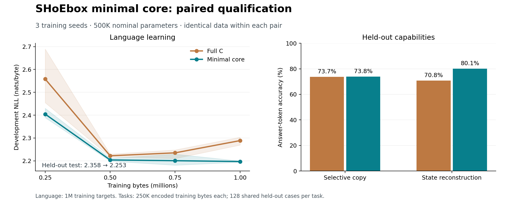

# SHoEbox minimal-core baseline

The public default is **minimal corrected C, checkpoint v19**. It keeps sparse
experts at 1/4 bytes, ordered summaries at 16/64 bytes, bounded context and memory,
and one-pass prediction. Full C remains available as `Model(core="full")`.

## Architecture

| Component | Minimal baseline |
| --- | --- |
| Input/output | Bytes; learned embedding; existing hierarchical byte decoder |
| Fast scale, 1 byte | Corrected-C sparse expert; context-dependent transition |
| L1, 4 bytes | Corrected-C sparse expert; ordered constituent composition |
| L2/L3, 16/64 bytes | Ordered trainable summaries; diagonal recurrence; memory reads |
| Upper output modulation | Learned constant gain/bias vectors |
| Memory | Existing MinKron context, addressed memory and retained-unit retrieval |
| Learning | Separate fast/slow/query rates; coverage-only routing warmup; reconstruction and bounded child credit |
| Excluded from the minimal path | Upper expert banks/routing/forecast heads, state-dependent upper modulation, D predictors, refinement loops, route-rate cycles and experimental credit multipliers |

The nominal budget is reassigned to the surviving expert banks in a 2:1 ratio.
At 1M nominal, the model has **996,799 fitted parameters** and **135/68/0/0 experts**.
At 5M, it has **4,996,927 parameters** and **766/384/0/0 experts**. Width remains 64.
This reduces the computational architecture while preserving requested capacity.
Historical structs remain shared; unused entries in the upper `Shared` parameter
blocks are not fitted, executed or serialized in v19.

## Paired qualification

| Measurement | Full C | Minimal | Change |
| --- | ---: | ---: | ---: |
| FineWeb test NLL ↓ | 2.358039 | 2.252588 | -0.105452 nats/byte |
| Selective-copy token accuracy ↑ | 73.70% | 73.83% | +0.13 pp |
| State-reconstruction token accuracy ↑ | 70.77% | 80.14% | +9.38 pp |

All three predeclared mean tolerances passed: no more than +0.01 nats/byte in
language loss and no more than 1 percentage point loss on either capability.
This qualifies the reduced baseline at the tested 500K operating point; the
previous full-C 20M-byte/5M-parameter results remain separate historical results.



Exact whole-answer scores were also retained:

| Task | Full C | Minimal |
| --- | ---: | ---: |
| Selective copy | 47.40% | 47.66% |
| State reconstruction | 22.14% | 40.36% |

Frozen contribution probes on the minimal models:

| Task | Intact token score | Intervention score | Intervention |
| --- | ---: | ---: | --- |
| Selective copy | 73.83% | 11.85% | Disable addressed and retained reads |
| State reconstruction | 80.14% | 7.42% | Zero the final 64-value state |

Copying therefore still depends on the memory path. Reconstruction depends on
the completed upper summary: its readout receives only the final 64-float L3
state. That experiment uses a separately trained MLP decoder, included in its
parameter budget; its score is not native language-generation accuracy.

## Protocol and cost

- Three paired seeds: 1, 7, 19. Nominal budget 500K; actual ordinary-model counts
  are 496,959 full and 498,367 minimal. Compression includes its decoder within
  the same nominal budget: 496,639 full and 498,047 minimal.
- FineWeb: one million next-byte training targets and disjoint 65,536-target
  development/test streams. Four 250K-target training blocks; constant default
  learning rates; the same bytes and explicit retirement boundaries for both cores.
- Copy: vocabulary 8, length 2, distractor fraction 0.5, learning-rate scale 2.
  Reconstruction: vocabulary 16, length 4, learning-rate scale 0.5. Both use
  auxiliary weight 0, 250K charged input bytes, 256 training examples and 128
  examples in each development/test split. Padding and context count toward cost.
- Learning-rate recipes were fixed before this comparison. No tuning or selection
  used its test set. All 18 fits were frozen before test scoring. Each seed uses
  the same held-out cases; 128 cases does not become 384 independent examples.
- Complete fitted-checkpoint round trips preserve predictions. Data and training
  order hashes, individual seed results and timings are in `qualification.json`.
- Training timing includes resets and final credit retirement, excludes compilation,
  evaluation and checkpoint I/O, and uses one pinned CPU process. Frozen inference
  is a separate one-pass measurement; median of three passes per seed. Concurrent
  correctness checks make the small timing differences unsuitable as a strong speed claim.

| Work | Full bytes/CPU-second | Minimal bytes/CPU-second | Change |
| --- | ---: | ---: | ---: |
| Language training | 34,638 | 35,596 | +2.8% |
| Copy training | 45,463 | 45,771 | +0.7% |
| Reconstruction training | 40,649 | 43,238 | +6.4% |
| Frozen language inference | 56,774 | 56,152 | -1.1% |

## Verification and compatibility

- 48 runtime Python tests; 35 MAD, EXP00 and state-adapter tests.
- Native derivative/regression suites pass optimized and ASan/UBSan builds.
  The added minimal suite passes 713 checks, including finite-difference summary
  gradients and poisoned unused dense operations. LSan was explicitly disabled
  for the managed host; ASan/UBSan remained enabled.
- Seven real historical policies (v7, v9, v10, v11, v12, v17, v18) match the
  pre-change source byte-for-byte before and after resumed training.
- Minimal checkpoints continue exactly across partial 1/4/16/64-byte boundaries
  at every supported depth. Frozen inference preserves the source model.
- Incompatible minimal extensions and a malformed refinement wrapper are rejected.
  Old checkpoints keep their saved architecture; no weight conversion is performed.

`verification.json` records the final checks. `compatibility.json` contains
the historical hashes against commit `047eabcd3622c3105a09fbaa49c33f9d67af38fe`.

## Use and reproduce

```python
from shoe_multiscale import Model

with Model(parameters=1_000_000) as model:
    assert model.stats()["core"] == "minimal"
    assert model.stats()["experts"] == [135, 68, 0, 0]
    model.train(b"Observed training bytes.")
    model.save("minimal.shoe")
```

```bash
python -m multiscale.cli train --core minimal --data train.bin --out minimal.shoe
python -m experiments.minimal_core.run --data DATA_DIRECTORY --out qualification.json
python -m experiments.minimal_core.verify_compat --old PREVIOUS_CHECKOUT --out compatibility.json
python -m experiments.mad.run --core minimal --preset smoke --execute --out minimal-mad.json
python -m multiscale.tests.run_all
```

The MAD v1 command retains `--core full` as its historical default; select
`--core minimal` for new baseline studies. Explicit historical architecture
options remain reproducible. The next capability task remains EXP01 query/readout
diagnosis, with the architecture named explicitly in each comparison.

Source, tests and compact evidence are committed. Trained weights, datasets and
temporary model snapshots are excluded.
